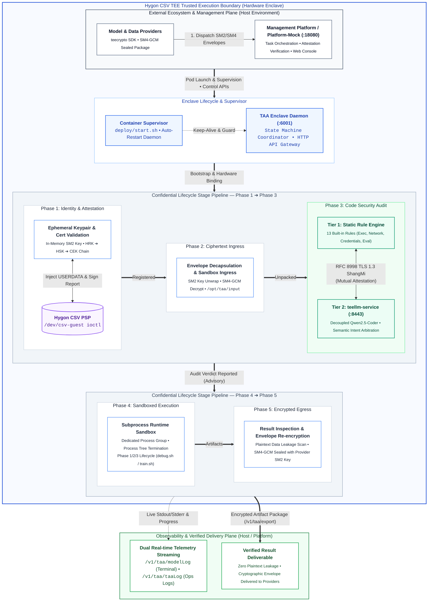

# Trusted Application Agent (TAA)

**Trusted Application Agent (TAA)** is a confidential computing execution framework designed to run inside **Hygon CSV (China Secure Virtualization) TEE (Trusted Execution Environment)**. 

TAA serves as a secure execution enclave for model training and computation workflows: it isolates proprietary model algorithms, evaluation datasets, training corpora, and computation artifacts within a hardware-enforced trusted boundary. By orchestrating hardware remote attestation, GM/T national cryptography (SM2/SM3/SM4), RFC 8998 TEE-TLS 1.3 ShangMi secure channels, two-tier defense-in-depth code security audits (rule-based static scanning + decoupled TEE-LLM semantic arbitration), and cryptographic digital envelopes, TAA establishes an end-to-end trusted computing loop: **"Hardware-Bound Identity, Ciphertext Delivery, In-Enclave Execution, and Verified Result Return"**.

---

## Key Positioning

- **Target Audience**: Management Platforms, AI Model Providers, Data Providers, and Training Execution Clusters.
- **Core Objective**: Execute secure resource ingress, deep code auditing, confidential training/debugging, artifact egress, and hardware attestation inside TEE while guaranteeing complete confidentiality and IP protection for both model and data providers.
- **Security Primitives**: Hygon CSV Remote Attestation + SM2/SM3/SM4-GCM Cryptographic Envelopes + RFC 8998 TEE-TLS 1.3 ShangMi Channels + Two-Tier Defense-in-Depth Code Audit (Static Rule Scanning + Decoupled TEE-LLM Semantic Arbitration).
- **Role**: A production-ready, closed-loop **Confidential Computing Execution Framework**.

---

## Architectural Workflow

TAA coordinates the entire confidential computing lifecycle through the following sequence:



1. **Hardware-Enforced Attestation**: On boot, TAA generates an ephemeral SM2 keypair, injects the public key into the CSV hardware `USERDATA` slot (`X || Y`), and retrieves a hardware-signed attestation report via direct `/dev/csv-guest` ioctl (`pkg/csvattest`).
2. **Identity Registration & Binding**: TAA registers with the platform by submitting its SM2 public key, raw CSV attestation report, and certificate validation parameters (`/v1/taa/register`), permanently tying the container workload to the genuine CSV hardware root of trust.
3. **Ciphertext Ingress**: The platform delivers encrypted resource packages via HTTP (`/v1/taa/import`, `/v1/taa/importModel`). Both endpoints accept either the URL-carried data key (`?dataKeyCipher=`) or the legacy in-file envelope. TAA decrypts, unpacks, and validates the resources strictly inside the TEE memory and local disk sandbox.
4. **Two-Tier Code Audit (Advisory Verdict)**: TAA performs rule-based static security scanning with 13 built-in pattern rules (covering command execution, network egress, sensitive file and environment access, obfuscation, and dynamic evaluation) over Python source, followed by semantic verification against a decoupled local LLM (`teellm-service`) over RFC 8998 TEE-TLS 1.3 to eliminate false positives. The audit runs in the background and in parallel with training, and both a scan error and any HIGH-severity finding make the audit fail closed - i.e. the verdict is `1`/`2` rather than `0`. The verdict is a *reference result*: it is reported to the platform via `/v1/taa/reportAudit` and decides nothing on the TAA side, so a failing audit neither rolls back the import nor stops training. Acting on the verdict is the platform's call.
5. **Real-time Progress & Dual-Log Telemetry**: During training execution, TAA monitors intermediate progress snapshots (`/v1/taa/reportProgress`), streams chunked deduplicated terminal execution logs (`/v1/taa/modelLog`), and actively reports internal operational logs (`/v1/taa/taaLog`).
6. **Task Interruption & Graceful Abortion**: TAA provides a dedicated stop interface (`/v1/taa/stopTraining`) that recursively terminates subprocess process trees upon command.
7. **Encrypted Egress**: Training output artifacts are inspected for sensitive data leakage, zipped, and encrypted with SM2/SM4-GCM digital envelopes before export, ensuring zero plaintext leakage to host or platform.

---

## Repository Structure

```text
.
├── cmd/                              # Executable entry points (Thin Entrypoints)
│   └── taa/                          # TAA Enclave daemon entry point (main.go)
├── internal/                         # Private internal application logic
│   ├── app/taa/                      # TAA daemon startup, registration & HTTP assembly
│   ├── controller/                   # HTTP routing, state machine, import/export/attestation APIs
│   ├── attestation/                  # CSV attestation report parsing & certificate chain validation
│   ├── codeaudit/                    # Two-tier security audit: static rule scanner + TEE-LLM client
│   ├── runtime/                      # Subprocess execution sandbox, process groups & output reader
│   ├── resource/                     # Resource package decompression, verification & file tree
│   ├── platform/                     # Unified HTTP client for platform callbacks
│   ├── config/                       # Configuration loader and validator
│   └── store/                        # In-memory and persistent state storage
├── pkg/                              # Reusable public packages
│   ├── csvattest/                    # Pure-Go Hygon CSV guest ioctl driver (/dev/csv-guest)
│   ├── crypto/                       # SM2, SM3, SM4-GCM envelope encryption & key utilities
│   ├── logger/                       # Structured JSON & console logger with monotonic sequence IDs
│   ├── filetree/                     # Directory tree scanner and ASCII formatting
│   ├── errors/                       # Unified error definitions and codes
│   └── utils/                        # File system, archive, and network helpers
├── teellm/                           # Decoupled TEE-LLM inference microservice (git submodule)
│   ├── cmd/teellm-service/           # Confidential inference daemon entry point
│   ├── configs/                      # TEE-LLM deployment configs (Docker & Production)
│   ├── deploy/                       # TEE-LLM container supervisor and start scripts
│   ├── models/ollama/                # Offline Ollama runtime & model weight bundle
│   └── teetls/                       # RFC 8998 TLS 1.3 ShangMi protocol library (nested submodule)
├── tools/                            # Auxiliary developer and platform tools
│   ├── platform-mock/                # Test management platform emulator & Web console
���   │   ├── cmd/platform-mock/        # CLI entry point (main.go)
│   │   └── internal/                 # Mock server logic, handlers, state store & UI assets
│   └── sdk/                          # TEE cryptographic SDK & CLI tools (teecrypto)
│       ├── cmd/teecrypto-cli/        # Command-line encryption/decryption tool
│       └── gui-tauri/                # Cross-platform desktop GUI application
├── api/                              # Standardized interface definitions
│   ├── openapi.yaml                  # OpenAPI 3.0.3 specification for all TAA endpoints
│   └── proto/                        # Protocol buffer schemas (e.g., CipherFlow v1)
├── configs/                          # Deployment configuration templates
│   ├── taa-docker.json               # Local Docker container development template
│   ├── taa-fhe.json                  # FHE instance template for the GPU host (server.type=fhe)
│   └── taa-production.json           # Production Kubernetes Pod template (identity injected via env)
├── deploy/                           # Container deployment manifests & supervisor scripts
│   ├── start.sh                      # TAA autostart supervisor daemon with keep-alive & manual mode
│   ├── certs/                        # Hygon CSV certificate chain (hrk.cert, hsk_cek.cert)
│   └── manifest/docker/              # Base environment Dockerfiles & build assets
├── models/                           # Bundled offline models & runtimes (e.g., Ollama / Qwen)
├── docs/                             # Architecture specifications & API design documents
├── deploy.sh                         # Unified multi-mode deployment, lifecycle & packaging script
├── deploy-llm.sh                     # TEE-LLM service deployment & model management script
├── go.work                           # Go workspace definition (orchestrating taa, teellm, teetls, sdk)
└── go.mod                            # Go module definition (Go 1.22+)
```

---

## Core Security Architecture

### 1. Trusted Computing Boundary

TAA isolates all sensitive operations inside the CSV TEE boundary:

- Ephemeral SM2 key generation & storage in memory.
- Hardware remote attestation report generation and verification via `/dev/csv-guest`.
- Decryption of model code, evaluation weights, and sensitive training data.
- Two-tier code security scanning: rule-based static analysis + local LLM semantic arbitration.
- Subprocess execution, standard I/O redirection, and intermediate monitoring.
- Result leakage inspection, archive packaging, and SM2/SM4-GCM envelope re-encryption.

### 2. GM/T National Cryptographic Envelope & RFC 8998 TEE-TLS 1.3

TAA strictly adopts Chinese National Standard Cryptography (GM/T) for all data at rest and data in transit:

```text
Plaintext Data  ──►  SM4-GCM Encryption  ──►  Ciphertext Payload
                            ▲
                 Random SM4 Data Key (128-bit)
                            │
                            ▼
                    SM2 Public Key Encryption
                            │
                            ▼
                       WrappedKey (113 Bytes)

In-file envelope (legacy):  [ WrappedKey (113B) ] || [ SM4-GCM Ciphertext ]
URL-carried key (current):  <download link>?dataKeyCipher=<hex C1C3C2>
                            (the downloaded body is bare SM4-GCM ciphertext)
```

Both `/v1/taa/import` and `/v1/taa/importModel` accept either shape. With `?dataKeyCipher=`, TAA strips the parameter before the download (it is never forwarded; the other query parameters survive byte-for-byte) and unwraps it with its own SM2 private key into the 16-byte SM4 data key. The hex is 112 bytes (`C1 || C3 || C2`, no `0x04` prefix) or 113 bytes carrying the `0x04` prefix; a duplicate, empty, malformed, or foreign-key envelope is rejected with HTTP 400 before any download. When the download link already carries a query string (a presigned link always does) the parameter may be appended with either `?` or `&`, so `...&X-Amz-Signature=<hex>?dataKeyCipher=<hex>` is stripped back to the signed URL byte-for-byte. Without the parameter the legacy in-file envelope applies unchanged (compatibility). `/v1/taa/getResourceInfo` does not parse the parameter.

- **SM2**: Used for asymmetric identity authentication, key exchange, and digital envelope key encapsulation.
- **SM3**: Cryptographic hash function used for digest calculation, model checksums, and attestation binding.
- **SM4-GCM**: High-throughput authenticated symmetric encryption protecting datasets, model weights, and exported training results.
- **RFC 8998 TEE-TLS 1.3 ShangMi**: Mutual attestation and TLS 1.3 channel (`TLS_SM4_GCM_SM3`, cipher suite `0x00c6`) securing intra-TEE microservice communication between TAA and `teellm-service`. Enclave hardware attestation evidence is cryptographically bound into X.509 certificate extensions (OID `1.3.6.1.4.1.58270.1.1`).

### 3. Two-Tier Defense-in-Depth Code Security Audit

Untrusted model code undergoes two-tier verification. The verdict is **advisory**: the audit runs in the
background, in parallel with training, and its result is a reference the platform acts on - TAA itself
neither rolls back the import nor withholds training because of it (`/v1/taa/reportAudit`, codes
`0` pass / `1` fail / `2` no verdict; the package is always left exactly as uploaded).

1. **Tier 1: Built-in Static Rule Scanner (`internal/codeaudit`)**:
   - 13 built-in pattern rules scanning Python source files (`.py`).
   - Detects command execution (`os.system`, `os.popen`, `subprocess`), network egress (`requests`, `urllib`, raw sockets), sensitive file and environment variable access, obfuscation/deserialization (`base64`, `pickle`, `marshal`), dynamic code execution (`eval`, `exec`, `__import__`), persistence mechanisms (`crontab`, `systemctl`), and result-embedded plaintext data (writing raw datasets into output artifacts or logs).
   - Each finding carries the matched line plus a physical ±3 line context window, which is what gets forwarded to Tier 2.
   - Detection is line-oriented text matching: alias re-binding (`import socket as s`), string-split obfuscation, and cross-function/cross-file data flow are currently out of scope.
   - Fail-closed verdict: a scan error or any HIGH-severity finding makes the audit fail closed (`reportAudit` code `1`/`2`). The audit only ever reads: the uploaded package and its dependencies are left exactly as uploaded, the model stays imported and trainable (`ModelImported` stays `true`), and the verdict is reported to the platform as a reference result.
2. **Tier 2: Decoupled TEE-LLM Semantic Arbitration**:
   - Forwards flagged code snippets and their context windows to the local `teellm-service` (Qwen2.5-Coder) over TEE-TLS 1.3.
   - LLM analyzes whether flagged snippets represent malicious intent or benign ML operations (e.g., standard PyTorch checkpoint saving).
   - Features circuit breaker protection, jittered exponential backoff retries, and strict fail-closed verdicts.

> **Roadmap — not part of the runtime audit path yet**: migrating Tier 1 from regex matching to a Semgrep AST + inter-procedural taint engine is tracked in `TODO` (静态代码扫描引擎升级). The Semgrep and CPG engines already exist in the offline audit benchmark harness (`models/audit/`, 22 rules across Python/Go/Shell, selectable via `audit_benchmark_eval.py --engine regex|semgrep`); they are evaluation tooling and are not wired into the TAA runtime audit path. Target architecture: `.claude/specs/2026-09-17-semgrep-audit-engine-design.md`.

### 4. Binary Audit Channel

Alongside source auditing, the import audit also walks the **binary files** in a model package, independent of the selected Tier 1 engine - it applies to both the regex-arm and the Semgrep-arm deployments.

- **Identification**: by file content (ELF / zip container / gzip / pickle / numpy / other binary), with the extension only as a supplement. Renaming the suffix does not bypass it; a binary file named `.py` is claimed as well. A file is read as a pickle when its head carries a pickle magic, when its name says `.pkl`/`.pickle`/`.joblib`, or - for the magic-less protocols 0 and 1 - when the head parses as a protocol 0/1 pickle stream carrying a `module.attribute` target. Only that third test yields to the source arm: a `.py` is vetoed from the head sniff and stays with the source channel, while a `.py` whose head carries a pickle magic, and any file named `.pkl`/`.pickle`/`.joblib`, is claimed as a pickle anyway - the claim rests on content the source reader would never look at, and a claimed file's text reading is dropped.
- **Evidence**: ELF dynamic-import symbols and `DT_NEEDED`, section layout and Shannon entropy, printable strings, container members (at most one level of recursion inside zip/gzip), pickle `GLOBAL`/`STACK_GLOBAL`/`INST` targets (read with a memo-table opcode interpreter). Files are read end to end up to 64 MiB, which at the measured 338 MB/s caps one file's read at about 190 ms; above that only the head and tail 1 MiB are read, which is what keeps a payload appended past a zip trailer visible.
- **Verdict**: evidence lines are matched against the rule table and produce a `Finding` tagged with `binary_kind` / `evidence_source` / `binary_offset`. **Structural evidence** (ELF dynamic symbols, `DT_NEEDED`) goes through the shared rules `NET_002`/`CMD_001`/`DYN_001`, whose severity is read from the source rule table rather than restated; the binary-only rules are `BIN_001` (near-random executable-section entropy, HIGH), `BIN_002` (`memfd_create`/`fexecve`, HIGH) and `PKL_001` (pickle deserialization execution, HIGH). **A name is not a call**: `NET_002`, `CMD_001` and `BIN_002` take their evidence only from `.dynsym` and `DT_NEEDED`, which a linker fills with every symbol the object might reference, so those three report HIGH only when the same file also carries a corroborator - entropy evidence or a resolved pickle target (`BIN_001` or `PKL_001`) - and LOW otherwise, with the count recorded as `presence_downgraded`. The rule table itself is untouched: the id and the severity it resolves to are still the shared table's, because the downgrade acts on the finding and never on the rule. **String evidence** does not share the source arm's ids - `CMD_002`/`PER_002`/`FIL_002`/`ENV_002` are four independent LOW families, for the reason below: a finding can be HIGH only when it is backed by a structure a file cannot produce by accident, and a string constant is not; the source arm's same-named families `CMD_001`/`PER_001`/`FIL_001`/`ENV_001` are HIGH/MEDIUM in the shared table, and borrowing them would lift "a certain word appeared in some literal" to blocking severity. `OBF_001` has **no** family in the binary arm: its old pattern `^[A-Za-z0-9+/]{120,}={0,2}$` fired on 23 of 28 legitimate shared libraries (long base64-alphabet strings are everywhere in `.pyc` constant pools and binary data), and neither narrowing the alphabet nor raising the floor fixes it, so only the source arm's call-site version is kept.
- **Review**: binary findings go down the same LLM path as source findings; file-level analysis uses a binary-specific prompt (the existing prompt targets Python source and does not apply). **Honesty**: the file-level branch is reachable only when the caller implements `FileAnalyzer`, and the production `LLMClient` (`teellm.Client`) has no `AnalyzeFile`, so today it is driven only by test mocks and is not live behavior - exactly the existing situation of the source file path, which this plan does not change.
- **Completeness**: `scan_metadata.binary` records `files_count` / `kinds` / `bounded_executable` / `bounded_data` / `incomplete` / `errored` / `findings_capped` / `findings_dropped` / `max_findings` / `presence_downgraded`. Any gap that lands on a format that can execute (ELF, archive, pickle, compressed) makes `ProvesCleanScan()` false - a truncated structural extraction, a capped listing, an unreadable file, or a whole-pass failure - and under fail-closed that withholds the pass; the same cut on a pure data file (raw blob, tensor) is recorded but does not withhold. The split is by kind rather than by which bound fired: a capped listing is the matcher's input, so on an executable kind it can drop blocking evidence, while on a data kind it can only drop LOW free-string lines. **The finding cap is not part of completeness**: reaching it writes only `findings_capped`/`findings_dropped`, not `scan_metadata.truncated`, and never withholds the pass; the cap spends only the LOW tier, and the findings that can withhold it - HIGH under `assist` and `gate`, MEDIUM under `gate` - are kept regardless of the budget.
- **Configuration**: `codeAudit.binaryAudit.enabled` (default `true`), `maxArchiveMembers`, `highEntropyThreshold`, `maxFindings` (default 50, independent of the source arm's 200; it is a listing budget, so lowering it drops only LOW findings and never a finding that can withhold the pass - HIGH under `assist` and `gate`, MEDIUM under `gate`), `maxFullScanBytes` (default 64 MiB) and `maxStreamBytes` (default 3 GiB, which against the shipped `maxFullScanBytes` never binds). Turning it off rolls back: the audit behaves byte-for-byte as before the channel was introduced.
- **Boundaries**: PE/Mach-O are not structurally parsed (not loaded on this platform), xz/zstd/bzip2/7z containers and tar are not opened, plain-text non-source files are not audited, nested archives recurse only one level, and the pickle interpreter runs only on streams claimed as pickle - by magic, by name, or by a protocol 0/1 target the head parses to. One residual boundary follows from the claim being made about the 4 KiB head: a protocol 0/1 stream whose `module.attribute` target lies past the head (say, a protocol 1 stream that pushes a large BINSTRING before its GLOBAL) is claimed only by extension, so only a `.pkl`/`.pickle`/`.joblib` name reaches the interpreter; next to it is the source-named residual: a protocol 0/1 pickle named `.py` is not claimed by the binary channel at all - `.py` is not in the pickle extension set and the source veto runs ahead of the head sniff - so it stays with the source arm, which reads it as Python text and never runs the pickle interpreter; and a pickle appended past the end of a non-pickle file whose head carries no pickle magic is not claimed at all.

---

## API Reference

All TAA APIs are exposed over HTTP `POST`. For comprehensive request/response schemas, refer to the OpenAPI 3.0.3 specification in `api/openapi.yaml`.

### 1. TAA → Platform (Callbacks & Reporting)

| Endpoint | Method | Description |
| :--- | :---: | :--- |
| `/v1/taa/register` | `POST` | Hardware attestation report & SM2 public key registration during bootstrap |
| `/v1/taa/reportModelImport` | `POST` | Reports model download/import status, error messages, and SM3 checksum |
| `/v1/taa/reportAudit` | `POST` | Reports code security audit status, risk statistics (`high`/`medium`/`low`), and report URL |
| `/v1/taa/reportProgress` | `POST` | Periodically reports training progress percentage, message, and timestamp |
| `/v1/taa/modelLog` | `POST` | Streams incremental, deduplicated training terminal execution logs written by the model under `/opt/taa/output/log` |
| `/v1/taa/taaLog` | `POST` | Streams incremental, deduplicated TAA internal operational logs with monotonic sequence IDs |
| `/v1/taa/reportRes` | `POST` | Asynchronously reports final training/debugging results packaged as a zip archive |

### 2. Platform → TAA (Business & Control)

| Endpoint | Method | Description |
| :--- | :---: | :--- |
| `/v1/taa/importModel` | `POST` | Ingresses model code archive (URL-carried data key or legacy in-file envelope), triggers decompression and two-tier security audit |
| `/v1/taa/import` | `POST` | Ingresses dataset/resource packages into sandbox directories |
| `/v1/taa/switch` | `POST` | Transitions lifecycle phases (`Phase 1`: Debug, `Phase 2`: Test, `Phase 3`: Train) |
| `/v1/taa/stopTraining` | `POST` | Forcibly interrupts the active training job and recursively cleans up child process trees |
| `/v1/taa/export` | `POST` | Exports computation results (supports plaintext or SM2/SM4 digital envelope encryption) |
| `/v1/taa/getResourceInfo` | `POST` | Inspects metadata, file listings, and sizes of uploaded resource packages |
| `/v1/taa/fheCallback?token=<callbackToken>` | `POST` | **`fhe` instances only.** Called by the FHE service rather than the platform, to report a task's terminal state. It is authenticated with the configured `fhe.callbackToken` in the `token` query parameter: an empty token is refused at startup rather than defaulted, and a request whose token does not match is rejected |

### 3. Observability & Diagnostics (Platform → TAA)

| Endpoint | Method | Description |
| :--- | :---: | :--- |
| `/v1/taa/health` | `POST` | Health & readiness probe (verifies memory state and attestation status) |
| `/v1/taa/status` | `POST` | Comprehensive diagnostics: active phase, tasks, audit findings, and key fingerprints |
| `/v1/taa/getAttestation` | `POST` | Generates a fresh CSV attestation report for on-demand verification |

---

## Runtime Configuration

TAA reads its configuration from `taa-config.json` located in its working directory. Configuration is organized into 7 cohesive functional domains (`server`, `platform`, `storage`, `model`, `codeAudit`, `attestation`, `fhe`). For backward compatibility, legacy flat fields are also accepted as fallbacks.

### Configuration Fields

```json
{
  "server": {
    "addr": ":6001"
  },
  "platform": {
    "ip": "127.0.0.1:18080",
    "dockerID": "taa-env-slim-v2",
    "contract": ""
  },
  "storage": {
    "model": "/root/taa/models",
    "data": "/root/taa/data",
    "result": "/root/taa/results",
    "keys": "/root/taa/keys"
  },
  "model": {
    "input": "/opt/taa/input",
    "output": {
      "result": "/opt/taa/output/result",
      "log": "/opt/taa/output/log",
      "progress": "/opt/taa/output/progress/progress.json"
    }
  },
  "codeAudit": {
    "enabled": true,
    "codeScan": {
      "engine": "semgrep",
      "rulesPath": "/opt/taa/semgrep/rules"
    },
    "resultCheck": {
      "enabled": true,
      "maxFileBytes": 3221225472
    },
    "binaryAudit": {
      "enabled": true
    },
    "llm": {
      "enabled": true,
      "transport": "teetls",
      "endpoint": "https://127.0.0.1:8443",
      "model": "qwen2.5-coder:7b",
      "policy": "assist",
      "failClosed": true,
      "insecureSkipVerify": false,
      "attestationMode": "strict"
    }
  },
  "attestation": {
    "hrkCertPath": "/root/taa/certs/hrk.cert",
    "hskCekCertPath": "/root/taa/certs/hsk_cek.cert"
  }
}
```

| Field | Default | Description |
| :--- | :--- | :--- |
| `server.addr` | `:6001` | HTTP server listening address |
| `server.type` | `tee` | Instance role, `tee` or `fhe`. `fhe` means this instance orchestrates an FHE service on a GPU node and performs no code audit, no remote attestation and no training pipeline |
| `platform.ip` | Env `PLATFORM_IP` | Platform IP and port (`host:port`); dynamically injected via environment in production. The file wins over the environment, except on an `fhe` instance — see [Platform Identity Precedence](#platform-identity-precedence) |
| `platform.dockerID` | Env `DOCKER_ID` | Container / Pod identifier; dynamically injected via environment in production. Same precedence rule as `platform.ip` |
| `platform.contract` | Env `CONTRACT` | Contract identifier (reserved optional). Always the file-wins rule, on both instance types |
| `storage.model` | `/root/taa/models` | TAA platform-internal storage directory for imported model code |
| `storage.data` | `/root/taa/data` | TAA platform-internal storage directory for imported datasets and resources |
| `storage.result` | `/root/taa/results` | TAA platform-internal storage directory for final packaged computation results |
| `storage.keys` | `/root/taa/keys` | Sensitive cryptographic key storage (restricted with `0700` permissions). On an `fhe` instance it must be a directory the deployment persists across container recreation: `configs/taa-fhe.json` points it at `/opt/taa-state/keys`, inside a bind of its own rather than the data directory the FHE stack mounts |
| `model.input` | `/opt/taa/input` | Read-only input dataset directory mounted for model training sandbox runtime |
| `model.output.result` | `/opt/taa/output/result` | Target output directory for model training checkpoints and artifacts |
| `model.output.log` | `/opt/taa/output/log` | Model execution log directory (or file) monitored by log watcher (`modelLog`); every `*.log`/`*.jsonl` file in it is streamed |
| `model.output.progress` | `/opt/taa/output/progress/progress.json` | Model progress file (or directory) monitored by progress watcher (`reportProgress`) |
| `codeAudit.enabled` | `true` | Master audit switch: enables the static rule-based security scan during model import |
| `codeAudit.codeScan.engine` | `semgrep` | Tier 1 static engine, `semgrep` or `regex`. Normalized to lower case; any other value is rejected at startup, because an unrecognized name would silently scan with the regex baseline while the deployment believed otherwise. `regex` is the baseline an operator falls back to deliberately |
| `codeAudit.codeScan.rulesPath` | unset | Rules file or directory for the semgrep engine, passed through as semgrep's `--config`. Unset means the engine's built-in default, which is relative to the repository root and therefore useless in a container: a deployment that selects semgrep has to set this, and startup fails when the path does not exist |
| `codeAudit.codeScan.timeoutSeconds` | unset | Whole-scan deadline for one semgrep run, not a scan budget but a safety net: an import waits on the scan, and an expired deadline becomes a failed scan, which the audit fails closed on. Unset or `0` means the adapter's own default (5 minutes); a negative value is rejected at startup. The `taa-initrd.json` template sets `900`; the other three leave it unset |
| `codeAudit.resultCheck.enabled` | `true` | Runs the plaintext data leakage check over the result directory as soon as training finishes, and stores the verdict on the task's import index record. `/v1/taa/export` reads that verdict instead of scanning again, so it refuses to export when the verdict failed, when the check itself could not run, and when no verdict exists at all (fail-closed: records committed before this field existed have none and must be retrained - both of those states are governed by `codeAudit.llm.failClosed`, which turns them into a warning when set to `false`). A failing check never fails the training process itself, but it does change how the run is reported: the training report is uploaded with `code` `2` and the reason in `msg`, its `training_task.status` is `failed` (with `exit_code` still `0`), and it carries no `result_files` at all - the directory tree's table previews are the data rows being withheld. Everything else about the run still reports normally (accepts object or boolean) |
| `codeAudit.resultCheck.maxFileBytes` | `3221225472` (3 GB) | Maximum file size limit enforced for both file downloads (`import`, `importModel`, `getResourceInfo`) and result exports (`export`), as well as anomaly inspection threshold |
| `codeAudit.binaryAudit.enabled` | `true` | Runs the binary audit channel alongside the source scan (see [4. Binary Audit Channel](#4-binary-audit-channel)). Off restores the pre-channel behavior exactly |
| `codeAudit.binaryAudit.maxArchiveMembers` | `4096` | How many container members one archive may contribute as evidence. Reaching the ceiling records a completeness gap on an executable kind, which withholds the pass |
| `codeAudit.binaryAudit.highEntropyThreshold` | `7.5` | Shannon entropy (bits/byte) **above** which an executable section reads as packed. Values are accepted within `[0, 8]`; `0` resolves to the default, and a negative value or one above `8` is rejected at startup rather than defaulted |
| `codeAudit.binaryAudit.maxFindings` | `50` | Listing budget for binary findings, independent of the source arm's `maxFindings`. It spends only the LOW tier, so lowering it can never drop a finding that withholds the pass |
| `codeAudit.binaryAudit.maxFullScanBytes` | `67108864` (64 MiB) | Above this size a file is no longer read end to end, only its head and tail (1 MiB each). A windowed executable or pickle records a completeness gap and withholds the pass - without that, padding a pickle past the cut would hide a mid-stream target and still pass. On a data file the gap is recorded but does not withhold |
| `codeAudit.binaryAudit.maxStreamBytes` | `3221225472` (3 GiB) | Per-file read budget for the end-to-end pass. Against the shipped `maxFullScanBytes` (64 MiB) it never binds; **lowering** it below `maxFullScanBytes` makes files in between stop short, which records a completeness gap and withholds the pass on executable kinds |
| `codeAudit.maxFileBytes` | `3221225472` (3 GB) | Alias for `maxFileBytes` set inside the audit block rather than at the root |
| `codeAudit.llm.enabled` | `true` | Enables local LLM semantic arbitration for code security audits |
| `codeAudit.llm.transport` | `teetls` | Transport protocol for TEE-LLM communication (`teetls` for RFC 8998 TLS 1.3 ShangMi, or `http`) |
| `codeAudit.llm.endpoint` | `https://127.0.0.1:8443` | Decoupled TEE-LLM service endpoint |
| `codeAudit.llm.model` | `qwen2.5-coder:0.5b` | Target LLM model for code analysis. The shipped templates all override this with `qwen2.5-coder:7b`, which is what a deployment actually runs |
| `codeAudit.llm.policy` | `assist` | LLM arbitration mode (`assist`: LLM results are informational and the static verdict stands; `gate`: strict — HIGH findings fail the audit unless the LLM rules them benign, MEDIUM findings always fail it). Values are normalized to lower case; any other value is rejected at startup |
| `codeAudit.llm.failClosed` | `true` | Fails code audit if the LLM inference service is unreachable or encounters timeout. It also decides what the export gate does when the result leakage check left no usable verdict: with `true`, a missing verdict or a verdict recording that the check could not run rejects the export with a 500; with `false`, both are logged as warnings and the export proceeds. A verdict that says the result leaks is never affected - it always returns 400 |
| `codeAudit.llm.temperature` | unset | Sampling temperature sent with each verify request, in `[0, 2]`. Unset leaves the choice to the inference service, which decodes deterministically so the same finding always yields the same verdict. Setting anything other than `0` re-enables sampling: identical findings may then be judged differently, and a single `MALICIOUS` verdict under `assist` + `failClosed` fails the audit. A non-zero value is therefore logged as a startup warning. Out-of-range values are rejected at startup |
| `codeAudit.llm.insecureSkipVerify` | `false` | Skips TLS CA certificate verification (set to `true` only for local Docker testing) |
| `codeAudit.llm.attestationMode` | `strict` | Hardware attestation verification policy for TEE-TLS (`strict` in production, `permissive` in local simulation) |
| `attestation.hrkCertPath` | `/root/taa/certs/hrk.cert` | Hygon Root Key (HRK) certificate path for CSV attestation verification |
| `attestation.hskCekCertPath` | `/root/taa/certs/hsk_cek.cert` | Hygon Sign Key (HSK) / Chip Endorsement Key (CEK) certificate path |
| `fhe.endpoint` | **required** | String. FHE API base URL, an absolute `http`/`https` URL with a host, e.g. `http://127.0.0.1:58996` |
| `fhe.dataDir` | **required** | String. The shared directory, given as the local path of the same bind mount the FHE containers see as `/data` |
| `fhe.keyCacheDir` | **required** | String. Holds eval keys by content digest, so a repeat user never re-downloads several gigabytes |
| `fhe.callbackBaseUrl` | **required** | String. How the FHE service reaches this TAA instance, e.g. `http://172.16.10.130:6001`. It must carry no query and no fragment, because `/v1/taa/fheCallback?token=...` is appended to it |
| `fhe.callbackToken` | **required** | String. Authenticates the callback endpoint, compared in constant time; an empty token is refused at startup rather than defaulted, because the endpoint would otherwise be open to every process on the host |
| `fhe.maxEvalKeyBytes` | `6442450944` (6 GiB) | Integer. Cap on the eval key download. It is **independent of** `codeAudit.resultCheck.maxFileBytes`: a measured evaluation key of 3.101 GiB already exceeds the latter's 3 GiB default |
| `fhe.pollIntervalMs` | `5000` | Integer. Fallback poll period used while waiting for a task |
| `fhe.requestTimeoutMs` | `30000` | Integer. Bounds one HTTP call to the FHE service |
| `fhe.taskTimeoutMs` | `1800000` (30 min) | Integer. Bounds a whole task, polls and callback together |
| `fhe.activateModelOnImport` | `true` | Boolean (`*bool` in the config struct). Calls `/models/activate` right after a model is staged. It is a pointer precisely so that "unset" stays distinguishable from "false": unset resolves to `true`, and a missing setting read as `false` would turn into a deliberate opt-out that leaves every task to fail at run time, against a model the service was never told to load |

The whole `fhe` section is read only when `server.type` is `fhe`; a `tee` instance that carries one logs a warning and ignores it.

### Platform Identity Precedence

`platform.ip` / `PLATFORM_IP` and `platform.dockerID` / `DOCKER_ID` are settled by one rule per instance type:

- **`tee` instances: the config file wins.** The startup file is applied over the environment-derived defaults, so a template that carries a `platform` block pins the identity no matter what the orchestration platform injects. `configs/taa-production.json` deliberately omits the block for exactly this reason — it wants the injected values to be the only source.
- **`fhe` instances: the environment wins.** On `server.type: "fhe"`, a non-empty `PLATFORM_IP` or `DOCKER_ID` in the container's environment overrides whatever the template says. The address an FHE instance registers with depends on the machine it is deployed to, and the image ships one template for every GPU host, so the template can only be a fallback. `configs/taa-fhe.json` carries a `platform` block for that role (`127.0.0.1:18081` / `taa-fhe`, the mock used in end-to-end testing), and setting the two variables replaces it field by field — unset one and the template's value for that field is what the instance runs with.

`platform.contract` / `CONTRACT` is not part of the flip: it stays file-wins on both types.

### Configuration Templates

- **`configs/taa-docker.json`**: For local Docker container testing. Uses standard `/root/taa/...` and `/opt/taa/...` container paths, with explicit `platform` configuration, `attestationMode: "permissive"`, and `insecureSkipVerify: true`.
- **`configs/taa-production.json`**: For production Kubernetes Pods. Omits `platform` so parameters are dynamically injected by the orchestration platform via environment variables, and enforces `attestationMode: "strict"`.
- **`configs/taa-fhe.json`**: For an `fhe` instance — the GPU host co-located with the FHE service. Sets `server.type: "fhe"` and the `fhe` section, and carries a `platform` block (`127.0.0.1:18081`, `taa-fhe`) naming the mock used in end-to-end testing; on this instance type the environment overrides both fields, so the block is the fallback rather than the last word. **`fhe.callbackToken` ships empty and must be filled in before use**: startup refuses an empty token rather than defaulting one, so this template will not boot as-is. `deploy-fhe.sh` renders it before starting taa, and that is where `fhe.dataDir` and `storage.keys` come from: the data directory is the tree the FHE stack shares as `/data`, and `storage.keys` is a directory that stack does not mount at all, so the SM2 key pair and the sealed instance state stay out of the FHE service's reach.

### FHE Instance Interface Differences

An instance whose `server.type` is `fhe` exposes the same API surface as a `tee` instance with one addition — `POST /v1/taa/fheCallback` exists only on an `fhe` instance. Every other path listed below exists on both, and behaves differently on the `fhe` one as described:

- `POST /v1/taa/import` must carry `evalKeyUrl` and `evalKeyFileHash` (SM3, lower-case hex, 64 characters); a `tee` instance returns 400 when either field is present.
- `importModel` on an FHE instance lays the model package out under `<fhe.dataDir>/models/<modelHash>/` and requires a `server/` directory inside the package.
- **Execution is triggered by the `import` landing on disk**, so `switch` does not have to be called first; `switch` only moves the phase.
- `POST /v1/taa/fheCallback?token=<callbackToken>` is new and lets the FHE service report a terminal state; a token mismatch returns 404.
- `export` on an FHE instance is always a plaintext zip (holding `output.zip` and `training_report.json`); a `publicKey` in the request is ignored and logged as a WARN.

---

## Deployment & Operation (`deploy.sh`)

`deploy.sh` provides unified, multi-mode lifecycle management and image packaging for TAA and platform-mock:

### 1. Two Mutually Exclusive Running Modes

```bash
./deploy.sh [docker|remote] [start|stop|save] [components...] [options...]
```

- **`docker`**: Local Docker container mode. Runs TAA inside a local Docker container (`taa-env-slim-v2`) managed by a supervisor daemon (`deploy/start.sh`), while platform-mock runs on the host.
- **`remote`**: Remote Kubernetes mode (default when omitted). Deploys to a remote TEE Kubernetes Pod via SSH and `kubectl`.

### 2. Supported Actions

- **`start`** (default): Builds binaries, prepares configs/certs, starts supervisor daemon, and launches target services.
- **`stop`**: Gracefully stops target services in the chosen mode.
- **`save`**: **Exclusively valid in `docker` mode** (`./deploy.sh docker save`). Assembles a **TAA-only production image — TAA plus the code scan engine** — and exports it as an archive. It removes every TEE-LLM and ollama artifact the base image may carry (asserting each is gone), installs the supervisor from `deploy/start.sh` instead of inheriting the base image's copy, provisions semgrep offline from a payload archive and verifies it with a real scan, then copies the binary, certificates and generated production config (`configs/taa-production.json`) before `docker commit` + `docker save`. TEE-LLM and ollama are **not** in this image; deploy them separately with `./deploy-llm.sh`. The generated config's `codeAudit.llm.endpoint` is the template's value verbatim — nothing is discovered on the packaging host — so a deployment that needs a different address sets `TAA_LLM_ENDPOINT` at container startup.

### 3. Component Selection

Specify one or more components: `platform-mock`, `taa`. If omitted:
- In `docker` mode: defaults to deploying both `platform-mock` and `taa`.
- In `remote` mode: defaults to `taa` (omits `platform-mock` to avoid port 18080 conflict with host production agents).
- **Note on TEE-LLM / Qwen / Ollama**: The LLM inference service sources live in the `teellm` submodule, but its deployment script now sits at the repository root. To deploy TEE-LLM, run `./deploy-llm.sh [docker|remote-docker|remote]`.

### 4. Container Autostart Supervisor (`deploy/start.sh`)

Inside Docker containers, TAA runs under the supervision of `deploy/start.sh` (deployed to `/root/taa/start.sh`):
- Automatically restarts `taa` upon unexpected exits (10s retry interval).
- Provides a manual debug override: `touch /root/taa/manual` pauses autostart; removing the file resumes supervisor management.
- Logs runtime supervisor events to `/root/taa/taa.log`.

### 5. Common CLI Examples

```bash
# Docker Container Mode
./deploy.sh docker start                      # Start TAA in container and platform-mock on host
./deploy.sh docker taa                        # Deploy/update only TAA inside Docker
./deploy.sh docker platform-mock              # Deploy/update only platform-mock on host
./deploy.sh docker stop                       # Stop local Docker services
./deploy.sh docker save                       # Export production Docker image archive
./deploy.sh docker save --tag my-taa:v1 -o /tmp/taa.tar.gz

# Remote Kubernetes Mode
./deploy.sh remote start                      # Deploy TAA to remote Kubernetes Pod (or simply ./deploy.sh)
./deploy.sh remote taa                        # Update TAA in remote Pod
./deploy.sh remote stop                       # Stop remote services

# Decoupled TEE-LLM Service
./deploy-llm.sh docker start                  # Deploy TEE-LLM service in a local Docker container
./deploy-llm.sh remote-docker start           # Deploy TEE-LLM service into a container on the remote host (SSH + docker)
./deploy-llm.sh remote start                  # Deploy TEE-LLM service in remote Kubernetes Pod
```

> **Remote deploys provision the code scan engine.** When the config selects the semgrep engine
> (`codeAudit.codeScan.engine`), `deploy.sh remote` makes sure the container has both the CLI and the
> rules *before* it touches the running daemon. The engine comes from a payload archive kept on the
> host (`REMOTE_SEMGREP_BUNDLE`, default `$REMOTE_DIR/semgrep-bundle.tar.gz`, built with
> `deploy/guest-build/build-semgrep-payload-container.sh`; set `SEMGREP_BUNDLE` to a local archive to
> have it uploaded first), and the rules are streamed from this checkout
> (`models/audit/semgrep/rules`) on every deploy. A missing archive fails the deploy immediately
> with the recipe to build it, instead of running into the readiness timeout through the daemon's
> 10s restart loop. The payload lands in the Pod's writable layer, so a recreated Pod needs another
> deploy.
>
> Every deploy then runs one scan with the same argv taa uses at audit time and requires it to read
> the target and still match a shipped rule, so "the files are there" is never mistaken for "the
> engine works" — that distinction is what the check exists for. All of it is offline and bounded
> (`SEMGREP_OFFLINE_TIMEOUT`, default 90s): semgrep reaches for the network before it scans, a
> container with no route off the host answers none of it, and the retry backoff makes one
> unflagged call cost over a minute. `semgrep --validate` is not usable here at all — it downloads
> a registry metacheck pack that no flag can skip, and offline that ends the command with a
> non-zero exit. A failure prints semgrep's own output rather than an exit code alone.

> **`docker save` needs the semgrep payload archive built first.** The base image carries neither
> the engine nor the rules while the production template selects semgrep, and a missing rules path is
> a hard startup failure rather than a downgrade — an image packaged without an engine would start,
> die, and then sit in the supervisor's 10s restart loop. Build the archive once with
> `./deploy/guest-build/build-semgrep-payload-container.sh` (needs network, ~350 MiB, writes
> `deploy/guest-build/out/semgrep-bundle.tar.gz`); every later `./deploy.sh docker save` extracts it
> offline, so packaging itself never needs the network. A missing archive fails the packaging with
> that command as the hint instead of producing an image that cannot scan.
>
> The archive's embedded `MANIFEST` is checked against `SEMGREP_VERSION` (1.177.0) so a stale bundle
> is rejected rather than shipped, the rules are copied from `SEMGREP_RULES_SOURCE`
> (`models/audit/semgrep/rules`) into the path the template names, and the same bounded offline scan
> probe the remote path runs has to pass — semgrep being *present* is not the same as semgrep being
> *able to run the rules*. Overrides: `SEMGREP_PAYLOAD_BUNDLE`, `CONTAINER_SEMGREP_DIR`,
> `SEMGREP_VERSION`.
>
> **Pointing the image at a separately deployed TEE-LLM.** `TAA_LLM_ENDPOINT` overrides
> `codeAudit.llm.endpoint` at startup, so the endpoint baked into an image is only a default:
>
> ```bash
> ./deploy.sh docker save --tag my-taa:v1 -o /tmp/taa.tar.gz
> ./deploy-llm.sh docker start                      # TEE-LLM in its own container
> docker run -e TAA_LLM_ENDPOINT=https://10.0.0.2:8443 my-taa:v1
> ```
>
> `TAA_LLM_ENDPOINT` is the one variable that **overrides** the config file (leave it empty to keep
> the endpoint the image was packaged with); the `platform` identity fields do not follow that rule.
> `PLATFORM_IP`, `DOCKER_ID` and `CONTRACT` only seed defaults that the file wins over — on a `tee`
> instance. On an `fhe` instance the first two flip to environment-wins (see
> [Platform Identity Precedence](#platform-identity-precedence)).

---

## Deploying the FHE Side (`deploy-fhe.sh`)

`deploy.sh` owns the TAA image; `deploy-fhe.sh` owns the FHE side of a GPU host. It imports the
delivered `latti/latti-server` image, stages the runtime and models into the shared data directory,
starts the api/worker/redis stack, and then starts this host's TAA instance under the same
supervisor.

```bash
# From a workstation: the default target is root@172.16.10.178 over ssh
./deploy-fhe.sh

# On the GPU host itself
./deploy-fhe.sh --local
```

- **Remote by default.** The run targets `REMOTE_HOST` (default `172.16.10.178`) over ssh, the
  same host `deploy.sh remote` uses, and takes the same credentials (`TARGET_PASSWORD`). It
  uploads the handoff bundle to `REMOTE_HANDOFF_DIR`, builds `bin/taa` and `bin/platform-mock`
  here and copies them over, then runs every command of the local path on that host. Everything
  else — the paths in the report, the render, the readiness wait — reads as a path on the
  deployment host. Defaults filled in by the script: `HOST_RUNTIME_DIR=$REMOTE_DIR/latti-runtime`,
  `TAA_CALLBACK_BASE_URL=http://$REMOTE_HOST:6001`, and a callback token. `REMOTE_HOST`,
  `REMOTE_USER`, `TARGET_PASSWORD`, `REMOTE_DIR` and `REMOTE_HANDOFF_DIR` override the target;
  setting any of the defaults in the environment still wins.
- **`--local`** deploys on the machine running the script instead, which then needs a CUDA GPU and
  a writable `HOST_DATA_DIR`/`HOST_TAA_STATE_DIR`.
- **`-n` / `--dry-run`** prints the whole plan and connects to nothing; it does not need the remote
  to be reachable, or the binaries to be built, or the bundle to be unpacked.
- **`--skip-build`** uses the binaries already on disk instead of building them.
- **`--no-platform-mock`** skips the platform-mock step, and with it the registration check below.

**The last step is the one that proves the deployment works.** After TAA answers its health probe,
the script asks the platform what `dockerId` it recorded, and refuses unless it is the one this
run's identity resolves to and it was accepted. TAA being up and the platform having heard from it
are two different statements: a rejected registration is a warning in TAA's own log and a background
retry, so the daemon looks perfectly healthy while nothing reaches the platform. Under `--local`
the same check runs against a platform-mock this script starts on the host.

Two notes for a remote run: the platform-mock is started with `-allow-empty-attestation`, because an
`fhe` instance writes an empty attestation by design; and `REMOTE_HANDOFF_DIR` has to be a directory
of its own, since the upload is an `rsync -a --delete`.

> **The GPU has to be able to run the delivered runtime.** The bundle's `liblattisense.so` needs
> CUDA 12 and is built for compute capability 8.9 (Ada), and the worker's memory pool pre-allocates
> against free device memory. The preflight reports what the host has and warns rather than refuses,
> so read it before concluding a stack that will not start is a configuration problem.

---

## Local Platform Mock & Web Console

TAA includes a full-featured management platform emulator with an embedded Web GUI console:

- **Source Code**: `tools/platform-mock/cmd/platform-mock/main.go`, `tools/platform-mock/internal/static/`
- **Default Port**: `18080`
- **Web Console**: `http://127.0.0.1:18080`

```bash
# Build standalone platform mock binary
go build -o bin/platform-mock ./tools/platform-mock/cmd/platform-mock

# Run in foreground
./bin/platform-mock -addr 0.0.0.0:18080 -taa-target http://127.0.0.1:6001

# Run in background via deploy.sh
./deploy.sh docker platform-mock
```

### Web Console Capabilities

1. **Lifecycle Pipeline Stepper**: Visual step progress bar across the entire pipeline (`Register` ➔ `Ingress` ➔ `Audit` ➔ `Switch` ➔ `Train` ➔ `Export`) with live auto-synchronization.
2. **Node Registration & Attestation**: Live display of TAA hardware attestation, certificate verification status, and SM2 public keys.
3. **Visual Audit Dashboard**: Report-level risk verdict pill and high/medium/low statistics bar, plus an interactive findings accordion showing line numbers, rule identifiers, matched code snippets, LLM verdict badges, and the LLM's arbitration reasoning.
4. **Live Dual-Log Streaming**: Independent, real-time views for training terminal logs (`/v1/taa/modelLog`) and TAA operational logs (`/v1/taa/taaLog`), equipped with level filters, instant search, smart auto-scroll, and pause/resume.
5. **Payload Inspector Modal**: Tabbed inspection of inbound callback and outbound request JSON payloads.
6. **Global Stacked Toast Notifications**: Real-time micro-interactions and asynchronous alert feedback.
7. **Task Interruption**: One-click "Stop Training" trigger invoking `/v1/taa/stopTraining` to abort running jobs.
8. **Result Verification & Decryption**: In-browser SM2/SM4 digital envelope decryption and inspection of exported training outputs.

---

## Build & Development

### Prerequisites

- **Go**: Version 1.22 or newer (orchestrated via `go.work` multi-module workspace).
- **Environment**: Linux x86_64 with Hygon CSV hardware support (for genuine TEE attestation; non-TEE environments run in simulation mode with warning).
- **Docker**: Required for `docker` mode and `docker save`.

### Build Commands

```bash
# Build TAA enclave daemon (static, as the production image and the CSV2 initrd build both require)
CGO_ENABLED=0 GOOS=linux go build -o bin/taa ./cmd/taa

# Build platform mock emulator
go build -o bin/platform-mock ./tools/platform-mock/cmd/platform-mock

# Build decoupled TEE-LLM microservice
(cd teellm && go build -o bin/teellm-service ./cmd/teellm-service)

# Build TEE Crypto SDK CLI
(cd tools/sdk && go build -o bin/teecrypto-cli ./cmd/teecrypto-cli)

# Run all unit tests across the workspace
go test ./...

# Format and vet code
gofmt -w .
go vet ./...
```

---

## Documentation

- **Architecture Design**: `docs/architecture-design.md`
- **API Specifications (Markdown)**: `docs/api-design.md`
- **OpenAPI 3.0.3 Specification**: `api/openapi.yaml`
- **Model Provider Integration Guide**: `docs/model-provider-integration-guide.md`
- **Model File I/O Conventions**: `docs/model-file-io-guide.html`
- **Platform Mock Emulator**: `tools/platform-mock/README.md`
- **TEE-LLM Inference Service**: `teellm/README.md`
- **TEE Crypto SDK**: `tools/sdk/README.md`
- **State Persistence & Self-Healing**: `docs/state-persistence-and-self-healing.md`
- **Project Changelog**: `CHANGELOG.md`

---

## Changelog

For a full historical record of changes, see [CHANGELOG.md](CHANGELOG.md).

### Recent Iterations & Milestones

- **2026-09-19: Architecture Decoupling, Supervisor Integration & Advanced UI/UX**
  - **Container Supervisor**: Extracted container autostart daemon (`deploy/start.sh`) for TAA with retry backoff and manual debug override (`manual`).
  - **Platform-Mock UI/UX Overhaul**: Interactive pipeline stage stepper, visual audit dashboard with expandable findings accordion, live dual-log viewer with level filtering and instant search, and global stacked toast notification system.
  - **Microservice Decoupling**: Decoupled `teellm` into an independent repository and embedded as a recursive git submodule; isolated backend inference lifecycle from TAA core.
  - **Toolchain Organization**: Reorganized auxiliary tools into top-level `tools/` directory (`tools/platform-mock` and `tools/sdk`).
  - **CipherFlow Specification Alignment**: Enforced 3-tier output directory isolation (`/opt/taa/output/{result,log,progress}`) and aligned Python SDK contracts.

- **2026-09-18: Operational Telemetry & RFC 8998 TEE-TLS Decoupling**
  - **Active Operational Logging**: Implemented `/v1/taa/taaLog` proactive streaming with monotonic sequence IDs and ring-buffer deduplication.
  - **TEE-TLS Protocol Decoupling**: Extracted `teetls` into a dedicated repository supporting RFC 8998 TLS 1.3 ShangMi with Hygon CSV hardware attestation evidence X.509 extensions.
  - **Platform-Mock Modularization**: Decomposed mock platform into modular API handlers, separated config/state stores, and embedded static web assets via `embed.FS`.
  - **Audit Benchmark Suite**: Automated matrix evaluation for static vs. LLM vs. hybrid code security auditing, including the offline Semgrep AST/taint and CPG inter-procedural engines.

- **2026-09-17: RFC 8998 ShangMi Channel & Offline Semgrep Taint Engine**
  - **Confidential TEE-TLS 1.3**: Implemented TLS 1.3 ShangMi cipher suites (`TLS_SM4_GCM_SM3`) with SM2 certificates cryptographically bound to Hygon CSV hardware attestation reports.
  - **Decoupled TEE-LLM Service**: Introduced standalone `teellm-service` over TEE-TLS 1.3 with circuit breakers, exponential jitter retries, and strict SSRF defenses.
  - **Semgrep Deep Semantic & Taint Engine (offline benchmark harness only)**: Added 22 AST and taint analysis rules across Python, Go, and Shell under `models/audit/` with fail-closed scan gates in the evaluation runner. The TAA runtime audit path still uses the built-in static rule scanner.
  - **Dynamic Export Thresholds**: Supported configurable `maxFileBytes` (default 3 GB) for export leakage inspection.

- **2026-09-16: Certificate Self-Verification & Three-Track Benchmark**
  - **Dynamic Attestation Verification**: Integrated Hygon CSV certificate chain (HRK/HSK/CEK) self-verification and runtime dynamic configuration.
  - **Three-Track Audit Benchmark**: Developed orthogonal benchmark suite evaluating rule-only, pure-LLM, and hybrid audit tracks with bootstrap confidence intervals.

- **2026-09-15: Initial Core Framework Release**
  - Initial implementation of TAA daemon inside Hygon CSV TEE, ephemeral SM2 keypair generation, hardware attestation injection (`/dev/csv-guest`), and GM/T SM2/SM3/SM4-GCM digital envelope packaging.
  - Three-tier runtime output directory isolation (`/opt/taa/output/{result,log,progress}`).
  - Lifecycle phase state transitions (`Phase 1` Debug, `Phase 2` Test, `Phase 3` Train) and graceful process tree termination (`/v1/taa/stopTraining`).

---

## License & Security Notices

TAA is designed for authorized, privacy-preserving computation and dual-use secure enclaves. All cryptographic algorithms follow GM/T national standards (SM2/SM3/SM4). Ensure proper key management and hardware attestation verification before running in production multi-tenant environments.
