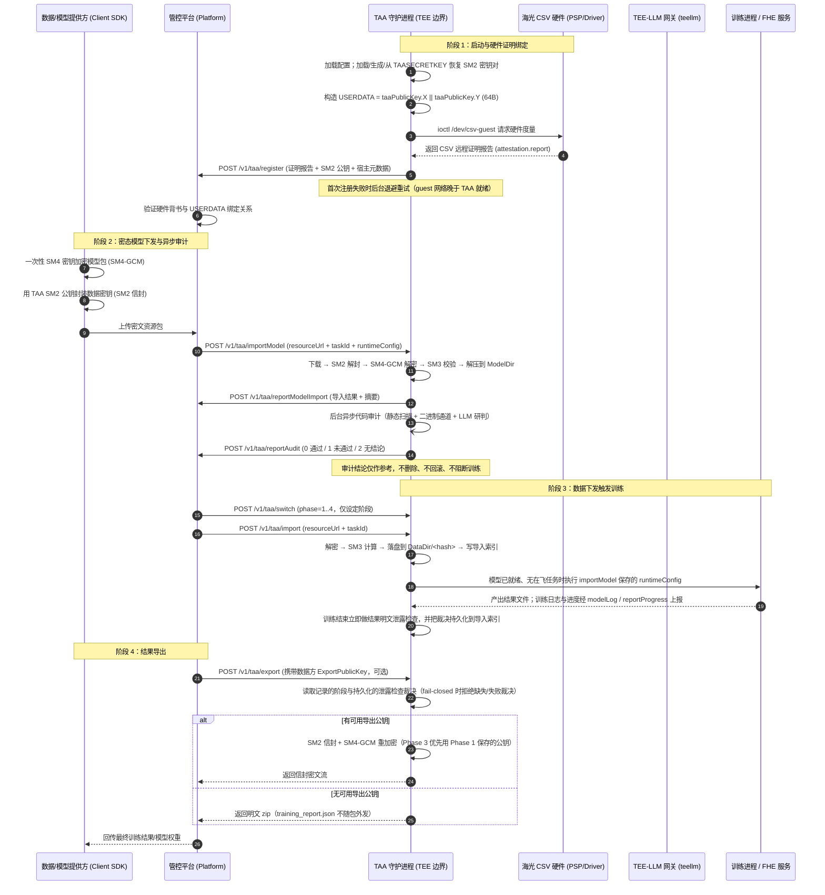

# TAA 设计文档

## 1. 项目概述

TAA（Trusted Application Attestation）是一个运行在 Hygon CSV（可信安全虚拟化）TEE 环境中的可信应用代理服务。对默认的 `tee` 实例而言，它负责：

- 通过远程证明（Remote Attestation）向平台注册自身身份
- 接收平台下发的加密资源（模型代码、测试数据、训练数据）
- 在 TEE 安全环境中解密、审计、执行训练任务
- 将训练结果加密导出给平台

同一个二进制还承担另外两种实例角色，由 `server.type` 决定，三条流水线互斥：

| `server.type` | 运行位置 | 职责 | 不做的部分 |
|---|---|---|---|
| `tee`（默认） | Hygon CSV 机密 VM / 容器 | 远程证明、密态导入、代码审计、训练/推理、结果防泄露检查与导出 | — |
| `fhe` | 普通 GPU 宿主机（非 TEE） | 把模型与密文数据转交给同机 FHE 服务（redis + api_server + worker），轮询进度、接收回调、取回密文结果并导出 | **不做**远程证明、不做本地训练、不做代码审计、不提供导出信封 |
| `data-anaylsis` | CSV guest（jupyter 基座） | 只接管平台下发的数据：解密后按 `dataResourceCode` 落盘 | **不做**审计、不做训练、不写导入索引、不接受模型导入 |

> 拼写 `data-anaylsis` 是配置契约的既有取值（`internal/config/config.go` 的 `ServerTypeDataAnalysis`），不是笔误。

## 2. 系统架构

### 2.1 整体数据流与核心链路

TAA 构建了跨**数据/模型提供方（客户端 SDK）**、**管控平台**与 **TEE 可信边界（TAA 实例）**的密态计算闭环。数据流转全过程保证“出端即加密、计算在密态、审计可追溯、结果可回传”。

三条时序上的事实决定了当前架构：

1. **模型与数据分开下发**：模型走 `/v1/taa/importModel`，数据走 `/v1/taa/import`。
2. **审计在模型导入后由后台 goroutine 异步执行**，与训练解耦：审计结论经 `reportAudit` 单独回传，既不删除也不阻断已导入的模型。
3. **训练由数据下发触发**，不是由 `/v1/taa/switch` 触发。`switch` 只设定并持久化阶段值（1 调试 / 2 测试 / 3 正式训练 / 4 推理），阶段值影响模型导入时是否保存导出公钥、以及导出是否允许。

#### 2.1.1 核心数据流转时序图



#### 2.1.2 部署拓扑

```text
 [数据/模型提供方 (teecrypto SDK)]
   │
   │ 1. 验证 TAA 证明报告 (HRK 根证书链)
   │ 2. 生成一次性 SM4 会话密钥加密资源包 (SM4-GCM)
   │ 3. 使用 TAA SM2 公钥封装会话密钥 (信封加密)
   ▼
┌────────────────────────────────────────────────────────┐
│ 管控平台 (Platform / Platform-Mock)                     │
│  - 维护实例生命周期与阶段标记 (Phase 1/2/3/4)           │
│  - 透传下发密态资源包 (URL)                             │
│  - 收集注册身份、导入/审计状态、进度、日志与训练结果     │
└───────────────────────┬────────────────────────────────┘
                        │ HTTP POST：import / importModel / switch / export
                        ▼
┌────────────────────────────────────────────────────────┐
│ Hygon CSV TEE 可信边界 (TAA Pod / 机密 VM)              │
│                                                        │
│  ┌──────────────────────────────────────────────────┐  │
│  │ 1. 身份与度量 (启动即证明，仅 tee 实例)           │  │
│  │    SM2 私钥 (storage.keys) ──► USERDATA (64B)     │  │
│  │    /dev/csv-guest ioctl ─────► Attestation Report │  │
│  └──────────────────────────────────────────────────┘  │
│                           │                            │
│                           ▼                            │
│  ┌──────────────────────────────────────────────────┐  │
│  │ 2. 密态导入与解密                                │  │
│  │    下载密文包 ──► SM2 解封 SM4 密钥 ──►          │  │
│  │    SM4-GCM 解密 ──► SM3 摘要 ──► 解包落盘        │  │
│  └──────────────────────────────────────────────────┘  │
│                           │                            │
│                           ▼                            │
│  ┌──────────────────────────────────────────────────┐  │
│  │ 3. 深度代码安全审计（后台异步，结论仅供参考）     │  │
│  │    正则 / Semgrep 静态扫描 ──► 源码可疑项        │  │
│  │    二进制审计通道 ──► pickle/可执行载荷证据       │  │
│  │    TEE-LLM 网关语义研判 ──► 排除误报 / 确认风险   │  │
│  └──────────────────────────────────────────────────┘  │
│                           │                            │
│                           ▼                            │
│  ┌──────────────────────────────────────────────────┐  │
│  │ 4. 隔离执行与结果防泄露检查                      │  │
│  │    执行 runtimeConfig.commands（模型目录为 cwd）  │  │
│  │    输出目录与输入数据逐文件哈希比对 (ResultCheck) │  │
│  └──────────────────────────────────────────────────┘  │
│                           │                            │
│                           ▼                            │
│  ┌──────────────────────────────────────────────────┐  │
│  │ 5. 结果重加密与导出                              │  │
│  │    读取持久化裁决与 ExportPublicKey              │  │
│  │    SM2 + SM4-GCM 信封重加密 → HTTP Response       │  │
│  └──────────────────────────────────────────────────┘  │
└────────────────────────────────────────────────────────┘
```

#### 2.1.3 核心数据流控制点矩阵

| 流转步骤 | 发起方 → 接收方 | 传输格式 / 算法 | 安全保护与控制目标 |
|---------|----------------|----------------|-------------------|
| **身份注册** | TAA → 管控平台 | Base64(CSV 报告) + SM2 公钥 | **启动即证明**：海光硬件 PSP 签名与 `USERDATA` 绑定，防止伪造实例身份与公钥劫持；注册失败后台重试 |
| **客户端验签** | SDK 内部验证 | SM2 验签 + 证书链 (HRK→PEK) | **离线背书**：客户端独立校验 TAA 是否运行在合法 CSV TEE 中 |
| **资源封装** | 客户端 → 平台 | SM2 信封 + SM4-GCM 密文 | **出端即加密**：平台侧全程无法窥探模型源码与敏感原始数据 |
| **资源导入** | 平台 → TAA | HTTP 下发密文包 URL（`?dataKeyCipher=` 可携带信封） | **按需解密**：TAA 在可信内存内解封 SM4 密钥；信封在下载前就校验，非法请求不消耗带宽 |
| **代码审计** | TAA 内部流转 | 正则 / Semgrep 静态规则 + 二进制审计 + TEE-LLM 语义研判 | **结论仅供参考**：后台异步执行，`reportAudit` 回传（0/1/2）；TAA 不因结论改动模型包，平台决定是否采用 |
| **训练执行** | TAA 内部流转 | `runtimeConfig.commands`（`/bin/sh -c`，独立进程组） | **密态计算**：模型与数据在 TEE 内存加密保障下执行；日志与进度通过受控目录采集 |
| **防泄露检测** | TAA 内部流转 | 结果目录与输入数据逐文件哈希比对 | **出口设卡**：训练结束即判定并持久化裁决；导出阶段不再重扫 |
| **结果导出** | TAA → 平台 → 提供方 | SM2 信封 (ExportPublicKey) 或明文 zip | **密态回传**：裁决缺失/执行失败在 `llm.failClosed=true` 时拒绝导出；平台只作密文管道 |

### 2.2 核心组件

| 组件 | 位置 | 职责 |
|------|------|------|
| TAA 主服务入口 | `cmd/taa/main.go` | 极简入口：`-config` / `-addr` 解析与 SIGINT/SIGTERM 监听 |
| 启动编排 | `internal/app/taa/` | 配置加载、密钥解析、证明报告、注册重试、崩溃恢复、HTTP 服务装配 |
| 控制器 | `internal/controller/` | HTTP 路由、导入/导出/审计/阶段切换、上报、状态与索引 |
| 远程证明 | `internal/attestation/` + `pkg/csvattest/` | 进程内经 ioctl 读取 CSV 硬件报告，解析与证书链自校验 |
| 代码安全审计 | `internal/codeaudit/`（含 `cpg/`、`testdata/`） | 静态引擎（regex / semgrep）、二进制审计通道、LLM 语义验证、结果泄露检测 |
| FHE 编排 | `internal/fhe/` | FHE 服务客户端、任务布局、eval key 缓存、进度轮询与回调 |
| 运行时 | `internal/runtime/` | `runtimeConfig` 解析、子进程编排、日志/进度遥测 |
| 资源处理 | `internal/resource/` | 下载、信封解封、解包、SM3 校验、导入索引 |
| 平台客户端 | `internal/platform/` | 注册与各类上报的 HTTP 封装 |
| 密封状态 | `internal/store/` | 受保护运行状态的密封持久化与密钥漂移处理 |
| 加密工具 | `pkg/crypto/` | SM2 信封加密/解密、SM4-GCM、SM3、证书与密钥工具 |
| LLM 推理服务 | `teellm/`（独立 go.work 模块） | `teellm-service` 网关 + Ollama/Qwen，供代码审计的语义验证 |
| 平台模拟器 | `tools/platform-mock/` | 模拟器 HTTP 服务、反向代理与嵌入控制台 |
| CSV2 机密 VM 工具 | `tools/csv2-vm/` | 机密 VM 启动脚本与 DCU 测试 Pod 清单 |
| 客户端 SDK | `tools/sdk/`（独立模块） | SM2/SM4 加解密、证明校验与命令行 |

## 3. 启动流程

```
┌─────────────────────────────────────────────────────────────────────┐
│              TAA 启动 (cmd/taa -> internal/app/taa)                 │
├─────────────────────────────────────────────────────────────────────┤
│                                                                     │
│  1. 读取 taa-config.json（-config 指定路径，-addr 覆盖监听地址）    │
│     └─ 拒绝已移除的旧配置键；校验 server.type / 密封密钥来源 / 引擎 │
│  2. LLM 审计开启时探测推理服务可用性（仅告警，不致命）              │
│     └─ 启动期 guest 可能还没有网络，fail-closed 只作用于导入前的探测│
│  3. 解析密钥材料                                                    │
│     └─ TAASECRETKEY 非空 → 用 csv-hw 硬件密钥 + CONTRACT_ID 恢复    │
│     └─ 否则从 storage.keys 加载/生成 SM2 密钥对（私钥 0600）        │
│     └─ 解析状态密封密钥：sm2（由 SM2 私钥派生）或 csv-hw（硬件）    │
│     └─ 打开 keys/state.sealed；密钥来源切换或解封失败时归档重建     │
│  4. 计算 USERDATA = taaPublicKey.X || taaPublicKey.Y                │
│  5. 生成远程证明报告 attestation.report 并自校验                    │
│     └─ tee：进程内 ioctl；生成/校验失败只告警，verifiedPass=false   │
│     └─ fhe：不尝试证明，写空报告，verifiedPass 保持 false           │
│  6. POST /v1/taa/register → 平台注册                                │
│     └─ 携带: dockerId, attestation(base64), taaPublicKey,           │
│              taaSecretKey(可选), timestamp, verifiedPass            │
│     └─ 失败则后台指数退避重试（时间戳沿用启动时刻）                 │
│  7. 构建 SecurityConfig（启动期解析静态引擎，失败即 FATAL）         │
│     └─ 确保 ModelDir / DataDir / ResultDir / input / output 存在    │
│  8. 创建 TAAState，恢复密封状态                                     │
│     └─ 有 RUNNING 在飞任务 → 崩溃恢复（含 3 次熔断）                │
│     └─ 有未决审计标记 → 对账并上报中断的审计                        │
│  9. 启动 TAA 日志上报 watcher，启动 HTTP 服务（默认 :6001）         │
│                                                                     │
└─────────────────────────────────────────────────────────────────────┘
```

### 3.1 启动参数与环境变量

命令行只保留两个参数（`cmd/taa/main.go`），其余配置全部来自 JSON 配置文件：

| 参数 | 默认值 | 说明 |
|------|--------|------|
| `-config` | 空 | 配置文件路径；留空则用 `taa-config.json`（相对当前工作目录，容器内为 `/root/taa/`） |
| `-addr` | 空 | HTTP 监听地址，**覆盖**配置文件里的 `server.addr` |

环境变量只用于部署侧覆盖，不替代配置文件：

| 变量 | 作用 |
|------|------|
| `LLM_IP` / `TAA_LLM_ENDPOINT` | 覆盖 `codeAudit.llm.endpoint`；前者优先。可写裸 IP，缺省补 `https://` 与 `:8443` |
| `PLATFORM_IP` / `DOCKER_ID` / `CONTRACT_ID` | 作为默认值填充 `platform.ip` / `platform.dockerID` / `platform.contract`（配置文件优先） |
| `PLATFORM_IP` / `DOCKER_ID`（`server.type=fhe` 时） | 反向覆盖配置文件：fhe 实例注册到哪里属于部署位置属性，环境变量优先 |
| `TAASECRETKEY` | 密钥目录丢失后恢复 SM2 私钥；要求 `storage.stateSealingKeySource=csv-hw` |

### 3.2 配置文件

配置文件分 7 段：`server` / `platform` / `storage` / `model` / `codeAudit` / `attestation` / `fhe`。

| 段 | 关键字段 | 说明 |
|---|---|---|
| `server` | `addr`、`type` | `type`：`tee`（默认）/ `fhe` / `data-anaylsis` |
| `platform` | `ip`、`endpoint`、`dockerID`、`contract` | 平台地址与实例身份；`contract` 参与 `taaSecretKey` 派生 |
| `storage` | `model`、`data`、`result`、`keys`、`stateSealingKeySource` | 目录与状态密封密钥来源（`sm2` / `csv-hw`） |
| `model` | `input`、`output.result` / `.log` / `.progress` | 训练输入/输出/日志/进度路径 |
| `codeAudit` | `enabled`、`codeScan.engine`（`regex`/`semgrep`）、`codeScan.rulesPath`、`codeScan.timeoutSeconds`、`binaryAudit`、`resultCheck`、`llm` | 审计总开关及各通道参数 |
| `attestation` | `hrkCertPath`、`hskCekCertPath` | 自校验证书；缺省回落到 `deploy/certs/` |
| `fhe` | `endpoint`、`dataDir`、`keyCacheDir`、`pollIntervalMs`、`requestTimeoutMs`、`activateModelOnImport` | 仅 `server.type=fhe` 必填 |

已移除的旧键（`security`、`llm`、`maxFileBytes`、`maxResultBytes`、`codeAudit.maxFileBytes`、`codeAudit.codeScanEngine`、`codeAudit.semgrepRulesPath`、`codeAudit.llm.*` 等）会让加载直接失败并列出修正项，而不是静默丢弃。旧版扁平字段（`addr`、`platformIP`、`dockerID` 等）仍可识别，但新配置应使用分段结构。

部署模板：

| 模板 | 用途 |
|---|---|
| `configs/taa-production.json` | 生产 Pod（`csv-hw` 密封，Semgrep + LLM 审计） |
| `configs/taa-docker.json` | 本地 Docker 测试（`sm2` 密封，LLM 指向 `127.0.0.1:8443`） |
| `configs/taa-fhe.json` | FHE 实例（`server.type=fhe`，指向同容器 `127.0.0.1:58996`） |
| `configs/taa-dataanaylsis.json` | 数据分析实例（审计/LLM 全关，数据落 `/home/jovyan/systemAuthData`） |
| `configs/taa-initrd.json` | CSV2 机密 VM initrd 内运行（证书在 `/etc/taa/certs`） |

### 3.3 持久化状态与崩溃恢复

运行状态（当前阶段、模型/数据摘要、`ExportPublicKey`、`RuntimeConfig`、在飞任务、未决审计标记）密封写入 `storage.keys/state.sealed`，由 `internal/store` 管理：

- 密封密钥来源：`sm2` 由 TAA SM2 私钥派生；`csv-hw` 由 `/dev/csv-guest` 硬件密钥派生（fhe 实例禁止使用 `csv-hw`）。
- 来源切换或解封认证失败时，旧状态归档为 `<keys>/.orphaned.<unix>` 并初始化干净状态，而不是带病继续。
- 重启时若发现 `RUNNING` 在飞任务，执行崩溃恢复：失败任务归档为 `.failed-<taskId>-<timestamp>`、清理临时文件与孤儿进程、补写失败报告、双轨补偿上报；连续恢复 3 次仍失败则进入熔断，归档为 `.dead-letter`。
- 后台审计可能比导入任务活得更久，因此单独记录 `AuditPending`；重启时据此对账，并把中断的审计作为参考结论上报平台。

细节见 `docs/state-persistence-and-self-healing.md`。

## 4. API 接口

### 4.1 接口路由

TAA 作为服务端注册的路由（`internal/controller/router.go`）：

| 接口 | 方法 | 说明 |
|------|------|------|
| `/v1/taa/health` | POST | 健康检查（阶段、模型就绪、训练中、当前操作） |
| `/v1/taa/status` | POST | 状态查询（health 字段 + 日志条数） |
| `/v1/taa/switch` | POST | 设定阶段 `phase=1..4`；有任务在飞时返回 409 |
| `/v1/taa/import` | POST | 导入数据（`data-anaylsis` 实例即数据落盘入口） |
| `/v1/taa/importModel` | POST | 导入模型包，保存 `runtimeConfig` 与（阶段 1）导出公钥 |
| `/v1/taa/fheCallback` | POST | FHE 服务回调（仅回环地址；仅 fhe 实例使用） |
| `/v1/taa/getResourceInfo` | POST | 下载/解密/解包资源并返回目录树（含预览，不触发训练） |
| `/v1/taa/stopTraining` | POST | 停止训练（tee 终止进程组；fhe 调用服务取消接口） |
| `/v1/taa/export` | POST | 导出结果（按裁决与公钥决定明文或信封密文） |
| `/v1/taa/getAttestation` | POST | 重新生成远程证明报告并返回字段 |

全部路由**只接受 POST**（`postOnly` 中间件统一强制，其余方法返回 405），并统一附加 CORS 头。

> 反向的、由 TAA 主动调用平台的方向是另一组路径，定义在 `internal/platform/` 与
> `internal/controller/taa_reporting.go`：`register` / `reportRes` / `reportModelImport` /
> `reportAudit` / `reportProgress` / `modelLog` / `taaLog`。它们不出现在 TAA 的路由表里。

### 4.2 公共返回格式

```json
{
  "msg": "success",
  "result": { ... },
  "error": 0
}
```

### 4.3 阶段语义

| `phase` | 名称 | 对流程的实际影响 |
|---|---|---|
| 1 | 调试 | `importModel` 携带的 `publicKey` 会被保存，供阶段 3 导出使用 |
| 2 | 测试 | 导出只使用请求携带的 `publicKey` |
| 3 | 正式训练 | 导出优先使用阶段 1 保存的公钥，其次请求携带的公钥 |
| 4 | 推理 | 仅作阶段标记；`/v1/taa/export` 拒绝该阶段 |

阶段在 `switch` 成功后密封持久化；`switch` 本身**不执行任何训练或推理**。

## 5. 业务流程

### 5.1 模型导入与异步审计 (`/v1/taa/importModel`)

```
平台发送 importModel 请求 (resourceUrl, taskId, requestId,
                          runtimeConfig, publicKey?)
                    │
                    ▼
  剥离 URL 中的 ?dataKeyCipher= 并在下载前解封（非法即 400）
                    │
                    ▼
  预留导入索引 → 下载密文 → SM2 解封 → SM4-GCM 解密
                    │
                    ▼
  SM3 计算模型包摘要 → 解压到 storage.model
                    │
                    ├─ 立即 POST /v1/taa/reportModelImport（成功 + 摘要）
                    │
                    └─ beginModelImportAndAudit：一次密封写入
                       “模型已导入 + 有一笔审计欠账”
                             │
                             ▼
                     后台 goroutine 执行审计（与后续流程并行）
                             │
                             ▼
                     POST /v1/taa/reportAudit
```

- `runtimeConfig` 在本接口保存，训练时执行；数据接口携带的同名字段会被忽略并告警。
- `publicKey` 仅在阶段 1 保存（已有则保留首次值）；fhe 实例一律忽略。
- `resourceUrl` 为空且已有保存的模型时，本接口只更新 `runtimeConfig`，不触发任何执行。
- 新模型下发会让上一笔仍在运行的审计失效（代际校验），被取代的审计不上报结论。

### 5.2 数据导入与训练触发 (`/v1/taa/import`)

```
平台发送 import 请求 (resourceUrl, taskId, requestId)
                    │
                    ▼
  tee 实例：剥离 ?dataKeyCipher= → 预留索引 → 下载
           → SM2 解封 → SM4-GCM 解密
                    │
                    ▼
  SM3 计算 → 解压到 storage.data/<hash> → 提交导入索引
                    │
                    ▼
  模型已导入？无在飞任务？runtimeConfig 非空且 commands 合法？
        │是                                   │否
        ▼                                     ▼
  提升为训练独占任务，执行                     记录原因并等待下一次
  runtimeConfig.commands  → 训练              （不报失败）
        │
        ▼
  训练结束：结果泄露检查 → 裁决写入索引 → reportRes
  （训练日志 → modelLog；进度 → reportProgress）
```

训练进程的约定（`internal/runtime`）：

- 命令在 `/bin/sh -c` 中串行执行，工作目录为 `storage.model`，独立进程组便于整体终止。
- 命令与环境变量中支持路径宏：`<input>`/`<output>`（大小写与缩写形式）以及 `/opt/taa/input`、`/opt/taa/output/**` 前缀，会重定向到本次任务的真实输入/输出目录。
- TAA 注入 `TAA_TASK_ID`、`TAA_STARTED_AT`、`TAA_DATA_DIR`、`TAA_INPUT_DIR`、`TAA_MODEL_INPUT_DIR`、`TAA_MODEL_OUTPUT_DIR`、`TAA_OUTPUT_DIR`、`TAA_LOG_DIR`、`TAA_PROGRESS_DIR`。
- 训练输出目录里的 `training_report.json` 是 TAA 自己的元数据（含表格预览），不参与导出打包，也被泄露检查跳过。

### 5.3 导出 (`/v1/taa/export`)

```
平台发送 export 请求 (taskId/requestId, publicKey?)
                    │
                    ▼
  查导入索引得到记录（结果目录、记录阶段、持久化泄露裁决）
  缺少 training_report.json → 404
                    │
                    ▼
  结果检查开启时按裁决放行：
    · 裁决缺失 / 检查执行失败 → failClosed ? 拒绝 : 告警放行
    · 裁决判定泄漏 → 一律拒绝（400）
                    │
                    ▼
  选公钥：记录阶段 1/2 用请求公钥；阶段 3 优先保存的公钥；
          阶段 4 或其他值 → 400
  fhe 实例：公钥一律为空（忽略请求携带的公钥并告警）
                    │
                    ├─ 无公钥 → 明文 zip（FHE 实例直接返回 output.zip 原字节）
                    └─ 有公钥 → SM2 信封 + SM4-GCM，文件名追加 .enc
```

### 5.4 数据分析实例 (`server.type=data-anaylsis`)

- `/v1/taa/import` 的 `resourceUrl` 必须携带三个查询参数：`dataKeyCipher`、`fileName`、`dataResourceCode`，缺一即 400。
- `fileName` 与 `dataResourceCode` 会做 URL 解码与单路径段校验，落盘前再次做 `SafeJoinWithBase`，防止路径穿越。
- 资源落到 `<storage.data>/<dataResourceCode>/`：压缩包解压（`.docx`/`.xlsx` 等文档容器除外，按原样保存）；单文件直接拷贝。
- 结果经 `reportRes` 上报（成功 `code=0`）；不写导入索引、不训练、不审计。
- `/v1/taa/importModel` 直接拒绝。

### 5.5 FHE 实例 (`server.type=fhe`)

- `/v1/taa/import` 必须同时提供 `evalKeyUrl`、`evalKeyFileHash`（64 位小写十六进制 SM3）与 `taskId`；tee 实例携带这两个字段会被拒绝。
- 模型包走 `importModel`：落进 FHE 服务共享目录，按配置 `activateModelOnImport` 激活。
- 数据包必须是 zip：作为任务输入提交给 FHE 服务，轮询进度并经 `reportProgress` 上报；FHE 服务的任务日志作为本实例的训练日志上报。
- 任务结束把服务产出的 `output.zip` 原样落到结果目录，并记录一条“无需泄露检查”的裁决。导出时直接返回该压缩包。
- `/v1/taa/fheCallback` 只接受回环地址请求，用于服务侧回调。

### 5.6 上报流程 (TAA → 平台)

| 路径 | 触发点 | 说明 |
|------|--------|------|
| `/v1/taa/register` | 启动 | 证明报告、公钥、`verifiedPass`、可选 `taaSecretKey` |
| `/v1/taa/reportModelImport` | 模型解压完成 / 异步失败 | 导入结果与 SM3 摘要 |
| `/v1/taa/reportAudit` | 审计结束 | `0` 通过 / `1` 未通过 / `2` 未得出结论（含 LLM 不可用、扫描失败、panic） |
| `/v1/taa/reportRes` | 数据导入/训练结束 | 成功、训练失败、结果泄露（`code=2`）、FHE 失败（`code=3`） |
| `/v1/taa/reportProgress` | 训练期间 | 读取进度文件上报百分比；100% 会等到结果裁决落定 |
| `/v1/taa/modelLog` | 训练期间 | 增量读取模型日志目录（`.jsonl` / `.log`） |
| `/v1/taa/taaLog` | 常驻 | TAA 自身日志，500ms 一批、每批 ≤100 条；空闲时 `requestId="system"` |

## 6. 代码安全审计

### 6.1 审计架构

```
    StaticEngine.ScanDirectory(ModelDir)          ← regex / semgrep
            │
            ▼
      源码 []Finding（网络外联、动态执行、敏感读写等）
            │
   二进制通道 runBinaryChannel(ModelDir)          ← 独立通道
            │
            ▼
      pickle / 可执行载荷 / 高熵证据，合并进同一份 Finding 列表
            │
            ▼
     VerifyReport()  ── TEE-LLM 网关（TEE-TLS，qwen-coder）
            │            对每条 Finding 判定：
            │            true_positive / false_positive / uncertain
            ▼
     AuditReport（passed、risk_level、findings[]、scan_metadata）
            │
            ▼
     reportAudit：0 通过 / 1 未通过 / 2 无结论
```

关键语义：

- **静态引擎二选一**：`regex`（内置规则基线）或 `semgrep`（外部 CLI 适配器，带超时与 `--max-memory` 上限，失败即判审计失败）。引擎名在启动期解析，无法兑现的选择会让进程启动失败，而不是悄悄退回别的引擎。
- **二进制通道**不是"没有发现就干净"：它会记录 `bounded_executable` / `incomplete` / `errored` 等覆盖缺口；有缺口时不会宣称扫描干净。通道自身不返回错误，缺口写进报告由结论体现。
- **LLM 启停与 fail-closed**：`llm.enabled` 且有 Finding 时才调用；`failClosed=true` 而推理客户端不可用时，审计直接判为无结论（`code=2`），避免"只跑了静态扫描却报告已审计"。`llm.failClosed=false` 时降级为静态结论并在报告中标记。
- **结论仅供参考**：审计在模型导入完成后由后台 goroutine 异步执行，与训练并行，两者互不阻塞。TAA 不因结论删除、回滚或拒绝已导入的模型包，是否采用该模型由平台侧决定。
- **结果泄露检查**独立于代码审计：训练结束时把结果目录与输入数据逐文件哈希比对，裁决写入导入索引；`resultCheck.enabled` 控制是否执行，`llm.failClosed` 决定裁决缺失/失败时是否拒绝导出。

### 6.2 源码文件

| 文件 | 行数 | 职责 |
|------|------|------|
| `internal/codeaudit/audit.go` | 844 | 报告组装、风险分级、文件级报告与结论 |
| `internal/codeaudit/scanner.go` | 380 | regex 引擎：遍历源码匹配规则 |
| `internal/codeaudit/rules.go` | 374 | 内置安全规则与 `Finding` 类型 |
| `internal/codeaudit/engine.go` | 168 | `StaticEngine` 抽象与引擎选择（regex / semgrep） |
| `internal/codeaudit/semgrep_engine.go` | 674 | Semgrep CLI 适配器：规则、超时、内存上限与结果映射 |
| `internal/codeaudit/binary_scanner.go` | 430 | 二进制审计通道编排与覆盖缺口统计 |
| `internal/codeaudit/binary_detect.go` | 241 | 文件类型识别（pickle、可执行载荷等） |
| `internal/codeaudit/binary_evidence.go` | 2125 | 二进制证据提取（pickle opcode、归档成员、熵分析等） |
| `internal/codeaudit/binary_rules.go` | 603 | 二进制证据的阻断规则 |
| `internal/codeaudit/llm.go` | 235 | TEE-LLM 客户端（TEE-TLS / 普通 TLS、熔断与冷却） |
| `internal/codeaudit/verifier.go` | 655 | 审计主流程：静态扫描 → 二进制通道 → 合并 → LLM 验证 → 报告 |
| `internal/codeaudit/context_slice.go` | 118 | 为 LLM 判定裁剪代码上下文窗口 |
| `internal/codeaudit/result_checker.go` | 211 | 训练结果明文泄露检测 |
| `internal/codeaudit/walk.go` | 31 | 模型目录遍历的公共入口 |
| `internal/codeaudit/cpg_analysis.go` | 247 | CPG（代码属性图）适配器；`cpg/` 为组件级实现，当前未作为可配置引擎暴露 |

## 7. 远程证明

### 7.1 证明流程

1. TAA 启动时派生 64 字节 USERDATA（SM2 公钥 X‖Y，见 §7.2）
2. 由 `internal/attestation` 的**进程内纯 Go 实现**（`pkg/csvattest`，ioctl 读写 `/dev/csv-guest`）取回 CSV 硬件报告
3. 报告写入容器工作目录下的 `attestation.report`（同目录另落 `nonce.bin`），随后用 HRK / HSK-CEK 证书链自校验
4. 注册时报告以 Base64 编码发送给平台
5. `/v1/taa/getAttestation` 可重新生成报告（复用启动时的 USERDATA，30s 超时，同一时刻只允许一个）

> 生成失败**不致命**——记 `WARNING` 后写一份空报告继续启动，证书链自校验失败同样只记 `WARNING` 而放行（见 `internal/app/taa/app.go` 的 `prepareAttestationReport`）。
> `server.type=fhe` 实例不是 TEE：不尝试生成，直接写空报告，`verifiedPass` 保持 `false`，平台不能把 "fhe" 读成 "已证明"。

### 7.2 USERDATA 构成

```
USERDATA = taaPublicKey.X || taaPublicKey.Y
```

- 64 字节 = 两个 32 字节坐标分别左侧补零到 32 字节后拼接（`internal/app/taa/app.go` 的 `deriveUserData`），不含任何哈希
- 正常路径由 TAA 直接传给报告生成器；`ATTESTATION_USERDATA`（64 字节 hex）是 `pkg/csvattest` 提供的覆盖项
- 在 `/v1/taa/getAttestation` 返回时，`userdata` 会转换为 PEM 格式的 SM2 公钥字符串
- 只绑定 TAA 公钥与 TEE 硬件；dockerId / platformIP / timestamp 随注册请求单独上报，不进入 USERDATA

### 7.3 attestationValues 字段

```json
{
  "userdata": "-----BEGIN PUBLIC KEY-----\n...\n-----END PUBLIC KEY-----",
  "mnonce": "dc4f8eb0...",
  "digest": "afb78b2e...",
  "chipId": "..."
}
```

## 8. 加密方案

### 8.1 SM2 信封加密

```
明文 → SM4-GCM 加密 → 密文
            ↑
        随机 SM4 数据密钥
            │
            └→ SM2 公钥加密 → WrappedKey (113 bytes)

输出格式: WrappedKey(113B) || Ciphertext(可变长)
```

### 8.2 密钥关系

- **TAA SM2 密钥对**：持久化于 `storage.keys`（私钥 `sm2_private_key.pem` 0600，公钥 `sm2_public_key.pem` 0644）；首次启动生成，公钥注册到平台
- **TAASECRETKEY**：`SM3(硬件密钥 || CONTRACT_ID)[:16]` 作为 SM4 密钥封装 SM2 私钥标量，用于密钥目录丢失后恢复
- **SM4 数据密钥**：每次加密随机生成，用 TAA SM2 公钥包装
- **导出公钥**：阶段 1 由 `importModel` 保存，或由 `/v1/taa/export` 请求携带，TAA 用于加密结果
- **状态密封密钥**：`sm2` 由 SM2 私钥派生；`csv-hw` 由 `/dev/csv-guest` 硬件密封密钥派生

## 9. 部署

### 9.1 部署脚本

仓库根目录共四条部署链路，外加 initrd 构建链：

| 脚本 | 目标 | 基础镜像 | 产出 |
|---|---|---|---|
| `deploy.sh` | TEE 训练/推理（审计） | `taa-env:slim-v2` | `taa-train-infer:<YYYYMMDD>` / `deploy/out/taa-train-infer-<YYYYMMDD>.tar.gz` |
| `deploy-fhe.sh` | FHE 实例（与 FHE 服务同容器） | `latti/latti-server-node:latest` | `taa-fhe:<YYYYMMDD>` / `deploy/out/taa-fhe-<YYYYMMDD>.tar.gz` |
| `deploy-dataanaylsis.sh` | 数据分析实例 | `jupyter-nologin-full:v2.2` | `taa-dataanaylsis:<YYYYMMDD>` / `deploy/out/taa-dataanaylsis-<YYYYMMDD>.tar.gz` |
| `build-teellm-image.sh`（构建）+ `deploy-llm.sh`（部署） | TEE-LLM 网关 | `taa-env:slim-v2` 去掉 `/root/taa` | `teellm:<YYYYMMDD>` / `deploy/out/teellm-<YYYYMMDD>.tar.gz` |
| `deploy-taa-vm.sh`（驱动 `deploy/guest-build/build-initrd.sh`） | CSV2 机密 VM initrd | `kata-containers-initrd-confidential-csv.img` | 追加 TAA 的 initrd 与测试 Pod 清单 |

`deploy.sh` 有两种模式（默认 `remote`）与三种动作（默认 `start`）：

| 模式 | 含义 |
| :--- | :--- |
| `remote` | 远程 Kubernetes Pod 部署（默认）；默认**不**部署 platform-mock，避免与 ccs-node-agent 争 18080 |
| `docker` | 本地 Docker 容器化测试：TAA 与依赖跑在本地容器内，platform-mock 跑在宿主机 |

| 动作 | 含义 |
| :--- | :--- |
| `start` | 部署并启动（默认动作） |
| `stop` | 停止目标服务 |
| `save` | 提交镜像并打包归档（**仅 docker 模式**） |

```sh
# 远程 Kubernetes 部署（默认模式，remote 可省略）
./deploy.sh [remote]                    # 全部组件部署
./deploy.sh remote taa                  # 仅部署 TAA 服务
./deploy.sh remote platform-mock        # 仅部署平台模拟器
TARGET_POD=<pod> ./deploy.sh remote taa # 指定目标 Pod

# 本地 Docker 容器化测试
./deploy.sh docker                      # 全部组件本地启动
./deploy.sh docker taa                  # 仅本地启动 TAA
./deploy.sh docker save                 # 打包镜像与归档
./deploy.sh docker save --tag taa-train-infer:$(date +%Y%m%d)

# FHE 实例 / 数据分析实例
./deploy-fhe.sh taa save                # 打包 taa-fhe 镜像与归档
./deploy-fhe.sh taa                     # 部署统一容器（FHE + TAA）
./deploy-dataanaylsis.sh save           # 打包数据分析镜像与归档
./deploy-dataanaylsis.sh docker         # 本地数据分析容器

# TEE-LLM 网关（独立 Kata CSV2 Pod）
./deploy-llm.sh [--create-pod] [start|stop|probe|pod-down]

# CSV2 机密 VM（initrd 内跑 TAA）
./deploy-taa-vm.sh up|build|deploy|launch|render|verify|delete
```

`local` 与 `local-docker` 是 `docker` 的历史别名，仍然可用；`qwen` 组件名保留但只打印指向 teellm 命令的提示。完整参数与环境变量清单见 `./deploy.sh --help` 与 `deploy.md`。

### 9.2 部署流程

```
本地构建 → scp 到远程宿主机 → kubectl cp 到容器 → 容器内由 supervisor 启动
```

`deploy/taa-supervisor.sh` 是容器内的常驻包装：`cd /root/taa`、`flock` 单例锁、`manual` 文件暂停开关、退出后自动重启。

### 9.3 容器内目录结构

容器工作目录为 `/root/taa`（镜像 `WORKDIR`，部署脚本变量 `TAA_CONTAINER_WORKDIR` / `CON_WORKDIR`）；运行时数据与暂存目录在 `/opt/taa`。

```
/root/taa/                        容器工作目录 (WORKDIR / CON_WORKDIR)
├── taa                           TAA 二进制（静态链接）
├── taa-config.json               TAA 运行时配置（部署时由部署脚本写入）
├── taa-supervisor.sh             启动监督脚本（保持 TAA 常驻）
├── taa.log                       TAA 运行日志
├── attestation.report            远程证明报告
├── certs/
│   ├── hrk.cert                  HRK 根证书
│   └── hsk_cek.cert              HSK/CEK 证书
├── keys/                         TAA SM2 密钥对与密封状态 (0700)
│   ├── sm2_private_key.pem
│   ├── sm2_public_key.pem
│   └── state.sealed
├── models/                       平台下发的模型包
├── data/                         解密解压后的任务数据
└── results/                      训练与审计结果

/opt/taa/                         运行时数据与暂存目录
├── input/                        待处理输入
├── output/                       训练产物 (result / log / progress)
└── semgrep/{pylib,MANIFEST,rules}  Semgrep payload（仅审计镜像）
```

模板路径可以整体覆盖：`data-anaylsis` 的 `storage.data` 为 `/home/jovyan/systemAuthData`，`fhe` 的 `storage.result` 为 `/data/taa-results`、`storage.keys` 为 `/opt/taa-state/keys`。新增可写路径时以模板为准，不要假设所有实例都落在 `/root/taa`。

Ollama 离线包**不在 TAA 容器内**：TEE-LLM 网关拆分为独立部署后，Ollama 与网关同容器，由 `teellm` 子模块提供源码、由 `build-teellm-image.sh` 构建镜像、`deploy-llm.sh` 部署到远端宿主机的 Kata CSV2 Pod，TAA 通过 `codeAudit.llm.endpoint`（或 `LLM_IP`）访问。

## 10. 项目目录结构

```
taa/
├── cmd/
│   └── taa/                     TAA 主服务可执行入口
├── internal/
│   ├── app/taa/                 启动编排、密钥解析、注册重试、崩溃恢复与 HTTP 服务装配
│   ├── controller/              HTTP 路由、导入/导出/审计/阶段切换、上报、索引
│   ├── attestation/             远程证明：生成、字段提取、证书链自校验
│   ├── codeaudit/               代码安全审计（文件清单见 §6.2；含 cpg/ 与 testdata/）
│   ├── config/                  启动配置加载、校验与环境变量覆盖
│   ├── fhe/                     FHE 服务客户端、任务布局、eval key 缓存、进度轮询
│   ├── platform/                平台注册与各类上报
│   ├── resource/                资源包下载、解封、解包、SM3 校验与导入索引
│   ├── runtime/                 训练子进程编排、日志与进度遥测
│   └── store/                   密封状态持久化与密钥漂移处理
├── pkg/                         可复用库
│   ├── crypto/                  国密加解密与证书/密钥工具
│   ├── csvattest/               CSV 证明报告获取（ioctl）与证书链校验
│   ├── errors/                  带状态码的错误封装
│   ├── filetree/                目录树解析（多模态数据集 → JSON）
│   ├── logger/                  分级日志与有界内存日志池
│   └── utils/                   通用工具
├── tools/                       辅助工具（各自独立构建入口）
│   ├── platform-mock/           平台模拟器（含嵌入式控制台）
│   ├── sdk/                     客户端 SDK（独立 go.work 模块）
│   ├── csv2-vm/                 CSV2 机密虚拟机脚本与 DCU 测试 Pod 清单
│   ├── fake-fhe/                FHE 服务测试替身
│   └── image-bind/              镜像绑定工具
├── api/                         OpenAPI 定义与 proto
├── configs/                     部署配置模板（production / docker / fhe / dataanaylsis / initrd）
├── deploy/                      基础镜像归档、证书、supervisor、guest-build 与 K8s/Docker 清单
├── models/                      模型项目与审计语料
├── tests/                       集成与回归测试脚本
├── teellm/                      TEE-LLM 独立 go.work 子模块（含 models/ollama）
├── go.mod / go.work             模块与工作区定义
├── deploy.sh / deploy-fhe.sh / deploy-dataanaylsis.sh / deploy-llm.sh
├── deploy-taa-vm.sh / build-teellm-image.sh
└── docs/                        文档
    ├── api-design.md
    ├── architecture-design.md   (本文件)
    ├── model-provider-integration-guide.md
    └── state-persistence-and-self-healing.md
```
