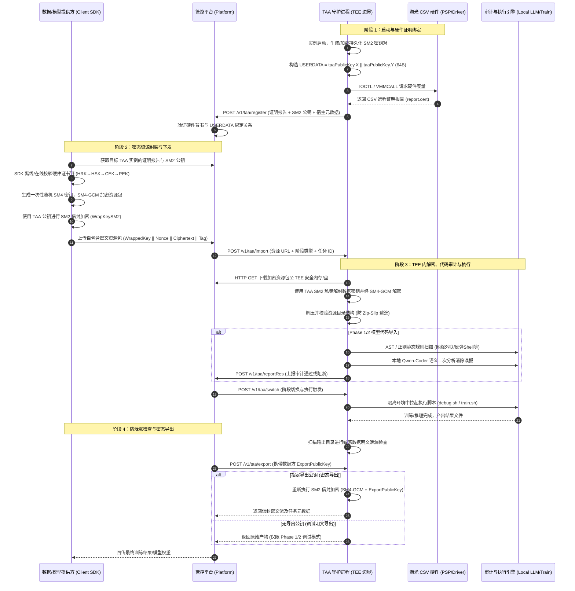

# TAA 设计文档

## 1. 项目概述

TAA（Trusted Application Attestation）是一个运行在 Hygon CSV（可信安全虚拟化）TEE 环境中的可信应用代理服务。它负责：

- 通过远程证明（Remote Attestation）向平台注册自身身份
- 接收平台下发的加密资源（模型代码、测试数据、训练数据）
- 在 TEE 安全环境中解密、审计、执行训练任务
- 将训练结果加密导出给平台

## 2. 系统架构

### 2.1 整体数据流与核心链路

TAA 构建了跨**数据/模型提供方（客户端 SDK）**、**管控平台**与 **Hygon CSV TEE 可信边界（TAA 实例）**的三方密态计算闭环。数据流转全过程保证“出端即加密、计算在密态、审计后执行、结果可回传”。

#### 2.1.1 核心数据流转时序图



#### 2.1.2 阶段流转架构拓扑

```text
 [数据/模型提供方 (teecrypto SDK)]
   │
   │ 1. 验证 TAA 证明报告 (HRK 根证书链)
   │ 2. 生成一次性 SM4 会话密钥加密资源包 (SM4-GCM)
   │ 3. 使用 TAA SM2 公钥封装会话密钥 (信封加密)
   ▼
┌────────────────────────────────────────────────────────┐
│ 管控平台 (Platform / Platform-Mock)                     │
│  - 维护容器生命周期与阶段切换 (Phase 1/2/3/4)            │
│  - 透传下发密态资源包 (URL)                             │
│  - 收集 TAA 注册身份、审计状态、心跳与训练结果          │
└───────────────────────┬────────────────────────────────┘
                        │
                        │ HTTP POST 调度指令 (import / switch / export)
                        ▼
┌────────────────────────────────────────────────────────┐
│ Hygon CSV TEE 可信硬件边界 (TAA Pod / Container)        │
│                                                        │
│  ┌──────────────────────────────────────────────────┐  │
│  │ 1. 身份与度量 (启动即证明)                       │  │
│  │    SM2 私钥 (/opt/taa/keys) ──► USERDATA (64B)   │  │
│  │    /dev/csv-guest IOCTL ────► Attestation Report │  │
│  └──────────────────────────────────────────────────┘  │
│                           │                            │
│                           ▼                            │
│  ┌──────────────────────────────────────────────────┐  │
│  │ 2. 密态导入与解密                                │  │
│  │    下载密文包 ──► SM2 私钥解封 SM4 密钥 ──►      │  │
│  │    SM4-GCM 解密 ──► 解包落盘 (/opt/taa/input)    │  │
│  └──────────────────────────────────────────────────┘  │
│                           │                            │
│                           ▼                            │
│  ┌──────────────────────────────────────────────────┐  │
│  │ 3. 深度代码安全审计                              │  │
│  │    AST/正则静态扫描 ──► 检出可疑高危特征         │  │
│  │    本地轻量大模型 (Ollama Qwen-Coder) 语义研判   │  │
│  │    阻断恶意逃逸 / 排除常规误报                   │  │
│  └──────────────────────────────────────────────────┘  │
│                           │                            │
│                           ▼                            │
│  ┌──────────────────────────────────────────────────┐  │
│  │ 4. 隔离执行与结果防泄露检查                      │  │
│  │    运行模型代码 (debug.sh / train.sh)            │  │
│  │    输出目录敏感明文排查 (ResultCheck)            │  │
│  └──────────────────────────────────────────────────┘  │
│                           │                            │
│                           ▼                            │
│  ┌──────────────────────────────────────────────────┐  │
│  │ 5. 结果重加密与导出                              │  │
│  │    读取 ExportPublicKey ──► SM2+SM4 信封重加密   │  │
│  │    HTTP Response 返回密文流给平台                │  │
│  └──────────────────────────────────────────────────┘  │
└────────────────────────────────────────────────────────┘
```

#### 2.1.3 核心数据流控制点矩阵

| 流转步骤 | 发起方 → 接收方 | 传输格式 / 算法 | 安全保护与控制目标 |
|---------|----------------|----------------|-------------------|
| **身份注册** | TAA → 管控平台 | Base64(CSV 报告) + SM2 公钥 | **启动即证明**：通过海光硬件 PSP 签名与 `USERDATA` 绑定，防止伪造容器身份与公钥劫持 |
| **客户端验签** | SDK 内部验证 | SM2 验签 + 证书链 (HRK→PEK) | **离线背书**：客户端独立校验 TAA 是否真实运行在合法 CSV TEE 环境中 |
| **资源封装** | 客户端 → 平台 | SM2 信封 + SM4-GCM 密文 | **出端即加密**：平台侧全程无法窥探模型源码与敏感原始数据 |
| **资源导入** | 平台 → TAA | HTTP 下发密文包 URL | **按需解密**：TAA 在可信内存内解封一次性 SM4 密钥并还原文件 |
| **代码审计** | TAA 内部流转 | Python AST 规则 + 本地 LLM 语义分析 | **审计后执行**：防止反弹 Shell、外联通信、数据外发等恶意行为 |
| **训练执行** | TAA 内部流转 | 隔离沙箱 /opt/taa/ | **密态计算**：模型与数据在 TEE 物理内存加密保障下执行计算 |
| **防泄露检测** | TAA 内部流转 | 熵值与特征扫描 | **出口设卡**：防止恶意代码将原始输入数据明文打包至模型输出权重中 |
| **结果导出** | TAA → 平台 → 提供方 | SM2 信封 (ExportPublicKey) | **密态回传**：计算结果经使用方指定公钥重新加密，平台仅作为密文管道 |

### 2.2 核心组件

| 组件 | 位置 | 职责 |
|------|------|------|
| TAA 主服务入口 | `cmd/taa/main.go` | 极简入口，参数解析与系统信号监听 |
| TAA 启动编排 | `internal/app/taa/` | 启动生命周期编排、密钥生成、注册、HTTP 服务初始化 |
| 平台模拟器入口 | `tools/platform-mock/cmd/platform-mock/main.go` | 平台模拟器可执行入口 |
| 平台模拟器核心 | `tools/platform-mock/` | 模拟器 HTTP 服务、反向代理与嵌入控制台 |
| 控制器 | `internal/controller/` | HTTP 路由、导入/导出/审计/阶段切换逻辑 |
| 远程证明 | `internal/attestation/` + `pkg/csvattest/` | 进程内经 ioctl 读取 CSV 硬件生成远程证明报告 |
| 安全审计 | `internal/codeaudit/` | Python 代码静态扫描 + LLM 语义验证 |
| 加密工具 | `pkg/crypto/` | SM2 信封加密/解密，SM4-GCM |
| LLM 推理服务 | `teellm/`（独立子模块） | `teellm-service` 网关 + Ollama/Qwen，供代码审计的语义验证 |

## 3. 启动流程

```
┌─────────────────────────────────────────────────────────────────────┐
│              TAA 启动 (cmd/taa -> internal/app/taa)                 │
├─────────────────────────────────────────────────────────────────────┤
│                                                                     │
│  1. 读取 taa-config.json（-config/-addr 可覆盖）                    │
│  2. 生成 SM2 密钥对 (taaKeyPair)                                    │
│  3. 计算 USERDATA = taaPublicKey.X || taaPublicKey.Y                │
│  4. 进程内生成远程证明报告 (attestation.report)，并用证书链自校验   │
│     └─ USERDATA 由 TAA 直接传入，ATTESTATION_USERDATA 可覆盖        │
│  5. POST /v1/taa/register → 平台注册                                │
│     └─ 携带: dockerId, attestation(base64), taaPublicKey,           │
│              attestationValues(JSON), timestamp, verifiedPass       │
│  6. 初始化 TAAState，启动 HTTP 服务 (默认 :6001)                    │
│                                                                     │
└─────────────────────────────────────────────────────────────────────┘
```

### 3.1 启动参数与配置

命令行只保留两个参数，其余配置全部来自 JSON 配置文件：

| 参数 | 默认值 | 说明 |
|------|--------|------|
| `-config` | 空 | 配置文件路径；留空则用 `taa-config.json`（相对当前工作目录，即容器内的 `/root/taa/`） |
| `-addr` | 空 | HTTP 监听地址，**覆盖**配置文件里的 `server.addr` |

配置文件分 7 段：`server` / `platform` / `storage` / `model` / `security` / `attestation` / `llm`，
模板见 `configs/taa-docker.json`（本地容器）与 `configs/taa-production.json`（生产 Pod），
字段含义见 `README.md` 的配置说明。

早期版本的 `-security-scan` / `-security-llm-*` / `-model-dir` / `-data-dir` / `-result-dir` 等命令行参数
与其同名环境变量均已并入配置文件，不再存在。

## 4. API 接口

### 4.1 接口路由

TAA 作为服务端注册的路由（`internal/controller/router.go`）：

| 接口 | 方法 | 说明 |
|------|------|------|
| `/v1/taa/health` | POST | 健康检查 |
| `/v1/taa/status` | POST | 查询状态 |
| `/v1/taa/switch` | POST | 切换阶段 (1→2→3) |
| `/v1/taa/import` | POST | 导入资源（测试数据 / 训练数据） |
| `/v1/taa/importModel` | POST | 导入模型资源 |
| `/v1/taa/getResourceInfo` | POST | 查询已导入资源信息 |
| `/v1/taa/stopTraining` | POST | 停止当前训练 |
| `/v1/taa/export` | POST | 导出结果 |
| `/v1/taa/getAttestation` | POST | 重新获取远程证明报告 |

全部路由**只接受 POST**（`postOnly` 中间件统一强制，其余方法返回 405），并统一附带 CORS 头。

> 反向的、由 TAA 主动调用平台的方向是另一组路径，定义在 `internal/platform/`：
> `register` / `reportRes` / `reportAudit` / `reportProgress` / `taaLog` / `modelLog`。
> 它们不出现在 TAA 的路由表里。

### 4.2 公共返回格式

```json
{
  "msg": "success",
  "result": { ... },
  "error": 0
}
```

## 5. 阶段流程

### 5.1 阶段切换

```
Phase 1 (调试)     Phase 2 (测试)     Phase 3 (正式训练)
┌──────────┐      ┌──────────┐      ┌──────────────┐
│ type=1   │  →   │ type=2   │  →   │ type=3       │
│ 模型+代码 │      │ 测试数据  │      │ 训练数据      │
│ debug.sh │      │ train.sh │      │ train.sh     │
│ +审计     │      │ +审计    │      │ 无审计        │
└──────────┘      └──────────┘      └──────────────┘
```

### 5.2 导入流程 (`/v1/taa/import`)

```
平台发送 import 请求 (resourceUrl, type, taskId, requestId)
                    │
                    ▼
          ┌─── 下载密文文件 ───┐
          │   HTTP GET URL     │
          │   → /tmp/taa-*     │
          └────────┬───────────┘
                   ▼
          ┌─── 解密 ───────────────────────────────────┐
          │  拆分: WrappedKey || SM4-GCM 密文           │
          │  SM2 私钥解包 → SM4 会话密钥 (16B)          │
          │  SM4-GCM 解密 → 明文归档包                   │
          └────────┬───────────────────────────────────┘
                   ▼
          ┌─── 解压 ───────────────────────────────────┐
          │  自动检测格式: tar.gz / zip / tar            │
          │  type=1 → ModelDir  (/opt/taa/models)      │
          │  type=2,3 → DataDir (/opt/taa/data)        │
          │  .sh 文件自动 chmod +x                      │
          └────────┬───────────────────────────────────┘
                   ▼
         ┌─────────────────────────┐
         │  DebugMode == true ?    │
         └────┬─────────────┬─────┘
           YES│             │NO
              ▼             ▼
    ┌─────────────┐   ┌────────────────────────────────────┐
    │  调试模式     │   │           生产模式                   │
    ├─────────────┤   ├────────────────────────────────────┤
    │             │   │                                    │
    │ 保存调试产物  │   │  Phase 1 (type=1):                 │
    │ resultDir/  │   │    执行 debug.sh                    │
    │  debug/     │   │    代码安全审计                      │
    │  <taskId>/  │   │    生成报告 → 上报平台               │
    │  input.bin  │   │                                    │
    │  manifest   │   │  Phase 2 (type=2):                 │
    │             │   │    执行 train.sh                    │
    │ 生成模板报告  │   │    代码安全审计                      │
    │ debug_mode  │   │    生成报告 → 上报平台               │
    │  = true     │   │                                    │
    │             │   │  Phase 3 (type=3):                 │
    │ 上报平台     │   │    执行 train.sh                    │
    │ code=0      │   │    无审计                           │
    │             │   │    生成报告 → 上报平台               │
    └─────────────┘   └────────────────────────────────────┘
```

### 5.3 导出流程 (`/v1/taa/export`)

```
    平台发送 export 请求 (taskId, publicKey?)
                    │
                    ▼
          ┌─────────────────────┐
          │  DebugMode == true ? │
          └────┬──────────┬─────┘
            YES│          │NO
               ▼          ▼
    ┌──────────────┐  ┌──────────────────────────────┐
    │   调试模式    │  │        生产模式                │
    ├──────────────┤  ├──────────────────────────────┤
    │              │  │                              │
    │ 读取调试产物   │  │ 读取 result.bin              │
    │ debug/<tid>/ │  │                              │
    │ input.bin    │  │ 无 publicKey → 明文导出       │
    │              │  │ 有 publicKey → SM2 信封加密   │
    │ Phase 1/2:   │  │                              │
    │  无key→明文   │  └──────────────────────────────┘
    │  有key→加密   │
    │              │
    │ Phase 3:     │
    │  无key→400   │
    │  有key→加密   │
    └──────────────┘
```

### 5.4 上报流程 (TAA → 平台)

```
TAA 内部                           平台
────────                          ────

reportTrainingAsync()
     │
     ├─ POST /v1/taa/reportRes          (训练/调试结果报告)
     │
     └─ POST /v1/taa/reportResourceRes  (资源下载结果通知)
```

## 6. 代码安全审计

### 6.1 审计架构

```
    scanner.ScanDir(ModelDir)
            │
            ▼
    ┌─── 遍历 Python 文件 ───┐
    │  匹配 rules.go 中的规则  │
    │  - 网络外联 (NET_*)     │
    │  - 文件读写 (FILE_*)    │
    │  - 系统调用 (SYS_*)     │
    │  - 动态执行 (DYN_*)     │
    └────────┬───────────────┘
             ▼
      []Finding (可疑项)
             │
             ▼
    verifier.VerifyFindings()
             │
             ▼
    ┌─── LLM 语义验证 ───────────┐
    │  llm.Client → teellm       │
    │  TEE-TLS (RFC 8998)        │
    │  :8443 qwen2.5-coder:7b    │
    │                            │
    │  对每个 Finding 判断:      │
    │  - true_positive (确认)    │
    │  - false_positive (误报)   │
    │  - uncertain (不确定)      │
    └────────┬───────────────────┘
             ▼
      AuditReport
      (passed/failed, risk_level, findings[])
```

### 6.2 源码文件

| 文件 | 行数 | 职责 |
|------|------|------|
| `internal/codeaudit/audit.go` | 612 | 审计入口，协调扫描+LLM验证，生成 `AuditReport` |
| `internal/codeaudit/scanner.go` | 359 | 静态扫描引擎，遍历 Python 文件匹配安全规则 |
| `internal/codeaudit/rules.go` | 319 | 安全规则定义，`Finding` 类型和严重级别 |
| `internal/codeaudit/engine.go` | 156 | 引擎标识与选择（规则引擎 / Semgrep / CPG） |
| `internal/codeaudit/semgrep_engine.go` | 585 | Semgrep 适配器：调用外部 CLI 并映射结果 |
| `internal/codeaudit/cpg_analysis.go` | 241 | CPG（代码属性图）引擎适配器 |
| `internal/codeaudit/llm.go` | 208 | TEE-LLM 客户端（经 TEE-TLS 访问 `teellm-service`） |
| `internal/codeaudit/verifier.go` | 489 | LLM 语义验证，过滤误报 |
| `internal/codeaudit/result_checker.go` | 241 | 导出结果明文泄露检测 |
| `internal/codeaudit/context_slice.go` | 118 | 为 LLM 判定裁剪代码上下文窗口 |

## 7. 远程证明

### 7.1 证明流程

1. TAA 启动时派生 64 字节 USERDATA（SM2 公钥 X‖Y，见 §7.2）
2. 由 `internal/attestation` 的**进程内纯 Go 实现**（`pkg/csvattest`，ioctl 读写 `/dev/csv-guest`）取回 CSV 硬件报告
3. 报告写入容器工作目录下的 `attestation.report`（同目录另落 `nonce.bin`），随后用 HRK / HSK-CEK 证书链自校验
4. 注册时报告以 Base64 编码发送给平台
5. `/v1/taa/getAttestation` 可重新生成报告（复用启动时的 USERDATA）

> 2026-09-15 起已无外部 `get-attestation` helper：早期实现要 `exec` 一个 C 助手（依赖 GmSSL 编译，产物约 25MB），
> 现由 Go 进程内直接出报告，仓库里的 `attestation/` C 工具链目录随之移除。生成失败**不致命**——
> 记 `WARNING` 后写一份空报告继续启动，证书链自校验失败同样只记 `WARNING` 而放行（见 `internal/app/taa/app.go`
> 的 `prepareAttestationReport`）。

### 7.2 USERDATA 构成

```
USERDATA = taaPublicKey.X || taaPublicKey.Y
```

- 64 字节 = 两个 32 字节坐标分别左侧补零到 32 字节后拼接（`internal/app/taa/app.go` 的 `deriveUserData`），不含任何哈希
- 正常路径由 TAA 直接传给报告生成器；`ATTESTATION_USERDATA`（64 字节 hex）是 `pkg/csvattest` 提供的覆盖项
- 在 `/v1/taa/getAttestation` 返回时，`userdata` 会转换为 PEM 格式的 SM2 公钥字符串
- 只绑定 TAA 公钥与 TEE 硬件；dockerId / platformIP / timestamp 随注册请求单独上报，不进入 USERDATA

### 7.3 attestationValues 字段

```json
{
  "userdata": "-----BEGIN PUBLIC KEY-----\n...\n-----END PUBLIC KEY-----",
  "mnonce": "dc4f8eb0...",
  "digest": "afb78b2e...",
  "chipId": "..."
}
```

## 8. 调试模式

### 8.1 启用方式

```sh
# 启动参数
./taa -debug -addr :6001

# 部署脚本
TAA_DEBUG_MODE=true ./deploy.sh taa
```

### 8.2 行为差异

| 行为 | 生产模式 | 调试模式 |
|------|---------|---------|
| 解密/解压 | ✅ 执行 | ✅ 执行 |
| debug.sh / train.sh | ✅ 执行 | ❌ 跳过 |
| 代码安全审计 | ✅ 执行 | ❌ 跳过 |
| 结果报告 | 真实训练报告 | 模板报告 (`debug_mode: true`) |
| 调试产物 | 无 | `resultDir/debug/<taskId>/input.bin` + `manifest.json` |
| 导出 Phase 1/2 无 key | result.bin 明文 | 原始输入包明文 |
| 导出 Phase 1/2 有 key | result.bin 加密 | 原始输入包加密 |
| 导出 Phase 3 无 key | result.bin 明文 | 400 错误 |
| 导出 Phase 3 有 key | result.bin 加密 | 原始输入包加密 |

## 9. 加密方案

### 9.1 SM2 信封加密

```
明文 → SM4-GCM 加密 → 密文
            ↑
        随机 SM4 数据密钥
            │
            └→ SM2 公钥加密 → WrappedKey (113 bytes)

输出格式: WrappedKey(113B) || Ciphertext(可变长)
```

### 9.2 密钥关系

- **TAA SM2 密钥对**：启动时随机生成，公钥注册到平台
- **SM4 数据密钥**：每次加密随机生成，用 TAA SM2 公钥包装
- **平台 SM2 密钥对**：导出时由平台提供公钥，TAA 用于加密结果

## 10. 部署

### 10.1 部署脚本

`deploy.sh` 有两种模式（默认 `remote`）与三种动作（默认 `start`）：

| 模式 | 含义 |
| :--- | :--- |
| `remote` | 远程 Kubernetes Pod 部署（默认）；默认**不**部署 platform-mock，避免与 ccs-node-agent 争 18080 |
| `docker` | 本地 Docker 容器化测试：TAA 与依赖跑在本地容器内，platform-mock 跑在宿主机 |

| 动作 | 含义 |
| :--- | :--- |
| `start` | 部署并启动（默认动作） |
| `stop` | 停止目标服务 |
| `save` | 打包基础镜像归档（**仅 docker 模式**） |

```sh
# 远程 Kubernetes 部署（默认模式，remote 可省略）
./deploy.sh [remote]                    # 全部组件部署
./deploy.sh remote taa                  # 仅部署 TAA 服务
./deploy.sh remote platform-mock        # 仅部署平台模拟器
./deploy.sh remote stop                 # 停止远程服务

# 本地 Docker 容器化测试
./deploy.sh docker                      # 全部组件本地启动
./deploy.sh docker taa                  # 仅本地启动 TAA
./deploy.sh docker platform-mock        # 仅本地启动平台模拟器
./deploy.sh docker stop                 # 停止容器内服务
./deploy.sh docker save --tag taa-env:slim-v2-$(date +%Y%m%d)

# LLM 推理服务（Qwen / Ollama / TEE-LLM）不在这里管理
(cd teellm && ./deploy.sh [docker|remote])
```

`local` 与 `local-docker` 是 `docker` 的历史别名，仍然可用；`qwen` 组件名保留但只打印指向上述 teellm 命令的提示。
完整参数与环境变量清单见 `./deploy.sh --help`。

### 10.2 部署流程

```
本地构建 → scp 到远程宿主机 → kubectl cp 到容器 → 容器内启动
```

### 10.3 容器内目录结构

容器工作目录为 `/root/taa`（镜像 `WORKDIR`，即部署脚本的 `CON_WORKDIR`）；运行时数据与暂存目录在 `/opt/taa`。

```
/root/taa/                        容器工作目录 (WORKDIR / CON_WORKDIR)
├── taa                           TAA 二进制
├── taa-config.json               TAA 运行时配置（部署时由部署脚本写入）
├── start.sh                      启动监督脚本（保持 TAA 常驻）
├── taa.log                       TAA 运行日志
├── attestation.report            远程证明报告
├── certs/
│   ├── hrk.cert                  HRK 根证书
│   └── hsk_cek.cert              HSK/CEK 证书
├── keys/                         TAA SM2 密钥对与密封状态 (0700)
├── models/                       平台下发的模型包
├── data/                         解密解压后的任务数据
└── results/                      训练与审计结果

/opt/taa/                         运行时数据与暂存目录
├── input/                        待处理输入
├── checkpoint/                   训练检查点
├── output/                       训练产物 (result / log / progress)
└── semgrep/rules/                Semgrep 扫描规则
```

配置模板 `configs/taa-docker.json` 中 `storage.keys` 写的是 `/opt/taa/keys`，实际部署时由部署脚本改写为
`/root/taa/keys`，以容器内生效的 `taa-config.json` 为准。

Ollama 离线包**不在 TAA 容器内**：TEE-LLM 网关拆分为独立容器后，Ollama 与网关同容器，
由 `teellm` 子模块独立部署（`(cd teellm && ./deploy.sh [docker|remote])`），TAA 通过容器 IP 访问。

## 11. 项目目录结构

```
tee/
├── cmd/
│   └── taa/                     TAA 主服务可执行入口
├── internal/
│   ├── app/taa/                 启动编排、崩溃恢复与 HTTP 服务装配
│   ├── controller/              HTTP 路由、导入/导出/审计/阶段切换
│   ├── attestation/             远程证明：生成、字段提取、证书链自校验
│   ├── codeaudit/               代码安全审计（文件清单见 §6.2）
│   ├── config/                  启动配置加载与校验
│   ├── platform/                平台注册与结果上报
│   ├── resource/                资源包下载、校验、信封解密与索引
│   ├── runtime/                 训练子进程编排与遥测
│   └── store/                   密封状态持久化
├── pkg/                         可复用库
│   ├── crypto/                  国密加解密与证书/密钥工具
│   ├── csvattest/               CSV 证明报告获取（ioctl）
│   ├── errors/                  带状态码的错误封装
│   ├── filetree/                目录树解析（多模态数据集 → JSON）
│   ├── logger/                  分级日志与有界内存日志池
│   └── utils/                   通用工具
├── tools/                       辅助工具（各自独立构建入口）
│   ├── platform-mock/           平台模拟器（含嵌入式控制台）
│   ├── csv2-vm/                 CSV2 机密虚拟机脚本
│   └── sdk/                     独立 go.work 模块
├── api/                         OpenAPI 定义与 proto
├── configs/                     部署配置模板（docker / production）
├── deploy/                      容器部署清单、证书与监管脚本
├── models/                      模型项目与审计语料
├── tests/                       集成与回归测试脚本
├── teellm/                      TEE-LLM 独立子模块（含 models/ollama）
├── go.mod / go.work             模块与工作区定义
└── docs/                        文档
    ├── api-design.md
    ├── architecture-design.md   (本文件)
    ├── model-provider-integration-guide.md
    └── state-persistence-and-self-healing.md
```
