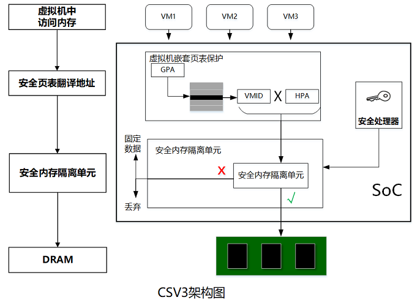

# CSV3加密虚拟机架构概要介绍

海光第三代安全虚拟化技术(CSV3)在前二代技术的基础上继续增强，在CPU内部实现了虚拟机数据的安全隔离，禁止主机操作系统读写CSV3虚拟机内存， 
禁止主机操作系统读写虚拟机嵌套页表，保证了虚拟机数据的完整性，实现了CSV3虚拟机数据机密性和完整性的双重安全。

#### 安全内存隔离单元

安全内存隔离单元是海光第三代安全虚拟化技术的专用硬件，是实现虚拟机数据完整性的硬件基础。 
该硬件集成于CPU内部，放置于CPU核心访问内存控制器的系统总线路径上。 
该硬件可获取CSV3虚拟机安全内存的信息，包括内存物理地址，虚拟机VMID，及相关的权限等。 
CPU在访问内存时，访问请求先经过安全内存隔离单元做合法性检查，若访问允许，继续访问内存，否则访问请求被拒绝。 

以CSV3架构图为例，在CSV3虚拟机运行过程中读取或写入内存时，先经过页表翻译单元完成虚拟机物理地址(GPA, Guest Physical Address) 
到主机物理地址(HPA, Host Physical Address)的转换，再向地址总线发出内存访问请求。 
访问请求中除了包含读写命令、内存地址(HPA)，还必须同时发出访问者的VM ID。 

当CPU读取内存数据时，若安全内存隔离单元判断内存读取请求者的VMID错误，返回固定模式的数据。 
当CPU写入内存数据时，若安全内存隔离单元判断内存写入请求者的VMID错误，丢弃写入请求。

#### 安全处理器

安全内存隔离单元是海光第三代安全虚拟化保护虚拟机内存完整性的核心硬件， 
对此硬件单元的配置必须保证绝对安全，无法被主机操作系统修改。 

海光安全处理器是SoC内独立于主CPU之外的处理器，是CPU的信任根。 
安全处理器在CPU上电后，通过内置验签密钥验证固件的完整性，并加载执行。 
安全处理器具有独立硬件资源和封闭的运行环境，是CPU内最高安全等级硬件，管理整CPU的安全。 
安全内存隔离单元的内容仅安全处理器有权限配置和管理，主机操作系统无权读写。 

在虚拟机启动时，主机操作系统向安全处理器发送请求，安全处理器对安全内存隔离单元做初始配置。 
虚拟机运行期间，安全处理器固件更新安全内存隔离单元。 
虚拟机退出后，安全处理器清除安全内存隔离单元的配置。 
安全处理器会检查主机发来的配置请求是否合法，主机向安全处理器发起的任何非法配置请求，都会被拒绝。 

虚拟机整生命周期内，安全内存隔离单元都在安全处理器的管理控制之下，保证了其配置的安全性。 

#### Virtual Machine Control Block(VMCB)保护

Virtual Machine Control Block(VMCB)是虚拟机的控制信息块，保存了虚拟机ID(VMID)，虚拟机页表基地址，虚拟机寄存器页面基地址等控制信息， 
主机操作系统通过修改虚拟机控制信息能够影响并更改虚拟机内存数据。

CSV3增加了对虚拟机控制信息的保护，安全处理器负责创建VMCB，并配置于安全内存隔离单元的硬件保护之下。 
主机操作系统无法更改CSV3虚拟机VMCB的内容。

为更好的与主机操作系统的软件配合，CSV3创建了真实VMCB与影子VMCB页面。主机操作系统创建影子VMCB，填入控制信息，传递给安全处理器。 
安全处理器创建真实VMCB页面，复制影子VMCB中除虚拟机ID，虚拟机页表基地址，虚拟机寄存器页面基地址等关键信息之外的控制信息，并自行添加关键控制信息。 
虚拟机使用真实VMCB页面启动和运行，阻止了主机操作系统对虚拟机VMCB的攻击。 

#### Virtual Machine Save Aera (VMSA)保护

Virtual Machine Save Area(VMSA)是安全虚拟机的寄存器信息，保存了虚拟机运行时的各通用寄存器和控制寄存器，以及其他运行时状态等。 
其中的内容对虚拟机的安全性至关重要，必须严格保密。 

CSV3虚拟机将VMSA内容配置于内存隔离单元的保护之下，主机操作系统无法读取VMSA内容(VMSA密文不可见)，无法更改VMSA内容，有效的阻止了对VMSA的攻击。
VMSA的创建和初始值配置，通过安全处理器完成，其初始内容包含于远程认证报告中。
用户可通过工具计算VMSA的初始值，并和远程认证报告对比，确认VMSA初始内容的真实性和正确性。

#### 嵌套页表 (Nested Page Table - NPT)保护

嵌套页表是安全虚拟机用于映射虚拟机物理地址(Guest Physical Address - GPA)和主机物理地址(Host Physical Address - HPA)的页表，
是内存虚拟化的核心。

嵌套页表包含了极其重要的虚拟机内存信息，除了GPA与HPA的映射关系，还包含了虚拟机内存页的Present、RW、Reserved等信息。
学术界有较多通过控制和操纵嵌套页表攻击虚拟机的研究，保护嵌套页表的机密性和完整性是提升虚拟机安全的重要手段。

CSV3虚拟机将嵌套页表配置于内存隔离单元的保护之下，主机操作系统无法读取嵌套页表内容(密文不可见)，更无法更改嵌套页表内容，有效的阻止了对嵌套页表的攻击。
CSV3虚拟机嵌套页表通过安全处理器分配与管理，主机操作系统不参与。

# CSV3 API文档

海光CSV3 API以`<major>`:`<minor>`形式标识版本号，例如`1`.`5`。

用户可在网址 [CSV3 API文档目录](https://download.sourcefind.cn:65024/8/main/standards)中下载所需版本的API文档。
