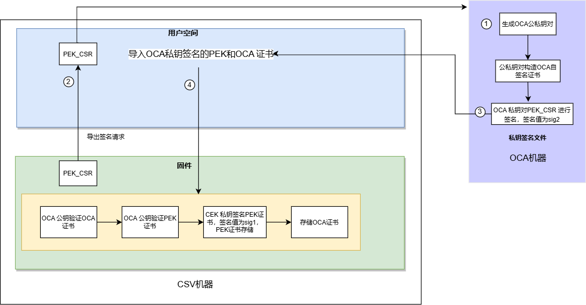
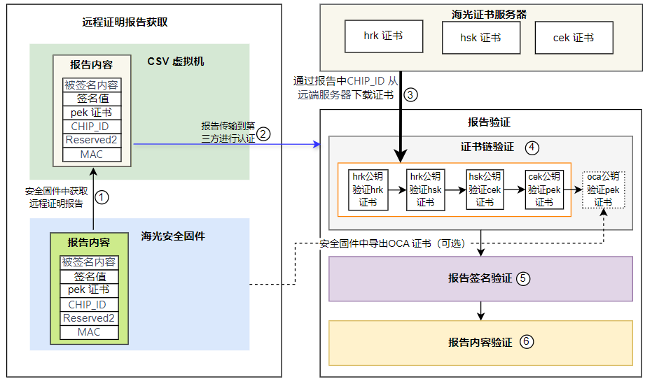
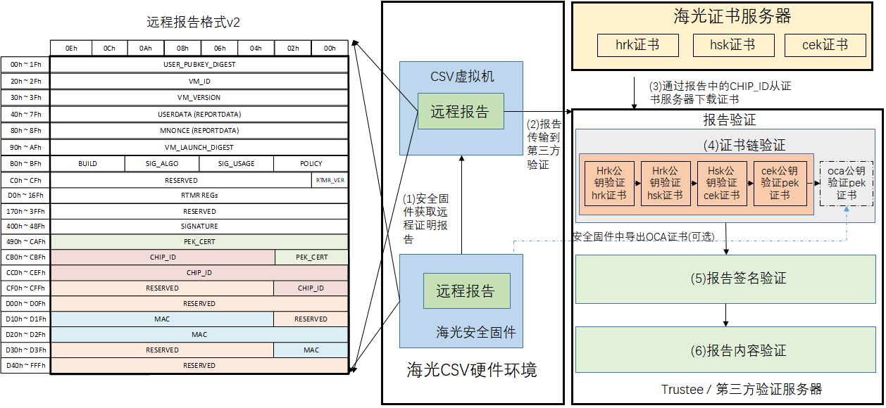

## 概要

CSV 虚拟机具有远程认证功能，从CSV 虚拟机中获取报告，将报告发送到认证方进行认证，从而确保机密信息是运行在客户可信的平台上。

## 证书链

为保证认证报告的真实性、完整性和不可否认性，认证报告中包含对报告中部分字段项的签名值。签名密钥为PEK私钥，PEK(Platform Endorsement Key) 是一组 SM2公私钥对，由CSV 固件使用硬件真随机数发生器产生。PEK证书可以被芯片密钥CEK 和硬件所有者密钥 OCA同时签名，以建立起可信证书链。

### 密钥介绍

#### Platform Diffie-Hellman Key

Platform Diffie-Hellman key (PDH)是国密SM2公私钥对，用于CSV固件和虚拟机使用者之间进行密钥协商。CSV固件使用硬件真随机数发生器产生PDH，PDH私钥保存于CSV固件中，PDH公钥可从CSV固件中导出，供虚拟机使用者使用。
虚拟机使用者随机生成主密钥(master secret)，并使用PDH公钥对主密钥加密后传递给CSV固件，CSV固件使用PDH私钥解密得到主密钥，后续CSV固件可使用主密钥派生出其他密钥。
PDH被PEK签名，如果PEK改变，必须生成新的PDH。PDH在平台的生命周期内不变。

#### Platform Endorsement Key

Platform Endorsement Key(PEK)是国密SM2公私钥对，作为平台的身份标识签名PDH证书，同时PEK证书被CEK和OCA签名，这样建立起可信证书链保证PDH证书是合法的。
CSV固件使用硬件真随机数发生器产生PEK。PEK在平台的生命周期内不变。

#### Chip Endorsement Key

Chip Endorsement Key(CEK)是国密SM2公私钥对，作为芯片标识签名PEK证书。CEK由保存在芯片安全fuse中的数据派生，每颗芯片的CEK都不相同，在芯片的生命周期内不变。

#### Hygon CSV Signing Key

Hygon CSV Signing Key(HSK) 是国密SM2公私钥对，签名CEK证书。HSK私钥保存在海光专用的HSK签名服务器上。

#### Hygon Root Key

Hygon Root Key(HRK) 是国密SM2公私钥对，签名HSK证书。HRK私钥保存在海光专用的HRK签名服务器上。

#### Owner Certificate Authority

Owner Certificate Authority(OCA) 是国密SM2公私钥对，是平台所有者的身份标识，签名PEK证书。平台所有者可以是CSV固件或者硬件所有者，如果CSV固件是平台所有者，OCA由CSV固件使用硬件真随机数发生器产生；否则平台所有者将OCA证书导入到CSV固件。

### 证书链构建流程

CSV 固件初始化时，CSV固件是平台所有者，OCA由CSV固件使用硬件真随机数发生器产生，平台初始化时CEK 和OCA 私钥对PEK 进行签名，构建一套默认和客户无关的海光证书链，由海光确保证书链可信。

如果虚拟机使用者想使用自己的私钥对相关的证书链签名，可使用以下流程： 

1、生成OCA公私钥对，使用公私钥对构造OCA自签名证书。 
2、生成PEK证书的签名请求，签名请求中包含PEK 公钥以及其他平台相关信息。 
3、使用OCA私钥将签名请求签名生成PEK证书。 
4、将签名后的PEK和OCA 证书文件导入到固件平台。 
CSV 固件利用芯片密钥CEK对PEK证书进行再次签名。此时PEK证书中包含PEK公钥和2个签名(CEK私钥签名和OCA私钥签名)，实现包含用户私钥签名的可信证书链建立。PEK证书在生成认证报告时被传入报告中。

## 远程认证报告生成校验

### 远程认证报告生成

#### 虚拟机摘要值生成

为了保证系统程序及其运行环境的完整性，虚拟机启动过程中，安全处理器需要对OVMF.fd、虚拟机内核文件和虚拟机内存文件(initrd)进行度量。 
1、将服务程序放入initrd文件中。 
2、对initrd文件、OVMF.fd和虚拟机内核镜像文件，利用SM3算法计算虚拟机文件摘要值。 
3、在虚拟机启动时提供虚拟机文件和摘要值，CPU中的安全处理器利用 SM3 算法计算虚拟机文件的摘要并进行完整性检验。 
4、完整性信息校验通过，虚拟机成功启动，在生成认证报告时将此摘要值作为虚拟机摘要值写入认证报告中。 

#### 生成认证报告

认证报告生成包含如下步骤： 
1、固件将 CSV 虚拟机启动时传入的虚拟机的 ID、版本号信息填入认证报告。 
2、将DH公钥的摘要值以及 MNONCE 填入认证报告，公钥摘要值用来确定启动虚拟机的用户身份， MNONCE用来确保认证报告的唯一性。 
3、将虚拟机摘要值、虚拟机规则、签名密钥、签名算法、PEK证书等信息填入认证报告中。 
4、固件会生成随机数并填写到认证报告的ANONCE 字段，由 ANONCE 对认证报告的00h-BBh和150h-9B3h范围分别进行异或。 
5、利用PEK私钥对认证报告中异或后的部分字段签名并填写到Signature字段。 
6、利用MNONCE对认证报告中异或后的部分字段计算HMAC并写入到 MAC字段。 

### 远程认证报告校验

用户端在获取到认证报告后，随即对PEK证书链进行验证，验证通过后进行验签，并校验报告中的其他字段项。

#### 证书链校验

PEK证书中包含CEK签名和客户私钥签名两个签名值，CEK证书被HSK（Hygon CSV Signing Key）密钥签名，HSK证书被HRK（Hygon Root Key）密钥签名。用户端需分别对两个签名值的证书链进行校验。 
CEK签名证书链校验流程： 
1、根据认证报告中芯片ID的值，从海光证书服务器下载对应的CEK证书、HSK证书和HRK证书。 
2、使用 HRK 公钥验证 HSK 证书，使用 HSK公钥验证 CEK 证书，使用 CEK 公钥验证 PEK 证书。 
3、验签通过说明PEK证书是由合法的海光芯片中的密钥颁发的。 
同样地，用户端可以使用客户OCA证书中公钥对PEK验签，验证OCA证书链，从而证明该 PEK 证书是由客户可信证书链保证的。

#### 报告内容校验

用户在完成PEK证书证书链校验后，对获取到的认证报告内容进行校验，校验过程如下： 
1、获取认证报告中的ANONCE字段值，利用ANONCE字段值对报告的00h-BBh范围进行异或。 
2、利用PEK证书中的公钥完成对认证报告中Signature值的验签。 
3、根据提前获取到的虚拟机信息、虚拟机摘要值、USERDATA、MNONCE等信息对报告中的相应字段完成校验。校验通过说明是在可信的CSV虚拟机中。

### 报告格式 (v1)

报告输入数据的格式，客户可以定制下面字段的内容

| 偏移 | 比特位 | 输入/输出 |	  名称  | 描述 |
|----- |-------| ---------|---------|------|
|00h  |	511:0|	In    | USERDATA| 用户自定义数据 |
|40h  |	127:0|	In    | MNONCE  | 一次性随机数   |
|50h  |	255:0|	In    | HASH	 |SM3(USERDATA || MNONCE)|

报告输出数据的格式

| 偏移 | 比特位 | 输入/输出 |      名称     |	  描述   |
|-----|--------|----------|---------------|--------------|
|00h	 |255:0  |    Out   | PUBKEY\_DIGEST  | DH公钥的SM3摘要值，用于确认启动虚拟机的用户身份。DH密钥由虚 拟机用户生成，用于对虚拟机启动参数进行签名。|
|20h	 |127:0	|    Out	 | ID	       |虚拟机ID，虚拟机用户自定义。|
|30h	 |127:0	|    Out   |Version	       |虚拟机版本号，虚拟机用户自定义。|
|40h	 |511:0	|    Out   |USERDATA	  |用户自定义数据|
|80h	 |127:0	|    Out   |MNONCE	       |一次性随机数，用于区别报告内容防重放攻击，由虚拟机用户生成。|
|90h	 |255:0	|    Out   |DIGEST	       |虚拟机的启动摘要，虚拟机initrd文件、OVMF.fd和虚拟机内核 镜像文件的SM3摘要值。|
|B0h	 |31:0	|    Out   |POLICY	       |虚拟机规则|
|B4h	 |31:0	|    Out   |SIG\_USAGE	  |签名密钥用途 PEK|
|B8h	 |31:0	|    Out   |SIG\_ALGO	  |签名算法 SM2|
|BCh	 |31:0	|    Out   |ANONCE	       |固件产生的随机数，用于对报告进行混淆处理，防止主机攻击。|
|C0h	 |1151:0	|    Out	 |Signature	       |PEK签名,覆盖00h ~ BFh|
|150h |16671:0	|    Out	 |PEK\_CERT	  |平台的PEK证书|
|974h |511:0	|    Out	 |CHIP\_ID	       |芯片ID，字符串|
|9B4h |255:0	|    Out	 |Reserved2	  |保留字段|
|9D4h |255:0	|    Out	 |MAC	       |MNONCE完整性保护PEK\_CERT || CHIP\_ID || Reserved2生成的HMAC|

## 阿里云海光机密虚拟机远程认证报告校验

参考[阿里云的构建CSV机密计算环境文档](https://help.aliyun.com/zh/ecs/user-guide/build-csv-encrypted-computing-environment?spm=5176.21213303.J_v8LsmxMG6alneH-O7TCPa.1.3b0e2f3dgpmvzK&scm=20140722.S_help@@%E6%96%87%E6%A1%A3@@2507879._.ID_help@@%E6%96%87%E6%A1%A3@@2507879-RL_%E6%9E%84%E5%BB%BAcsv%E6%9C%BA%E5%AF%86%E8%AE%A1%E7%AE%97%E7%8E%AF%E5%A2%83-LOC_2024SPAllResult-OR_ser-PAR1_2150441a17451983762238923ea90d-V_4-RE_new6-P0_0-P1_0)，您可在阿里云构建CSV虚拟机，生成远程认证报告，并校验远程认证报告的真实性。

## 支持RTMR的报告格式

随着新功能的加入，认证报告的格式也在发生变化。 
根据CSV3 API的版本变化，目前有3个版本的认证报告格式。 
•	在API 1.3及以前支持的版本，简记为认证报告V1。（本文章前半部分的格式）
•	在API 1.4开始支持的版本，简记为认证报告V2。
•	在API 1.5开始支持的版本，简记为认证报告V3。

### 报告格式 (v2)

CSV3 API 1.4引入了[RTMR支持](<../02. 用户指南/03. 测试加密虚拟机/13. 测试CSV3虚拟机RTMR动态度量功能.md>)，RTMR用于保护TEE环境的启动、运行过程的完整性。 
认证报告V2对RTMR进行了签名，通过认证报告V2，机密虚拟机用户可以验证虚拟机TEE环境启动、运行过程中动态信息的完整性。
此外，认证报告V2还包含了固件的BUILD版本信息。 

报告输入数据的格式，客户可以定制下面字段的内容

| 偏移 | 比特位 | 输入/输出 |	  名称  | 描述 |
|----- |-------| ---------|---------|------|
|00h  |	511:0|	In    | USERDATA| 用户自定义数据 |
|40h  |	127:0|	In    | MNONCE  | 一次性随机数   |
|50h  |	255:0|	In    | HASH	 |SM3(USERDATA || MNONCE)|

报告输出数据的格式

| 偏移 | 比特位 | 输入/输出 |      名称     |	  描述   |
|-----|--------|----------|---------------|--------------|
|00h	 |255:0  |    Out   | PUBKEY\_DIGEST  | DH公钥的SM3摘要值，用于确认启动虚拟机的用户身份。DH密钥由虚 拟机用户生成，用于对虚拟机启动参数进行签名。|
|20h	 |127:0	|    Out	 | ID	       |虚拟机ID，虚拟机用户自定义。|
|30h	 |127:0	|    Out   |Version	       |虚拟机版本号，虚拟机用户自定义。|
|40h	 |511:0	|    Out   |USERDATA(Report Data)	  |用户自定义数据|
|80h	 |127:0	|    Out   |MNONCE(Report Data)	       |一次性随机数，用于区别报告内容防重放攻击，由虚拟机用户生成。|
|90h	 |255:0	|    Out   |DIGEST	       |虚拟机的启动摘要，虚拟机initrd文件、OVMF.fd和虚拟机内核 镜像文件的SM3摘要值。等同于RTMR\[0\]|
|B0h	 |31:0	|    Out   |POLICY	       |虚拟机规则|
|B4h	 |31:0	|    Out   |SIG\_USAGE	  |签名密钥用途 PEK|
|B8h	 |31:0	|    Out   |SIG\_ALGO	  |签名算法 SM2|
|BCh	 |31:0	|    Out   |Build Version |固件build版本号|
|C0h     |15:0  |    Out   |RTMR Version  |RTMR功能版本号|
|C2h     |111:0 |    Out   |Reserved0     |保留|
|D0h      |255:0 |    Out   |RTMR\[0\]       |RTMR0寄存器|
|E0h      |255:0 |    Out   |RTMR\[1\]       |RTMR1寄存器|
|100h     |255:0 |    Out   |RTMR\[2\]       |RTMR2寄存器|
|120h     |255:0 |    Out   |RTMR\[3\]       |RTMR3寄存器|
|140h     |255:0 |    Out   |RTMR\[4\]       |RTMR4寄存器|
|170h     |5247:0|   Out   |Reserved1       |保留|
|400h	 |1151:0|    Out	 |Signature     |PEK签名，覆盖00h ~ 3FFh|
|490h  |16671:0	|    Out	 |PEK\_CERT	  |平台的PEK证书|
|CB4h |511:0	|    Out	 |CHIP\_ID	  |芯片ID，字符串|
|CF4h |511:0    |    Out     |Reserved2    |保留|
|D14h  |255:0    |    Out     |MAC         |MNONCE完整性保护PEK\_CERT || CHIP\_ID || Reserved2生成的HMAC|
|D34h |5727:0	|    Out	 |Reserved3	      |保留|

### 报告格式 (v3)

CSV3 API 1.5引入了HOST\_DATA功能，HOST\_DATA用于记录虚拟机创建阶段，主机提供给机密虚拟机的数据。 
认证报告V3对HOST\_DATA进行了签名，通过认证报告V3，机密虚拟机用户可以验证虚拟机创建阶段提供数据的完整性及正确性。 
此外，认证报告V3还包含了API的版本号信息。

报告输入数据的格式，客户可以定制下面字段的内容

| 偏移 | 比特位 | 输入/输出 |	  名称  | 描述 |
|----- |-------| ---------|---------|------|
|00h  |	511:0|	In    | USERDATA| 用户自定义数据 |
|40h  |	127:0|	In    | MNONCE  | 一次性随机数   |
|50h  |	255:0|	In    | HASH	 |SM3(USERDATA || MNONCE)|

报告输出数据的格式

| 偏移 | 比特位 | 输入/输出 |      名称     |	  描述   |
|-----|--------|----------|---------------|--------------|
|00h	 |255:0  |    Out   | PUBKEY\_DIGEST  | DH公钥的SM3摘要值，用于确认启动虚拟机的用户身份。DH密钥由虚 拟机用户生成，用于对虚拟机启动参数进行签名。|
|20h	 |127:0	|    Out	| ID	       |虚拟机ID，虚拟机用户自定义。|
|30h	 |127:0	|    Out   |Version	       |虚拟机版本号，虚拟机用户自定义。|
|40h	 |511:0	|    Out   |USERDATA(Report Data)	  |用户自定义数据|
|80h	 |127:0	|    Out   |MNONCE(Report Data)	       |一次性随机数，用于区别报告内容防重放攻击，由虚拟机用户生成。|
|90h	 |255:0	|    Out   |DIGEST	       |虚拟机的启动摘要，虚拟机initrd文件、OVMF.fd和虚拟机内核 镜像文件的SM3摘要值。等同于RTMR\[0\]|
|B0h	 |31:0	|    Out   |POLICY	       |虚拟机规则|
|B4h	 |31:0	|    Out   |SIG\_USAGE	  |签名密钥用途 PEK|
|B8h	 |31:0	|    Out   |SIG\_ALGO	  |签名算法 SM2|
|BCh	 |31:0	|    Out   |Build Version |固件build版本号|
|C0h     |15:0  |    Out   |RTMR Version  |RTMR功能版本号|
|C2h     |7:0  |    Out   |API Major  |API Major版本号|
|C3h     |7:0  |    Out   |API Minor  |API Minor版本号|
|C4h     |111:0 |    Out   |Reserved0     |保留|
|D0h      |255:0 |    Out   |RTMR\[0\]       |RTMR0寄存器|
|E0h      |255:0 |    Out   |RTMR\[1\]       |RTMR1寄存器|
|100h     |255:0 |    Out   |RTMR\[2\]       |RTMR2寄存器|
|120h     |255:0 |    Out   |RTMR\[3\]       |RTMR3寄存器|
|140h     |255:0 |    Out   |RTMR\[4\]       |RTMR4寄存器|
|170h     |4735:0|   Out    |Reserved1       |保留|
|3C0h     |511:0|   Out    |Host Data       |虚拟机创建阶段，主机提供给机密虚拟机的数据|
|400h	 |1151:0|    Out	 |Signature     |PEK签名,覆盖00h ~ 3FFh|
|490h  |16671:0	|    Out	 |PEK\_CERT	  |平台的PEK证书|
|CB4h |511:0	|    Out	 |CHIP\_ID	  |芯片ID，字符串|
|CF4h |511:0    |    Out     |Reserved2    |保留|
|D14h  |255:0    |    Out     |MAC         |MNONCE完整性保护PEK\_CERT || CHIP\_ID || Reserved2生成的HMAC|
|D34h |5727:0	|    Out	 |Reserved3	      |保留|

支持RTMR功能的远程认证流程和报告，如下图所示： 

### 支持RTMR功能的远程认证流程

#### 虚拟机启动过程信息度量

在支持[RTMR](<../02. 用户指南/03. 测试加密虚拟机/13. 测试CSV3虚拟机RTMR动态度量功能.md>)功能的系统中，虚拟机启动过程中的各个模块的度量信息
将动态记录到Event Log中(Event Log保存于虚拟机内存中)，并动态扩展到RTMR寄存器中(RTMR寄存器保存于固件中)。
用户可使用工具获取计算Event Log中的值，重放后与RTMR值对比。
若结果一致，表明Event Log中记录的启动过程为真实硬件所执行的过程，其度量值真实可信。
在启动之前，用户能够获取OVMF.fd，并计算度量值，结果应该与认证报告中的RTMR\[0\]字段一致。
过程中其他组件的信息，则需要从Event Log中获取度量值。

#### 生成认证报告

认证报告生成包含如下步骤： 
1、固件将认证报告中所需的各个字段填入认证报告，其中mnonce字段为用户挑战数据，保证报告的唯一性与新鲜性。 
2、用PEK私钥对认证报告中需签名的字段签名，并填写到Signature字段。 
3、利用MNONCE对PEK\_CERT到Reserved2字段计算HMAC并写入到 MAC字段。 

### 远程认证报告校验

用户端在获取到认证报告后，先对PEK证书链进行验证，验证通过后再对报告进行验签，并校验报告中的其他字段项。

#### 证书链校验

PEK证书中包含CEK签名，CEK证书被HSK（Hygon CSV Signing Key）密钥签名，HSK证书被HRK（Hygon Root Key）密钥签名。用户端需分别对两个签名值的证书链进行校验。 
CEK签名证书链校验流程： 
1、根据认证报告中芯片ID的值，从海光证书服务器下载对应的CEK证书、HSK证书和HRK证书。 
2、使用 HRK 公钥验证 HSK 证书，使用 HSK公钥验证 CEK 证书，使用 CEK 公钥验证 PEK 证书。 
3、验签通过说明PEK证书是由合法的海光芯片中的密钥颁发的。 

#### 报告内容校验

用户在完成PEK证书证书链校验后，对获取到的认证报告内容进行校验，校验过程如下： 
1、利用PEK证书中的公钥完成对认证报告中Signature值的验签。 
2、对比报告中的MNONCE是否与用户发出的挑战值一致，两者必须一致。 
3、使用MNOCE字段为key，对PEK\_CEK字段到Reserved2字段做HMAC计算，对比计算结果与MAC字段，两者必须一致。
校验通过说明是在可信的CSV虚拟机中。
