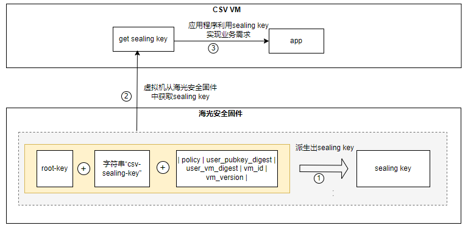

## 概要

CSV虚拟机可以从海光安全固件中获取由机器根密钥和虚拟机相关信息派生出的密钥。该key不需要存储，只能通过账号密码登录或访问虚拟机中服务等方式从虚拟机内部获取，没有泄漏风险，key绑定了虚拟机和主机的相关信息，可信唯一，该密钥可以被客户用于任何目的，例如加密磁盘中的敏感数据，通过派生出的密钥对磁盘中存储的数据进行加密，确保即使攻击者访问存储介质，也无法读取数据，虚拟机启动后从虚拟机中获取该key并用其对磁盘中的敏感数据进行解密。

## 原理介绍



1、海光安全固件通过硬件派生出的root-key 、固件中csv-sealing-key 字符串、虚拟机| policy | user\_pubkey\_digest | user\_vm\_digest | vm\_id | vm\_version | 内容派生出sealing key，该key 只能从虚拟机内部获取，确保了key的可信，在相同的主机上使用相同的虚拟机参数和虚拟机相关文件启动虚拟机，虚拟机中的key保持不变，key绑定了虚拟机和主机的相关信息，确保了key的唯一性。

2、虚拟机通过相应的接口获取海光安全固件中产生的sealing key。

3、虚拟机中用户应用程序使用获取的sealing key 进行一定场景的业务应用。

### 派生sealing key组件描述

| 组件 | 描述 |
|----- |-------|
|root-key|海光安全固件通过硬件派生出的root-key，每台机器唯一且固定不变。|
|csv-sealing-key|海光安全固件提供的字符串，固定不变，作为派生密钥的参数之一。|
|policy|csv虚拟机的启动策略，用户通过 hag csv generate\_policy  --nodebug 生成默认的配置，csv generate\_policy --help 可以查看详细配置说明，qemu 启动虚拟机的policy 参数配置需要和hag 设置的一致。|
|user\_pubkey\_digest|DH公钥的SM3摘要值，用于确认启动虚拟机的用户身份。DH证书在使用hag csv generate\_launch\_blob -build $build\_id -bios OVMF.fd -kernel vmlinuz  -initrd initramfs.img 计算虚拟机组件摘要时候自动生成，证书中包含DH公钥，DH证书文件为guest\_owner\_dh.cert,作为qemu的参数传入。|
|user\_vm\_digest|虚拟机组件启动摘要，通常由ovmf，内核image，文件系统initrd组成，通过hag csv generate\_launch\_blob -build $build\_id -bios OVMF.fd -kernel vmlinuz  -initrd initramfs.img 命令生成launch\_blob.bin文件，该文件中包含虚拟机启动摘要，文件作为qemu 启动参数传入。|
|vm\_id|虚拟机id，用户自己定义，hag csv generate\_launch\_blob --help 中 通过-id 参数传入，字段默认都为0。|
|vm\_version|虚拟机版本号，用户自己定义，hag csv generate\_launch\_blob --help 中 通过-version 参数传入，字段默认都为0。|

### sealing key qemu启动参数介绍

1、获取安全固件build\_id

```
build_id=`sudo hag csv platform_status  |grep "build id"`
```

2、导出证书链

```
hag csv export_cert_chain
```

3、生成 policy 文件

```
hag csv generate_policy  --nodebug
```

4、生成launch\_blob.bin、guest\_owner\_dh.cert

```
hag csv generate_launch_blob -build $build_id -bios OVMF.fd -kernel vmlinuz  -initrd initramfs.img
```

guest\_owner\_dh.cert 为用户dh证书，对应的私钥对launch\_blob.bin中的字段进行签名，dh证书和私钥都由hag中 generate\_launch\_blob 命令自动生成，guest\_owner\_dh.cert 作为qemu的参数传入，海光安全固件获取证书中的公钥，对launch\_blob.bin 中的内容进行验签。
launch\_blob.bin作为qemu启动参数传入，launch\_blob.bin内容对应为SESSION的数据结构，内容如下：

| 偏移 | 比特位 | 输入/输出 |	  名称  | 描述 |
|----- |-------| ---------|---------|------|
|00h  |	127:0|	In    | NONCE| 一次性随机数，用户随机生成 |
|10h  |	255:0|	In    | WRAP\_TK  | KEK对 TEKTIK 加密形成WRAP\_TK，TEKTIK 用户随机生成 ，KEK 由主密钥派生出来|
|30h  |	127:0|	In    | WRAP\_IV	 |加密TEKTIK使用的IV，加密参数之一|
|40h  |	255:0|	In    | WRAP\_MAC |使用KIK作为key 对WRAP\_TK，WRAP\_IV 进行hmac计算生成WRAP\_MAC进行完整性保护，KIK 由主密钥派生出来|
|60h |	255:0|	In    | SESSION\_MAC	 |使用TIK对policy||session data(0x124 - 0x2C3)进行hmac计算生成SESSION\_MAC对数据进行完整性保护|
|80h  |	1311:0|	In    | -	 |保留字段，0|
|124h |	2047:0|	In    | Menc |主密钥，用户随机生成，被PDH公钥加密后为Menc，KEKKIK 由主密钥派生，海光安全固件中使用PDH私钥对Menc进行解密得到主密钥，使用主密钥派生出KEKKIK,使用KIK对WRAP\_TK、WRAP\_IV 进行完整性验证，KEK解密WRAP\_TK 得到TEKTIK,使用TIK对policy||session data(0x124 - 0x2C3)重新进行hmac计算和SESSION\_MAC进行对比，实现数据完整性保护|
|224h |	255:0|	In    | DIGEST	|虚拟机摘要，使用虚拟机组件计算生成，虚拟机组件如 OVMF.fd、 vmlinuz 、initramfs.img，安全固件中会对其进行重新计算和用户计算出的DIGEST进行对比，从而实现可信度量启动|
|244h  |	255:0|	In    | -	 |保留字段，0|
|264h |	127:0|	In    | VM\_ID	 |虚拟机id，用户自己定义，hag csv generate\_launch\_blob --help 中 通过-id 参数传入|
|274h  |	127:0|	In    | VM\_VERSION	 |虚拟机版本号，用户自己定义，hag csv generate\_launch\_blob --help 中 通过-version 参数传入|
|284h  |	511:0|	In    | USERDATA	 |用户自定义数据|
|2C4h  |	511:0|	In    | SIG	 |用户DH私钥对SESSION数据的签名|

### 测试用例参考 [测试密钥封印](<../02. 用户指南/03. 测试加密虚拟机/03. 测试密钥封印.md>)
