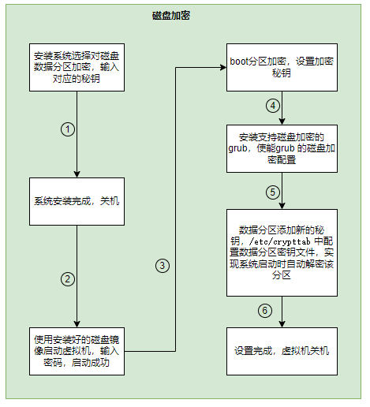
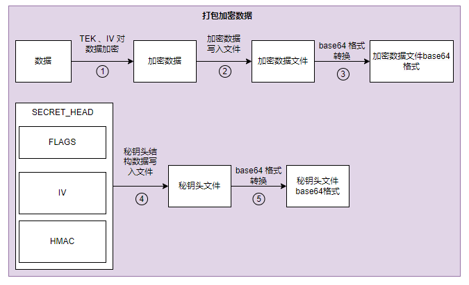
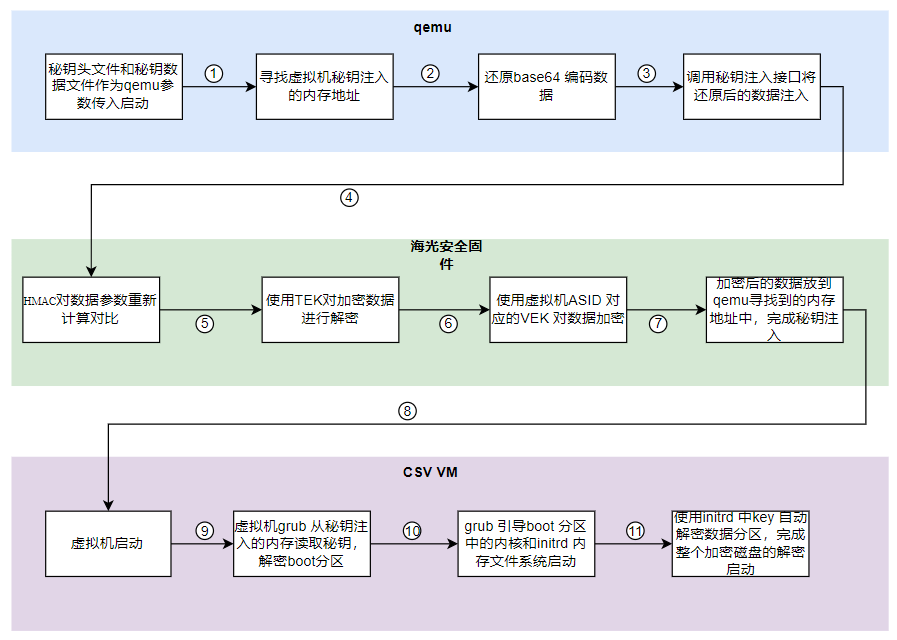

## 概要

普通虚拟机磁盘加密技术只能对虚拟机数据分区进行加密，且密钥管理是一个问题，密钥放在boot分区存在泄漏的风险，CSV虚拟机提供了全磁盘加密技术，可以同时对boot分区和数据分区进行加密，boot分区的密钥加密后通过
虚拟机qemu启动参数动态注入到虚拟机内存中，密钥只能虚拟机启动后从虚拟机内存获取，实现磁盘的解密启动，虚拟机boot分区中不保存boot分区的加密密钥，密钥具有很强的安全性，虚拟机磁盘中的数据在主机上为密文形式存储，确保数据安全不被泄漏。

## 原理介绍

### 磁盘加密

1、使用iso镜像安装虚拟机，安装时选择对磁盘的数据分区进行加密，虚拟机安装完毕，关机。

2、使用安装好的磁盘镜像启动虚拟机，输入安装时的加密数据分区的密钥，虚拟机启动成功。

3、对虚拟机的boot分区加密，设置加密密钥，该密钥后续会作为qemu 的参数传入注入到虚拟机内存中。

4、安装支持磁盘加密的grub，使能grub 的磁盘加密配置。

5、生成密钥，密钥放到initrd文件系统中，生成的密钥文件添加到数据分区的一个新的 LUKS 密钥槽中，LUKS 支持多个密钥槽，每个密钥槽可存储一个解锁加密磁盘的密钥，每个密钥槽中的密钥都可以独立解锁加密分区，更新/etc/crypttab配置，使得系统可以在启动时通过密钥文件自动解锁数据分区，该密钥和iso安装虚拟机时加密磁盘的密钥是相互独立的，都可以对磁盘进行解密，它们分别属于不同的密钥槽。

6、设置完成，虚拟机关机。

### 打包密钥

1、将加密boot 分区的密钥进行加密打包，使用TEK 和IV 对数据进行加密，后续会将该密钥注入到虚拟机内存中，用于解密boot分区，TEK由hag 命令generate\_launch\_blob 随机产生并写入到文件中，后续由hag 加密打包命令package\_secret使用，IV 由hag 打包命令随机生成。

2、将加密后的数据写入文件，该文件为密钥文件。

3、将文件内容进行base64 编码处理，使内容为base64 编码的格式存储在密钥文件中，该文件会作为qemu参数传入。

4、将密钥头的结构数据写入到密钥头文件中。

密钥头参数

| 参数 | 描述 |
|----- |-------|
|FLAGS|FLAGS.REUSE=0时，MEASURE 是LAUNCH\_MEASURE命令返回的MEASURE值。FLAGS.REUSE=1时，MEASURE=0。|
|IV|加密密钥数据的参数之一,随机产生|
|HMAC|对(0x01 || FLAGS || IV || GUEST\_LENGTH || TRANS\_LENGTH || DATA ||MEASURE|| TIK)进行hmac 计算，用于保护数据的完整性，GUEST\_LENGTH为虚拟机密钥的长度，16的整数倍，不超过16K,TRANS\_LENGTH为源数据的长度，DATA 为加密后的密钥，MEASURE 为虚拟机的MEASURE，TIK为完整性保护用的KEY，由hag 命令generate\_launch\_blob 随机产生并写入到文件中，后续由hag 加密打包命令package\_secret使用|

5、将密钥头文件内容进行base64编码转换，该文件会作为qemu参数传入。

### 注入密钥，解密磁盘加密分区

1、将上面步骤打包好的密钥头文件和密钥数据文件作为qemu参数传入启动虚拟机。

2、qemu 找到虚拟机中可以注入密钥的内存地址。

3、将需要注入的数据还原成原有格式，即将base64 的数据格式恢复成原始的格式。

4、调用密钥注入接口函数将密钥注入。

5、海光安全固件中重新将(0x01 || FLAGS || IV || GUEST\_LENGTH || TRANS\_LENGTH || DATA ||MEASURE||TIK)进行计算和传下来的密钥头结构中的mac 进行对比，实现完整性保护。

6、使用TEK对加密数据进行解密。

7、使用虚拟机ASID 对应的VEK 对密钥数据加密。

8、将加密后的数据放到qemu寻找到的内存地址中，完成密钥注入，密钥数据是被虚拟机VEK 加密的，主机上是看不到明文，只有在虚拟机中才能获取明文密钥。

9、启动虚拟机，虚拟机grub 从密钥注入的内存读取密钥，解密boot分区。

10、grub 引导boot 分区中的内核和initrd 内存文件系统启动。

11、使用initrd 中的key 自动解密数据分区，完成整个加密磁盘的解密启动。

### 测试用例参考 [测试全盘加密](<../02. 用户指南/03. 测试加密虚拟机/04. 测试全盘加密.md>)
