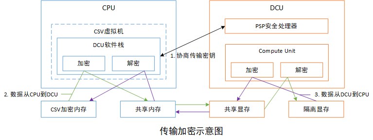

## 系统原理介绍

在CSV虚拟机中运行AI训练、推理，可以保护用户数据和模型数据的安全性，但是仅仅使用CPU算力无法满足某些应用场景的性能要求。DCU卡作为PCIE设备可以直通给CSV虚拟机使用，提高CSV虚拟机的系统算力。由于PCIE设备无法解密CSV加密内存，不能直接把CSV加密内存发送给DCU卡处理。为了阻止攻击者窥探PCIE总线数据，也不能直接发送明文数据给DCU卡，需要采用传输加密技术保护CPU和DCU之间传输的数据。如下图的传输加密示意图中所示，数据从CPU传输到DCU、从DCU传输到CPU之前都会被加密，保护数据在传输过程中不会被窃取。

## 隔离显存

DCU卡上的显存分为普通显存和隔离显存，CSV虚拟机使用隔离显存存放模型数据和用户数据，主机无法读写隔离显存，保障DCU计算过程中的显存数据安全。

## 协商传输密钥

1. DCU的安全处理器固件在初始化时生成一对SM2公私钥对K1\_pub和K1\_priv。
2. CSV虚拟机中的DCU软件栈在初始化时获取DCU安全处理器固件的K1公钥K1\_pub。
3. DCU软件栈随机产生一个SM4密钥K2作为传输密钥，使用K1\_pub加密K2生成K2\_enc，并将K2\_enc发送给DCU安全处理器固件。
4. DCU安全处理器固件使用私钥K1\_priv解密K2\_enc得到K2。
5. DCU软件栈和安全处理器固件后续使用K2作为传输密钥加密数据。

## CPU传输数据给DCU

1. CSV虚拟机中的DCU软件栈分配隔离显存，准备将CSV加密内存中的数据拷贝到隔离显存中。
2. DCU软件栈将CSV加密数据使用传输密钥K2重新加密后，存放到共享内存中。
3. DCU软件栈使用SDMA引擎将共享内存中的加密数据拷贝到共享显存中。
4. DCU Compute Unit将共享显存中的加密数据使用传输密钥K2解密后，存放到隔离显存中。

## DCU传输数据给CPU

1. CSV虚拟机中的DCU软件栈准备将隔离显存中的数据拷贝到CSV加密内存中。
2. DCU Compute Unit使用传输密钥K2加密隔离显存中的数据，将加密后的数据存放到共享显存中。
3. DCU软件栈使用SDMA引擎将共享显存中的加密数据拷贝到共享内存中。
4. DCU软件栈将共享内存中的加密数据使用传输密钥K2解密后，存放到CSV加密内存中。

## DCU安全页表

DCU访问显存时使用虚拟地址，需要经过页表转换成物理地址，用户的机密数据保存在隔离显存中，一种可能的攻击是将指向隔离显存的页表项篡改为普通显存，为了阻止这种攻击需要对隔离显存的页表进行保护，将隔离显存的安全页表也存放在隔离显存中。

隔离显存的安全页表存放在隔离显存中，普通显存的页表存放在普通显存中，需要把隔离显存和普通显存的虚拟地址空间分开，保证隔离显存和普通显存不会共享同一张页表。

DCU驱动在管理隔离显存时，从隔离显存中预留一段区间用来存放安全页表，使用DCU安全处理器更新安全页表。

## DCU安全command queue

DCU command queue中存放Compute Unit需要执行的DCU指令，一种可能的攻击是篡改command queue中的内容将隔离显存中的数据拷贝到共享显存，为了阻止这种攻击需要对command queue进行保护，将command queue存放在隔离显存中。

DCU驱动在管理command queue时，从隔离显存中分配空间用来存放command queue，使用DCU安全处理器更新command queue。

## 直通多张DCU卡

如果CSV虚拟机接入了多张DCU卡，除了CPU和DCU之间需要传输数据，DCU卡之间也需要传输数据，并且也需要对DCU卡之间传输的数据进行加密保护。

CSV虚拟机中的DCU软件栈和每张DCU卡之间都需要协商传输密钥，软件栈与第1张DCU卡之间协商一个SM4传输密钥K2，与其他DCU卡协商传输密钥时也使用K2。

DCU卡之间传输数据时，发送方的Compute Unit使用K2对数据进行加密，接收方的Compute Unit使用K2对数据进行解密。
