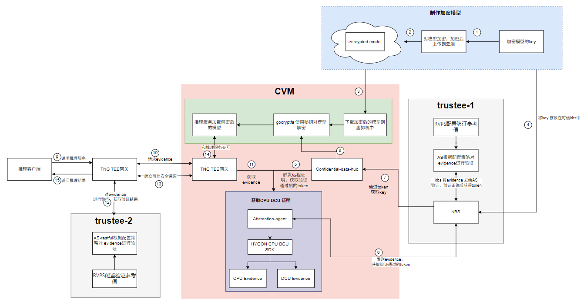

## 概要

AI数据的⾼度敏感性和⾼度隐私性决定了⽤户对AI基础设施的安全和隐私保护能⼒提出了更⾼的要求，针对上述需求，海光联合阿里共同推出了CSV虚拟机
Confidential AI技术解决⽅案，⽅案旨在对AI 中的模型和数据提供高安全级别的保护，为用户提供一个放心可靠的AI使用环境。

## 原理介绍

CSV虚拟机Confidential AI 技术以CSV虚拟机为可信底座，结合远程认证、密钥管理技术，实现对加密的AI模型、数据进行 下载-\>认证-\>解密-\>运行 全链路保护，使整个链路运行在可信的环境中。

- 技术框架

框架分为 trustee-1、模型提供方、模型部署方、trustee-2、客户端 5个部分，通常trustee-1、模型提供方、模型部署方 为同一方，trustee-2、客户端 为同一方，客户可根据自己需要自行调整。

trustee-1：trustee-1 是模型提供方和模型部署方都信任的角色部署。

    核心组件：
    
        KBS: 密钥代理服务，管理存储密钥，实现了基于证明的远程身份验证和授权、秘密资源存储和访问控制。
    
        Attestation-Service：对远程报告进行验证，验证报告的合法性，内部包含策略引擎，支持自定义验证策略。
    
        RVPS：参考值提供服务，配置验证参考值。

模型提供方：使用gocryptfs对模型进行加密，加密后的模型以密文形式公开发布，提供模型解密key，key放到trustee-1的KBS中

模型部署方：部署模型，通过远程认证获取trustee-1 中的key，使用key对加密模型进行解密，使用推理服务加载解密后的模型。

    核心组件：
    
        Attestation-Agent: 是用于鉴证过程的服务。它提供与证明相关的各种服务 API，通过该组件获取远程认证报告，发送给
        trustee-1 或trustee-2中的AS进行验证。
    
        Confidential-data-hub: 触发远程证明，远程证明通过后使用获取到的token 和trustee-1 中KBS 交互获取模型解密key。
    
        gocryptfs: 使用密钥key对模型解密。
    
        TNG：一种建立安全通道的工具，支持各种入站和出站流量方式。提供基于远程证明的安全会话功能。通过配置不同的 Ingress （Ingress） 和 Egress （Egress） 终端节点，用户可以灵活地控制流量的加密和解密，而无需修改现有应用程序，模型推理端的tng 负责获取远程报告和客户端的tng 建立安全通道。
    
        app：负责加载解密后的模型,提供推理服务。

trustee-2：由客户端信任的角色部署，负责对获取的报告进行验证。

    核心组件：
    
        Attestation-service-restful：对远程报告进行验证，验证报告的合法性。
    
        RVPS：参考值提供服务，配置验证参考值。

客户端：通过tng 网关访问推理服务。

    核心组件：
    
        TNG：触发远程证明，和模型推理端的tng 交互获取证明报告，报告提交给trustee-2 中的Attestation-service-restful 进行验证，验证通过后和模型推理端的tng建立安全通道，对整个链路上的数据进行保护。

- 完整流程

1、模型提供方使用密钥key对AI模型进行加密。

2、模型提供方将加密后的AI模型上传到云端存储（客户根据自己需求选择存放的位置），此时模型可以以密文的形式对外公开暴露。

3、模型部署者将加密的模型下载到CSV虚拟机中，为部署做准备。

4、模型提供方将模型解密的密钥KEY放到可信trustee-1 KBS中保存，后续用于模型的解密。

5、模型部署者配置Attestation-Service认证策略，同时可在RVPS中配置参考值，Confidential-data-hub 服务启动触发远程证明，Attestation-agent 通过 HYGON CPU DCU 的SDK 接口获取远程认证报告，将获取的报告发给trustee-1 端进行验证。

6、trustee-1 端的KBS将获取的报告发给Attestation-Service进行验证，Attestation-Service根据认证策略和RVPS中的参考值对报告进行验证，验证通过后生成token，Attestation-agent 从KBS 获取该token。

7、Confidential-data-hub 从Attestation-agent 获取报告验证通过后获取的token，并使用该
token 向KBS 获取解密模型的KEY。

8、模型部署者启动Gocryptfs 解密模块使用获取到的KEY 对模型进行解密，模型解密成功后推理服务加载模型运行。

9、推理客户端配置Attestation-Service-restful认证策略，同时可在RVPS中配置参考值，请求推理服务，请求通过客户端的TNG TEE 网关触发远程证明。

10、推理客户端TNG TEE 网关 向模型服务端TNG TEE 网关请求远程证明报告。

11、模型服务端TNG TEE 网关向Attestation-agent获取远程证明报告，Attestation-agent 通过 HYGON CPU DCU 的SDK 接口获取远程认证报告。

12、客户端的trustee-2 使用Attestation-Service-restful 根据指定的验证策略，及RVPS中的参考值对获取的报告进行验证。

13、验证通过后客户端TNG 和模型服务端TNG之间建立安全通道，该通道作为推理请求和结果返回的传输安全通道。

14、推理的请求通过安全通道传输到模型推理服务程序，模型推理服务对请求进行推理，返回推理结果。

15、客户端通过安全通道获取推理结果，整个请求推理过程完成。

- 安全性分析

1、模型是被加密后以密文形式对外公开暴露，密钥保存在可信的trustee-1 KBS 中，模型文件和密钥都是安全的。

2、模型部署时首先对TEE运行环境进行验证，通过远程证明对CSV虚拟机和DCU设备进行验证，该TEE环境具有高级别的安全性，实现了虚拟机内存、虚拟机到DCU设备全链路数据加密，能有效防止主机对其进行攻击从而获取敏感数据。认证通过后才能获取密钥对模型进行解密，加载模型运行，整个过程都是在可信环境中进行。

3、客户端在请求推理时，会对推理服务的TEE环境进行认证，通过远程证明对CSV虚拟机、DCU设备、推理服务进行验证，验证通过后建立可信TNG安全通道，用该安全通道请求服务，安全通道中的数据都是被加密的，确保了全链路可信保护。

**部署CSV虚拟机Confidential AI步骤请参考** [CSV虚拟机Confidential\_AI](<../02. 用户指南/03. 测试加密虚拟机/12. CSV虚拟机Confidential_AI.md>)

同时可以配合[基于远程证明的CSV 虚拟机磁盘加密技术介绍](<07. 基于远程证明的CSV 虚拟机磁盘加密技术介绍.md>) 实现模型的落盘加密，实现了端到端全链路保护。
