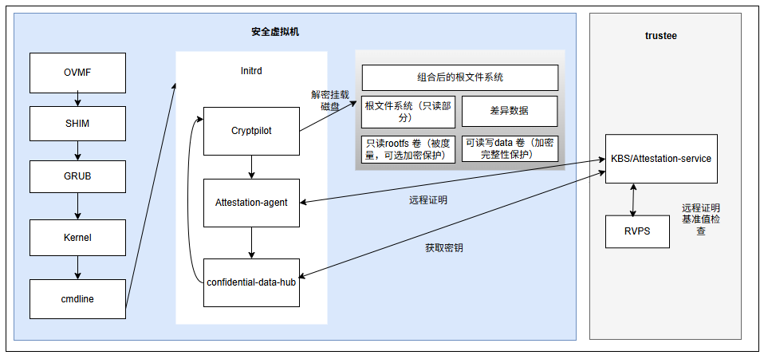
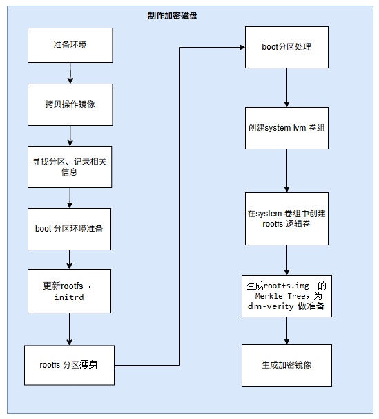
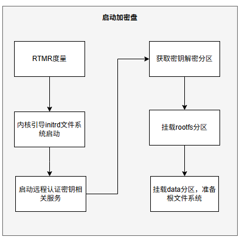
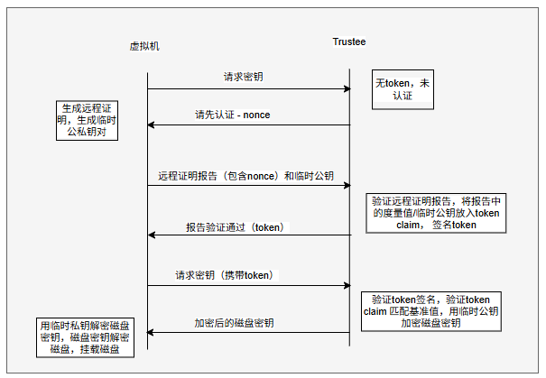

## 概要

海光联合阿里推出了基于远程证明的 CSV 虚拟机磁盘加密技术，实现了系统的安全引导和离线数据保护，并赋予CSV虚拟机全生命周期(从运行到关机，从内存到存盘)数据加密、完整性保护和可度量的能力。

## 原理介绍

### 整体架构



机密系统盘通过CSV 运行时度量(RTMR)技术、 Linux内核的dm-verity、dm-integrity 和LUKS2技术实现，能够为机密实例的系统盘提供可度量、数据加密和完整性保护三种能力。

上图是支持磁盘加密的安全虚拟机的系统环境和启动流程。整个系统由两部分组成，左侧为CSV虚拟机运行环境，必须为支持海光CSV3功能的硬件和系统环境。右侧为远程认证和密钥管理服务环境(trustee)，负责验证虚拟机远程证明报告并分发密钥，该环境可使用任意硬件。
左侧图CSV虚拟机启动过程中，initrd是完成远程获取磁盘密钥并挂载加密磁盘的核心组件。本方案在initrd中装入 cryptpilot\[1\]/attestation-agent\[3\]/confidential-data-hub\[3\] 程序，其中attestation-agent负责获取TEE远程证明报告并发送给trustee，confidential-data-hub负责向trustee请求密钥，cryptpilot负责全流程管理、磁盘解密、根分区完整性校验、磁盘挂载。

远程认证和密钥管理服务使用CoCo社区的trustee组件\[2\] 部署在用户可信的环境中，CSV安全虚拟机启动后通过远程认证获取密钥解密磁盘挂载启动系统。

本技术方案中，CSV虚拟机使用的磁盘文件(.qcow2文件)固定为以下分区，用户可使用cryptpilot-convert工具将已有的磁盘文件转换为以下分区格式，转换过程在离线的环境中完成，过程安全，数据完好。

| 组件 | 描述 |
|----- |-------|
|/efi | EFI分区，明文|
|/boot | 启动分区，明文|
|/rootfs | 根文件系统逻辑卷，密文，有完整性保护|
|/rootfs\_hash | 根文件系统哈希树逻辑卷，明文，用于rootfs完整性校验|
|/data | 数据分区逻辑卷，密文|

本方案实现了保护/rootfs逻辑卷的机密性完整性，保护/data逻辑卷的机密性。

基于远程证明的CSV虚拟机磁盘加密技术有以下几个特点：

#### 可度量

1、基于CSV RTMR技术（介绍参考[测试CSV3虚拟机RTMR动态度量功能](<../02. 用户指南/03. 测试加密虚拟机/13. 测试CSV3虚拟机RTMR动态度量功能.md>) ）对系统的OVMF、shim、grub、kernel、cmdline 、initrd、rootfs 组件进行度量，系统启动时对各个组件进行hash 运算，将相应的度量值扩展到RTMR寄存器中，同时记录在eventlog中。RTMR寄存器存储在海光CPU中，用户可从远程证明报告中获取RTMR值和硬件签名。 CSV 虚拟机initrd
启动过程中的attestation-agent 组件获取远程报告和eventlog 一起发送到trustee 端,Attestation Service 对其进行验证，验证度量值与配置的基准值一致后释放解密密钥，CSV 虚拟机获取密钥解密磁盘启动。

2、基于dm-verity机制，用户在离线制作加密磁盘时，对rootfs卷构建完整的哈希树结构，并保存在/root\_hash逻辑卷，该逻辑卷保存了逐层校验文件系统完整性所需的哈希树。当系统启动时，内核会验证rootfs卷每个数据块的哈希值与/rootfs\_hash预存的根哈希值是否一致，任何未经授权的修改都会被实时检测并阻止系统启动，从而实现对根文件系统的可信度量和防篡改保障。而哈希树的根哈希(root\_hash)值，扩展到RTMR寄存器，并配置到Trustee基准值文件中，保证了整棵哈希树的完整性。对/rootfs分区的任何修改(局部修改或完全替换)，都会导致root\_hash的变化，trustee发现并拒绝分发磁盘解密密钥。

#### 数据加密

通过 LUKS2 标准采用 AES 算法实现磁盘加密。加密过程使用分层密钥体系：系统随机生成的主密钥（Master Key）用于加密数据，而主密钥本身由另一个密钥加密密钥（KEK）保护。KEK 会在实例通过远程证明验证后由trustee下发。所有数据在由内存写入磁盘前自动加密，从磁盘读取时自动解密，确保数据在存储期间始终处于加密状态，同时满足密钥全生命周期的安全可控需求。

#### 完整性保护

对于数据区域基于dm-integrity 技术实现数据完整性保护，为块设备中的每个扇区维护一段“完整性元数据”，该元数据可包含校验值（如 CRC、HMAC），用于读写时校验数据完整性。

#### rootfs卷

rootfs卷存放了只读的根文件系统，在启动时该卷的内容会被度量，并基于内核的dm-verity机制验证rootfs卷的哈希树（启动前离线建立）。为了保持系统中业务程序的兼容性，在启动阶段，一个可写入的覆盖层将被覆盖在只读的根文件系统上，从而允许您在根文件系统上做临时性的写入修改。这些写入修改将不会破坏只读层，也不会影响只读根文件系统的度量。

对该卷的加密是一个可选的操作，这取决于您的业务需求。如果您需要加密rootfs卷的数据，可以在创建机密系统盘的过程中配置加密选项。

#### data卷

在系统启动过程中，该卷会被解密，并且在进入系统后，该卷会被挂载到/data位置上。任何data卷上写入的数据，都会被加密后落盘。由于加密密钥保存在远程的trustee端，攻击者使用任何手段无法获取密钥，无法读取虚拟机落盘数据。data 卷同时可配置 基于dm-integrity 的完整性保护特性。

### 磁盘加密流程

整个流程分两个阶段，加密磁盘制作阶段，加密磁盘使用阶段。

1. 加密磁盘制作



1、准备需要加密的虚拟机镜像，准备加密配置文件，准备加密需要的组件，如 attestation-agent-1.2.1-3.an8.x86\_64.rpm、confidential-data-hub-1.2.1-3.an8.x86\_64.rpm、cryptpilot-0.2.6-1.an8.x86\_64.rpm ，配置文件介绍请参考https://github.com/openanolis/cryptpilot/blob/master/dist/etc/fde.toml.template。

2、在拷贝的虚拟机镜像上进行操作，从而避免对原始镜像造成影响。

3、寻找efi、boot、rootfs分区并记录分区号、以及相应的扇区地址。

4、如果虚拟机没有 boot 分区，提取rootfs 分区中boot目录内容，内容写入到boot.img文件中，为构造boot分区做准备，如果有跳过该步骤。

5、rootfs 分区中安装cryptpilot、attestation-agent、confidential-data-hub 磁盘加密以及远程认证相关组件、拷贝磁盘加密配置文件、如果需要创建boot分区，将boot分区信息添加到/etc/fstab挂载配置项中、更新initrd。

6、rootfs 分区进行瘦身，内容提取到rootfs.img中，删除rootfs 分区。

7、如果需要创建boot分区，在原来rootfs 分区扇区位置创建boot分区并将boot.img写入boot分区，如果不需要则跳过该步骤。

8、创建system lvm 逻辑卷组，为后面创建逻辑分区做准备。

9、在system 卷组中创建rootfs 逻辑卷，并使用提供的密钥对其加密，将rootfs.img 内容写到加密卷中，使用veritysetup计算rootfs.img 的Merkle Tree 并写入到rootfs\_hash.img 文件中，创建rootfs\_hash 卷并将rootfs\_hash.img 内容写入到rootfs\_hash 卷中，将Merkle Tree 的roothash 写入到boot分区的cryptpilot/metadata.toml文件中，为后续使用dm-verity机制构建rootfs只读文件系统做准备。通过本步骤，原虚拟机镜像被加密并提供了完整性保护。

10、加密镜像制作完毕。

磁盘制作完毕后，将由以下分区组成:

- /efi：EFI 分区（明文）
- /boot：启动分区（明文）
- 物理卷（后续在 LVM 中创建逻辑卷）：rootfs（密文，带完整性保护）、rootfs\_hash（明文，存放哈希树）、data（密文）

2. 启动加密磁盘



1、先进行度量启动，海光安全固件对OVMF进行度量，OVMF 对shim 度量，shim 对grub 进行度量，grub 对kernel、cmdline、initrd  进行度量，initrd 对rootfs进行度量。

2、initrd 中启动cryptpilot 服务的initrd-fde-before-sysroot 阶段 ，启动attestation-agent 、confidential-data-hub服务，attestation-agent 获取远程认证报告，将报告发送到trustee 端，Attestation Service 对证书内容、证书链、度量参考值进行验证。

3、验证通过后confidential-data-hub获取密钥解密rootfs分区，并对分区进行dm-verity 处理。

4、获取密钥解密data 分区（第一次启动会创建data分区，并设置data 为加密卷），data 分区同时具有完整性保护特性，该特性可选，退出cryptpilot 服务的initrd-fde-before-sysroot 阶段。

5、挂载rootfs 为/sysroot 。

6、启动cryptpilot 服务进入initrd-fde-after-sysroot 阶段，挂载 data分区，设置sysroot为overlay 的只读层，overlay上层为内存tmpfs 或者为disk ，disk 内容放在data 分区中。

### 启动后镜像完整视图

```
[root@localhost ~]# lsblk 
NAME                   MAJ:MIN RM  SIZE RO TYPE  MOUNTPOINT
fd0                      2:0    1    4K  0 disk  
sda                      8:0    0   20G  0 disk  
├─sda1                   8:1    0    2M  0 part  
├─sda2                   8:2    0  200M  0 part  /boot/efi
├─sda3                   8:3    0    1G  0 part  /boot
└─sda4                   8:4    0 18.8G  0 part  
  ├─system-rootfs      252:0    0  8.4G  0 lvm   
  │ └─rootfs_decrypted 252:3    0  8.4G  0 crypt 
  │   └─rootfs         252:4    0  8.4G  1 crypt /
  ├─system-rootfs_hash 252:1    0   68M  0 lvm   
  │ └─rootfs           252:4    0  8.4G  1 crypt /
  └─system-data        252:2    0 10.3G  0 lvm   
    └─data_dif         252:5    0  9.7G  0 crypt 
      └─data           252:6    0  9.7G  0 crypt /data
```

system-rootfs：加密的rootfs 分区。

rootfs\_decrypted： system-rootfs解密后的映射。

rootfs： rootfs\_decrypted通过dm-verity 处理过的映射，挂载到根目录。

system-rootfs\_hash： 专门用来存储 rootfs 的 Merkle Tree 哈希数据。dm-verity 在校验 rootfs 时会用到这个卷中的 hash tree，并将其与预置的 roothash 进行比对。

system-data： 加密的数据分区。

data\_dif： system-data 通过dm-integrity 完整性保护处理后的映射。

data： 最终解密后的映射，用于挂载到/data 目录。

## 安全性分析

本方案中最关键的安全数据为磁盘解密的密钥。只要解密密钥安全，虚拟机用户以外的攻击者就无法读取虚拟机用户存盘的数据。虚拟机启动和运行阶段，唯一可获取密钥的阶段是在initrd启动过程，本小节讨论了本方案中initrd阶段如何保证密钥的安全性。

攻击手段一：攻击者离线挂载磁盘的/boot分区，替换initrd文件

如前文所述，虚拟机磁盘文件的/boot分区为明文，initrd保存于/boot分区，攻击者是否可篡改initrd文件，替换其中的attestation-agent或cryptpilot程序，增加保存密钥或打印密钥的过程，用于离线解密磁盘?

在本方案中，trustee侧释放密钥的前提是请求方提供远程证明报告，且RTMR/eventlog中的度量值与配置的基准值一致。攻击者对initrd的任何改变都将引起RTMR/eventlog度量值的变化，trustee在验证远程证明报告后，将报告中的度量值与基准值对比后将发现数据不符，拒绝发送密钥。因此攻击者离线修改initrd的方法无法获取磁盘密钥。

攻击手段二：攻击者是否可在虚拟机启动后，伪造http请求，请求trustee再次发送密钥?



上图为initrd中的attestation-agent/confidential-data-hub请求trustee发送密钥的流程图，从图中可看出，虚拟机必须先提供远程证明报告，trustee验证报告正确后，才发送token。虚拟机必须携带token才能请求密钥，trustee验证token的签名为真实后，用TEE提供的临时公钥加密磁盘密钥，并发出。

攻击者任意发出http request请求密钥，如果没有token，只能得到trustee要求远程证明的回应。而token中包含了TEE远程证明的内容和trustee签名，攻击者无法伪造签名，因而无法制造出有效的http request。

进一步的假设攻击者通过某种手段获取到了有效的token，并制造出有效的http request，请求密钥。trustee认为是真实的请求者，用临时公钥加密磁盘解密密钥，并回应。由于临时公钥对应的临时私钥仅TEE虚拟机拥有，攻击者无法解密磁盘密钥，无法读取虚拟机磁盘中的密文内容。

总结来说，Trustee必须鉴别密钥请求方为真实的、度量值匹配的TEE虚拟机，并使用TEE虚拟机提供的临时公钥保护磁盘密钥。除TEE虚拟机以外，攻击者无法同时提供远程证明报告和临时私钥，因此无法获取磁盘解密密钥。

## 相关参考链接

部署测试文档请查考[基于远程证明的CSV 虚拟机磁盘加密测试过程](<../02. 用户指南/03. 测试加密虚拟机/14. 基于远程证明的CSV 虚拟机磁盘加密测试过程.md>)

\[1\] https://github.com/openanolis/cryptpilot

\[2\] https://github.com/confidential-containers/trustee

\[3\] https://github.com/confidential-containers/guest-components
