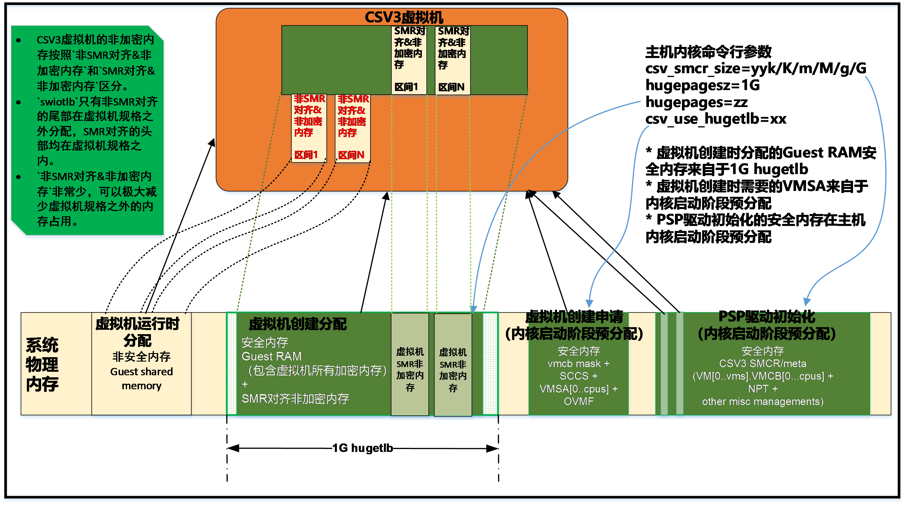

## 概要

为了适配云场景下普通虚拟机和CSV3虚拟机混布的业务场景，同时也为了提升CSV3热迁移的速率，基于1G hugetlb 方案优势，openEuler 社区软件栈（kernel/qemu）现在已经完整支持CSV3 1G hugetlb方案。如需使用CSV3 1G hugetlb方案，请按照下表拉取到指定的kernel/qemu节点以后的版本。

| 组件 | 版本要求 |
| ---- | -------- |
| openEuler kernel | branch：OLK-6.6，commit id：fc6c9b6159778 |
| openEuler qemu | branch：8.2.0，commit id：90e32ac3cdcac |

## 内核CSV3功能说明

表1-1是主机内核必须配置的基础内核命令行参数。

CSV3安全隔离内存分为3类，见表1-2。目前，CSV3内存管理机制需要配置主机内核命令行参数，请参考[主机内核命令行配置CSV3内存隔离的方法](#主机内核命令行配置csv3内存隔离的方法)和[内存模型](#内存模型)。

表1-1 主机基础内核命令行参数

| 参数 | 参数说明 |
| ---- | -------- |
| `mem_encrypt=off` | 主机内核默认页表映射时不打开内存加密。<br>确保主机内核和QEMU普通虚拟机不受内存加解密性能影响。 |
| `kvm-amd.sev=1` | kvm-amd.ko的模块参数sev=1。<br>CSV1/2/3均依赖该参数。 |
| `kvm-amd.sev_es=1` | kvm-amd.ko的模块参数sev\_es=1。<br>CSV2/3均依赖该参数。 |
| `amd_iommu=on` | 主机内核使能IOMMU功能。 |
| `iommu=pt` | 主机内核启动iommu passthrough模式。表示主机侧管理的外设DMA不需要IOMMU地址转换，虚拟机管理的直通外设DMA使用IOMMU地址转换。 |

表1-2 CSV3安全隔离内存类别

| CSV3安全隔离内存类别 | 说明 |
| -------------------- | ---- |
| 系统管理内存 | 系统全局的安全隔离内存。例如，SMCR，NPT。 |
| 虚拟机上下文内存 | 虚拟机级别的上下文内存。例如，虚拟机的vcpu状态。<br>每个虚拟机的虚拟机上下文内存大小为1个SMR。<br>SMR是CSV3硬件内存隔离粒度单元，随着物理主机内存配置而定。<br>SMR大小=max(物理主机单个NUMA NODE内存大小 / 8K) |
| 虚拟机私有内存 | 大小与虚拟机规格定义的内存大小相等。例如，8G虚拟机就按照8G私有内存对待处理。 |

### 主机内核命令行配置CSV3内存隔离的方法

表1-3 主机的CSV3内核命令行参数组合

| 参数 | 参数说明 | 建议配置 |
| ---- | -------- | -------- |
| `csv_smcr_size=yyk/K/m/M/g/G` | 预留指定大小内存作为CSV3的系统管理内存 | 建议配置为4352M |
| `csv_use_hugetlb=xx` | 指定支持同时提供多少个CSV3虚拟机的上下文内存。<br>会发生内存预留。<br>如果主机预期启动csv3个数的上线是xx，csv\_use\_hugetlb就配置为xx |  |
| `hugepagesz=1G hugepages=xx` | 预留多少个1G hugetlb大页 | 规划xx个1G hugetlb用于启动csv3虚拟机，这里配置就配置为xx |
| `hugepagesz=2M hugepages=xx` | 预留多少个2M hugetlb大页 | 如果主机预期启动csv3个数的上线是100，建议主机预留5G大小的2M hugetlb<br>如果主机预期启动csv3个数的上线是200，建议主机预留10G大小的2M hugetlb<br>如果主机预期启动csv3个数的上线是300，建议主机预留15G大小的2M hugetlb<br>如果主机预期启动csv3个数的上线是400，建议主机预留20G大小的2M hugetlb<br>如果主机预期启动csv3个数的上线是500，建议主机预留25G大小的2M hugetlb |

### 内存模型

图1-1的解释：

- 表1-2中的系统管理内存来自于主机内核命令行参数csv\_smcr\_size指定预留的内存。
- 表1-2中的虚拟机上下文内存来自于主机内核命令行参数csv\_use\_hugetlb指定预留的内存。csv\_use\_hugetlb指定单个物理主机最大支持的CSV3虚拟机个数，例如，假设物理主机内存规格对应的SMR=16M，且主机内核命令行设置csv\_use\_hugetlb=100，那么主机内核就会在初始化阶段预留16M \* 100 =~ 1.6G的物理内存，且系统最多只能同时运行100个CSV3虚拟机，所有CSV3虚拟机的虚拟机上下文内存均从这个预留区域获取。
- 表1-2中的虚拟机私有内存来自于1G hugetlb区域（可以通过主机内核命令行参数hugepagesz=1G hugepages=xxx指定预留，也可以开机后设置）。
- CSV3虚拟机运行时，会产生非加密内存。这些非加密内存中，可以按照`SMR对齐区域`和`非SMR对齐区域`来区分，`SMR对齐区域`不再从系统内存中额外分配，`非SMR对齐区域`仍然从系统内存中额外分配，但是每个虚拟机的非加密内存中只有非常小的一部分是`非SMR对齐区域`（kvmclock、vcpu共享通信、virtio vring/virtqueue，swiotlb未对齐部分），因此内存浪费被大大减小。

举个简单的例子：假设物理主机内存100G，主机内核命令行参数设置`csv_smcr_size=1G`、`csv_use_hugetlb=40`、`hugepagesz=1G hugepages=60`（这时，1G hugetlb为60G），当你并行运行了30个2c2G的CSV3虚拟机时，30个CSV3虚拟机需要从1G hugetlb之外的系统物理内存分配约20M \* 30 = 600M内存。



图1-1 CSV3内存模型（仅当固件BUILD ID \>= 2657可用）

## 主机和虚拟机内核建议统一包含Kconfig编译配置

Kconfig编译配置列表：

- CONFIG\_AMD\_MEM\_ENCRYPT=y
- CONFIG\_KVM\_AMD\_SEV=y
- CONFIG\_CRYPTO\_DEV\_CCP=y
- CONFIG\_CRYPTO\_DEV\_CCP\_DD=m 或 CONFIG\_CRYPTO\_DEV\_CCP\_DD=y
- CONFIG\_CRYPTO\_DEV\_SP\_CCP=y
- CONFIG\_CRYPTO\_DEV\_SP\_PSP=y
- CONFIG\_HYGON\_CSV=y
- CONFIG\_VIRT\_DRIVERS=y
- CONFIG\_CSV\_GUEST=m 或 CONFIG\_CSV\_GUEST=y（如果配置为m，虚拟机内使用远程认证和RTMR等功能之前需要执行`sudo modprobe csv-guest`；如果配置为y，虚拟机内则不需要执行`sudo modprobe csv-guest`）
- CONFIG\_EFI\_SECRET=y
- CONFIG\_EFI\_COCO\_SECRET=y

编译演示：

```bash
make openeuler_defconfig
./scripts/config -e AMD_MEM_ENCRYPT
./scripts/config -e AMD_MEM_SEV
./scripts/config -e CRYPTO_DEV_CCP
./scripts/config -m CRYPTO_DEV_CCP_DD
./scripts/config -e CRYPTO_DEV_SP_CCP
./scripts/config -e CRYPTO_DEV_SP_PSP
./scripts/config -e HYGON_CSV
./scripts/config -e VIRT_DRIVERS
./scripts/config -e CSV_GUEST
./scripts/config -e EFI_SECRET
./scripts/config -e EFI_COCO_SECRET
make olddefconfig
make -j123 -s LOCALVERSION=-oe-2203 rpm-pkg
```

## QEMU CSV3虚拟机内存配置方案

图1-1所示的CSV3内存使用模型，对应到云场景，建议使用的QEMU CSV3虚拟机内存方案见表2-4。

表2-4 与图1-1的模型对应的CSV3云实例内存后端方案

| QEMU CSV3虚拟机内存后端方案 | QEMU参数示例 |
| -------------------------- | ------------ |
| 1G hugetlb | `-m 2G`<br>`-object memory-backend-memfd,id=mem,size=2G,share=on,hugetlb=yes,hugetlbsize=1G`<br>`-numa node,memdev=mem` |

例子，一个完整CSV3虚拟机QEMU命令行：

```bash
qemu-system-x86_64 \
-name vm_19_5 \
-enable-kvm \
-m 2G \
-object memory-backend-memfd,id=mem,size=2G,share=on,hugetlb=yes,hugetlbsize=1G \
-numa node,memdev=mem \
-smp 64 \
-cpu host \
-machine q35 -machine memory-encryption=sev0 \
-object sev-guest,id=sev0,cbitpos=47,reduced-phys-bits=5,policy=0x47 \
-drive if=pflash,format=raw,unit=0,file=/usr/share/edk2/ovmf/OVMF_CODE.cc.fd,readonly=on \
-boot d \
-device virtio-scsi-pci,id=scsi0,disable-legacy=on,iommu_platform=on \
-drive file=$HOME/QEMU.DISK/vm_19_5/vm_19_5.qcow2,if=none,id=drive.0 \
-device scsi-hd,bus=scsi0.0,id=scsi-hd.0,drive=drive.0 \
--chardev socket,id=vhost_sock_net0,path=/dev/shm/vpc19-5.sock,server=on,wait=off \
-netdev vhost-user,id=vhost_net0,chardev=vhost_sock_net0,queues=2 \
-device virtio-net-pci,netdev=vhost_net0,mq=on,vectors=6,rx_queue_size=1024,tx_queue_size=1024,mac=00:00:00:00:13:05,disable-legacy=on,iommu_platform=off \
-chardev socket,id=vhost_sock_blk0,path=/dev/shm/vhost-blk19_5 \
-device vhost-user-blk-pci,chardev=vhost_sock_blk0,id=vhost_blk0,disable-legacy=on,iommu_platform=off \
-serial file:/dev/shm/log.guest-vm_19_5 \
-trace events=/dev/shm/log.qemu-trace19_5.events.list \
-D /dev/shm/log.qemu-trace19_5 \
-qmp unix:/dev/shm/vm_19_5.qmp.sock,server,nowait -monitor unix:/dev/shm/vm_19_5.hmp.sock,server,nowait \
-device pcie-root-port,port=0x5,chassis=5,id=rp5,bus=pcie.0,multifunction=on,addr=0x5 \
-device pcie-root-port,port=0x6,chassis=6,id=rp6,bus=pcie.0,multifunction=on,addr=0x6 \
-device pcie-root-port,port=0x7,chassis=7,id=rp7,bus=pcie.0,multifunction=on,addr=0x7 \
-device pcie-root-port,port=0x8,chassis=8,id=rp8,bus=pcie.0,multifunction=on,addr=0x8 \
-device pcie-root-port,port=0x9,chassis=9,id=rp9,bus=pcie.0,multifunction=on,addr=0x9 \
-device pcie-root-port,port=0xa,chassis=10,id=rp10,bus=pcie.0,multifunction=on,addr=0xa \
…… \
-device pcie-root-port,port=0x1e,chassis=30,id=rp30,bus=pcie.0,multifunction=on,addr=0x1e \
-vnc 0.0.0.0:0,to=500
```

QEMU内核后端相关命令行指定的内存可追踪CSV3虚拟机的：a）私有内存（加密内存）；b）`SMR对齐`的共享内存（非加密内存）。vhost-user后端访问的虚拟机`SMR对齐`的共享内存来自QEMU内存后端相关命令行指定的内存。

CSV3虚拟机的`非SMR对齐`的共享内存（非加密内存）由1个memfd(2M HUGETLB)追踪。vhost-user后端访问的虚拟机`非SMR对齐`的共享内存来自该新建memfd(2M HUGETLB)。
