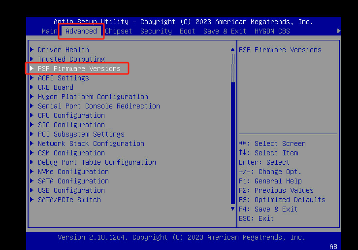
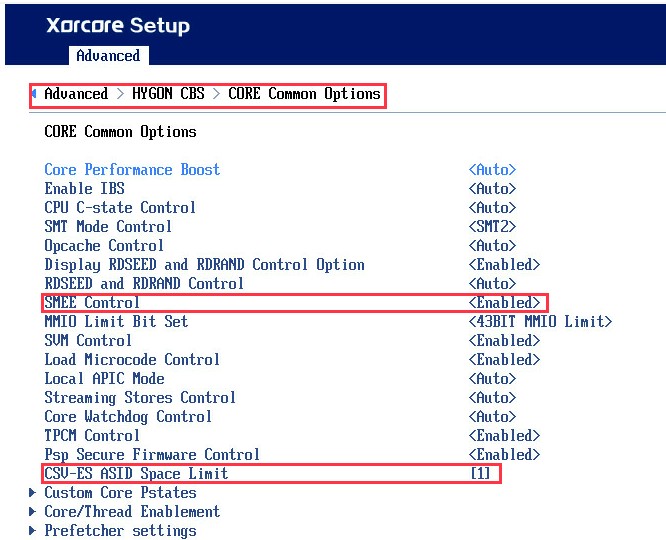
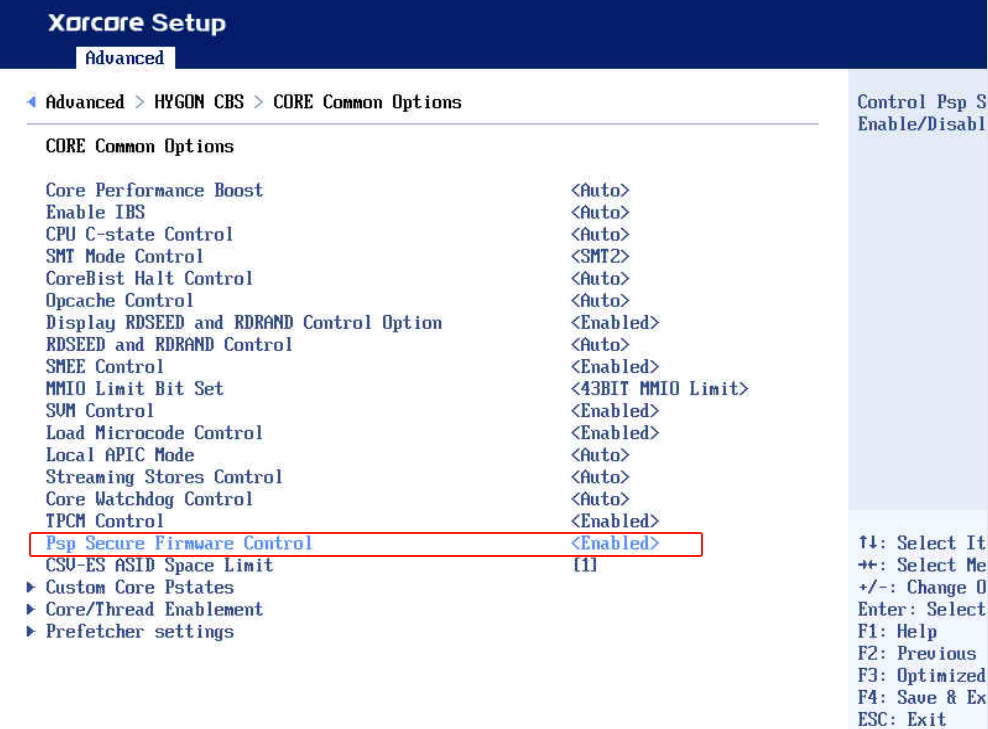
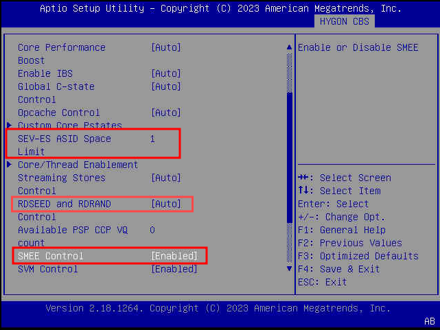
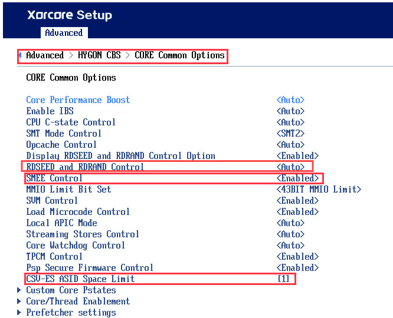
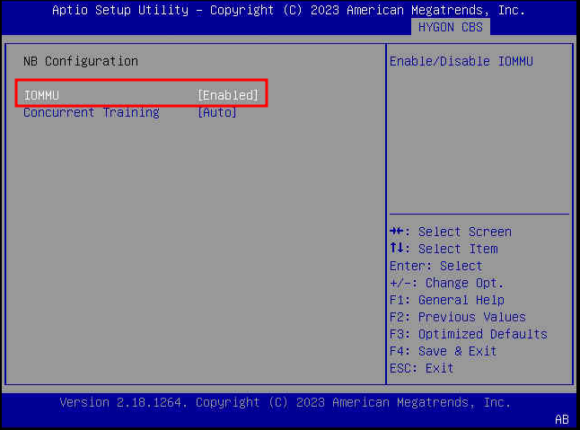
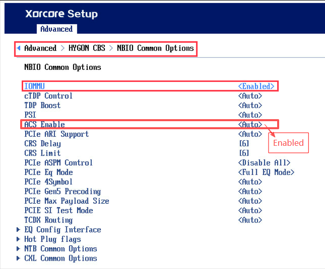
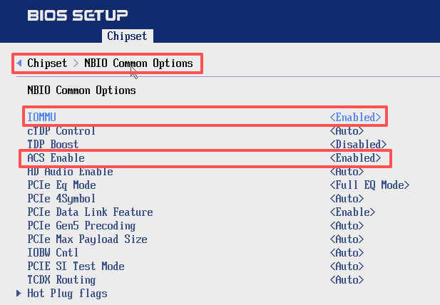

## 硬件配置要求

安全功能包括CSV、TPM2.0、TCM2.0、TPCM、TDM、TKM、HCT等，这些功能依赖CPU硬件、BIOS。

- 表1是各种CPU型号所属的CPU代际信息。
- 表2是各代际CPU使用安全功能的硬件配置版本要求。
- 表3是各代际CPU的机密计算硬件能力细分说明。

表 1 各CPU型号对应的海光CPU代际

| CPU代际    | CPU型号             |
| ---------- | ------------------- |
| 海光2号    | 32XX,52XX,72XX      |
| 海光C86-3G | 33XX,53XX,73XX      |
| 海光C86-4G | 343X,748X,749X,548X |

表 2 安全功能的硬件配置版本要求

| 配置 | CPU               | BIOS                                                         |
| ---- | ----------------- | ------------------------------------------------------------ |
| 1    | <p>海光2号</p>    | #**要求1**#：<p>1. 两种方法都可以确认bios是否支持相应的功能，方法如下：<br/> (1) PI版本 \>= `2.1.0.4`，通过机器型号和厂商沟通确认<br/>(2) Bootloader版本 \>= `1.2.55`，Bootloader版本号可以通过bios查看，方法在下面章节说明<br/>2. 必须支持CSV、fTPM2.0、fTCM2.0、TPCM等安全功能<br/><br/>BIOS必须满足以上2点要求，如果不满足请直接联系整机厂商</p> |
| 2    | <p>海光C86-3G</p> | #**要求2**#：<p>1. 两种方法都可以确认bios是否支持相应的功能，方法如下：<br/> (1) PI版本 \>= `2.1.0.4`，通过机器型号和厂商沟通确认<br/>(2) Bootloader版本 \>= `1.3.52`（Bootloader版本必须 \>= `1.3.52` 才能支持 *CSV2虚拟机*，如果不需要 *CSV2虚拟机* 功能，Bootloader版本满足 #**要求1**# 中的要求也能进行其他测试），Bootloader版本号可以通过bios查看，方法在下面章节说明<br/>2. 必须支持CSV（包括CSV1、CSV2）、fTPM2.0、fTCM2.0、TPCM等安全功能<br/><br/>BIOS必须满足以上2点要求，如果不满足请直接联系整机厂商</p> |
| 3    | <p>海光C86-4G</p> | #**要求3**#：<p>1. 两种方法都可以确认bios是否支持相应的功能，方法如下：<br/>(1) PI版本 \>= `4.2.0.0`，通过机器型号和厂商沟通确认<br/>(2) Bootloader版本要求需要根据CPU Model确认（通过执行 `grep -i model /proc/cpuinfo \| grep -v "model name" \| uniq` 可以查看CPU Model值），各CPU Model值对应的Bootloader版本要求如下：<br/> 1) **4**: Bootloader版本 \>= `3.5.3.1`<br/> 2) **6**（model=6的 74xx/54xx CPU）: Bootloader版本 \>= `3.7.3.37`<br/>3) **6**（model=6的 34xx CPU）：Bootloader版本 \>= `3.7.1.115`<br/>Bootloader 版本号可以通过bios 查看，方法在下面章节说明 <br/>2. 必须支持CSV（包括CSV1、CSV2、CSV3）、fTPM2.0、fTCM2.0、TPCM等安全功能<br/><br/>BIOS必须满足以上2点要求，如果不满足请直接联系整机厂商</p><br/><font size='4'>**注意：**</font><br/>（1）如果用户希望测试`CSV3`的远程认证、kernel启动hash验证、秘密注入等功能（CSV3密钥封印，CSV3全磁盘加密，CSV3机密容器 等依赖于这些功能），要求安全固件的版本号（即build id）\>= `2200`。如果版本号 \< `2200`，用户需要联系OEM厂商获取指定PI版本的BIOS，以`PI4.6.x`为前缀的PI版本要求 \>= `PI4.6.0.6`，以`PI4.2.x`为前缀的PI版本要求 \>= `PI4.2.0.10`。</font><br/>（2）如果用户希望用CSV3 1G Hugetlb方案，要求安全固件的版本号（即build id）\>= `2657`。 |

表 3 机密计算硬件能力细分说明

| CPU               | CSV支持情况                                                  |
| ----------------- | ------------------------------------------------------------ |
| <p>海光2号</p>    | CSV1，支持15个不同虚拟机加密密钥<sup>1</sup>                 |
| <p>海光C86-3G</p> | CSV1，支持15个不同虚拟机加密密钥<sup>1,2</sup><br/>CSV2，支持15个不同虚拟机加密密钥<sup>1,2</sup> |
| <p>海光C86-4G</p> | CSV1，支持500个不同虚拟机加密密钥<sup>3</sup><br/>CSV2，支持500个不同虚拟机加密密钥<sup>3</sup><br/>CSV3，支持500个不同虚拟机加密密钥<sup>3,4</sup> |

- 1. 海光支持ASID复用扩展启动的CSV1/2虚拟机个数
- 2. CSV1/2共用15个密钥
- 3. CSV1/2/3共用500个密钥
- 4. 海光C86-4G的54xx、74xx均支持CSV1/2/3，34xx中部分型号不支持CSV1/2/3，34xx遇到不支持CSV1/2/3时请联系海光确认

## Bootloader 版本查看

海光2号配置

```
Setup Utility -> Advanced -> PSP Firmware Versions
```

如下图：



海光C86-4G配置

```
Chipset -> PSP Firmware Versions
```

如下图：


## 查看CPU型号

```
$ lscpu |grep "Model name"
Model name: Hygon C86 7280 32-core Processor
```

第2位数字代表CPU型号，7280表示是2号CPU，类似地7180代表1号CPU，7380代表3号CPU。

## 查看hag版本

```
$ cd /opt/hygon/bin
$ ./hag general version
Version: 1820 (release)
```

## 查看固件版本

```
$ cd /opt/hygon/bin
$ sudo ./hag csv platform_status
api_major: 1
api_minor: 3
platform_state: CSV_STATE_INIT
owner: PLATFORM_STATE_SELF_OWN
chip_secure: SECURE
fw_enc: ENCRYPTED
fw_sign: SIGNED
CSV: CSV CSV2 CSV3
build id: 1805
guest_count: 0
is HGSC imported: YES
supported csv guest:11
platform_status command successful
```

## BIOS机密计算功能确认方法

> 该节描述的是主流的BIOS配置路径，如遇找不到相关配置路径的情况，请联系OEM厂商。

### SMEE使能，ASID Space Limit为1

#### 海光2号和C86-3G

BIOS设置中，在 *HYGON CBS -\> Moksha Common Options* 中设置 *ASID Space Limit* 为 *1* ，设置 *SMEE Control* 为 *Enabled* 。

#### 海光C86-4G

BIOS设置中，在 *Advanced -\> HYGON CBS -\> Core Common Options* 中设置 *ASID Space Limit* 为 *1* ，设置 *SMEE Control* 为 *Enabled* （如下图）。



### 机密计算安全固件使能

#### 海光2号和C86-3G

> 有些OEM厂商的BIOS可能不提供这个BIOS配置选项，所以用户在使用时遇到海光机密计算功能不可用，及时联系OEM厂商获得解释。

BIOS设置中，在 *HYGON CBS -\> Moksha Common Options* 中设置 *PSF Control* 为 *Enabled* 。

#### 海光C86-4G

BIOS设置中，在 *Advanced -\> HYGON CBS -\> Core Common Options* 中设置 *Psp Secure Firmware Control* 为 *Enabled* （如下图）。



## BIOS安装及设置要求

### 1. 加密虚拟化功能

要使用HYGON加密虚拟化功能(CSV,CSV2,CSV3)，必须进入BIOS设置，通过以下路径打开SMEE功能，并设置SEV-ES ASID Space Limit为1,RDSEED AND RDRAND 为Auto。
*注：PI2104以上的版本，不需要设置SEV-ES ASID Space Limit为*

#### CPU BIOS配置参考

**BIOS界面因厂家不同各有区别，如果找不到对应选项请联系厂家确认**

海光2号配置

```
HYGON CBS -> Moksha Common Options
```

```
Setup Utility -> Advanced -> HYGON CBS -> Core Common Options
```

效果如下图：



海光C86-4G配置

```
Advanced -> HYGON CBS -> Core Common Options
```

效果如下图：



### 2. DCU直通功能

要使用DCU直通功能，必须在BIOS中打开IOMMU功能，同时尽量打开ACS功能。

IOMMU使能选项在NBIO Common Options目录下，可以参考后面**CPU BIOS配置参考**内容进行找到。

ACS使能选项也在NBIO Common Options目录下， 但可能被隐藏，尝试按键Ctrl+F11显示隐藏选项，找到ACS选项，设置为使能。ACS选项如果找不到，就要给Host kernel 打patch，打patch方式在[03.测试加密虚拟机-05测试K100-AI异构机密计算功能](<03. 测试加密虚拟机/05. 测试K100-AI异构机密计算功能.md>) 与[03.测试加密虚拟机-15测试BW异构机密计算功能]() 中提及。

#### CPU BIOS配置参考

海光2号配置参考：

```
HYGON CBS -> NBIO Common Options -> NB Configuration -> IOMMU
```

```
Setup Utility -> Advanced -> HYGON CBS -> NBIO Common Options
```

效果如下图：



海光C86-4G配置参考：

```
Advanced -> HYGON CBS -> NBIO Common Options
```

效果如下图，图中ACS请设置为Enabled而非Auto：



其他BIOS配置路径参考：

```
Chipset -> NBIO Common Options
```

效果如下图：


