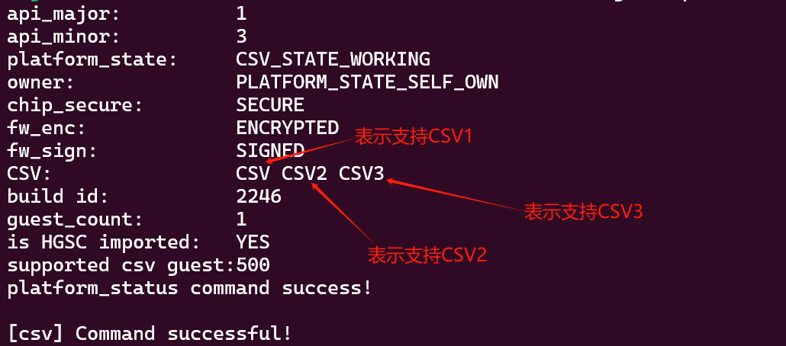
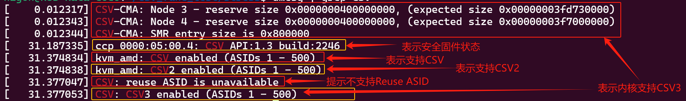
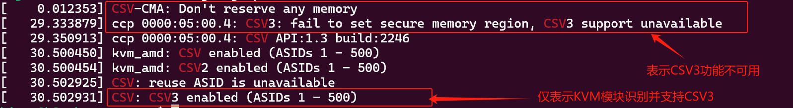
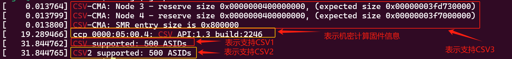
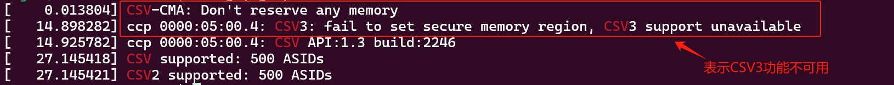

安装CSV公共软件之前，请先准备系统环境并导入通用安全证书。

请参考[安装操作系统](<02. 安装操作系统.md>)准备系统环境。

## 安装依赖软件

```
sudo /opt/hygon/csv/install_csv_sw.sh
```

## 安装devkit

```
cd /opt/hygon/csv/
git clone -b master https://github.com/guanzhi/GmSSL.git
sudo ./build_devkit.sh
```

## 安装后确认主机支持的机密计算类型

### hag确认海光安全固件支持的机密计算类型

在物理主机上执行hag工具可以查看主机是否支持**CSV1、CSV2、CSV3**。

```shell
sudo /opt/hygon/bin/hag csv platform_status
```

展示效果如下图：



### dmesg确认主机Linux支持运行的机密计算虚拟机类型

在物理主机上执行dmesg可以查看Linux内核是否支持**CSV1、CSV2、CSV3**。

```shell
dmesg | grep CSV
```

### 虚拟机配置

运行不同的虚拟机需要修改虚拟机策略policy参数
|虚拟机类型|虚拟机policy|
|--------|--------|
| CSV   | 0x1  |
| CSV2  | 0x5  |
| CSV3  | 0x45 |

#### Linux 6.6内核

下图是**支持CSV1、CSV2、CSV3**时看到的dmesg信息：



* dmesg信息如果包含“CSV3 support unavailable”，则表示主机内核不能启动/运行CSV3虚拟机：



* 关于显示“reuse ASID is unavailable”的说明：

```
在Linux 6.6内核中，编译内核时需要打开CONFIG_KVM_SUPPORTS_CSV_REUSE_ASID=y才能支持Reuse ASID功能，但是这个内核编译配置依赖于CONFIG_CGROUP_MISC=n。如果用户希望在Linux 6.6内核中使用Reuse ASID功能，请注意编译的内核需配置：
  CONFIG_CGROUP_MISC=n
  CONFIG_KVM_SUPPORTS_CSV_REUSE_ASID=y

其他内核的Reuse ASID不受此限制。
```

#### Linux 5.10 / 4.19内核

下图是**支持CSV1、CSV2、CSV3**时看到的dmesg信息：



* dmesg信息如果包含“CSV3 support unavailable”，则表示主机内核不能启动/运行CSV3虚拟机：



## 主机Linux部署海光机密计算虚拟机建议

### 主机Linux内核需配置内核命令行参数

为了让各种型号海光CPU能够应用合适的机密计算能力，下表1列出了主机Linux启动时的必要内核命令行参数和说明。

表1 主机Linux内核命令行参数及其说明

| CPU        | 主机Linux的内核命令行参数                                    |
| ---------- | ------------------------------------------------------------ |
| 海光2号    | kvm-amd.sev=1 mem\_encrypt=on<sup>1</sup>                     |
| 海光C86-3G | kvm-amd.sev=1 kvm-amd.sev\_es=1 mem\_encrypt=on<sup>1</sup>    |
| 海光C86-4G | kvm-amd.sev=1 kvm-amd.sev\_es=1 mem\_encrypt=on<sup>1</sup> csv\_mem\_percentage=<a id='csv3-mem-cmdline'>XX</a><sup>2</sup> |

- 1. `mem_encrypt=on`表示主机Linux开启SME功能，开启该功能可以保证主机Linux运行时，内存中的数据是加密的，是一种主机侧的内存保护；这是一个可选内核命令行参数，运行海光机密虚拟机不强制要求添加该内核命令行参数。
- 2. `csv_mem_percentage=XX`是使用CSV3功能时，最大可占用服务器总物理内存的比例，其中[XX](#csv3-mem-cmdline)是十进制数字，[XX](#csv3-mem-cmdline)最大为80。例如，当系统内存总量为200G，[XX](#csv3-mem-cmdline)为50时，表示可提供服务器总物理内存的 *50%* （即100G）给CSV3功能使用。
- 3. 通常将上述参数设置在/etc/default/grub 文件的GRUB\_CMDLINE\_LINUX 中，设置完使其生效，ubuntu系统使用sudo update-grub使其生效，类centos系统使用grub2-mkconfig -o /boot/efi/EFI/OS/grub.cfg,OS 为具体的系统类型，客户根据具体使用的系统进行替换，或者直接通过sudo grubby --update-kernel=ALL --args="csv\_mem\_percentage=50 amd\_iommu=on mem\_encrypt=on kvm-amd.sev=1 kvm-amd.sev\_es=1"进行设置，sudo grubby --info=$(sudo grubby --default-kernel) 查看grubby 参数设置是否生效，重启系统，系统重新启动后cat /proc/cmdline 检查grub 设置是否生效，cat /sys/module/kvm\_amd/parameters/sev 为Y或者1 表示主机支持csv虚拟机，否则表示不支持，cat /sys/module/kvm\_amd/parameters/sev\_es 为Y或者1 表示主机支持csv2虚拟机，否则表示不支持，cat /proc/meminfo |grep -i cma 输出的内容如果不为0表示cma 内存设置生效，csv3 虚拟机必须设置cma 内存，csv3支持的条件为:硬件支持 + csv + csv2 + cma配置。

### 海光机密计算虚拟机分配内存说明

**虚拟机分配内存**：是指qemu/libvirt指定的虚拟机的内存。例如，`/usr/bin/qemu-system-x86_64 ... -m 2G ...`表示为虚拟机分配内存为2G。下表2列出了海光机密计算**虚拟机分配内存**要求：

表2 海光机密计算虚拟机分配内存要求

| CPU        | 虚拟机分配内存总量要求                                       |
| ---------- | ------------------------------------------------------------ |
| 海光2号    | 所有CSV1虚拟机 \< *(总物理内存 \* 95%)*<sup>1</sup>            |
| 海光C86-3G | 所有CSV1/2虚拟机 \< *(总物理内存 \* 95%)*<sup>1</sup>          |
| 海光C86-4G | 1. 所有CSV1/2虚拟机 \< *(总物理内存 \* (95 - ([XX](#csv3-mem-cmdline) \* 1.06))%)*<sup>1</sup><br/>2. 所有CSV3虚拟机 \< *(总物理内存 \* [XX](#csv3-mem-cmdline)% \* 95%)* |

* 1. 如果主机总物理内存本身就很小，请保证预留2G内存不分配给CSV1/2虚拟机

#### 海光2号运行海光机密计算虚拟机的分配内存说明

海光CSV1虚拟机创建阶段会直接锁住**虚拟机的分配内存**。因此，主机上创建的**所有CSV1虚拟机分配内存总量** \< **总物理内存**。考虑到内核、系统软件等占用内存的情况，建议用户至少预留 *max(总物理内存 \* 5%，2G)* 。

* **例子：**<br/>假设主机总物理内存为100G，这时可以运行最多 *15* 个CSV1虚拟机，分配给所有CSV1虚拟机的总内存应 \< 95G。分配给单个CSV1虚拟机的内存可以由用户自己决定，建议分配给单个CSV1虚拟机的内存 \>= 1G。

#### 海光C86-3G运行海光机密计算虚拟机的分配内存说明

海光CSV1/2虚拟机创建阶段会直接锁住**虚拟机的分配内存**。因此，主机上创建的**所有CSV1/2虚拟机分配内存总量** \< **总物理内存**。考虑到内核、系统软件等占用内存的情况，建议用户至少预留 *max(总物理内存 \* 5%，2G)* 。

* **例子：**<br/>假设主机总物理内存为100G，这时可以运行最多 *15* 个CSV1/2虚拟机，分配给所有CSV1/2虚拟机的总内存应 \< 95G。CSV1/2这2种类型机密虚拟机的具体数量分别由用户自己决定。分配给单个CSV1/2虚拟机的内存可以由用户自己决定，建议分配给单个CSV1/2虚拟机的内存 \>= 1G。

#### 海光C86-4G运行海光机密计算虚拟机的分配内存说明

在海光C86-4G上，为了支持运行CSV3虚拟机，需要在Linux内核命令行上添加`csv_mem_percentage=XX`声明可用于CSV3功能的内存总量，这时：

- 总物理内存中，只有 *(100 - [XX](#csv3-mem-cmdline))%* 的内存可用于CSV1/2**虚拟机分配内存**。考虑到内核、系统软件、虚拟机额外缓冲等潜在的内存使用情况，建议用户至少预留 *max(((总物理内存 \* 5%) + (总物理内存 \* [XX](#csv3-mem-cmdline)% \* 6%))，2G)* 。
- 总物理内存中，有 *[XX](#csv3-mem-cmdline)%* 的内存可用于CSV3功能，其中涉及到CSV3虚拟机的`内存`、`嵌套页表（NPT）`、`寄存器状态`、`虚拟机控制块`的使用，建议所有CSV3的**虚拟机分配内存** \<= *总物理内存 \* [XX](#csv3-mem-cmdline)% \* 95%* 。

* **例子：**<br/>假设主机总物理内存为500G，且[XX](#csv3-mem-cmdline)的值为 *60* （即300G），这时可运行最多 *500* 个CSV1/2/3虚拟机，其中分配给所有CSV1/2虚拟机的总内存应 \< 157G；分配给所有CSV3虚拟机的总内存应 \< 285G。CSV1/2/3这3种类型机密虚拟机的具体数量分别由用户自己决定，但是考虑到可分配给所有CSV1/2虚拟机的总内存 \< 157G，所以建议CSV1/2虚拟机总数量 \< 157个，且分配给单个CSV1/2虚拟机的内存 \>= 1G；考虑到分配给所有CSV3虚拟机的总内存应 \< 285G，所以建议CSV3虚拟机总数量 \< 285个，且分配给单个CSV3虚拟机的内存 \>= 1G。
