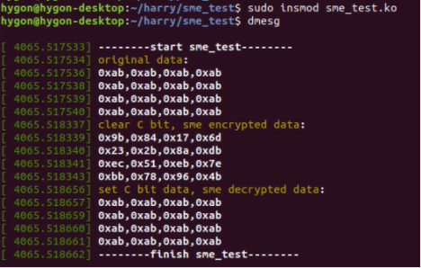

## 功能描述

主机内存加密技术用来加密主机内存，主机写内存数据时，如果页表项的加密位C bit为1，CPU会自动对数据加密后再写入内存；如果页表项的C bit为0，CPU不会进行加密。主机操作系统通过将重要数据的页表项C bit设置为1，可以实现数据加密后保存在内存中，保护数据的安全性。

## 测试主机内存加密功能

### 运行测试程序

测试程序的执行过程分为 3 步：

1. 分配内存并将内存中的数据初始化为 0xab，通过 clflush 指令将数据从缓存写入内存，默认情况下页表中的 C bit=1，因此内存中的数据是被加密后的数据。
2. 调用系统函数set\_memory\_decrypted将内存的 C bit 设置为0然后读出，发现不是0xab而是加密的数据。
3. 调用系统函数set\_memory\_encrypted将内存的C bit设置为1然后读出，发现数据被恢复成 0xab。

```
$ cd /opt/hygon/csv/sme_test
$ sudo insmod sme_test.ko
$ dmesg
```

图 1 主机内存加密测试结果



### 卸载测试程序

```
$ sudo rmmod sme_test
```
