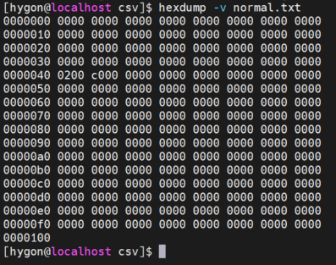
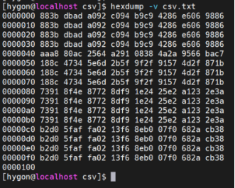

## 功能描述

CSV技术通过加密虚拟机的内存来保护虚拟机数据的安全性，每个CSV虚拟机使用不同的密钥，主机和其他虚拟机都不能访问当前CSV虚拟机的内存数据，本文描述了测试CSV虚拟机功能的方法。

测试中遇到问题请先查看下面问题列表中是否有相关解决方案：

[常见问题 - 安全内存加密](<../../04. 常见问题/03. 安全内存加密.md>)

[常见问题 - 机密虚拟机](<../../04. 常见问题/04. 机密虚拟机.md>)

[常见问题 - 远程认证](<../../04. 常见问题/06. 远程认证.md>)

## 测试内存加密功能

### 查看普通虚拟机的内存数据

运行普通虚拟机。

```
$ sudo qemu-system-x86_64 -name normal-vm --enable-kvm -cpu host -m 2048 -hda /opt/hygon/csv/vm.qcow2 -drive if=pflash,format=raw,unit=0,file=/opt/hygon/csv/OVMF_CODE.fd,readonly=on -qmp tcp:127.0.0.1:1111,server,nowait -vnc 0.0.0.0:0 -nographic
```

虚拟机启动后，登陆虚拟机,用户名为root，密码为root。

打开新终端，保存虚拟机的内存数据到文件。

```
$ telnet 127.0.0.1 1111
$ { "execute" : "qmp_capabilities" }
$ { "execute": "pmemsave", "arguments": {"val": 0, "size": 256, "filename": "normal.txt"} }
```

按下Ctrl+\]退回到终端，查看文件中的内存数据。

```
$ quit
$ hexdump -v normal.txt
```

**normal.txt 文件在运行虚拟机命令的目录下**

普通虚拟机的内存数据如下图，数据是明文。

图 1 普通虚拟机的内存数据



关闭普通虚拟机。

### 查看CSV虚拟机的内存数据

下面测试方法只支持CSV/CSV2，CSV3测试请查看[测试CSV3内存隔离](<10. 测试CSV3内存隔离.md>)

运行CSV虚拟机。

如果测试csv2虚拟机需要将下面参数中policy设置为0x5。

```
sudo qemu-system-x86_64 -name csv-vm --enable-kvm -cpu host -m 2048 -hda /opt/hygon/csv/vm.qcow2 -drive if=pflash,format=raw,unit=0,file=/opt/hygon/csv/OVMF_CODE.fd,readonly=on -qmp tcp:127.0.0.1:2222,server,nowait -vnc 0.0.0.0:1 -object sev-guest,id=sev0,policy=0x1,cbitpos=47,reduced-phys-bits=5 -machine memory-encryption=sev0 -nographic
```

虚拟机启动后，登陆虚拟机，用户名为root，密码为root。

保打开新终端,保存虚拟机的内存数据到文件。

```
$ telnet 127.0.0.1 2222
$ { "execute" : "qmp_capabilities" }
$ { "execute": "pmemsave", "arguments": {"val": 0, "size": 256, "filename": "csv.txt"} }
```

按下Ctrl+\]退回到终端，查看文件中的内存数据。

```
$ quit
$ hexdump -v csv.txt
```

**csv.txt 文件在运行虚拟机命令的目录下**

CSV虚拟机的内存数据如下图，数据是密文。

图 2 CSV虚拟机的内存数据



关闭CSV虚拟机。

## 测试远程认证功能

### 生成认证报告

运行CSV虚拟机。

如果测试csv2虚拟机需要将下面参数中policy设置为0x5，测试csv3虚拟机policy设置为0x45，
csv3远程认证要求安全固件版本不低于2200，可以通过sudo hag general check 查看版本号。

```
$ sudo qemu-system-x86_64 -name csv-vm --enable-kvm -cpu host -m 2048 -hda /opt/hygon/csv/vm.qcow2 -drive if=pflash,format=raw,unit=0,file=/opt/hygon/csv/OVMF_CODE.fd,readonly=on -qmp tcp:127.0.0.1:2222,server,nowait -vnc 0.0.0.0:1 -object sev-guest,id=sev0,policy=0x1,cbitpos=47,reduced-phys-bits=5 -machine memory-encryption=sev0 -netdev bridge,br=virbr0,id=net0 -device virtio-net-pci,netdev=net0,romfile= -nographic
```

启动麒麟Kylin-Server-V10-SP3-2403 虚拟机镜像需要将参数-device virtio-net-pci,netdev=net0,romfile= 使用 -device virtio-net-pci,netdev=net0,disable-legacy=on,iommu\_platform=on,romfile= 参数进行替换，否则启动会卡住。

虚拟机启动后，登陆虚拟机，用户名为root，密码为root。

在虚拟机中使用scp命令从主机拷贝远程认证测试程序，假设主机的用户名是user，host\_ip 为主机ip，在虚拟机中运行测试程序get-attestation生成认证报告。

```
dhclient
# Kylin-Server-V10-SP3-2403 暂时不支持csv-guest，且不支持CSV3 远程认证，执行下面部分时将get-attestation 替换为vmmcall-get-attestation 来执行
# 由于历史原因，一些客户代码使用vmmcall-get-attestation 的逻辑，或者不支持csv-guest 驱动，请使用vmmcall-get-attestation 进行获取报告
scp user@${host_ip}:/opt/hygon/csv/attestation/get-attestation  ./
# 不支持 csv-guest 驱动的内核可以直接使用vmmcall-get-attestation  获取报告，忽略modprobe csv-guest 步骤
modprobe csv-guest
./get-attestation
```

测试程序get-attestation产生mnonce和userdata作为认证报告的输入，生成的认证报告使用PEK私钥签名，并且包含mnonce和userdata，认证方需要检查认证报告的签名、mnonce、userdata。

### 验证认证报告

可以在任意机器上验证认证报告，这里使用主机作为示例，验证程序需要联网从芯片证书服务器下载芯片证书验证认证报告的证书链。

在虚拟机中使用scp命令将认证报告拷贝到主机。

```
# vmmcall-get-attestation 不生成nonce.bin，vmmcall-get-attestation 获取的报告执行下面命令时删除nonce.bin 部分
scp report.cert nonce.bin test@192.168.122.1:/opt/hygon/csv/attestation/
```

在主机中运行验证程序verify-attestation。

```
cd /opt/hygon/csv/attestation
# vmmcall-get-attestation 不生成nonce.bin，vmmcall-get-attestation 获取的报告执行下面命令时删除nonce.bin 部分
sudo chmod 666 report.cert nonce.bin
./verify-attestation true
```

验证程序verify-attestation从芯片证书服务器下载HRK、HSK、CEK芯片证书，使用PEK公钥验证认证报告的签名，并且验证HRK-\>HSK-\>CEK-\>PEK证书链的签名。

关闭CSV虚拟机。

## 若主机OS定制内核不能更换，怎么测试CSV虚拟机内存加密效果？

如果主机OS定制内核不能更换：

* 至少要保证主机内核版本 \>= 4.19；
* 确保主机内核已经支持测试平台；（例如，在C86-4G平台测试时，必须确保主机内核能够正确支持C86-4G CPU）
* 至少保证能够取得与主机OS定制内核对应的内核源码基线；（定制内核一般基于 `OpenAnolis`、`openEuler`、`OpenCloudOS`的社区内核开发的，所以社区内核源码都会有对应的内核基线。用户需要联系定制内核的提供方取得内核基线信息）

### 获取主机OS定制内核对应的内核源码基线

```shell
## 如果定制内核基于openEuler
git clone https://atomgit.com/openeuler/kernel kernel-src
## 如果定制内核基于OpenAnolis
git clone https://gitee.com/anolis/cloud-kernel kernel-src
## 如果定制内核基于OpenCloudOS
git clone https://gitee.com/OpenCloudOS/OpenCloudOS-Kernel kernel-src

## 内核源码状态设置到基线状态
cd kernel-src
git reset --hard <基线commit id>
```

### 回合海光安全处理器驱动补丁

补丁PR list如下，用户请核实基线源码里是否包含PR list中的补丁修改（切勿按照补丁名去对照，应当在源码层面对照），如果基线源码中不包含修改，请按顺序合入PR list中的补丁（用户需手动处理补丁合入冲突）：

https://gitee.com/openeuler/kernel/pulls/16659
https://gitee.com/openeuler/kernel/pulls/16715

### 编译、安装新的ccp和kvm-amd模块

```shell
## 编译模块
cd kernel-src
cp /lib/modules/$(uname -r)/build/.config .
make oldconfig
make modules_prepare LOCALVERSION=$(uname -r | sed 's/^[0-9]\+\.[0-9]\+\.[0-9]\+//')
cp /lib/modules/$(uname -r)/build/Module.symvers .
make M=$(pwd)/drivers/crypto/ccp/ modules -j$(nproc --ignore=1)
make M=$(pwd)/arch/x86/kvm/ modules -j$(nproc --ignore=1)
## 安装编译好的模块
sudo rmmod kvm-amd
sudo rmmod ccp
sudo insmod drivers/crypto/ccp/ccp.ko
sudo insmod arch/x86/kvm/kvm-amd.ko sev=1
```

### 测试对比虚拟机内存加密效果

**这里测试使用`Kernel Direct Boot`的方式简单展示内存加密效果**

`Kernel Direct Boot`需要直接提供虚拟机kernel，initrd。

```shell
vm_kernel_basename=vmlinuz-$(uname -r)
## 类CentOS系统的initrd名称如下
vm_initrd_basename=initrd.img-$(uname -r)
## 类Debian系统的initrd名称如下
vm_initrd_basename=initramfs-$(uname -r).img

export vm_kernel=$(pwd)/${vm_kernel_basename}
export vm_initrd=$(pwd)/${vm_initrd_basename}

sudo cp /boot/${vm_kernel_basename} ${vm_kernel}
sudo cp /boot/${vm_initrd_basename} ${vm_initrd}
sudo chmod 444 ${vm_kernel}
sudo chmod 444 ${vm_initrd}
```

#### 启动普通虚拟机

```shell
export guest_serial_log="/dev/shm/log.norm-vm"
export hmp_sock="/dev/shm/hmp.norm-vm.sock"
export guest_mem_dump_file="dump-guest-mem.norm-vm"

sudo qemu-system-x86_64 \
-name norm-vm \
-enable-kvm -cpu host \
-smp 8 \
-m 1G \
-drive if=pflash,format=raw,unit=0,file=/opt/hygon/csv/OVMF_CODE.fd,readonly=on \
-machine q35 \
-kernel ${vm_kernel} \
-initrd ${vm_initrd} \
-append 'earlyprintk console=ttyS0,115200' \
-serial file:${guest_serial_log} \
-monitor unix:${hmp_sock},server,nowait \
-nographic &
sleep 5
```

#### 使用检测工具确认普通虚拟机的内存无加密保护

```shell
echo "pmemsave 0 256 ${guest_mem_dump_file}" | sudo ncat -U ${hmp_sock}
hexdump -C ${guest_mem_dump_file}
```

* 可以看到虚拟机内存是明文

```
00000000  00 00 00 00 00 00 00 00  00 00 00 00 00 00 00 00  |................|
*
00000040  00 02 00 c0 00 00 00 00  00 00 00 00 00 00 00 00  |................|
00000050  00 00 00 00 00 00 00 00  00 00 00 00 00 00 00 00  |................|
*
00000100
```

* 关闭虚拟机

```shell
sudo pkill qemu
```

#### 启动CSV虚拟机

```shell
export guest_serial_log="/dev/shm/log.csv-vm"
export hmp_sock="/dev/shm/hmp.csv-vm.sock"
export guest_mem_dump_file="dump-guest-mem.csv-vm"

sudo qemu-system-x86_64 \
-name csv-vm \
-enable-kvm -cpu host \
-smp 8 \
-m 1G \
-drive if=pflash,format=raw,unit=0,file=/opt/hygon/csv/OVMF_CODE.fd,readonly=on \
-machine memory-encryption=sev0 \
-object sev-guest,id=sev0,cbitpos=47,reduced-phys-bits=5,policy=0x3 \
-machine q35 \
-kernel ${vm_kernel} \
-initrd ${vm_initrd} \
-append 'earlyprintk console=ttyS0,115200' \
-serial file:${guest_serial_log} \
-monitor unix:${hmp_sock},server,nowait \
-nographic &
sleep 5
```

#### 使用检测工具确认CSV虚拟机的内存有加密保护

```shell
echo "pmemsave 0 256 ${guest_mem_dump_file}" | sudo ncat -U ${hmp_sock}
hexdump -C ${guest_mem_dump_file}
```

* 可以看到CSV虚拟机内存是密文

```
00000000  dd 89 af 62 44 ef ec ab  27 a9 ed 01 99 e1 f1 e5  |...bD...'.......|
*
00000040  a7 4b 7a 68 5e 9b 9b b6  a2 71 3b 45 ea d6 00 0b  |.Kzh^....q;E....|
00000050  29 8a 1d 45 bb df c3 d7  a1 9d 4a 14 8b 66 79 9d  |)..E......J..fy.|
*
00000080  4e d1 c1 10 84 e4 27 f2  d3 29 64 3e 0a 4d 1a 2d  |N.....'..)d>.M.-|
*
000000c0  62 42 0a 35 f7 74 fe df  e5 82 17 e8 70 25 11 44  |bB.5.t......p%.D|
*
00000100
```

* 关闭虚拟机

```shell
sudo pkill qemu
```
