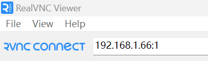

## 功能描述

CSV虚拟机支持密钥封印功能，CSV虚拟机可以请求安全处理器固件生成一个与虚拟机绑定的密钥，虚拟机重启后该密钥保持不变，本文描述了测试CSV虚拟机密钥封印功能的方法。

表1列出了各代际CSV对于密钥封印的支持情况。

表 1 密钥封印支持情况

| CSV安全等级 | 支持情况 | 备注 |
| :--------- | :------ | :--- |
| CSV1 | <p>**支持** `Kernel Direct Boot`虚拟机的密钥封印功能<p>**支持** `Normal Boot`虚拟机的密钥封印功能 | |
| CSV2 | <p>**支持** `Kernel Direct Boot`虚拟机的密钥封印功能<p>**支持** `Normal Boot`虚拟机的密钥封印功能 | |
| CSV3 | <p>**支持** `Kernel Direct Boot`虚拟机的密钥封印功能<p>**支持** `Normal Boot`虚拟机的密钥封印功能 | |

> `Kernel Direct Boot`是指虚拟机启动时直接指定kernel, initrd, kernel cmdline，虚拟机启动过程中直接加载这些指定的kernel, initrd, kernel cmdline，而不是从虚拟机磁盘镜像中读取kernel, initrd等。<br/>`Normal Boot`是指虚拟机启动时不指定kernel, initrd, kernel cmdline，虚拟机启动过程中直接从虚拟机磁盘镜像中读取kernel, initrd等。

测试中遇到问题请先查看下面问题列表中是否有相关解决方案：

[常见问题 - 安全内存加密](<../../04. 常见问题/03. 安全内存加密.md>)

[常见问题 - 机密虚拟机](<../../04. 常见问题/04. 机密虚拟机.md>)

[常见问题 - 远程认证](<../../04. 常见问题/06. 远程认证.md>)

## 测试`Kernel Direct Boot`启动虚拟机时的密钥封印功能

* 麒麟server V10 SP3 2403默认不支持该功能，支持该功能需要将各个组件进行更新，更新流程请参考[软件编译安装](<../01. 环境部署/04. 软件编译安装.md>))

* sealing\_key工具不支持CSV3虚拟机获取封印密钥，当前只有csv-guest-module-tool支持CSV3虚拟机获取封印密钥，[测试normal-boot启动虚拟机时的密钥封印功能](#测试normal-boot启动虚拟机时的密钥封印功能)演示了使用csv-guest-module-tool获取封印密钥。

### 准备测试文件

```
cd /opt/hygon/csv
# Kylin-Server-V10-SP3-2403 系统自带的OVMF.fd不支持该功能，需要下载支持该功能的OVMF.fd
mv /opt/hygon/csv/OVMF.fd /opt/hygon/csv/OVMF.fd-bk
wget -c https://download.sourcefind.cn:65024/directlink/8/c86-devkit/previous-release/csv/pkg/OVMF.fd -O /opt/hygon/csv/OVMF.fd
# 这里默认提供了csv虚拟机测试，csv2虚拟机测试方法为sudo ./sealing_key.sh csv2
sudo ./sealing_key.sh
```

注：**如果机器不能联网**，需要将sealing\_key.sh 中hag csv export\_cert\_chain 步骤注释掉，然后使用[测试CSV虚拟机迁移](<06. 测试CSV虚拟机迁移.md>) 中 **离线导出证书** 章节步骤进行制作证书，制作完执行cp -f /opt/hygon/bin/\*cert  /opt/hygon/csv/ 命令将证书拷贝到对应目录，再重新运行sudo ./sealing\_key.sh 脚本

### 启动CSV虚拟机

> `Kernel Direct Boot`启动虚拟机时，需要使用 *hygon-edk2* 编译出的 *OVMF.fd* 文件，而非 *OVMF\_CODE.fd* 文件。

```
# 如果测试csv2虚拟机，则需要将下面命令行中的policy设置为0x5
sudo qemu-system-x86_64 --enable-kvm -cpu host -smp 4 -m 4G \
  -kernel /opt/hygon/csv/vmlinuz \
  -initrd /opt/hygon/csv/initramfs.img \
  -drive if=pflash,format=raw,unit=0,file=/opt/hygon/csv/OVMF.fd,readonly=on \
  -object sev-guest,id=sev0,policy=1,cbitpos=47,reduced-phys-bits=5,kernel-hashes=on,session-file=launch_blob.bin,dh-cert-file=guest_owner_dh.cert \
  -machine memory-encryption=sev0 \
  -vnc 0.0.0.0:1 \
  -netdev bridge,br=virbr0,id=net0 \
  -device virtio-net-pci,netdev=net0
```

### 连接CSV虚拟机

**linux 端登录**

*0.0.0.0*替换为虚拟机所在物理机的ip，本机登录不需要替换

```
$ vncviewer 0.0.0.0:1
```

**windows端登录**

*192.168.1.66* 替换为虚拟机所在物理机的ip



**dhclient 可以获取虚拟机ip**

### 在CSV虚拟机中获取封印密钥

```
＃ cd /
# ./get_key
sealing key:
1460ca87d513047c01729272fe0247d29f53e28895113f962c6a8ffbc7218ff5
# reboot
虚拟机重启完毕，重新登录虚拟机
# cd /
# ./get_key
sealing key:
1460ca87d513047c01729272fe0247d29f53e28895113f962c6a8ffbc7218ff5

可以看出，虚拟机重启后，封印密钥不变
```

## 测试`Normal Boot`启动虚拟机时的密钥封印功能

> 本章节展示了一种场景，即用户使用无状态系统盘，封印密钥需要与无状态系统盘一一绑定。<br/>本章节以CSV3虚拟机作为作为演示示例。<br/>本章节不对虚拟机系统盘的制作进行说明，用户在实验时请提前：1）制作虚拟机系统盘；2）安装支持CSV3的`guest kernel`至虚拟机中；

### 主机侧进入/opt/hygon/csv/genrate\_launch\_blob目录

* 如果用户按照文档顺序一路执行到这里，那么`/opt/hygon`已然存在，`/opt/hygon`实际上为仓库`https://gitee.com/anolis/hygon-devkit.git`。如果`/opt/hygon`不存在，请执行以下命令生成`/opt/hygon`。

```
sudo chmod 777 /opt
git clone https://gitee.com/anolis/hygon-devkit.git /opt/hygon
```

* 进入/opt/hygon/csv/genrate\_launch\_blob目录。

```
cd /opt/hygon/csv/genrate_launch_blob
```

### 主机侧制作一个用户私钥

**这个私钥是创建虚拟机启动会话的重要输入；而且其公钥是封印密钥输入的一部分，因此，请确保该私钥持久不变。**

* 创建一个专门用于存储用户资料的目录，后续会将用户私钥存放于该目录中

```
mkdir -p /opt/hygon-cvm/guest-owner/
```

* 如果openssl工具的版本为openssl 1.1.1，执行以下命令生成用户私钥

```
openssl ecparam -genkey -name SM2 -out /opt/hygon-cvm/guest-owner/priv.key
```

* 如果主机侧的openssl版本 \>= 3.0，执行以下命令生成私钥

```
./create_openssl_1_1_1_key.sh
cp ./priv.key /opt/hygon-cvm/guest-owner/priv.key
```

### 主机侧导出物理平台密钥协商证书`pdh.cert`

**`pdh.cert`创建虚拟机启动会话的重要输入**

```
sudo hag csv pdh_cert_export
```

### 主机侧编译生成generate\_launch\_blob工具

#### 准备GmSSL环境

> 编译generate\_launch\_blob依赖于GmSSL

```
git clone https://github.com/guanzhi/GmSSL
cd GmSSL
git checkout 5b904768
sed -i "s/qw\/glob/qw\/:glob/g" Configure
sed -i "s/qw\/glob/qw\/:glob/g" test/build.info
./config --prefix=/opt/gmssl
make -j$(nproc) && sudo make install
cd ..
```

#### 编译生成generate\_launch\_blob

```
make
```

### 主机侧获取2个不同的虚拟机无状态系统盘的md5sum

> 假设虚拟机1的无状态系统盘为/opt/cvm\_1\_stateless\_base\_disk.qcow2，虚拟机2的无状态系统盘为/opt/cvm\_2\_stateless\_base\_disk.qcow2

```
cvm_1_base_disk_md5sum=$(md5sum /opt/cvm_1_stateless_base_disk.qcow2 | awk '{print $1}')
cvm_2_base_disk_md5sum=$(md5sum /opt/cvm_2_stateless_base_disk.qcow2 | awk '{print $1}')
```

### 主机侧使用generate\_launch\_blob工具生成虚拟机启动会话

虚拟机启动会话里包含：`policy`（必须），`vm_digest`（必须），`guest_pubkey`（必须），`vm_id`（可选），`vm_version`（可选）。

* `policy`为虚拟机运行规则。
* `vm_digest`为虚拟机静态度量值。对于`Kernel Direct Boot`，静态度量值包括OVMF.fd、Kernel、initrd、kernel cmdline；对于`Normal Boot`，静态度量值包括OVMF\_CODE.fd。
* `guest_pubkey`为用户自定义的公钥，generate\_launch\_blob工具可从[主机侧制作一个用户私钥](#主机侧制作一个用户私钥)生成的私钥中推导得出。
* `vm_id`为虚拟机ID标识。本示例中会把虚拟机无状态系统盘的md5sum作为`vm_id`。
* `vm_version`为虚拟机版本标识。用户可根据需要定义版本信息。

generate\_launch\_blob工具会生成`launch_blob.bin`（启动会话封装包），`guest_owner_dh.cert`（用户自定义私钥对应的公钥证书），启动机密虚拟机时，这2个文件可以辅助安全处理器恢复出`vm_digest`，`guest_pubkey`，`vm_id`，`vm_version`。

> 对于CSV1/2虚拟机：generate\_launch\_blob工具的输入参数`--guest_policy`必须与启动虚拟机QEMU命令行里的`policy`保持一致；<br/>
> 对于CSV3虚拟机：generate\_launch\_blob工具的参数`--cpu`，`--smp`，`--guest_policy`必须与启动虚拟机QEMU命令行里的`--cpu`，`--smp`，`policy`保持一致。<br/><br/>以下示例给出的虚拟机OVMF路径为/usr/share/edk2/ovmf/OVMF\_CODE.cc.fd，用户请根据自己的OS调整为对应的OVMF\_CODE.fd。

#### 为虚拟机1生成启动会话

```
./generate_launch_blob \
  --build $(sudo hag csv platform_status | grep build | awk -F: '{print $2}') \
  --bios /usr/share/edk2/ovmf/OVMF_CODE.cc.fd \
  --guest_policy 0x45 \
  --guest_private_key /opt/hygon-cvm/guest-owner/priv.key \
  --cpu host \
  --smp 8 \
  --vm_id ${cvm_1_base_disk_md5sum}
mv launch_blob.bin cvm_1_launch_blob.bin
mv guest_owner_dh.cert cvm_1_guest_owner_dh.cert
```

#### 为虚拟机2生成启动会话

```
./generate_launch_blob \
  --build $(sudo hag csv platform_status | grep build | awk -F: '{print $2}') \
  --bios /usr/share/edk2/ovmf/OVMF_CODE.cc.fd \
  --guest_policy 0x45 \
  --guest_private_key /opt/hygon-cvm/guest-owner/priv.key \
  --cpu host \
  --smp 8 \
  --vm_id ${cvm_2_base_disk_md5sum}
mv launch_blob.bin cvm_2_launch_blob.bin
mv guest_owner_dh.cert cvm_2_guest_owner_dh.cert
```

### 主机侧启动虚拟机1，在虚拟机1中获取封印密钥

> 该演示为了体现无状态系统盘的情景，会以/opt/cvm\_1\_stateless\_base\_disk.qcow2作为基础镜像生成一个新的增量镜像/opt/cvm\_1\_dut.qcow2。

```
qemu-img create -f qcow2 -b /opt/cvm_1_stateless_base_disk.qcow2 \
  -F qcow2 /opt/cvm_1_dut.qcow2
```

#### 第一次启动虚拟机1，获取并记住封印密钥

```
sudo qemu-system-x86_64 \
  -enable-kvm -machine q35 \
  -cpu host -smp 8 -m 8G \
  -drive if=pflash,format=raw,unit=0,file=/usr/share/edk2/ovmf/OVMF_CODE.cc.fd,readonly=on \
  -boot d -device virtio-scsi-pci,id=scsi0,disable-legacy=on,iommu_platform=on \
  -drive file=/opt/cvm_1_dut.qcow2,if=none,id=drive.0 \
  -device scsi-hd,bus=scsi0.0,id=scsi-hd.0,drive=drive.0 \
  -object sev-guest,id=sev0,cbitpos=47,reduced-phys-bits=5,policy=0x45,session-file=cvm_1_launch_blob.bin,dh-cert-file=cvm_1_guest_owner_dh.cert \
  -machine memory-encryption=sev0 \
  -vnc 0.0.0.0:0,to=100
```

* 在虚拟机1中编译csv-guest-module-tool

```
git clone https://gitee.com/anolis/hygon-devkit.git
cd hygon-devkit/csv/csv-guest-module-tools
./build.sh
```

* 在虚拟机1中获取封印密钥

```
sudo modprobe csv-guest
./csv-guest-module-tool sealing
```

* 在虚拟机1中获取到的封印密钥如下

```
[INFO]  handle_subcmd_sealing: Sealing Key: 18e379ca22996b682caca6971a1db91c9c8ec66d40782413354402fa66d88dbd
```

#### 第二次启动虚拟机1，发现虚拟机1中的封印密钥与第一次启动时相同

```
sudo qemu-system-x86_64 \
  -enable-kvm -machine q35 \
  -cpu host -smp 8 -m 8G \
  -drive if=pflash,format=raw,unit=0,file=/usr/share/edk2/ovmf/OVMF_CODE.cc.fd,readonly=on \
  -boot d -device virtio-scsi-pci,id=scsi0,disable-legacy=on,iommu_platform=on \
  -drive file=/opt/cvm_1_dut.qcow2,if=none,id=drive.0 \
  -device scsi-hd,bus=scsi0.0,id=scsi-hd.0,drive=drive.0 \
  -object sev-guest,id=sev0,cbitpos=47,reduced-phys-bits=5,policy=0x45,session-file=cvm_1_launch_blob.bin,dh-cert-file=cvm_1_guest_owner_dh.cert \
  -machine memory-encryption=sev0 \
  -vnc 0.0.0.0:0,to=100
```

* 在虚拟机1中获取封印密钥

```
sudo modprobe csv-guest
./csv-guest-module-tool sealing
```

* 在虚拟机1中获取的封印密钥与第一次启动时相同

```
[INFO]  handle_subcmd_sealing: Sealing Key: 18e379ca22996b682caca6971a1db91c9c8ec66d40782413354402fa66d88dbd
```

### 主机侧启动虚拟机2，在虚拟机2中获取封印密钥

该演示为了体现无状态系统盘的情景，会以/opt/cvm\_2\_stateless\_base\_disk.qcow2作为基础镜像生成一个新的增量镜像/opt/cvm\_2\_dut.qcow2。

```
qemu-img create -f qcow2 -b /opt/cvm_2_stateless_base_disk.qcow2 \
  -F qcow2 /opt/cvm_2_dut.qcow2
```

#### 第一次启动虚拟机2，获取并记住封印密钥，封印密钥与虚拟机1不同

```
sudo qemu-system-x86_64 \
  -enable-kvm -machine q35 \
  -cpu host -smp 8 -m 8G \
  -drive if=pflash,format=raw,unit=0,file=/usr/share/edk2/ovmf/OVMF_CODE.cc.fd,readonly=on \
  -boot d -device virtio-scsi-pci,id=scsi0,disable-legacy=on,iommu_platform=on \
  -drive file=/opt/cvm_2_dut.qcow2,if=none,id=drive.0 \
  -device scsi-hd,bus=scsi0.0,id=scsi-hd.0,drive=drive.0 \
  -object sev-guest,id=sev0,cbitpos=47,reduced-phys-bits=5,policy=0x45,session-file=cvm_2_launch_blob.bin,dh-cert-file=cvm_2_guest_owner_dh.cert \
  -machine memory-encryption=sev0 \
  -vnc 0.0.0.0:0,to=100
```

* 在虚拟机2中编译csv-guest-module-tool

```
git clone https://gitee.com/anolis/hygon-devkit.git
cd hygon-devkit/csv/csv-guest-module-tools
./build.sh
```

* 在虚拟机2中获取封印密钥

```
sudo modprobe csv-guest
./csv-guest-module-tool sealing
```

* 在虚拟机2中获取到的封印密钥如下

```
[INFO]  handle_subcmd_sealing: Sealing Key: af812b3b6d10ed0ae84cb3f24a72dfa67b682ff6e48cd243dbd6fe076a4c0256
```

#### 第二次启动虚拟机2，发现虚拟机2中的封印密钥与第一次启动时相同

```
sudo qemu-system-x86_64 \
  -enable-kvm -machine q35 \
  -cpu host -smp 8 -m 8G \
  -drive if=pflash,format=raw,unit=0,file=/usr/share/edk2/ovmf/OVMF_CODE.cc.fd,readonly=on \
  -boot d -device virtio-scsi-pci,id=scsi0,disable-legacy=on,iommu_platform=on \
  -drive file=/opt/cvm_2_dut.qcow2,if=none,id=drive.0 \
  -device scsi-hd,bus=scsi0.0,id=scsi-hd.0,drive=drive.0 \
  -object sev-guest,id=sev0,cbitpos=47,reduced-phys-bits=5,policy=0x45,session-file=cvm_2_launch_blob.bin,dh-cert-file=cvm_2_guest_owner_dh.cert \
  -machine memory-encryption=sev0 \
  -vnc 0.0.0.0:0,to=100
```

* 在虚拟机2中获取的封印密钥与第一次启动时相同

```
[INFO]  handle_subcmd_sealing: Sealing Key: af812b3b6d10ed0ae84cb3f24a72dfa67b682ff6e48cd243dbd6fe076a4c0256
```
