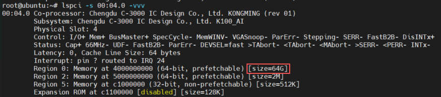
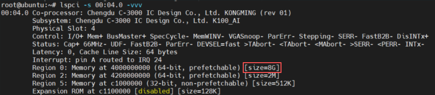
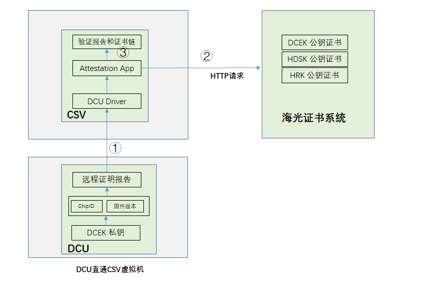

# 1. 功能描述

某些应用场景需要在加密虚拟机中运行图像识别、机器学习等算法，这些场景下使用DCU加速卡可以极大地提高计算性能。加密虚拟机（包括CSV虚拟机、CSV2虚拟机、CSV3虚拟机）支持设备直通，可以将DCU卡直通给机密虚拟机使用。

本文档包含三部分内容：

* DCU直通加密虚拟机（也称半机密模式）
  
  将DCU直通到加密虚拟机，在加密机密环境中运行DCU。

* 全机密模式
  
  作为DCU直通加密虚拟机的增强版，机密虚拟机和DCU卡之间通过PCIE总线传输数据，传输的数据被DCU软件栈加密，密钥由安全处理器管理。DCU支持显存隔离功能，用户数据放在隔离显存中处理，SDMA无法访问。原理参考[异构机密计算全机密模式](<../../01. 技术白皮书/05. 异构机密计算全机密模式技术介绍.md>)章节的内容。

* DCU attestation
  
  DCU attestation用来向用户证明DCU卡是真实的海光DCU，而不是伪造的DCU。

我们使用qemu启动加密虚拟机，借助vfio将DCU直通给加密虚拟机，就可以在加密虚拟机中直接使用DCU设备。

# 2. 测试环境要求与推荐

- CPU要求：支持CSV，参考[01.环境部署-01.环境要求](<../01. 环境部署/01. 环境要求.md>)

- DCU要求：K100-AI

- 软件环境推荐
  
  龙蜥环境：

| 类别       | 详情                        | 说明                                                         |
| ---------- | --------------------------- | ------------------------------------------------------------ |
| 主机系统   | AnolisOS-8.10               | 参考[01.环境部署-02.安装操作系统](<../01. 环境部署/02. 安装操作系统.md>) 进行获取安装 |
| 主机内核   | 5.10-anolis                 | 获取：https://gitee.com/anolis/cloud-kernel/tree/devel-5.10 本文档基于commit id为 a33879e5cc7d 进行验证 <br />编译：make anolis\_defconfig \&\& make rpm-pkg -j$(nproc --ignore=4) -s LOCALVERSION=-anolis |
| qemu       | QEMU emulator version 8.2.2 | 获取:  git clone  https://gitee.com/anolis/qemu-kvm.git -b devel-8.2<br />本文档基于commit id为a5a7e87e8280f 进行验证并打上了待合入的patch 打patch方式：git fetch https://gitee.com/anolis/qemu-kvm.git pull/97/head:pr\_97;git checkout pr\_97 <br />编译：mkdir -p build \&\& cd build \&\& ../configure --target-list=x86\_64-softmmu --sysconfdir=/etc/ --audio-drv-list= --disable-docs --disable-curl --enable-kvm --enable-slirp --prefix=/opt/qemu\_anolis --extra-ldflags=-lrt \&\& make -j128 \&\& sudo make install |
| 虚拟机镜像 | AnolisOS-8.10               | 参考[03.测试加密虚拟机-01.安装CSV虚拟机依赖](<01. 安装CSV虚拟机依赖.md>)进行获取 |
| 虚拟机内核 | 5.10-anolis                 | 与主机内核保持一致                                           |
| edk2       | 系统自带最新版本            | 获取：yum install -y edk2-ovmf-20220126gitbb1bba3d77-13.0.1.an8.10.noarch <br />位置：/usr/share/edk2/ovmf/OVMF\_CODE.cc.fd |

openEuler环境：

| 类别       | 详情                      | 说明                                                         |
| ---------- | ------------------------- | ------------------------------------------------------------ |
| 主机系统   | openEuler 24.03 (LTS-SP2) | 参考[01.环境部署-02.安装操作系统](<../01. 环境部署/02. 安装操作系统.md>) 进行获取安装 |
| 主机内核   | 6.6.0-euler               | 获取：https://atomgit.com/openeuler/kernel.git <br />本文档基于commit id为adbe47b6cb32进行验证<br />需要git revert d57dfffb41b67 从而Revert "PCI: Enable ACS after configuring IOMMU for OF platforms" <br />编译：make openeuler\_defconfig; make -j$(nproc) -s LOCALVERSION=-euler rpm-pkg |
| qemu       | qemu-8.2.0                | 获取:  git clone -b qemu-8.2.0 https://gitcode.com/openeuler/qemu.git <br />本文档基于3a3c82a1c8验证 <br />编译：mkdir -p build \&\& cd build \&\& ../configure --target-list=x86\_64-softmmu --sysconfdir=/etc/ --audio-drv-list= --disable-docs --disable-curl --enable-kvm --enable-slirp --prefix=/opt/qemu\_euler --extra-ldflags=-lrt \&\& make -j128 \&\& sudo make install |
| 虚拟机镜像 | openEuler 24.03           | 参考[03.测试加密虚拟机-01.安装CSV虚拟机依赖](<01. 安装CSV虚拟机依赖.md>)进行获取 |
| 虚拟机内核 | 6.6.0-euler               | 与主机内核保持一致                                           |
| edk2       | 系统自带最新版本          | 获取：yum install -y edk2-ovmf-202308-45.oe2403sp3.noarch <br />位置：/usr/share/edk2/ovmf.nosb/OVMF\_CODE.nosb.fd |

# 3. 测试DCU直通加密虚拟机

## 3.1. BIOS中开启iommu并在grub中使能

- 请参考[01.环境部署-01.环境要求](<../01. 环境部署/01. 环境要求.md>)章节中的DCU直通功能部分，在BIOS开启IOMMU

- 为满足DCU直通需求，需要在cmdline中设置“amd\_iommu=on”参数
  
  > 注意：DCU直通虚拟机后，是在虚拟机中使用DCU。如果您还要同时在Host上运行DCU，需要参考确认`5.2.Host中使用DCU的注意点`

- 主机系统起来后检查dcu设备的iommu group
  
  在有些机器上，DCU没有处在单独的iommu group，而是和其他外设或者bridge处在同一个iommu group中。设备直通要求iommu group中的所有设备要直通到虚拟机。对于这种情形，DCU就不能直通到虚拟机，需要设置Host内核，使得DCU设备出在单独的iommu group。
  
  通过如下命令查看每个设备的iommu group：
  
  ```
  #!/bin/bash
  for d in $(find /sys/kernel/iommu_groups/ -type l | sort -n -k5 -t/); do
      n=${d#*/iommu_groups/*}; n=${n%%/*}
      printf 'IOMMU Group %s ' "$n"
      lspci -nns "${d##*/}"
  done;
  ```
  
  如果DCU（含Co-processor关键字的设备）和其他设备出现在同一个iommu group中，那么需要：
  
  1. 在Host内核上参考https://github.com/benbaker76/linux-acs-override 打上该patch，重新编译、安装内核。
  2. 在Host内核的cmdline中添加“ pcie\_acs\_override=downstream,multifunction”，更新grub
  3. 重启Host

## 3.2. Host启动DCU直通的加密虚拟机

* Host上安装DCU的fixup header插件
  
  ```sh
  $ wget https://download.sourcefind.cn:65024/directlink/8/c86-devkit/previous-release/csv/dcu/hycu_pci_fixup_header_0.4.4.bin
  $ chmod +x hycu_pci_fixup_header_0.4.4.bin
  $ sudo ./hycu_pci_fixup_header_0.4.4.bin
  ```
  
  安装完成后，验证当前fixup header版本，显示为0.4.4：
  
  ```sh
  $ cat /sys/module/hycu_pci_fixup_header/version
  0.4.4
  ```
  
  > **注意**：如果更改host kernel，如使用其他版本的Kernel，或者重新编译host kernel，必须要重新安装fixup header插件才能生效。

* 查看DCU设备的Vendor ID和Device ID
  
  通过下面命令找到DCU设备的Device ID和Vendor ID：
  
  ```sh
  $ lspci -nn | grep "Co-processor"
  07:00.0 Co-processor [0b40]: Chengdu Haiguang IC Design Co., Ltd. Device [1d94:6211] (rev 01)
  ```
  
  可以看到，示例设备的PCI地址为**07:00.0**，VendorID为**1d94**，Device Id为**6211**。
  
  > **注意**：不同机器上的卡的PCI地址不同、不同型号的DCU的Device ID不同，以实际为准。下面操作中请用DCU实际的PCI地址替换07:00.0，用实际的Device Id替换6211。

* Host加载VFIO驱动
  
  执行下面命令，在Host加载VFIO驱动：
  
  ```sh
  #部分内核上不存在vfio_virqfd，可以不用加载该模块
  $ sudo modprobe vfio_virqfd
  $ sudo modprobe vfio_pci
  $ sudo modprobe vfio_iommu_type1
  $ sudo modprobe vfio
  ```
  
  > **注意**：每次重启host后，启动虚拟机前，需要加载vfio驱动。

* 将DCU与DCU驱动解绑
  
  通过下面命令查看DCU当前绑定情况：
  
  ```sh
  $ lspci -s 07:00.0 -v | grep "Kernel driver"
  ```
  
  如果输出位空，那么表明当前Host上DCU没有绑定到到任何驱动，可以直接进行下一个步骤“将DCU绑定到VFIO驱动”。
  
  如果DCU已经绑定到DCU驱动，上面命令的输出为：
  
  ```sh
  $ lspci -s 07:00.0 -v | grep "Kernel driver"
  Kernel driver in use: hycu
  ```
  
  表明DCU当前在使用hycu驱动。我们将DCU和hycu驱动解绑：
  
  ```sh
  $ echo 0000:07:00.0 | sudo tee /sys/bus/pci/devices/0000:07:00.0/driver/unbind
  ```
  
  执行命令后，可以再次通过命令lspci -s 07:00.0 -v | grep "Kernel driver"验证，此时该命令输出为空。
  
  可以使用命令` sudo systemctl disable hymgr.service`永久禁止Host自动加载DCU驱动，需重启Host才能生效。

* 将DCU绑定到VFIO驱动
  
  执行下面命令将DCU绑定到VFIO驱动，再次查看DCU的当前驱动为`vfio-pci`：
  
  ```sh
  $ echo 1d94 6211 | sudo tee /sys/bus/pci/drivers/vfio-pci/new_id
  $ lspci -s 07:00.0 -v | grep "Kernel driver"
  Kernel driver in use: vfio-pci
  ```
  
  同时也可以看到，在目录`/dev/vfio`下会产生名为DCU设备所在iommu group的ID文件，例如，本机上DCU的iommu group为16，显示如下：
  
  ```sh
  $ ls /dev/vfio
  16  vfio
  ```
  
  > **注意**：每次重启Host后，启动虚拟机前，需要重新绑定DCU到VFIO驱动。

* 运行直通DCU卡的加密虚拟机
  
  经过前面的准备工作，我们在Host上将DCU设备绑定到VFIO驱动，现在可以通过qemu启动加密虚拟机，将DCU直通到加密虚拟机中。
  
  启动直通DCU的加密虚拟机命令如下：（请按照你文件夹的情况调整命令中qemu、vm.qcow2、ovmf\_code.fd组件的位置，可参考`2.测试环境要求与推荐`）：
  
  ```sh
  $ sudo qemu-system-x86_64 -name csv-vm --enable-kvm -cpu host -smp 32 -m 64G -nographic \
         -hda /opt/hygon/csv/vm.qcow2 \
         -drive if=pflash,format=raw,unit=0,file=/opt/hygon/csv/OVMF_CODE.fd,readonly=on \
         -object sev-guest,id=sev0,policy=0x1,cbitpos=47,reduced-phys-bits=5 -machine memory-encryption=sev0 \
         -device vfio-pci,host=07:00.0 \
         -fw_cfg name=opt/ovmf/X-PciMmio64Mb,string=131072 \
         -net user,hostfwd=tcp::2222-:22 \
         -net nic
  ```
  
  其中：
  
  - `-object sev-guest,id=sev0,policy=0x1,cbitpos=47,reduced-phys-bits=5 -machine memory-encryption=sev0` 其中policy=0x1表示启动CSV虚拟机；若是启动普通非加密虚拟机，则可以完全删除这一行；若是启动CSV2虚拟机，修改policy值为0x5；若是启动CSV3虚拟机，修改policy值为0x45
  
  * `-device vfio-pci,host=07:00.0` 指定DCU的PCI地址，例程中为`07:00.0`，用户需要更改自己DCU的实际PCI地址
  *  `-fw_cfg name=opt/ovmf/X-PciMmio64Mb,string=131072`指定vfio mmio bar的大小。
  
  > **注意**：
  > 
  > 1. 不同的DCU的VRAM大小可能不同，此处对于64G的VRAM的DCU，指定`sring=131072`；32G的VRAM的DCU，需要指定更改为`string=65536`。
  > 2. 如果有多个DCU卡需要直通到CSV虚拟机，在上述命令中添加一行`-device vfio-pci,host=xx:yy.z` ，xx:yy.z为新增DCU卡的设备地址。同时将参数`-fw_cfg name=opt/ovmf/X-PciMmio64Mb,string=131072`按照线性比例调整。
  
  虚拟机启动后，登录虚拟机，确认是否正常启动加密虚拟机，如下为CSV3虚拟机显示示例:
  
  ```
  $ dmesg | grep CSV
  [    0.570143]  HYGON CSV
  [    0.571143]  HYGON CSV2
  [    0.572141]  HYGON CSV3
  [   10.384354] kvm_amd: KVM is unsupported when running as an CSV guest
  ```
  
  在虚拟机中查看到DCU设备，说明DCU直通虚拟机成功：
  
  ```
  $ lspci | grep "Co-processor"
  00:04.0 Co-processor: Chengdu Haiguang IC Design Co., Ltd. Device 6211 (rev 01)
  ```

## 3.3. 在加密虚拟机中安装DCU环境

这一小节说明如何在虚拟机中安装DCU的运行环境，包括安装驱动与拉取开箱即用的vllm docker容器。为保证环境一致，建议虚拟机使用root权限操作。

进入虚拟机终端，确保虚拟机网络畅通。

* 虚拟机中安装DCU驱动
  
  ```shell
  $ wget -c https://download.sourcefind.cn:65024/directlink/8/c86-devkit/previous-release/csv/dcu/dtk-25.04.1-tee/rock-6.3.14-V1.13.0-tee.run -O rock-6.3.14-V1.13.0-tee.run
  $ chmod +x rock-6.3.14-V1.13.0-tee.run
  $ CSV_PLATFORM=on ./rock-6.3.14-V1.13.0-tee.run
  ```

​	安装完成后，禁止虚拟机的selinux。打开`/etc/selinux/config`文件，修改`SELINUX`为`SELINUX=disabled`

- 虚拟机中更新DCU的VBIOS
  
  > **注意**：部分机器在使用hyflash工具烧写vbios时会报错drv\_get\_devtype\_via\_opn(),148: Unrecognized HCU，原因是该版本hyflash对一些新的机器主板没有做标记识别，但不影响正常的烧录行为，我们看到successfully burned the VBIOS就说明烧写操作成功。
  
  如果测试**半机密模式**，在安装DCU驱动时，已经对普通vbios做了烧写，可以重启Host使其生效。也可以通过如下命令对其烧写：
  
  ```shell
  $ /opt/hyhal/firmware/vbios/hyflash --index a --update /opt/hyhal/firmware/vbios/ZD/K100_AI-5.721.001200r.745344.bin --ecc off
  ```
  
  烧写完成后，重启物理主机使之生效。通过在虚拟机中执行 `/opt/hyhal/bin/hy-smi --showvbios` 确认DCU已经烧录我们想要的版本。
  
  如果测试**全机密模式**，需要通过如下命令对其用于隐藏VRAM功能的vbios进行烧写：
  
  ```shell
  $ /opt/hyhal/firmware/vbios/hyflash --index a --update /opt/hyhal/firmware/vbios/ZD/TEE_K100_AI-5.721.001200r.780093.bin --ecc off
  ```
  
  烧写完成后，重启Host使之生效。通过在虚拟机中执行`/opt/hyhal/bin/hy-smi --showvbios` 确认DCU已经烧录我们想要的版本。通过如下操作确认DCU驱动已经识别当前为**全机密模式**：
  
  ```shell
  $ cat /sys/devices/virtual/kfd/kfd/topology/nodes/1/properties | grep cc_mode
  ```
  
  输出为1表示开启了**全机密模式**
  
  非机密模式/半机密模式下，dcu设备可见vram大小为如图所示的64G：
  
  
  
  全机密模式下，查看dcu设备可见vram大小，为如图所示的8G：
  
  
  
  全机密模式下，DCU卡上的显存被分为普通显存和隔离显存，8G为普通显存（也称共享显存），剩下56G为隔离显存，CSV虚拟机使用隔离显存存放模型数据和用户数据，主机无法读写隔离显存。更详细的介绍可以参考[异构机密计算全机密模式介绍](<../../01. 技术白皮书/05. 异构机密计算全机密模式技术介绍.md>)。

- 虚拟机中确认DCU驱动加载正常
  
  在上述驱动安装，vbios烧写，Host重启后，再启动虚拟机在虚拟机中执行下面命令，确认驱动加载正常：
  
  ```
   $ /opt/hyhal/bin/hy-smi
   ============================ System Management Interface =============================
   ======================================================================================
   DCU     Temp     AvgPwr     Perf     PwrCap     VRAM%      DCU%      Mode
   0       47.0C    15.0W      auto     450.0W     0%         0.0%      Normal
   ======================================================================================
   =================================== End of SMI Log ===================================
  ```

- 虚拟机中拉取并启动dtk docker容器
  
  > 注意：由于docker容器占用磁盘空间较大，请提前确保虚拟机磁盘容量足够50G，可参考5.1.虚拟机镜像扩容 对镜像进行扩容。
  
  ```
  $ docker pull haigon.cn/test/vllm:0.8.5-ubuntu22.04-dtk25.04.1-py3.10-tee
  ```
  
  启动docker容器
  
  ```shell
  $ docker run -it \
  --name csv_test \
  -u root \
  --privileged \
  --network=host \
  --ipc=host \
  --shm-size=64G \
  --device=/dev/kfd \
  --device=/dev/mkfd \
  --device=/dev/dri \
  -v /opt/hyhal:/opt/hyhal \
  --group-add video \
  --cap-add=SYS_PTRACE \
  --ulimit stack=-1:-1  --ulimit memlock=-1:-1 \
  --security-opt seccomp=unconfined \
  -v /root:/root \
  haigon.cn/test/vllm:0.8.5-ubuntu22.04-dtk25.04.1-py3.10-tee \
  /bin/bash
  ```

## 3.4. 简易用例的测试

这里使用一个简单的向量加法示例演示DCU并行计算。在CSV虚拟机中下载`HIP-Examples`仓库，编译、运行其中的`vectorAdd`测试程序。

- 在容器中下载测试用例并编译测试
  
  ```sh
  $ git clone https://github.com/ROCm-Developer-Tools/HIP-Examples.git
  $ cd HIP-Examples/vectorAdd
  $ make
  $ HIP_LOG_LEVEL=4 HIP_MODULE_MASK=0x7fffffff HIP_ENABLE_LIST=hip HIP_LOG_OUTPUT_PATH="./" ./vectoradd_hip.exe
  System minor 2
  System major 9
  agent prop name K100_AI
  hip Device prop succeeded
  PASSED!
  ```
  
  显示PASSED!表示通过，其中`agent prop name`因卡不同会有差异。

- **全机密模式**检查
  
  如果测试**全机密模式**，需要额外检查log确认全加密模式生效，测试**半机密模式** 不需要进行，测试通过则表示成功。
  
  **全机密模式**检查log的方式：
  
  ```shell
  $ /opt/hyhal/bin/hiplogdump sort "$(ls -t ./*.nano 2>/dev/null | head -n 1)" | grep "encrypted"
  thread=0x111abb00 writeBufferEncTrans: h2d using encrypted transmission, buf size 0x400000
  thread=0x111abb00 writeBufferEncTrans: h2d using encrypted transmission, buf size 0x400000
  thread=0x111abb00 readBufferEncTrans: d2h using encrypted transmission, buf size 0x400000
  ```
  
  看到`using encrypted transmission`打印表示**全机密模式**下的传输加密功能正常。

## 3.5. 大模型部署与调用

- 拉取通用大模型
  
  作为演示，我们使用Qwen2.5-7B-Instruct模型，从 https://www.modelscope.cn/models/Qwen/Qwen2.5-7B-Instruct 下载，保存到CSV虚拟机的/root/models目录下，以下操作也都在容器中进行。
  
  ```shell
  $ pip install modelscope
  $ mkdir -p /root/models/Qwen/Qwen2.5-7B-Instruct
  $ modelscope download --model Qwen/Qwen2.5-7B-Instruct --local_dir /root/models/Qwen/Qwen2.5-7B-Instruct
  ```

- 基于vllm部署大模型
  
  ```
  $ vllm serve /root/models/Qwen/Qwen2.5-7B-Instruct --trust-remote-code  --dtype float16 --max-model-len 4096  --served-model-name qwen --disable-log-requests --enforce-eager --gpu-memory-utilization 0.85 -tp 1
  ```
  
  > 注意：使用多卡的话，需要将tp的值做相应修改。同时，需要确保cmdline中没有设置 mem\_encrypt=on的参数。测试全机密多卡时，由于K100-AI上全机密不支持卡与卡之间的直接通讯，需要在vllm server之前加上NCCL\_P2P\_DISABLE=1环境变量取消设备之间的P2P

- 基于vllm调用大模型
  
  开一个虚拟机终端，并调用/opt/hyhal/bin/hy-smi可以看到dcu运行状态，在进行后续的对话时可以查看到DCU处于占用状态。
  
  ```
  watch -n 1 "/opt/hyhal/bin/hy-smi"
  ```
  
  重新开启一个docker终端作为client端调用：
  
  ```
  $ docker exec -it csv_test /bin/bash
  $ curl -X POST -H "Content-Type:application/json" http://localhost:8000/v1/chat/completions  -d '{"model": "qwen","messages": [{"role": "user","content": "介绍诗人李白"}],"stream":false }'
  ```
  
  示例输出：
  
  ```
  {"id":"chatcmpl-c897f499efa14f8f8d6ae172876be559","object":"chat.completion","created":1770365636,"model":"qwen","choices":[{"index":0,"message":{"role":"assistant","reasoning_content":null,"content":"李白（701年－762年），字太白，号青莲居士，唐代伟大的浪漫主义诗人，被后人誉为“诗仙”。他与杜甫并称为“李杜”，是盛唐文化的重要代表人物。\n\n李白出生于中亚碎叶城（今吉尔吉斯斯坦境内），幼时随父迁至绵州昌隆县（今四川江油）。他的诗歌以豪放飘逸著称，擅长描绘自然景象和抒发个人情感。李白的诗作题材广泛，风格多样，既有雄奇壮丽的边塞诗，也有清新明快的山水田园诗，更有深沉悲凉的咏怀诗。他的诗歌语言流畅、想象丰富、意境深远，具有极高的艺术价值和历史价值。\n\n李白一生经历了唐玄宗开元盛世到安史之乱的动荡时期，他的诗作也反映了当时社会的变迁和个人的遭遇。李白的诗歌对后世影响深远，不仅在中国文学史上占有重要地位，而且在世界文学史上也有着不可忽视的影响。\n\n李白的代表作品包括《静夜思》、《将进酒》、《望庐山瀑布》等。其中，《静夜思》表达了他对故乡的思念之情；《将进酒》展现了他豪迈不羁的性格和积极乐观的生活态度；《望庐山瀑布》则通过描写壮观的自然景观来表达对自由的向往。\n\n李白的一生虽然短暂，但他留给后世无数珍贵的文化遗产，成为中国乃至世界文学宝库中的瑰宝之一。","tool_calls":[]},"logprobs":null,"finish_reason":"stop","stop_reason":null}],"usage":{"prompt_tokens":32,"total_tokens":360,"completion_tokens":328,"prompt_tokens_details":null},"prompt_logprobs":null}
  ```
  
  > 注意：如果无任何输出，大部分原因是有设置网络代理，临时屏蔽网络代理再测。

# 4. 测试 DCU Attestation

## 4.1. 背景

从深算二号(K100-AI)开始,海光DCU开始支持Attestation(身份认证)功能，DCU Attestation的目的是向DCU加速器的使用者证明，正在使用中的DCU设备具有真实身份，其芯片ID、固件版本、硬件环境等相关数据皆为真实可信，用户可将机密数据下发到DCU中计算，无需担心数据被恶意的加速器窃取。

## 4.2. 认证机制

每一颗DCU芯片拥有唯一的芯片ID(ChipID)，在芯片生产时烧入，以后无法更改。芯片内置一SM2密钥对(DCEK, DCU Chip Endorsement Key)，私钥作为DCU芯片的身份象征，只保存在DCU芯片，永不外泄。公钥被HDSK(海光DCU签名密钥)/HRK(海光根密钥)签名后，存放于海光证书系统中，可公开下载。



如上图所示，认证过程如下：

1. CSV虚拟机启动完毕后，用户加载DCU驱动识别DCU卡。用户运行Attestation App通过DCU驱动向DCU卡请求远程认证报告。DCU卡生成远程认证报告，内容包含DCU芯片ID，固件版本等信息，并使用DCEK私钥签名，返回给用户。
2. 用户从远程认证报告中取出DCU芯片ID，向海光证书系统请求该芯片的DCEK/HDSK/HRK公钥证书。
3. 用户依次验证HRK-\>HDSK-\>DCEK证书链的签名，并使用DCEK证书中的公钥验证远程认证报告的签名。

上述第3步全部验证通过，可认为该DCU芯片为真实的海光芯片，报告中的数据真实可信。验证过程中任一步失败，则验证过程失败。

海光提供了Attestation demo，演示了CSV虚拟机用户向DCU请求认证报告、获取认证报告、下载证书链、验证远程报告、验证证书链的全过程。该demo程序仅做展示，用户可根据需要修改或重新编写。

## 4.3. 测试

假设CSV中直通DCU的环境已经搭建完毕，CSV虚拟机能够访问DCU。拷贝主机中目录`/opt/hygon/csv/attestation`到CSV虚拟机中，其中的`dcu_attestation_demo.c`为演示DCU远程证明的示例程序。拷贝主机中目录/opt/gmssl到CSV虚拟机中的/opt/gmssl目录下作为编译所需库。

> 主机中/opt/hygon/csv/attestation 参考[01.环境要求-01.安装操作系统 ](<../01. 环境部署/02. 安装操作系统.md>)中的“下载测试代码仓库”步骤获取，主机中的/opt/gmssl目录参考[01.环境要求-01.安装公共软件](<../01. 环境部署/03. 安装公共软件.md>) 的“安装devkit”步骤获取。

* 在线远程认证
  
  如果您的CSV虚拟机能够直接连接海光证书服务器( https://cert.hygon.cn/ )，请直接编运行，示例程序将自动完成DCU认证过程。
  
  ```sh
  $ cd attestation
  $ make
  $./dcu_attestation_demo
  ```

* 手动认证
  
  如果您的CSV虚拟机无法连接海光证书服务器，则需要手动下载证书，再将下载的证书放置于dcu\_attestation\_demo程序的所在的目录下，执行下面步骤:
  
  1. 运行demo程序，获取DCU ChipID
  
    ```sh
    $ ./dcu_attestation_demo
    ```
  
  该程序会打印出DCU ChipID，并打印证书下载失败的日志，然后退出。
  
    ```sh
    chip_id
    T6N69800002080601
    ```
  
  如上日志所示，该DCU的ChipID为”T6N6980002080601”。
  
  2. 手动下载该芯片的HSK\_CEK证书
  
    ```sh
    $ curl -s -f -o hsk_cek.cert https://cert.hygon.cn/hsk_cek?snumber=T6N6980002080601
    ```
  
  命令完成后，在当前目录下生成hsk\_cek.cert文件，文件包含HSK证书和CEK证书，再手动传到attestation目录下。
  
  3. 手动下载HRK证书
  
    ```sh
    $ curl -s -f -o ./hrk.cert https://cert.hygon.cn/hrk
    ```
  
  命令完成后，在当前目录下生成hrk.cert，再手动传到attestation目录下。
  
  4. 再次运行attestation demo程序，完成DCU身份验证
  
    ```sh
    $ ./dcu_attestation_demo
    ```

# 5. 常见问题

## 5.1. 虚拟机镜像扩容操作

由于异构机密计算中需要使用大模型推理，虚拟机空间占用较大，可以提前安装以下操作为虚拟机镜像磁盘扩容

- 在Host上执行下面命令为虚拟机磁盘镜像增加500G的容量
  
  ```
  $ qemu-img resize vm.qcow2 +500G
  ```
  
  > 注意：此处增加的是虚拟容量，并不是文件vm.qcow2 的真实容量。

- 启动虚拟机，在虚拟机内部将扩充的容量加入虚拟机的磁盘分区中。
  
  ```
  $ growpart /dev/sda N
  $ resize2fs /dev/sdaN
  ```
  
  > 注意，将上述命令中的N换成虚拟机中通过lsblk命令查看的真实磁盘分区号。

## 5.2. Host中使用DCU的注意点

在Host使用DCU时，当bios中SMEE内存加密使能、且使能iommu，如果Host的cmdline中设置了“mem\_encrypt=on”，请确保iommu不要处于pt模式，需要**删除**Host cmdline中的“iommu=pt”。修改Host的cmdline后，需要更新grub，重启生效。
