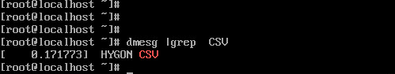
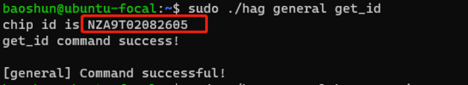
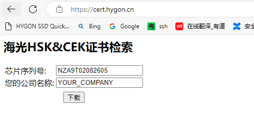

## 功能描述

CSV 虚拟机支持在线迁移，本文档描述CSV虚拟机迁移测试步骤

openEuler-24.03-LTS系统上该功能暂时有问题，使用该系统的不验证该功能。

## 测试CSV虚拟机迁移

如果测试csv2虚拟机需要将下面参数中policy设置为0x5，测试csv3虚拟机policy设置为0x45。

### 迁移源端启动虚拟机

```
sudo qemu-system-x86_64 \
  -name csv_send \
  --enable-kvm \
  -cpu host \
  -m 4096 \
  -smp 2 \
  -drive if=pflash,format=raw,unit=0,file=/opt/hygon/csv/OVMF_CODE.fd,readonly=on \
  -object sev-guest,id=sev0,policy=0x1,cbitpos=47,reduced-phys-bits=5 \
  -machine q35,memory-encryption=sev0 \
  -vnc 0.0.0.0:0 \
  -device virtio-blk-pci,scsi=off,drive=drive0,disable-legacy=on,iommu_platform=on \
  -drive file=/opt/hygon/csv/vm.qcow2,if=none,id=drive0 \
  -qmp tcp:localhost:4444,server,nowait \
  -nographic
```

欧拉虚拟机需要增加-drive if=pflash,format=raw,unit=1,file=/opt/hygon/csv/OVMF\_VARS.fd参数

### 迁移目标端启动虚拟机

```
sudo qemu-system-x86_64 \
  -name csv_receive \
  --enable-kvm \
  -cpu host \
  -m 4096 \
  -smp 2 \
  -drive if=pflash,format=raw,unit=0,file=/opt/hygon/csv/OVMF_CODE.fd,readonly=on \
  -object sev-guest,id=sev0,policy=0x1,cbitpos=47,reduced-phys-bits=5 \
  -machine q35,memory-encryption=sev0 \
  -vnc 0.0.0.0:1 \
  -device virtio-blk-pci,scsi=off,drive=drive0,disable-legacy=on,iommu_platform=on \
  -drive file=/opt/hygon/csv/vm.qcow2,if=none,id=drive0 \
  -qmp tcp:localhost:4445,server,nowait \
  -incoming tcp:127.0.0.1:6666 \
  -nographic

```

欧拉虚拟机需要增加-drive if=pflash,format=raw,unit=1,file=/opt/hygon/csv/OVMF\_VARS.fd参数

注：这里测试是本机迁移，设置ip为**127.0.0.1**，跨机迁移ip需要设置对应机器的ip地址

此时，迁移源端可以正常登录操作，迁移目标端处于等待接收迁移数据的状态。

send端：



receive端：


图 VNCViewer连接迁移源端和迁移目标端

### 导出迁移目标端证书

```
$ cd /opt/hygon/bin
$ sudo ./hag csv export_cert_chain
$ cat hsk.cert hrk.cert > vendor_cert.bin && \
    cat pek.cert oca.cert cek.cert > plat_cert.bin && \
    cat pdh.cert > pdh.bin && \
    base64 -w 0 vendor_cert.bin > vendor_cert.base64 && \
    base64 -w 0 plat_cert.bin > plat_cert.base64 && \
    base64 -w 0 pdh.bin > pdh.base64
$ sudo chmod 666 *.base64
# 将 receive 端平台的证书拷贝到发送端所在的机器上,send_ip 为发送端主机的ip地址
$ sudo scp *.base64 send_host@send_ip:/tmp
```

#### 离线导出证书

如果机器不能连接外网，提供离线方式，如下方式是对上面步骤
*sudo ./hag csv export\_cert\_chain*的替换

获取芯片chip ID



网站下载HSK，CEK证书



将证书文件hygon-hsk-cek-cert-NZA9T02082605.bin
拷贝到机器上的 /opt/hygon/bin/目录，生成hsk.cert,cek.cert

```
$ dd if=hygon-hsk-cek-cert-NZA9T22092805.bin  bs=1  count=832 of=hsk.cert
$ dd if=hygon-hsk-cek-cert-NZA9T22092805.bin  bs=1 skip=832 count=2084 of=cek.cert
```

下载HRK证书,拷贝hrk.cert 到/opt/hygon/bin 目录

```
$ wget -O  hrk.cert https://cert.hygon.cn/hrk
$ scp hrk.cert  user@your_machine_ip:/opt/hygon/bin/
```

生成pdh.cert,pek.cert,oca.cert

```
$ cd /opt/hygon/bin
$ sudo ./hag csv pdh_cert_export
$ dd if=cert_chain.cert  bs=1  count=2084 of=pek.cert
$ dd if=cert_chain.cert  bs=1 skip=2084 count=2084 of=oca.cert
```

### 迁移源端发起迁移

```
$ sudo socat - tcp:localhost:4444
{"QMP": {"version": {"qemu": {"micro": 1, "minor": 2, "major": 4}, "package": "v4.2.1-42-g6e701de2d0-dirty"}, "capabilities": ["oob"]}}
{"execute":"qmp_capabilities"}
{"return": {}}
# 将 receive 端平台的证书设置到send 虚拟机中
{"execute":"migrate-set-parameters","arguments":{"sev-pdh":"/tmp/pdh.base64","sev-plat-cert":"/tmp/plat_cert.base64","sev-amd-cert":"/tmp/vendor_cert.base64"}}
{"return": {}}
# 执行迁移命令，这里测试是本机迁移，设置ip为127.0.0.1，跨机迁移ip需要设置对应机器的ip地址
{"execute":"migrate","arguments":{"uri":"tcp:127.0.0.1:6666"}}
{"return": {}}
# 虚拟机迁移结束会有如下输出
{"timestamp": {"seconds": 1760248296, "microseconds": 135706}, "event": "STOP"}
# 可以查看虚拟机迁移状态，下面字符串中的completed 表示迁移结束
{"execute": "query-migrate"}
{"return": {"status": "completed", "setup-time": 181, "downtime": 569, "total-time": 94703, "ram": {"total": 4316127232, "postcopy-requests": 0, "dirty-sync-count": 3, "multifd-bytes": 0, "pages-per-second": 10497, "downtime-bytes": 1872503, "page-size": 4096, "remaining": 0, "postcopy-bytes": 0, "mbps": 369.04656862952544, "transferred": 4360092611, "dirty-sync-missed-zero-copy": 0, "precopy-bytes": 242403454, "duplicate": 8630, "dirty-pages-rate": 0, "skipped": 0, "normal-bytes": 4288438272, "normal": 1046982}}}

```

### 等待迁移结束

在迁移完成时，通过VNC登录虚拟机查看，此时VNCViewer看到迁移源端的虚拟机已经停止响应；而迁移目的端的虚拟机沿着迁移源端停止的状态继续运行，并响应用户操作。

receive端：


图 迁移目标端继续运行迁移过来的虚拟机
