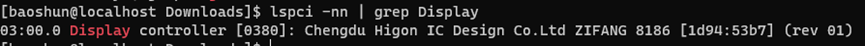

## 功能描述

某些应用场景需要在CSV2虚拟机中运行图像识别、机器学习等算法，这些场景下使用DCU加速卡可以极大地提高计算性能，CSV2虚拟机支持设备直通，可以将DCU卡直通给CSV2虚拟机使用。

## 测试CSV2虚拟机使用DCU卡

### 运行CSV2虚拟机

```
$ sudo qemu-system-x86_64 -name csv-vm --enable-kvm -cpu host -m 6114 -hda /opt/hygon/csv/vm.qcow2 -drive if=pflash,format=raw,unit=0,file=/opt/hygon/csv/OVMF_CODE.fd,readonly=on -qmp tcp:127.0.0.1:2222,server,nowait -vnc 0.0.0.0:1 -object sev-guest,id=sev0,policy=0x5,cbitpos=47,reduced-phys-bits=5 -machine memory-encryption=sev0 -netdev bridge,br=virbr0,id=net0 -device virtio-net-pci,netdev=net0,romfile= -nopraghic
```

### 在虚拟机中安装DCU软件栈

```
# dhclient
# scp host@hostip:/opt/hygon/csv/dcu/vm_dcu_sw_deploy.sh ./
# ./vm_dcu_sw_deploy.sh
# poweroff
```

### 将DCU卡分配给VFIO

找到DCU设备的设备标识、Device Id和Vendor Id

```
$ lspci -nn | grep Display
```

命令的执行效果如下图，该设备的VendorID为1d94, Device Id为53b7。



将DCU设备与VFIO模块关联

```
$ sudo modprobe vfio
$ sudo modprobe vfio-pci
$ sudo echo 0000:03:00.0 > /sys/bus/pci/devices/0000:03:00.0/driver/unbind
$ sudo -s
# echo 1d94 53b7 > /sys/bus/pci/drivers/vfio-pci/new_id
```

命令说明：示例中用到的设备标识、VendorID、DeviceID，请替换成上一步自己获取到的信息。对于第三条命令(unbind)，如果PCI设备已经与宿主机绑定，则需要执行；如未绑定，将不存在unbind文件，则无需执行。

### 运行直通DCU卡的CSV2虚拟机

```
$ sudo qemu-system-x86_64 -name csv-vm --enable-kvm -cpu host -m 10240 -hda /opt/hygon/csv/vm.qcow2 -drive if=pflash,format=raw,unit=0,file=/opt/hygon/csv/OVMF_CODE.fd,readonly=on -qmp tcp:127.0.0.1:2222,server,nowait -vnc 0.0.0.0:1 -object sev-guest,id=sev0,policy=0x5,cbitpos=47,reduced-phys-bits=5 -machine memory-encryption=sev0 -device vfio-pci,host=03:00.0 -fw_cfg name=opt/ovmf/X-PciMmio64Mb,string=65536 -netdev bridge,br=virbr0,id=net0 -device virtio-net-pci,netdev=net0,romfile= -nopraghic
```

### 在CSV2虚拟机中运行DCU测试程序

```
# git clone https://github.com/ROCm-Developer-Tools/HIP-Examples.git
# source /opt/dtk/env.sh
# cd HIP-Examples/vectorAdd
# make clean;make
# ./vectoradd_hip.exe
```

## BW1000测试大模型推理

### 将BW1000设备分配给VFIO

找到BW1000的设备信息

```
$ lspci -nn | grep 'Haiguang' |grep 'Co-processor'
```

示例输出：

```
05:00.0 Co-processor [0b40]: Chengdu Haiguang IC Design Co., Ltd. Device [1d94:6320] (rev 01)
```

将BW1000设备与VFIO模块关联

```
$ sudo modprobe vfio
$ sudo modprobe vfio-pci
$ sudo echo 0000:05:00.0 > /sys/bus/pci/devices/0000:05:00.0/driver/unbind
$ sudo -s
# echo 1d94 6320 > /sys/bus/pci/drivers/vfio-pci/new_id
```

### 运行直通BW1000的CSV2虚拟机

```
$ sudo qemu-system-x86_64 -name csv-vm --enable-kvm -cpu host -m 64G -smp 16 -hda /opt/hygon/csv/vm.qcow2 -drive if=pflash,format=raw,unit=0,file=/opt/hygon/csv/OVMF_CODE.fd,readonly=on -qmp tcp:127.0.0.1:2222,server,nowait -vnc 0.0.0.0:1 -object sev-guest,id=sev0,policy=0x5,cbitpos=47,reduced-phys-bits=5 -machine memory-encryption=sev0 -device vfio-pci,host=05:00.0 -fw_cfg name=opt/ovmf/X-PciMmio64Mb,string=131072 -netdev bridge,br=virbr0,id=net0 -device virtio-net-pci,netdev=net0,romfile= -nopraghic
```

说明：如果整机有多张BW1000卡，可以在命令行中添加多个`-device vfio-pci`参数，将多张卡都直通给CSV2虚拟机。

### 运行大模型推理

运行大模型推理，需要在虚拟机中安装BW1000的驱动程序，然后使用光合社区提供的容器镜像运行推理程序。

- 安装驱动程序

从光合社区下载驱动程序，并安装到虚拟机中。

```bash
$ wget https://download.sourcefind.cn:65024/directlink/6/dtk-25.04.2%E9%A9%B1%E5%8A%A8/rock-6.3.16-V1.1.0a.run
$ chmod +x rock-6.3.16-V1.1.0a.run
$ sudo ./rock-6.3.16-V1.1.0a.run
```

- 运行推理程序

从光合社区下载容器镜像，并启动容器。

```bash
$ docker pull image.sourcefind.cn:5000/dcu/admin/base/vllm:0.9.2-ubuntu22.04-dtk25.04.2-tx-1210-das1.7-py3.10-20251216
$ docker run -dit --gpus all --name ai-test -v /dev/shm:/dev/shm --ulimit core=-1:-1 image.sourcefind.cn:5000/dcu/admin/base/vllm:0.9.2-ubuntu22.04-dtk25.04.2-tx-1210-das1.7-py3.10-20251216
```

在容器中启动推理服务端。

```bash
$ docker exec -it ai-test /bin/bash
$ vllm serve Qwen2.5-7B-Instruct --trust-remote-code --distributed-executor-backend ray --dtype float16 --max-model-len 4096 -tp 1 --gpu-memory-utilization 0.95 --max-num-seqs 128 --served-model-name qwen  --port 8000
```

在容器中启动推理客户端。

```bash
$ docker exec -it ai-test /bin/bash
$ curl -X POST -H "Content-Type:application/json" http://localhost:8000/v1/chat/completions  -d '{"model": "qwen","messages": [{"role": "user","content": "介绍诗人李白"}],"stream":false }'
```

示例输出：

```
{"id":"chatcmpl-350663780ddc4a5d8b76d9ba62171db5","object":"chat.completion","created":1767059743,"model":"llama","choices":[{"index":0,"message":{"role":"assi
stant","reasoning_content":null,"content":"李白（701年—762年），字太白，号青莲居士，又号“谪仙人”，是唐代伟大的浪漫主义诗人，被后人誉为“诗仙”。他与杜甫并称为“李
杜”，其诗作在唐代影响深远，对后世产生了巨大的影响。\n\n李白的生平大致可以分为以下几个阶段：\n\n1. **少年时期**：李白出生于陇西成纪（今甘肃天水附近），自幼聪明
好学，尤其擅长书法和剑术。他的父亲李白曾担任蜀中道监察御史，因此李白自小就受到了良好的教育，并且有机会接触到丰富的文化知识。\n\n2. **青年时期**：李白在青年时期
游历了大半个中国，足迹遍布许多名山大川，如庐山、黄山等。这一时期，他结识了许多志同道合的朋友，如贺知章、杜甫等人，并且开始创作了大量的诗歌作品。其中，《静夜思
》《望庐山瀑布》等脍炙人口的诗篇就是在这一时期创作的。\n\n3. **中年时期**：李白在中年时期遭遇了仕途上的挫折，曾经多次被朝廷征召，但最终未能得到重用。他开始更加
专注于诗歌创作，并且开始游历各地，寻找自己的理想之地。这一时期，他创作了大量反映个人情感和思想的作品，如《将进酒》《梦游天姥吟留别》等。\n\n4. **晚年时期**：李
白晚年时，身体状况逐渐恶化，但他依然坚持创作。他曾在安史之乱期间被流放到夜郎，后来又被赦免回到长安。晚年时，李白的身体状况越来越差，最终在安徽当涂去世，享年六
十一岁。\n\n李白的诗歌风格独特，语言优美，意境深远，被誉为“诗仙”。他的诗歌题材广泛，既有对自然美景的赞美，也有对人生哲理的思考；既有对友情的歌颂，也有对爱情的
描写。他的诗歌不仅在中国文学史上占有重要地位，在世界文学史上也具有很高的声誉。","tool_calls":[]},"logprobs":null,"finish_reason":"stop","stop_reason":null}],"u
sage":{"prompt_tokens":22,"total_tokens":465,"completion_tokens":443,"prompt_tokens_details":null},"prompt_logprobs":null,"kv_transfer_params":null}
```
