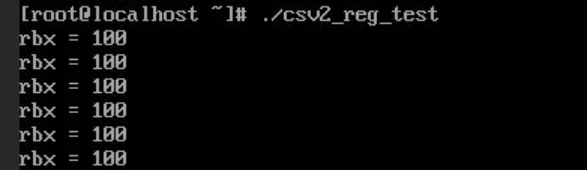
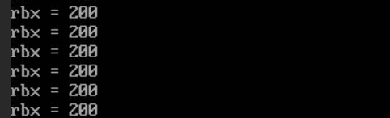
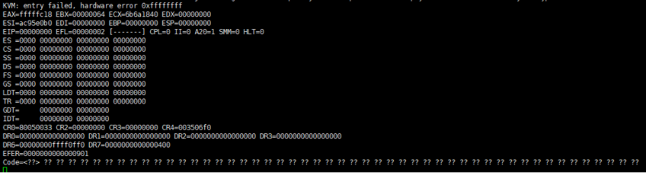

## 功能描述

3号CPU开始支持CSV2安全虚拟化功能，在CSV技术加密虚拟机内存的基础上，CSV2技术增加了虚拟机寄存器加密的功能，主机不能访问或者篡改CSV2虚拟机的寄存器。

## 测试CSV2虚拟机的寄存器加密功能

海光C86-3G 机器需要参考[环境要求](<../01. 环境部署/01. 环境要求.md>) 中 **BIOS安装及设置要求** 设置SEV-ES ASID Space Limit为3，使用空格键设置，因为该内核不支持动态分配CSV、CSV2 ASID 的能力。

### 升级主机内核

```
$ wget https://mirrors.edge.kernel.org/pub/linux/kernel/v5.x/linux-5.17.tar.gz 
$ tar -xvf linux-5.17.tar.gz
$ cd linux-5.17/
$ sudo /opt/hygon/csv/build_csv2_kernel.sh 
```

修改/etc/selinux/config ，设置SELINUX=disabled，完成后重启，内核选择5.17.0-csv2

### 运行普通虚拟机

运行普通虚拟机。

```
$ sudo qemu-system-x86_64 -name normal-vm --enable-kvm -cpu host -m 2048 -hda /opt/hygon/csv/vm.qcow2 -drive if=pflash,format=raw,unit=0,file=/opt/hygon/csv/OVMF_CODE.fd,readonly=on -qmp tcp:127.0.0.1:1111,server,nowait -vnc 0.0.0.0:0 -netdev bridge,br=virbr0,id=net0 -device virtio-net-pci,netdev=net0,romfile= -nographic
```

虚拟机启动后，登陆虚拟机,用户名为root，密码为root。

### 升级虚拟机内核

假设主机的用户名为user

```
# dhclient
# scp user@${host_ip}:/opt/hygon/csv/kernel.tgz  ./
# scp user@${host_ip}:/opt/hygon/csv/vm_kernel_install.sh ./
# ./vm_kernel_install.sh 
```

安装完成后,选择安装的内核重启虚拟机

### 普通虚拟机运行寄存器测试程序

假设主机的用户名为user

```
# dhclient
# scp user@${host_ip}:/opt/hygon/csv/csv2-reg-test/csv2_reg_test ./
# chmod 777 csv2_reg_rest
# ./csv2_reg_rest
```

测试程序循环执行设置虚拟机rbx 值为100并打印rbx。

图1 普通虚拟机修改寄存器打印



打开主机攻击程序，主机修改虚拟机rbx寄存器为200，虚拟机中打印rbx变为200。

```
$ sudo -s
# echo 1 >/sys/module/kvm/parameters/vm_reg_test
```

图2 主机修改普通虚拟机寄存器打印



关闭主机攻击程序，虚拟机中打印rbx恢复为100。

```
$ sudo -s
# echo 0 >/sys/module/kvm/parameters/vm_reg_test
```

### 运行CSV2虚拟机

```
$ sudo qemu-system-x86_64 -name csv2-vm --enable-kvm -cpu host -m 2048 -hda /opt/hygon/csv/vm.qcow2 -drive if=pflash,format=raw,unit=0,file=/opt/hygon/csv/OVMF_CODE.fd,readonly=on -qmp tcp:127.0.0.1:2222,server,nowait -vnc 0.0.0.0:1 -object sev-guest,id=sev0,policy=0x5,cbitpos=47,reduced-phys-bits=5 -machine memory-encryption=sev0 -nographic
```

虚拟机启动后，登陆虚拟机。

### 运行CSV2虚拟机寄存器测试程序

```
$ ./csv2_reg_rest
```

图3 CSV2虚拟机修改寄存器打印


打开主机攻击程序，主机修改虚拟机rbx寄存器为200，CSV2虚拟机无法继续执行，CSV2虚拟机可以阻止主机篡改虚拟机的寄存器。

```
$ sudo -s
# echo 1 >/sys/module/kvm/parameters/vm_reg_test
```

图4 主机修改CSV2虚拟机寄存器打印


