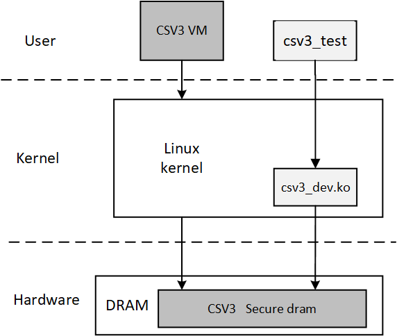
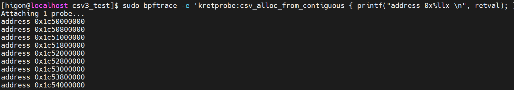
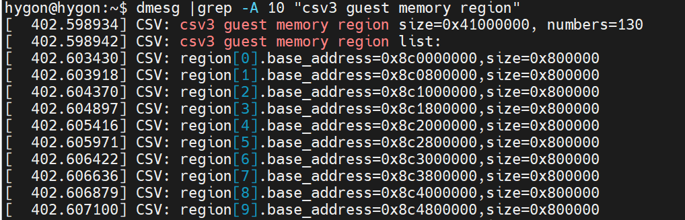
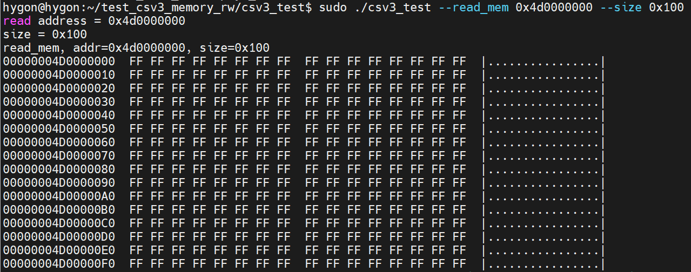

## 功能描述

C86-4G CPU支持CSV3安全虚拟化功能，在CSV/CSV2技术加密虚拟机内存和加密虚拟机寄存器的基础上，CSV3技术增加了虚拟机安全内存隔离、关键控制信息保护、嵌套页表完整性保护等功能。

本文演示读写CSV3虚拟机安全内存，展示内存访问隔离效果。

## 测试方案说明

### CSV3虚拟机内存物理地址

CSV3虚拟机所使用的安全内存由主机操作系统从系统内存中分配，并不映射到用户态地址空间，无法直接从用户进程中获取。
因此需要从主机操作系统内核中获取并打印出分配给CSV3虚拟机使用的内存地址，用于CSV3虚拟机内存读写测试。

### 测试用例说明

首先启动CSV3安全虚拟机，获取主机操作系统为CSV3虚拟机分配的内存物理地址；然后执行测试用例，对CSV3虚拟机内存执行读写测试。

测试用例主要包括用户层测试用例程序和内核层驱动程序两部分。如图1所示，csv3\_test为用户层测试用例程序，用于接收用户输入的CSV3虚拟机内存物理地址，并将该地址传递给内核层驱动，打印测试结果；csv3\_dev.ko为内核层驱动程序，用于对用户层传递的内存物理地址建立页表映射，进行内存读写，并将读取的内存数据返回给用户层。



<center>图1 测试用例框图</center>

## 测试过程

### 获取CSV3虚拟机内存地址

可以通过以下两种方式获取CSV3虚拟机内存地址，两种方式选择一种即可。

推荐使用方式一。

#### 方式一、通过bpftrace工具获取

该方式获取的优点为不需要修改和替换主机操作系统内核。

1: 安装bpftrace

在操作系统linux发行版中安装bpftrace工具:

```
$ sudo yum install bpftrace
```

或

```
$ sudo apt install bpftrace
```

2: 使用bpftrace工具探测CSV3虚拟机的内存物理地址

在启动CSV3虚拟机前执行以下命令，开始探测:

```
$ sudo bpftrace -e 'kretprobe:csv_alloc_from_contiguous { printf("address 0x%llx \n", retval); }'
```

3: 启动CSV3虚拟机

参考 [启动CSV3加密虚拟机](<08. 启动CSV3加密虚拟机.md>)

4: CSV3虚拟机启动完成后，bpftrace打印出探测到的内存地址。

bpftrace工具打印出CSV3虚拟机内存地址区间如下所示：


#### 方式二、通过修改操作系统内核源码打印获取

1： 在Linux内核源码arch/x86/kvm/svm/csv.c中添加打印，CSV3虚拟机启动过程中，打印出CSV3虚拟机使用的全部内存地址。

参考[csv3-memory-address-kernel-patch](https://gitee.com/anolis/hygon-cloud-kernel/commit/40d1732d942bebf4fc2281c06ea2f1ea46cb9341)提交修改内核源码

2: 重新编译并更新操作系统内核

参考[软件编译安装 - 内核安装](<../01. 环境部署/04. 软件编译安装.md>)

3: 开启csv.c文件debug级别log的动态打印

```
$ su root
# echo 'file csv.c +p' > /sys/kernel/debug/dynamic_debug/control
```

4: 启动CSV3虚拟机

参考 [启动CSV3加密虚拟机](<08. 启动CSV3加密虚拟机.md>)

5: 通过打印获取CSV3虚拟机安全内存地址

CSV3虚拟机启动完成后，在主机操作系统中执行dmesg ，并搜索“csv3 guest memory region”关键字，获取CSV3虚拟机安全内存区地址列表。

```
$ dmesg | grep -A 10 "csv3 guest memory region"
```

具体需要显示地址区域的个数取决于CSV3虚拟机启动参数中定义的内存大小。


### 获取测试用例代码

测试用例代码在/opt/hygon/csv/csv3-memory-rw-test目录下

### 编译测试代码、安装测试内核驱动module

```
$ cd /opt/hygon/csv
$ sudo ./build_devkit.sh
$ cd /opt/hygon/csv/csv3-memory-rw-test/host-module
$ sudo insmod csv3_dev.ko
```

编译完成的测试程序为/opt/hygon/csv/csv3-memory-rw-test/csv3\_test目录下的csv3\_test

### 执行读取CSV3虚拟机内存地址测试

使用第一步骤中获取的CSV3虚拟机的内存地址，选取其中的一段内存区间进行内存读取测试。

例如选取CSV3虚拟机内存的第一段内存区间0x8c0000000，执行测试程序，尝试读取CSV3虚拟机内存。

```
$ sudo ./csv3_test --read_mem 0x8c0000000 --size 0x100
```

打印出读取到的数据全部为”FF”。


说明：第一步骤中获取的地址区间为分配给CSV3虚拟机使用的全部内存地址，其中部分地址在虚拟机启动和运行过程中可能会被作为共享内存使用，因此可能存在读取部分地址时，能够读取到内存中的数据，不显示为全FF的情况；可以忽略这块内存区间，换用其他地址区间测试。
