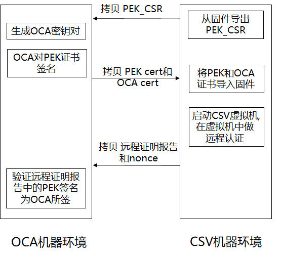
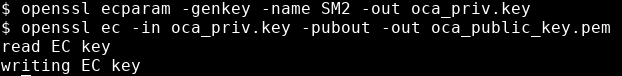
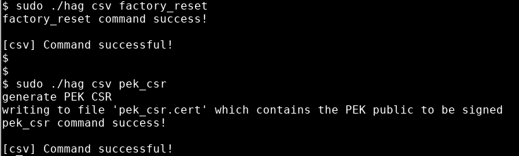
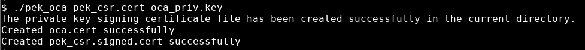
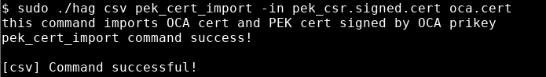
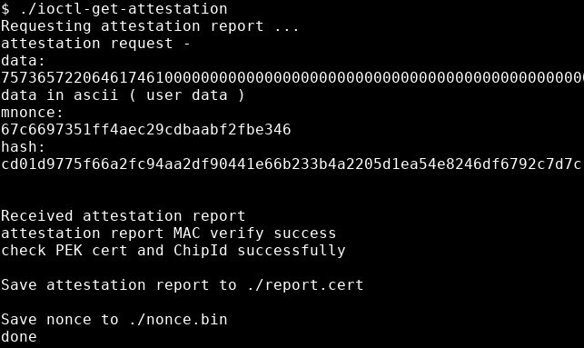
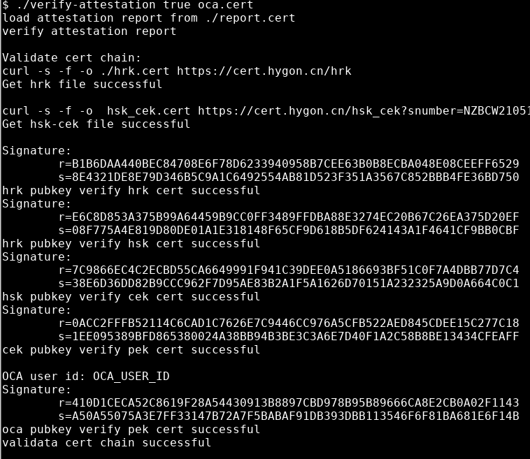
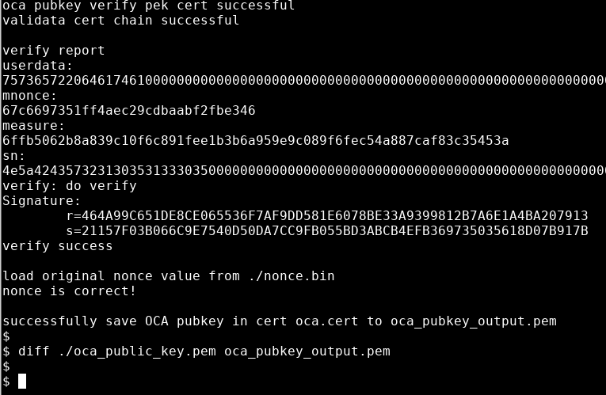

## 功能描述

关于OCA的概念，请参考[CSV远程认证技术介绍](<../../01. 技术白皮书/02. CSV远程认证技术介绍.md>)。

当平台所有者OCA与CSV固件所有者(CPU厂商)不同时，OCA可生成自己拥有的公私钥对，并对PEK证书签名。<br>
虚拟机用户请求的远程认证报告中包含了PEK的公钥证书，该证书包含了CEK和OCA两个签名。<br>
用户可用OCA公钥验证PEK证书中的OCA签名，若验证通过，可证明远程报告属于OCA(同时也属于CPU厂商)。<br>

本文测试了OCA产生密钥对和验签远程证明报告中的PEK签名的过程。

## 测试方案说明

### 测试环境

本测试包含两个机器环境：

1) CSV虚拟机运行机器环境：该机器运行CSV虚拟机
2) OCA机器环境：该机器为OCA所拥有，用于保存OCA的私密数据，比如OCA私钥。OCA需保证该环境的安全。
   <br>
   
   <br>

需要注意的是，生成OCA公私钥对和OCA对PEK证书签名的过程，需要使用OCA私钥，必须在OCA自己的环境中完成。<br>
对远程证明报告证明中的PEK签名的验证，只需用到OCA公钥，可以在OCA环境中完成，也可以在CSV环境或者其他环境中完成，<br>
本测试过程以在OCA环境中完成为例。

## 测试过程

### 在OCA机器环境： 生成OCA公私钥对

请先运行openssl version命令判断版本

#### openssl 1.1.1

生成私钥

```
openssl ecparam -genkey -name SM2 -out oca_priv.key
```

生成公钥

```
openssl ec -in oca_priv.key -pubout -out oca_public_key.pem
```



#### openssl 3.0.9

将下列代码复制到脚本中运行

```
#!/bin/bash

# Generate SM2 private key (raw EC format without extra parameters)
openssl genpkey -algorithm EC -pkeyopt ec_paramgen_curve:SM2 -pkeyopt ec_param_enc:named_curve -out sm2_key.pem

# SM2 curve parameters in Base64 encoding (from OpenSSL 1.1.1)
sm2_params_base64="BggqgRzPVQGCLQ=="

# Combine the SM2 private key into a format compatible with OpenSSL 1.1.1
output_key="oca_priv.key"
{
    echo "-----BEGIN EC PARAMETERS-----"
    echo "$sm2_params_base64"
    echo "-----END EC PARAMETERS-----"
    # Modify private key header to match EC private key format
    cat sm2_key.pem | sed 's/BEGIN PRIVATE KEY/BEGIN EC PRIVATE KEY/g' | sed 's/END PRIVATE KEY/END EC PRIVATE KEY/g'
} > "$output_key"

#generate the public key
openssl pkey -in sm2_key.pem -pubout -out oca_public.key

# Clean up temporary files
rm sm2_key.pem

# Output message indicating that the private key has been generated
echo "SM2 private key has been generated: $output_key"

# Output message indicating that the public key has been generated
echo "SM2 public key has been generated: oca_public.key"
```

### 在CSV机器环境： reset PEK，并产生PEK\_CSR：

reset PEK

```
sudo ./hag csv platform_shutdown
sudo ./hag csv factory_reset
sudo ./hag csv platform_init
```

产生PEK\_CSR

```
sudo ./hag csv pek_csr
```



此命令会产生pek\_csr.cert和pek\_csr\_readable.txt两个文件
pek\_csr.cert为PEK公钥签名请求文件，其中OCA签名字段为空，待OCA私钥签名。
将pek\_csr.cert拷贝到OCA环境中

### 在OCA机器环境： 用OCA私钥为PEK公钥签名和OCA公钥自签名

```
$ cd /opt/hygon/csv/
$ sudo ./build_devkit.sh
$ cd /opt/hygon/csv/pek_oca
```

```
$ ./pek_oca pek_csr.cert oca_priv.key
```



输入的oca\_priv.key和pek\_csr.cert分别为前两步流程中输出的文件，<br>
此命令将输出pek\_csr.signed.cert和oca.cert。<br>
pek\_csr.signed.cert包含了OCA私钥对PEK公钥的签名，oca.cert包含了OCA私钥对OCA公钥的签名。<br>

如果想为OCA的公钥添加自定义user id，可使用命令
<br>./pek\_oca pek\_csr.cert oca\_priv.key your\_userid<br>
否则OCA公钥的user id默认为OCA\_USER\_ID

将pek\_csr.signed.cert和oca.cert复制到CSV环境

### 在CSV机器环境： 导入签名后的PEK\_CSR和OCA自签名证书

(hag general version \>= 2257)

```
sudo ./hag csv pek_cert_import -in pek_csr.signed.cert oca.cert
```



### 在CSV机器环境： 启动虚拟机，生成远程证明报告

请参考
[测试内存加密 测试远程认证功能章节](<./02. 测试内存加密.md>)

将虚拟机中生成的远程报告report.cert和随机数文件nonce.bin拷贝到OCA环境



### 在OCA机器环境：验证远程证明报告中的PEK签名为OCA所签

```
cd /opt/hygon/csv/attestation/
./verify-attestation true oca.cert
```

其中oca.cert为步骤“用OCA私钥为PEK公钥签名和OCA公钥自签名”产生的OCA自签名公钥证书，用于验证证书中的PEK签名。<br>
此命令会使用oca.cert中的公钥验证远程证明报告中PEK公钥证书的OCA签名,<br>
此命令同时将oca.cert中的公钥保存为openssl pem格式的文件oca\_pubkey\_output.pem，<br>
用户可将其与第一步中生成的oca\_public\_key.pem对比，比较文件内容是否一致。<br>
验证过程还会打印出OCA公钥的USER ID，用户可人工对比是否与pek\_oca输入的USER ID一致。<br>
若全部一致，则证明:远程报告中的PEK中的OCA签名正确，且使用的公钥为OCA使用者产生，说明远程认证包含了正确的OCA签名。<br>



