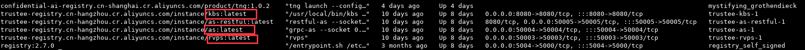
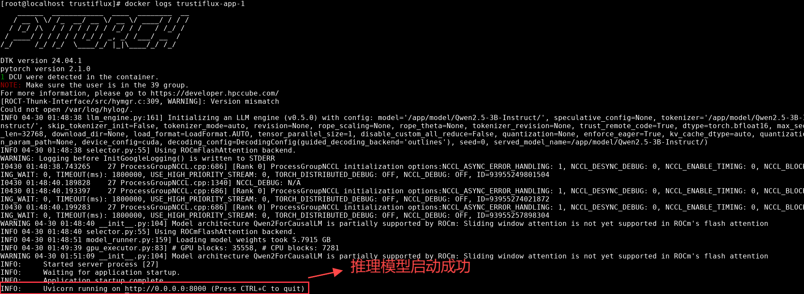
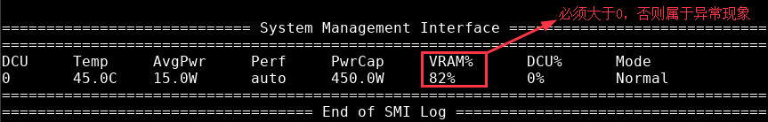
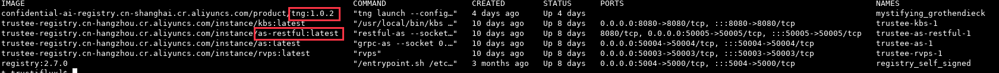
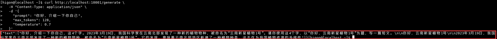
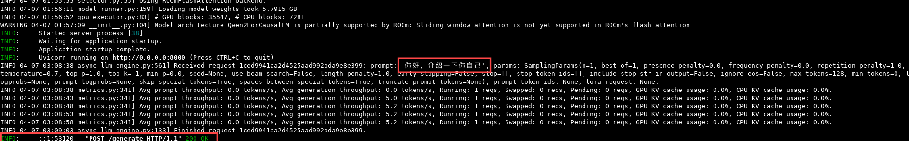

## 功能描述

部署Confidential AI 之前，要先准备好CSV虚拟机DCU 直通环境，DTK版本使用[DTK-25.04.1](https://download.sourcefind.cn:65024/directlink/1/DTK-25.04.1/Anolis8.4/DTK-25.04.1-Anolis8.4-x86_64.tar.gz)，驱动版本使用[rock-6.3.13-V1.12.0.run](https://download.sourcefind.cn:65024/directlink/6/dtk-25.04.1%E9%A9%B1%E5%8A%A8/rock-6.3.13-V1.12.0.run)，请参考[测试CSV虚拟机直通DCU](https://c86.sourcefind.cn/documents/2/1971517885863104556)准备DCU 直通环境。

如果想了解相关技术原理，请查看[CSV虚拟机Confidential\_AI技术介绍](<../../01. 技术白皮书/06. CSV虚拟机Confidential_AI技术介绍.md>)。

## 部署流程

### 加密模型

- 下载模型

```
pip3 install modelscope importlib-metadata 
modelscope download --model Qwen/Qwen2.5-3B-Instruct
```

- 准备加密模型工具

```
wget https://github.jobcher.com/gh/https://github.com/rfjakob/gocryptfs/releases/download/v2.4.0/gocryptfs_v2.4.0_linux-static_amd64.tar.gz 
# 解压并安装  
tar xf gocryptfs_v2.4.0_linux-static_amd64.tar.gz 
sudo install -m 0755 ./gocryptfs /usr/local/bin
```

- 生成密码文件

```
cat << EOF > ~/cachefs-password 
password
EOF
```

- 加密模型

```
PLAINTEXT_MODEL_PATH=~/.cache/modelscope/hub/Qwen/Qwen2.5-3B-Instruct/
mkdir -p ~/mount; cd ~/mount; mkdir -p cipher plain 
sudo yum install -y fuse
cat ~/cachefs-password | gocryptfs -init cipher 
cat ~/cachefs-password | gocryptfs cipher plain 
cp -r ${PLAINTEXT_MODEL_PATH} ~/mount/plain
cd ~/mount/; tar czvf Qwen2.5-3B-Instruct_encrypt.tgz cipher
```

将加密后的模型Qwen2.5-3B-Instruct\_encrypt.tgz 发布到云端。

### Trustee 部署

负责模型密钥管理，远程报告验证

```
git clone https://github.com/openanolis/trustee.git
cd trustee
git checkout fd326a0
yes | cp -f /opt/hygon/csv/cai/docker-compose_trustee.yml docker-compose.yml
mkdir -p ./kbs/data/attestation-service/token/ear/policies/opa/
# 设置kbs的策略
yes | cp  -f /opt/hygon/csv/cai/policy.rego kbs/config/docker-compose/policy.rego
# 设置grpc-AS cpu认证策略
yes | cp  -f /opt/hygon/csv/cai/policy.rego ./kbs/data/attestation-service/token/ear/policies/opa/default_cpu.rego
# 设置grpc-AS dcu认证策略
yes | cp -f /opt/hygon/csv/cai/default_dcu.rego ./kbs/data/attestation-service/token/ear/policies/opa/default_dcu.rego
# 设置grpc-AS的配置
yes | cp -f /opt/hygon/csv/cai/as-grpc-config.json ./kbs/config/as-grpc-config.json

# 创建一个非对称密钥，用于表征Trustee服务所有者的身份，以在服务启动后对一些关键策略和机密数据进行配置和修改
openssl genpkey -algorithm ed25519 > kbs/config/private.key
openssl pkey -in kbs/config/private.key -pubout -out kbs/config/public.pub
# 在kbs 中设置模型解密key
mkdir -p kbs/data/kbs-storage/default/key/
cp ~/cachefs-password kbs/data/kbs-storage/default/key/1
# 启动Trustee 相关组件
sudo docker compose up -d
```

红框中为模型部署Trustee 中的服务：


### Trustiflux 部署

在虚拟机中部署服务，下载加密模型，对模型进行解密，推理服务加载解密后的模型。

```
# 虚拟机镜像会比较大，将其放到空间比较大的分区
mv /opt/hygon/csv/vm.qcow2  ~/
# 启动虚拟机，内存要配置大点，07:00.0，string=131072 根据实际情况调整
sudo qemu-system-x86_64 -name csv-vm \
  --enable-kvm \
  -cpu host \
  -m 30240 \
  -smp 16 \
  -hda ~/vm.qcow2 \
  -drive if=pflash,format=raw,unit=0,file=/opt/hygon/csv/OVMF_CODE.fd,readonly=on \
  -qmp tcp:127.0.0.1:2222,server,nowait \
  -vnc 0.0.0.0:1 \
  -object sev-guest,id=sev0,policy=0x1,cbitpos=47,reduced-phys-bits=5 \
  -machine memory-encryption=sev0 \
  -device vfio-pci,host=07:00.0 \
  -fw_cfg name=opt/ovmf/X-PciMmio64Mb,string=131072 \
  -netdev bridge,br=virbr0,id=net0 \
  -device virtio-net-pci,netdev=net0,romfile= \
  -nographic
```

登录到虚拟机中,下面动作在虚拟机中执行：

```
git clone https://github.com/inclavare-containers/Confidential-AI.git
cd Confidential-AI; git checkout 8b5bbb6

cd ~/; git clone --depth 1 https://gitee.com/anolis/hygon-devkit.git

# 下载加密的模型文件到虚拟机上，客户可以根据需要进行调整，下面链接只是作为示例
wget http://ip/Qwen2.5-3B-Instruct_encrypt.tgz 
mkdir -p /tmp/encrypted-model /tmp/plaintext-model
tar xvf Qwen2.5-3B-Instruct_encrypt.tgz
mv cipher/* /tmp/encrypted-model/

# KBS_DB_HOST 为可信kbs 服务地址，上面Trustee 主机所在的ip地址
export KBS_DB_HOST=$KBS_DB_HOST
sed -i "s|TRUSTEE_ADDR=http://[0-9]\+\.[0-9]\+\.[0-9]\+\.[0-9]\+:8080|TRUSTEE_ADDR=http://${KBS_DB_HOST}:8080|g" ~/Confidential-AI/.env
sed -i "s|TRUSTEE_AS_ADDR=http://[0-9]\+\.[0-9]\+\.[0-9]\+\.[0-9]\+:50005|TRUSTEE_AS_ADDR=http://${KBS_DB_HOST}:50005|g" ~/Confidential-AI/.env
# default/key/1 为密钥存放路径
sed -i 's/^KBS_KEY_PATH=.*/KBS_KEY_PATH=default\/key\/1/' ~/Confidential-AI/.env
yes | cp -f ~/hygon-devkit/csv/cai/docker-compose_trustiflux.yml ~/Confidential-AI/Trustiflux/trustiflux/docker-compose.yml

cd ~/Confidential-AI/Trustiflux/trustiflux/
# 加载csv-guest内核模块，获取远程报告依赖该模块
modprobe  csv-guest
# 启动服务，服务进行远程认证获取kbs 中的密钥，解密模型，推理服务加载模型
docker compose --env-file ../../.env up -d 
```

查看推理服务启动状态如下：

```
docker logs trustiflux-app-1
```



查看DCU 状态是否正常，开启新终端运行下面命令：

```
source /opt/dtk-25.04.1/env.sh
watch -n 1 rocm-smi 
```



### 推理客户端部署

```
# 部署trustee 
git clone https://github.com/openanolis/trustee.git
cd trustee
git checkout fd326a0
cp -f /opt/hygon/csv/cai/docker-compose_trustee.yml docker-compose.yml
# 设置restful-AS 策略
cp -f /opt/hygon/csv/cai/default.rego ./kbs/data/attestation-service/token/simple/policies/opa/default.rego
sudo docker compose up -d
# "port": 10001 为推理客户端代理地址，后续通过该地址访问推理服务
# "host": "192.168.122.76" 推理服务端虚拟机ip地址
# "port": 41000 推理服务端监听的端口，由推理端TNG 网关配置
# "as_addr": "http://127.0.0.1:50005/", 为TNG 信任的认证服务地址
sudo docker run -d \
    --network=host \
    confidential-ai-registry.cn-shanghai.cr.aliyuncs.com/product/tng:2.2.5 \
    tng launch --config-content '
      {
        "add_ingress": [
          {
              "mapping": {
                  "in": {
                      "port": 10001 
                  },
                  "out": {
                      "host": "192.168.122.76",
                      "port": 41000
                  }
              },
              "verify": {
                  "as_addr": "http://127.0.0.1:50005/",
                  "policy_ids": [
                      "default"
                  ]
              }
          }
        ]
      }
    '
```

这里将客户端依赖的验证服务AS和TNG 在一起部署了，可以分别在不同的地方部署，红框中为推理客户端的服务：


推理请求

```
curl http://localhost:10001/generate \
  -H "Content-Type: application/json" \
  -d '{
    "prompt": "你好，介绍一下你自己",
    "max_tokens": 128,
    "temperature": 0.7
  }'
```

收到结果：


查看推理服务log

```
docker logs trustiflux-app-1
```


