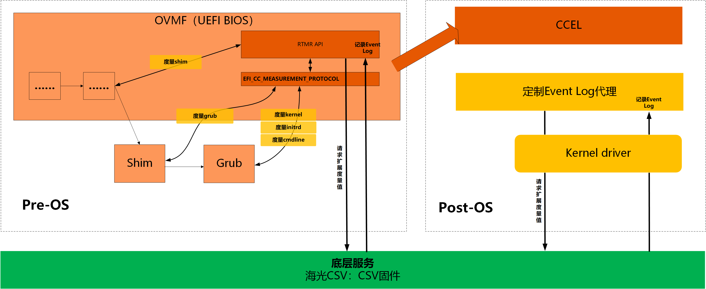
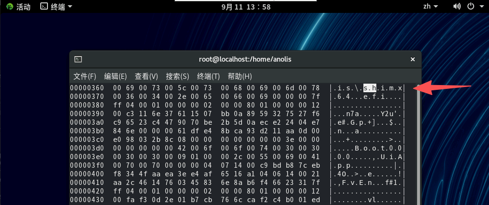
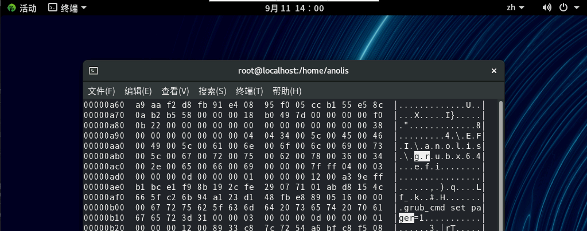
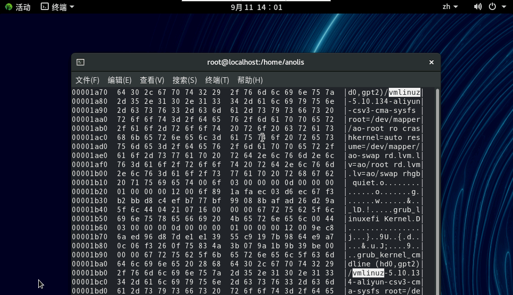
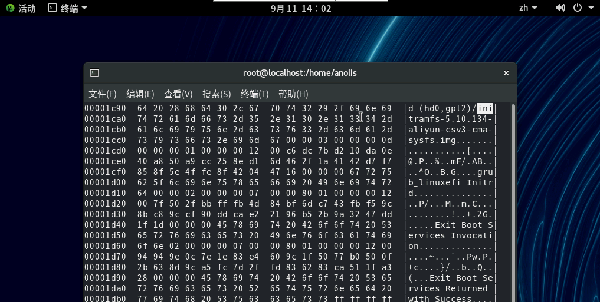

# 功能描述

CSV3 RTMR动态度量提供了类似于TPM PCR扩展度量的能力。当前CSV3支持RTMR V1版本，在V1版本中，TPM PCR扩展度量的索引与CSV3虚拟机RTMR寄存器索引关系如下表所示。

| TPM PCR索引 | Event Log度量寄存器索引 | RTMR |
| --- | --- | --- |
| 0 | 0 | RTMR\[0\] |
| 1,7 | 1 | RTMR\[1\] |
| 2~6 | 2 | RTMR\[2\] |
| 8~15 | 3 | RTMR\[3\] |
| 16,23 | 4 | RTMR\[4\] |

CSV3虚拟机在启动、运行负载等阶段的核心二进制和动作均能动态扩展到虚拟机的RTMR寄存器中，同时追加到类似于TPM的Event Log中，用户可以透过Event Log重放RTMR寄存器值，从而验证核心程序和动作的完整性。于此同时，CSV3虚拟机还支持包含RTMR寄存器值的远程认证功能，验证方可以通过认证报告中的RTMR寄存器值确认CSV3虚拟机内的行为是否正常。

## RTMR动态度量流程示例

下图是CSV3虚拟机启动、运行过程中的RTMR动态度量的大致示例。在 `Pre-OS` 阶段，虚拟机会扩展度量 `shim`、`grub`、`kernel`、`initrd`、`kernel cmdline` 的信息，同时会将相关事件记录到Event Log中；等到系统进入 `Post-OS` 阶段，虚拟机系统会为用户提供 `Pre-OS` 阶段的Event Log访问接口（见图中 `CCEL`），用户可以通过 `CCEL` 重放RTMR寄存器值，验证Event Log的完整性，进而确认Event Log中记录的事件信息是否符合预期。用户还可以自定义符合需求的`定制Event Log代理`，对重要的程序和动作扩展度量并记录日志。



*注：`Pre-OS` 阶段在这里主要是指Linux kernel正式接管系统之前的阶段，这个阶段主要是UEFI BIOS调用执行程序、提供系统服务、OS loader执行等。`Post-OS` 阶段在这里主要是指Linux kernel正式接管系统之后的阶段，在这个阶段，Linux kernel先完成一系列初始化加载动作等，然后用户即可登入系统执行负载。*

## CSV3远程认证对RTMR的支持情况

CSV3虚拟机可以提供包含RTMR寄存器值的认证报告。通过将 a) `CCEL`、b) `定制Event Log代理`记录的Event Log、c) 认证报告，一并发送给验证方，验证方可以通过认证报告中RTMR寄存器值验证 a) `CCEL`、b) `定制Event Log代理`记录的Event Log，的完整性，在完整性验证通过后，可以通过对比目标Event Log项中的内容是否符合预期。

# 演示CSV3虚拟机RTMR动态度量功能

演示使用的主机、虚拟机环境如下表所示：

| 软件组件 | 软件版本 | 说明 |
| --- | --- | --- |
| Host OS | Anolis OS8.4 | |
| Host Kernel | 5.10.134-19.1.an8 | 如果用户主机内核已经支持启动CSV3虚拟机，可以不遵从这里的内核版本。 |
| Qemu | 6.2.0-53.0.8.module+an8.10.0+11342+88f0b6b5.4 | 如果用户Qemu已经支持启动CSV3虚拟机，可以不遵从这里的Qemu版本。 |
| edk2-ovmf (OVMF) | 20220126gitbb1bba3d77-13.0.1.an8.8 | 在Anolis OS8中，`edk2-ovmf` 软件包包含启动海光机密虚拟机所须的OVMF，在版本 `13.0.1.an8.8` 中，开始支持CSV3虚拟机的RTMR功能。 |
| Guest OS | Anolis OS8.4 | |
| Guest Kernel | <p>url: https://gitee.com/anolis/cloud-kernel/tree/devel-5.10 <p>commit: HEAD | 支持CSV3 RTMR动态度量功能的虚拟机内核目前未发布到Anolis OS8的yum源中，需要用户自行编译。 |
| Guest shim-x64 | 15.8-2.0.1.an8 | 在Anolis OS8中，`shim-x64` 软件版本 `15.8-2.0.1.an8` 开始支持机密虚拟机动态度量接口。 |
| Guest grub2 | 2.02-165.0.2.an8 | 在Anolis OS8中，`grub2` 软件包版本 `2.02-165.0.2.an8` 开始支持机密虚拟机动态度量接口。 |
| 安全固件 | 版本不低于2337| 通过sudo hag general check 查看firmware version 字段的值 |

## 更新主机的软件环境

### 更新内核版本

如果用户已经在主机中更新支持CSV3的内核，那么请忽略该步骤。

```shell
sudo yum makecache
sudo yum update kernel*
```

### 更新Qemu版本

如果用户已经在主机中更新了支持CSV3的Qemu，那么请忽略该步骤。

```shell
sudo yum makecache
sudo yum update qemu*
```

### 更新OVMF版本

```shell
sudo yum makecache
sudo yum install -y edk2-ovmf-20220126gitbb1bba3d77-13.0.1.an8.8
```

## 更新虚拟机软件环境

### 启动虚拟机

```shell
sudo /usr/bin/qemu-system-x86_64 \
-enable-kvm -machine q35 -cpu host \
-smp 16 -m 8G \
-drive if=pflash,format=raw,unit=0,file=/usr/share/edk2/ovmf/OVMF_CODE.cc.fd,readonly=on \
-boot d -device virtio-scsi-pci,id=scsi0,disable-legacy=on,iommu_platform=on \
-drive file=AnolisOS-8.4.qcow2,if=none,id=drive.0 \
-device scsi-hd,bus=scsi0.0,id=scsi-hd.0,drive=drive.0 \
-vnc 0.0.0.0:0,to=100
```

### 在虚拟机中更新shim，grub版本

#### 更新shim

```shell
sudo yum makecache
sudo yum install -y shim-x64-15.8-2.0.1.an8
```

#### 更新grub

```shell
sudo yum makecache
sudo yum install -y grub2-efi-x64-2.02-165.0.2.an8
```

#### 更新虚拟机内核

> 这里为了保持文档连贯性，使用户了解每个组件的位置，所以将虚拟机内核的编译放在虚拟机中执行。用户可以在其他Anolis OS8机器上编译。

* 编译内核

```shell
git clone https://gitee.com/anolis/cloud-kernel -b devel-5.10
cd cloud-kernel
make anolis_defconfig
make binrpm-pkg -s -j$(nproc --ignore=1) LOCALVERSION=-csv-guest
```

* 安装内核

> 假设内核rpm包位于 `$HOME/rpmbuild/RPMS/x86_64/`

```shell
kernel_rpm_dir="$HOME/rpmbuild/RPMS/x86_64"
sudo rpm -ivh --force --nodeps ${kernel_rpm_dir}/*.rpm
```

* 设置默认启动内核

> 设置基于编译内核时指定了的 LOCALVERSION 版本 `-csv-guest`。

```shell
sudo grubby --set-default=/boot/vmlinuz-5.10.134-csv-guest
```

#### 关闭虚拟机

```shell
sudo poweroff
```

## 测试CSV3虚拟机的RTMR功能

### 启动CSV3虚拟机

```shell
sudo /usr/bin/qemu-system-x86_64 \
-enable-kvm -machine q35 -cpu host -smp 16 -m 8G \
-drive if=pflash,format=raw,unit=0,file=/usr/share/edk2/ovmf/OVMF_CODE.cc.fd,readonly=on \
-boot d -device virtio-scsi-pci,id=scsi0,disable-legacy=on,iommu_platform=on \
-drive file=AnolisOS-8.4.qcow2,if=none,id=drive.0 \
-device scsi-hd,bus=scsi0.0,id=scsi-hd.0,drive=drive.0 \
-object sev-guest,id=sev0,cbitpos=47,reduced-phys-bits=5,policy=0x45 \
-machine memory-encryption=sev0 \
-vnc 0.0.0.0:0,to=100
```

### 查看CCEL

CCEL位于 `/sys/firmware/acpi/tables/data/CCEL` ，CCEL中包含了shim、grub、kernel、initrd、cmdline的度量日志。

```shell
sudo hexdump -C /sys/firmware/acpi/tables/data/CCEL | less
```

可以看到下面的信息：






### 验证CCEL

* 下载、编译测试工具

```shell
git clone https://gitee.com/anolis/hygon-devkit.git
cd hygon-devkit/csv/csv-guest-module-tools/
./build.sh
```

* 加载csv-guest模块

```shell
sudo modprobe csv-guest
```

* 读取RTMR寄存器值

```shell
./csv-guest-module-tool rtmr --read
```

可以看到如下的输出：

```
[INFO]  do_rtmr_read: RTMR_READ values:
[INFO]  do_rtmr_read:   RTMR[00]: ae2a2cf1f41a485fa37bf9ae92f678783c59fbc79de7b5d237743d58f5538034
[INFO]  do_rtmr_read:   RTMR[01]: 72b9162969146dc09d9a3d740e27e2f100f809228db755cee2aaa706a8847bef
[INFO]  do_rtmr_read:   RTMR[02]: 9624cdc55013218730423ae6738790546c94c1b8b38be6e2ebc0a1d8da3b4086
[INFO]  do_rtmr_read:   RTMR[03]: 8737cfb6e4074d67fd0c652c4f598379f92795f777a58ddfe4102f7cdd79e4d1
[INFO]  do_rtmr_read:   RTMR[04]: 0000000000000000000000000000000000000000000000000000000000000000
```

* 通过CCEL重放RTMR寄存器值

```shell
sudo ./csv-guest-module-tool rtmr --replay
```

可以看到成功重放了RTMR\[1\]、RTMR\[2\]、RTMR\[3\]寄存器值。

> RTMR\[0\]寄存器用于记录虚拟机运行之前的静态度量值，不在CCEL范畴。RTMR\[4\]寄存器用于 `Post-OS` 阶段，不在CCEL范畴。

```
[INFO]  _read_ccel: CCEL: start=0x7f3ef000, len=0x10000
[INFO]  _replay_event_log: Final RTMR (SM3) value:
[INFO]  _replay_event_log:   RTMR[00] 0000000000000000000000000000000000000000000000000000000000000000
[INFO]  _replay_event_log:   RTMR[01] 72b9162969146dc09d9a3d740e27e2f100f809228db755cee2aaa706a8847bef
[INFO]  _replay_event_log:   RTMR[02] 9624cdc55013218730423ae6738790546c94c1b8b38be6e2ebc0a1d8da3b4086
[INFO]  _replay_event_log:   RTMR[03] 8737cfb6e4074d67fd0c652c4f598379f92795f777a58ddfe4102f7cdd79e4d1
[INFO]  _replay_event_log:   RTMR[04] 0000000000000000000000000000000000000000000000000000000000000000
```

### 验证包含RTMR寄存器值的认证报告

* 获取包含RTMR寄存器值的认证报告

> 该步骤会将认证报告保存到当前目录的 `report.bin` 文件中。

```shell
./csv-guest-module-tool attestation --report --extension 0x1
```

* 解析包含RTMR寄存器的认证报告

> 该步骤会读取当前目录的 `report.bin` 文件，然后解析出来。

```shell
./csv-guest-module-tool attestation --parse --extension 0x1
```

可以看到认证报告中包含了RTMR版本和RTMR寄存器内容

```
[INFO]  do_attestation_parse_ext: Parsed Extended Attestation Report:
[INFO]  do_attestation_parse_ext:   TEE_INFO:
[INFO]  do_attestation_parse_ext:     user_pubkey_digest: 0000000000000000000000000000000000000000000000000000000000000000
[INFO]  do_attestation_parse_ext:     vm_id: 00000000000000000000000000000000
[INFO]  do_attestation_parse_ext:     vm_version: 00000000000000000000000000000000
[INFO]  do_attestation_parse_ext:     user_data: f03b608da631786f57d07d3797e354114aa81009129ae0c7fa36a6bfb35f0ef889761e2c283f9eec5f29d2774d323b1044cd167cb781125eed9cc5f4d1551483
[INFO]  do_attestation_parse_ext:     mnonce: f4e101f826fd213fb7105cf16193378a
[INFO]  do_attestation_parse_ext:     measure: ae2a2cf1f41a485fa37bf9ae92f678783c59fbc79de7b5d237743d58f5538034
[INFO]  do_attestation_parse_ext:     policy: 45000000
[INFO]  do_attestation_parse_ext:     sig_usage: 02100000
[INFO]  do_attestation_parse_ext:     sig_algo: 04000000
[INFO]  do_attestation_parse_ext:     build: 28090000
[INFO]  do_attestation_parse_ext:     rtmr_version: 01000000
[INFO]  do_attestation_parse_ext:     reserved0: 0000000000000000000000000000
[INFO]  do_attestation_parse_ext:     rtmr: ae2a2cf1f41a485fa37bf9ae92f678783c59fbc79de7b5d237743d58f553803472b9162969146dc09d9a3d740e27e2f100f809228db755cee2aaa706a8847bef9624cdc55013218730423ae6738790546c94c1b8b38be6e2ebc0a1d8da3b40868737cfb6e4074d67fd0c652c4f598379f92795f777a58ddfe4102f7cdd79e4d10000000000000000000000000000000000000000000000000000000000000000
[INFO]  do_attestation_parse_ext:     reserved1: 0000000000000000000000000000000000000000000000000000000000000000000000000000000000000000000000000000000000000000000000000000000000000000000000000000000000000000000000000000000000000000000000000000000000000000000000000000000000000000000000000000000000000000000000000000000000000000000000000000000000000000000000000000000000000000000000000000000000000000000000000000000000000000000000000000000000000000000000000000000000000000000000000000000000000000000000000000000000000000000000000000000000000000000000000000000000000000000000000000000000000000000000000000000000000000000000000000000000000000000000000000000000000000000000000000000000000000000000000000000000000000000000000000000000000000000000000000000000000000000000000000000000000000000000000000000000000000000000000000000000000000000000000000000000000000000000000000000000000000000000000000000000000000000000000000000000000000000000000000000000000000000000000000000000000000000000000000000000000000000000000000000000000000000000000000000000000000000000000000000000000000000000000000000000000000000000000000000000000000000000000000000000000000000000000000000000000000000000000000000000000000000000000000000000000000000000000000000000000000000000000000000000000000000000000000000000000000000000000000000000000000000000000000000000000000000000000000000000000000
[INFO]  do_attestation_parse_ext:     sig1: add3882de1326440ed13bfb42272c8ad055700615f119dffbfac5ffe24dee91b000000000000000000000000000000000000000000000000000000000000000000000000000000004d5905aee802fe0408934272cf607282f3f8883ee7760a8620234de8e62d5d5600000000000000000000000000000000000000000000000000000000000000000000000000000000
[INFO]  do_attestation_parse_ext:   PEK Cert: 01000000010400000210000004000000030000003b10e440c2bad9e6d0180f478111d40ddea0db8b44b3c66bffeee4c81b90c50700000000000000000000000000000000000000000000000000000000000000000000000000000000b8394bf37e9bb1a529d91e8976d8c5a44af39864d42a5361e6245ab66ece2449000000000000000000000000000000000000000000000000000000000000000000000000000000000d004859474f4e2d5353442d50454b000000000000000000000000000000000000000000000000000000000000000000000000000000000000000000000000000000000000000000000000000000000000000000000000000000000000000000000000000000000000000000000000000000000000000000000000000000000000000000000000000000000000000000000000000000000000000000000000000000000000000000000000000000000000000000000000000000000000000000000000000000000000000000000000000000000000000000000000000000000000000000000000000000000000000000000000000000000000000000000000000000000000000000000000000000000000000000000000000000000000000000000000000000000000000000000000000000000000000000000000000000000000000000000000000000000000000000000000000000000000000000000000000000000000000000000000000000000000000000000000000000000000000000000000000000000000000000000000000000000000000000000000000000000000000000000000000000000000000000000000000000000000000000000000000000000000000000000000000000000000000000000000000000000000000000000000000000000000000000000000000000000000000000000000000000000000000000000000000000000000000000000000000000000000000000000000000000000000000000000000000000000000000000000000000000000000000000000000000000000000000000000000000000000000000000000000000000000000000000000000000000000000000000000000000000000000000000000000000000000000000000000000000000000000000000000000000000000000000000000000000000000000000000000000000000000000000000000000000000000000000000000000000000000000000000000000000000000000000000000000000000000000000000000000000000000000000000000000000000000000000000000000000000000000000000000000000000000000000000000000000000000000000000000000000000000000000000000000000000000000000000000000000000000000000000000000000000000000000000000000000000000000000000000000000000000000000000000000000410000004000000fd248e127af6e44a31453097589783d4fba57280a30c883844bb88a6acb04377000000000000000000000000000000000000000000000000000000000000000000000000000000005492b8059e59878addafbc668d1d8e5338d113758d3acc8c1725fe02f168ae0e00000000000000000000000000000000000000000000000000000000000000000000000000000000000000000000000000000000000000000000000000000000000000000000000000000000000000000000000000000000000000000000000000000000000000000000000000000000000000000000000000000000000000000000000000000000000000000000000000000000000000000000000000000000000000000000000000000000000000000000000000000000000000000000000000000000000000000000000000000000000000000000000000000000000000000000000000000000000000000000000000000000000000000000000000000000000000000000000000000000000000000000000000000000000000000000000000000000000000000000000000000000000000000000000000000000000000000000000000000000000000000000000000000000000000000000000000000000000000000000000000000000000000000000000000000000000000000000000000000000000000000000000000000000000000000000000001100000040000008d6d3b38e04f70ce195f2da442e26355e0b50dc035ef596c8ebe11d1074b691c00000000000000000000000000000000000000000000000000000000000000000000000000000000a1c53d59a31371e41f731dfb2bf963594679dc2690cca021787e5de6a75da18c000000000000000000000000000000000000000000000000000000000000000000000000000000000000000000000000000000000000000000000000000000000000000000000000000000000000000000000000000000000000000000000000000000000000000000000000000000000000000000000000000000000000000000000000000000000000000000000000000000000000000000000000000000000000000000000000000000000000000000000000000000000000000000000000000000000000000000000000000000000000000000000000000000000000000000000000000000000000000000000000000000000000000000000000000000000000000000000000000000000000000000000000000000000000000000000000000000000000000000000000000000000000000000000000000000000000000000000000000000000000000000000000000000000000000000000000000000000000000000000000000000000000000000000000000000000000000000000000000000000000000000000000000000000000000000000000
[INFO]  do_attestation_parse_ext:   Chip ID: 4b504136343931313234303530370000000000000000000000000000000000000000000000000000000000000000000000000000000000000000000000000000
[INFO]  do_attestation_parse_ext:   Sealing Key: 9e66ea42e919a2c629a872eb3214d7f027d01e6b5ad9aa17a27cf03f15b3139f
[INFO]  do_attestation_parse_ext:   sm3 hmac: c1c40c69a2217d8f36c48b49d452e546a6a03e83d0d3379348cc327727a9874d
[INFO]  do_attestation_parse_ext:   reserved: 0000000000000000000000000000000000000000000000000000000000000000000000000000000000000000000000000000000000000000000000000000000000000000000000000000000000000000000000000000000000000000000000000000000000000000000000000000000000000000000000000000000000000000000000000000000000000000000000000000000000000000000000000000000000000000000000000000000000000000000000000000000000000000000000000000000000000000000000000000000000000000000000000000000000000000000000000000000000000000000000000000000000000000000000000000000000000000000000000000000000000000000000000000000000000000000000000000000000000000000000000000000000000000000000000000000000000000000000000000000000000000000000000000000000000000000000000000000000000000000000000000000000000000000000000000000000000000000000000000000000000000000000000000000000000000000000000000000000000000000000000000000000000000000000000000000000000000000000000000000000000000000000000000000000000000000000000000000000000000000000000000000000000000000000000000000000000000000000000000000000000000000000000000000000000000000000000000000000000000000000000000000000000000000000000000000000000000000000000000000000000000000000000000000000000000000000000000000000000000000000000000000000000000000000000000000000000000000000000000000000000000000000000000000000000000000000000000000000000000000000000000000000000000000000000000000000000000000000000000000000000000000000000000000000000000000000000000000000000000
```

* 验证认证报告

> 该步骤会验证当前目录下的 `report.bin` 认证报告内容。

```shell
./csv-guest-module-tool attestation --verify --extension 0x1 --certchain
```

可以看到

```
[INFO]  verify_hygon_certchain: Verify HSK Cert PASS.
[INFO]  verify_hygon_certchain: Verify CEK Cert PASS.
[INFO]  verify_hygon_certchain: Verify PEK Cert PASS.
[INFO]  do_attestation_verify_ext: Verify Hygon cert chain PASS
[INFO]  do_attestation_verify_ext: Verify attestation report PASS
```
