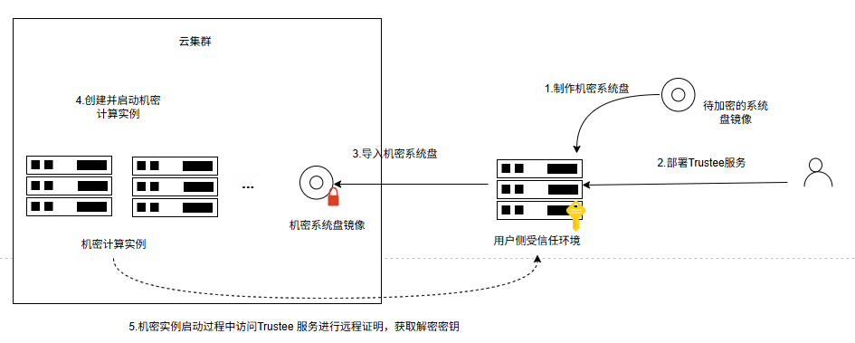

## 功能描述

本文提供了基于远程证明的机密虚拟机磁盘加密方案测试过程。本加密方案仅支持CSV3虚拟机，并要求远程证明支持运行时度量(Runtime Attestation)功能。
本测试需要两台机器<br>
一台部署Trustee程序(KBS/RVPS服务)（称为机器一）<br>
另一台部署和运行加密虚拟机（称为机器二）。

具体技术原理细节请参考[基于远程证明的CSV 虚拟机磁盘加密技术介绍](<../../01. 技术白皮书/07. 基于远程证明的CSV 虚拟机磁盘加密技术介绍.md>)。

## 使用流程

机密系统盘的制作和使用流程大致如下图所示：



演示使用的主机、虚拟机环境如下表所示，目前支持两套测试组合：

### 组合一

| 机器 | 软件组件 | 软件版本 | 说明 |
| --- | --- | --- | --- |
| 机器一 | Host OS | Anolis OS 8.10 |机器硬件无要求，主机的ISO 安装镜像地址：[https://mirrors.openanolis.cn/anolis/8.10/isos/GA/x86\_64/AnolisOS-8.10-x86\_64-dvd.iso](https://mirrors.openanolis.cn/anolis/8.10/isos/GA/x86_64/AnolisOS-8.10-x86_64-dvd.iso)，请测试者自行安装系统，此处略过。 |
| 机器二 | Host OS | Anolis OS 8.10 | 机器硬件必须要能支持CSV3虚拟机启动，由于本测试过程中的虚拟机操作系统为AnolisOS-8.10-x86\_64-ANCK.qcow2，因此建议主机系统也使用Anolis 8.10|
| 机器二 | Guest OS | AnolisOS-8.10-x86\_64-ANCK.qcow2 | 下面**准备资源**章节中提供了下载方法 |
| 机器二 | 安全固件 | 版本不低于2337 | 通过sudo hag general check 查看firmware version 字段的值|

### 组合二

| 机器 | 软件组件 | 软件版本 | 说明 |
| --- | --- | --- | --- |
| 机器一 | Host OS | openEuler 24.03 (LTS-SP2) |机器硬件无要求，主机的ISO 安装镜像地址：[https://mirrors.ocf.berkeley.edu/openeuler/openEuler-24.03-LTS-SP2/ISO/x86\_64/openEuler-24.03-LTS-SP2-x86\_64-dvd.iso](https://mirrors.ocf.berkeley.edu/openeuler/openEuler-24.03-LTS-SP2/ISO/x86_64/openEuler-24.03-LTS-SP2-x86_64-dvd.iso)，请测试者自行安装系统，此处略过。 |
| 机器二 | Host OS | openEuler 24.03 (LTS-SP2) | 机器硬件必须要能支持CSV3虚拟机启动 |
| 机器二 | Guest OS | noble-server-cloudimg-amd64.img | 下面**准备资源**章节中提供了下载方法 |
| 机器二 | 安全固件 | 版本不低于2337 | 通过sudo hag general check 查看firmware version 字段的值|

noble-server-cloudimg-amd64.img 镜像是定制过的镜像，如果客户要定制自己的虚拟机镜像，需要做下面操作，ubuntu 系统版本必须不小于24.04 版本

```
1、下载内核更新虚拟机内核，内核支持CSV3以及rtmr 功能
wget -c https://download.sourcefind.cn:65024/directlink/8/c86-devkit/previous-release/csv/pkg/kernel-5.10.134-deb.tgz
内核安装后，设置为默认内核，/etc/default/grub 中设置GRUB_DEFAULT=saved， grub 默认用saved_entry=Ubuntu, with Linux 5.10.134-csv，参考值获取会通过saved_entry 在grub.cfg 中寻找对应的内核，下面步骤中参考值default_cpu_20260108.rego 策略文件中parse_kernel、parse_initrd函数也要设置匹配相应的内核
2、 参考下面链接系统切换使用dracut，cryptpilot 依赖dracut
https://discourse.ubuntu.com/t/please-try-out-dracut/48975
3、更新grub，系统默认的grub 不支持度量
wget https://download.sourcefind.cn:65024/directlink/8/c86-devkit/previous-release/csv/cryptpilot/grub-efi-amd64-bin_2.12-1ubuntu7.3_amd64.deb
dpkg -i grub-efi-amd64-bin_2.12-1ubuntu7.3_amd64.deb
cp -f /usr/lib/grub/x86_64-efi/monolithic/grubx64.efi /boot/efi/EFI/ubuntu/grubx64.efi
```

## 对磁盘进行加密

使用机器一制作磁盘，机器硬件不限制，假设测试者已经准备好主机环境，下面开始制作加密虚拟机磁盘。

### 准备资源

#### 组合一

```
mkdir -p ~/test/
cd ~/test/
git clone --depth 1 https://gitee.com/anolis/hygon-devkit.git

# 准备虚拟机镜像,目前只提供了这个虚拟机，客户有需要可以进行适配，虚拟机的默认账号root，密码为root
wget -c https://download.sourcefind.cn:65024/directlink/8/c86-devkit/previous-release/csv/AnolisOS-8.10-x86_64-ANCK.qcow2 -O ~/test/AnolisOS-8.10-x86_64-ANCK.qcow2

wget -c https://download.sourcefind.cn:65024/directlink/8/c86-devkit/previous-release/csv/cryptpilot/attestation-agent-1.2.1-3.an8.x86_64.rpm -O ~/test/attestation-agent-1.2.1-3.an8.x86_64.rpm

wget -c https://download.sourcefind.cn:65024/directlink/8/c86-devkit/previous-release/csv/cryptpilot/confidential-data-hub-1.2.1-3.an8.x86_64.rpm -O ~/test/confidential-data-hub-1.2.1-3.an8.x86_64.rpm

wget -c https://download.sourcefind.cn:65024/directlink/8/c86-devkit/previous-release/csv/cryptpilot/cryptpilot-0.2.6-1.an8.x86_64.rpm -O ~/test/cryptpilot-0.2.6-1.an8.x86_64.rpm

wget -c https://download.sourcefind.cn:65024/directlink/8/c86-devkit/previous-release/csv/cryptpilot/e2fsprogs-1.47.3.tgz -O ~/test/e2fsprogs-1.47.3.tgz

wget -c https://download.sourcefind.cn:65024/directlink/8/c86-devkit/previous-release/csv/cryptpilot/rvps-tool -O ~/test/rvps-tool
```

#### 组合二

```
mkdir -p ~/test/
cd ~/test/
git clone --depth 1 https://gitee.com/anolis/hygon-devkit.git

# 准备虚拟机镜像,目前只提供了这个虚拟机，客户有需要可以进行适配，虚拟机的默认账号root，密码为root
wget -c https://download.sourcefind.cn:65024/directlink/8/c86-devkit/previous-release/csv/noble-server-cloudimg-amd64.img -O ~/test/noble-server-cloudimg-amd64.img

wget -c https://download.sourcefind.cn:65024/directlink/8/c86-devkit/previous-release/csv/cryptpilot/attestation-agent_1.4.6-1_amd64.deb -O ~/test/attestation-agent_1.4.6-1_amd64.deb

wget -c https://download.sourcefind.cn:65024/directlink/8/c86-devkit/previous-release/csv/cryptpilot/confidential-data-hub_1.4.6-1_amd64.deb -O ~/test/confidential-data-hub_1.4.6-1_amd64.deb

wget -c https://download.sourcefind.cn:65024/directlink/8/c86-devkit/previous-release/csv/cryptpilot/cryptpilot_0.2.9-1_amd64.deb -O ~/test/cryptpilot_0.2.9-1_amd64.deb

wget -c https://download.sourcefind.cn:65024/directlink/8/c86-devkit/previous-release/csv/cryptpilot/rvps-tool -O ~/test/rvps-tool
```

### 准备加密磁盘配置文件

```
mkdir -p  ~/test/config_dir
# kbs_ip 为下面构建trustee kbs 服务的主机ip 地址，客户根据自己情况进行填写
# kbs:///default/local-resources/rootfs_passwd 中为rootfs分区的解密密钥
# kbs:///default/local-resources/data_passwd 中为data分区的解密密钥
cat > ~/test/config_dir/fde.toml << 'EOF'
[rootfs]
rw_overlay = "disk"
[rootfs.encrypt.kbs]
kbs_url = "http://kbs_ip:8080"
key_uri = "kbs:///default/local-resources/rootfs_passwd"

[data]
integrity = true
[data.encrypt.kbs]
kbs_url = "http://kbs_ip:8080"
key_uri = "kbs:///default/local-resources/data_passwd"
EOF
```

配置文件介绍请参考https://github.com/openanolis/cryptpilot/blob/master/dist/etc/fde.toml.template

### 制作加密磁盘

准备容器镜像，在容器环境中制作加密虚拟机磁盘镜像

#### 组合一

```
sudo docker pull alibaba-cloud-linux-3-registry.cn-hangzhou.cr.aliyuncs.com/alinux3/alinux3:latest
sudo docker run -dit \
  --name cryptpilot-disk \
  --network host \
  --privileged \
  --ipc=host \
  -v /run/udev/control:/run/udev/control \
  -v /dev:/dev \
  -v /lib/modules:/lib/modules:ro \
  -v /usr/include/linux:/usr/include/linux:ro \
  -v /usr/include/asm:/usr/include/asm:ro \
  -v ~/test:/mnt \
  alibaba-cloud-linux-3-registry.cn-hangzhou.cr.aliyuncs.com/alinux3/alinux3:latest
  
sudo docker exec -it  cryptpilot-disk bash 

# 更新yum源,若制作者通过网络代理连接yum，请在/etc/yum.conf文件中添加代理
sed -i 's|http://mirrors.cloud.aliyuncs.com|https://mirrors.aliyun.com|g' /etc/yum.repos.d/*.repo
sed -i 's|mirrors.cloud.aliyuncs.com|mirrors.aliyun.com|g' /etc/yum.repos.d/*.repo
cd /mnt && rpm -ivh  --force --nodeps --noscripts cryptpilot-0.2.6-1.an8.x86_64.rpm
yum install -y tar

# 容器中的e2fsprogs 版本较低需要对其进行升级
tar xvf e2fsprogs-1.47.3.tgz
mv e2fsprogs-1.47.3  /usr/local/bin/
echo 'export PATH=/usr/local/bin/e2fsprogs-1.47.3/sbin:$PATH' >> ~/.bashrc
source ~/.bashrc
# 检查下设置是否生效
fsck -v
fsck 1.47.3 (8-Jul-2025)

# 以下为制作加密镜像命令，"AAAaaa111" 为rootfs 的加密密码，要和trustee 中
# kbs/data/kbs-storage/default/local-resources/rootfs_passwd 一致
# AnolisOS-8.10-x86_64-ANCK-enc.qcow2 为加密后的镜像
# 若您的容器网络需要代理才能连接公网，请先执行以下命令配置网络代理环境变量：
# export proxy="http://proxy_ip:7890";export http_proxy=$proxy;export https_proxy=$proxy

cryptpilot-convert --in AnolisOS-8.10-x86_64-ANCK.qcow2 \
--out AnolisOS-8.10-x86_64-ANCK-enc.qcow2 \
--config-dir ./config_dir/ --rootfs-passphrase "AAAaaa111" \
--package cryptpilot-0.2.6-1.an8.x86_64.rpm --package \
confidential-data-hub-1.2.1-3.an8.x86_64.rpm \
--package attestation-agent-1.2.1-3.an8.x86_64.rpm -b 1024M
```

镜像制作成功类似如下输出

```
--------------------------------
Everything done, the new disk image is ready to use: AnolisOS-8.10-x86_64-ANCK-enc.qcow2

You can calculate reference value of the disk with:

    cryptpilot fde show-reference-value --disk AnolisOS-8.10-x86_64-ANCK-enc.qcow2

```

#### 组合二

```
sudo docker pull ubuntu:24.04
sudo docker run -dit \
  --name cryptpilot-disk \
  --network host \
  --privileged \
  --ipc=host \
  -v /run/udev/control:/run/udev/control \
  -v /dev:/dev \
  -v /lib/modules:/lib/modules:ro \
  -v ~/test:/mnt \
  ubuntu:24.04
  
sudo docker exec -it  cryptpilot-disk bash

apt update
cd /mnt && dpkg -i cryptpilot_0.2.9-1_amd64.deb 2>/dev/null
apt --fix-broken install -y

# 以下为制作加密镜像命令，"AAAaaa111" 为rootfs 的加密密码，要和trustee 中
# kbs/data/kbs-storage/default/local-resources/rootfs_passwd 一致
# noble-server-cloudimg-amd64-enc.img 为加密后的镜像
# 若您的容器网络需要代理才能连接公网，请先执行以下命令配置网络代理环境变量：
# export proxy="http://proxy_ip:7890";export http_proxy=$proxy;export https_proxy=$proxy

cryptpilot-convert --in noble-server-cloudimg-amd64.img \
--out noble-server-cloudimg-amd64-enc.img \
--config-dir ./config_dir/ --rootfs-passphrase "AAAaaa111" \
--package cryptpilot_0.2.9-1_amd64.deb --package \
confidential-data-hub_1.4.6-1_amd64.deb \
--package attestation-agent_1.4.6-1_amd64.deb -b 1024M
```

镜像制作成功类似如下输出

```
--------------------------------
Everything done, the new disk image is ready to use: noble-server-cloudimg-amd64.img

You can calculate reference value of the disk with:

    cryptpilot fde show-reference-value --disk noble-server-cloudimg-amd64-enc.img

```

## 准备trustee 环境

trustee 可以部署在任意用户可信的环境中，这里选择和制作加密磁盘共用一台主机,使用的是机器一。

### 配置Trustee

```
# 主机上重新开一个窗口执行
cd ~/test/ 
git clone https://github.com/confidential-containers/trustee.git
cd trustee && git reset --hard b6ebe8d8e15e11a19aa133a6a391b9c81a5b78d7
mkdir -p kbs/data/kbs-storage/default/local-resources/
mkdir -p kbs/data/attestation-service/token/ear/policies/opa/

#设置数据分区密钥，后续kbs 服务从该地方获取数据分区密钥,数据分区是在加密磁盘做好后第一次启动通过kbs 获取密钥设置为加密卷
printf 'BBBbbb222'  > kbs/data/kbs-storage/default/local-resources/data_passwd

#设置rootfs分区密钥，后续kbs服务从该地方获取rootfs分区密钥
printf 'AAAaaa111'  > kbs/data/kbs-storage/default/local-resources/rootfs_passwd

cp -f ~/test/hygon-devkit/csv/cryptpilot/docker-compose.yml  ./

# 配置as 的认证策略，组合一
cp -f ~/test/hygon-devkit/csv/cryptpilot/default_cpu.rego  kbs/data/attestation-service/token/ear/policies/opa/
# 配置as 的认证策略，组合二
cp -f ~/test/hygon-devkit/csv/cryptpilot/default_cpu_20260108.rego  kbs/data/attestation-service/token/ear/policies/opa/default_cpu.rego

# 配置kbs 的认证策略
cp -f ~/test/hygon-devkit/csv/cryptpilot/policy.rego  kbs/config/docker-compose/
cp -f ~/test/hygon-devkit/csv/cryptpilot/kbs-config.toml  kbs/config/docker-compose/
cp -f ~/test/hygon-devkit/csv/cryptpilot/as-config.json  kbs/config/

# KBS 管理接口（Admin API）的公私钥
openssl genpkey -algorithm ed25519 > kbs/config/private.key
openssl pkey -in kbs/config/private.key -pubout -out kbs/config/public.pub

# Attestation-agent完成远程认证后，kbs向confidential-data-hub颁发token。
# Confidential-data-hub向kbs获取机密资源时需携带token，kbs需验证token的正确性。
# 因而需要创建私钥和证书，算法为ECC，用于签名token。
# 由于文档用于测试，因此创建的证书为自签名证书。产生的token_ec_private.key为私钥，token_ec_cert.crt为自签名证书
openssl ecparam -genkey -name secp256r1 -out kbs/data/attestation-service/token_ec_private.key
openssl req -new -x509 -days 365 -key kbs/data/attestation-service/token_ec_private.key -out kbs/data/attestation-service/token_ec_cert.crt
cp -f kbs/data/attestation-service/token_ec_cert.crt kbs/config/

sudo docker compose up -d
```

等待服务启动成功，docker ps 查看容器服务是否启动成功，类似如下

```
higon@anolis trustee]$ sudo docker ps
CONTAINER ID   IMAGE                                                                                                 COMMAND                  CREATED          STATUS          PORTS                                             NAMES
5d791ab1ddc6   ghcr.io/confidential-containers/coco-keyprovider:latest                                               "coco_keyprovider --…"   44 minutes ago   Up 44 minutes   0.0.0.0:50000->50000/tcp, [::]:50000->50000/tcp   trustee-keyprovider-1
055cc3a66e16   ghcr.io/confidential-containers/staged-images/kbs-grpc-as:b6ebe8d8e15e11a19aa133a6a391b9c81a5b78d7    "/usr/local/bin/kbs …"   44 minutes ago   Up 44 minutes   0.0.0.0:8080->8080/tcp, [::]:8080->8080/tcp       trustee-kbs-1
b528695a6605   ghcr.io/confidential-containers/staged-images/coco-as-grpc:b6ebe8d8e15e11a19aa133a6a391b9c81a5b78d7   "grpc-as --socket 0.…"   44 minutes ago   Up 44 minutes   0.0.0.0:50004->50004/tcp, [::]:50004->50004/tcp   trustee-as-1
f23aa7bcf16d   ghcr.io/confidential-containers/staged-images/rvps:b6ebe8d8e15e11a19aa133a6a391b9c81a5b78d7           "rvps --address 0.0.…"   44 minutes ago   Up 44 minutes   0.0.0.0:50003->50003/tcp, [::]:50003->50003/tcp   trustee-rvps-1
cdf80dd33d3a   77c6ff15a2c8                                                                                          "bash"                   6 weeks ago      Up 2 months 
```

### trustee参考值配置

此过程共需要计算2个参考值：<br>
参考值1：根据输入的加密磁盘镜像，计算远程证明中的rtmr1~rtmr4字段，包含kernel、grub、shim、initrd、rootfs、内核参数cmdline、加密磁盘配置文件的哈希值。<br>
参考值2：根据输入的OVMF文件和虚拟机vcpu信息，计算远程证明中的rtmr0字段，包含OVMF的哈希值和虚拟机vcpu哈希值。<br>

在即将运行加密镜像虚拟机的主机上(机器二)安装支持RTMR的OVMF文件,然后拷贝到机器一

```
sudo yum makecache
# 更新OVMF版本,OVMF需要更新到支持RTMR功能的版本
wget https://mirrors.openanolis.cn/anolis/8/AppStream/x86_64/os/Packages/edk2-ovmf-20220126gitbb1bba3d77-13.0.1.an8.8.noarch.rpm
sudo rpm -ivh --force --nodeps edk2-ovmf-20220126gitbb1bba3d77-13.0.1.an8.8.noarch.rpm
# 将OVMF_CODE.cc.fd 拷贝到trustee 部署环境机器上，设置参考值需要使用它，kbs_ip 为trustee 部署环境机器的ip地址
scp /usr/share/edk2/ovmf/OVMF_CODE.cc.fd user@kbs_ip:~/test/
```

#### 计算和设置参考值1

该动作在trustee 所在主机上执行（机器一）

##### 组合一

```
cd ~/test/ && sudo rpm -ivh  --force --nodeps --noscripts cryptpilot-0.2.6-1.an8.x86_64.rpm


# 执行以下命令获取参考值1
sudo cryptpilot fde show-reference-value --stage initrd --disk ~/test/AnolisOS-8.10-x86_64-ANCK-enc.qcow2 > ./reference-value.json

provenance=$(cat ./reference-value.json | base64 --wrap=0)
cat << EOF > ./register-request.json

{
"version" : "0.1.0",
"type": "sample",
"payload": "$provenance"
}
EOF

# 向rvps 中写入参考值1 ，trustee 环境中执行，可以将register-request.json 中参考值调整验证参考值是否生效
sudo chmod +x ~/test/rvps-tool
~/test/rvps-tool register --path ./register-request.json
```

##### 组合二

/*注：组合二的代码版本较高，已经将rootfs 和配置文件的参考值验证统一通过initrd 模块进行验证了。*/

```
# 参考值获取在容器环境中获取
sudo docker exec -it  cryptpilot-disk bash 
# 执行以下命令获取参考值1
cd /mnt && cryptpilot fde show-reference-value   --hash-algo sm3 --disk noble-server-cloudimg-amd64-enc.img > reference-value.json
# 退出容器
exit
# trustee 主机环境中执行
cd ~/test/
provenance=$(cat ./reference-value.json | base64 --wrap=0)
cat << EOF > ./register-request.json

{
"version" : "0.1.0",
"type": "sample",
"payload": "$provenance"
}
EOF

# 向rvps 中写入参考值1 ，trustee 主机环境中执行，可以将register-request.json 中参考值调整验证参考值是否生效
sudo chmod +x ~/test/rvps-tool
~/test/rvps-tool register --path ./register-request.json
```

#### 计算和设置参考值2

该动作在trustee 所在主机上执行（机器一）

```
wget https://gitee.com/hanliyang-kata-coco/deployment/raw/master/tools/measurement/csv-measure.py
pip3 install gmssl

measurement=$(python3 csv-measure.py \
  --ovmf ~/test/OVMF_CODE.cc.fd \
  --csv3 \
  --smp 1 \
  --family 24 \
  --model 4 \
  --stepping 1 | base64 -d | xxd -p | tr -d '\n')
```

**此处特别强调，虽然此计算命令在机器一执行，但由于其所计算的内容family/model/stepping为虚拟机信息，
因此必须先在机器二上获取family/model/stepping内容，再返回机器一完成计算**。

\--ovmf指向ovmf路径

\--smp后接qemu启动时指定的vcpu个数（-smp），没有指定默认为1

\--family通过在机器二执行  lscpu | grep "^CPU family:" | awk -F':' '{print $2}'获取

\--model通过在机器二执行 lscpu | grep "^Model:" | awk -F':' '{print $2}'获取

\--stepping通过在机器二执行 lscpu | grep "^Stepping:" | awk -F':' '{print $2}'获取

```
cat << EOF > ovmf-reference-value.json
{
  "csv.measurement": [
    "${measurement}"
  ]
}
EOF

provenance=$(cat ./ovmf-reference-value.json | base64 --wrap=0)
cat << EOF > ./register-request.json
{
    "version" : "0.1.0",
    "type": "sample",
    "payload": "$provenance"
}
EOF

# 向rvps 中写入参考值2 
~/test/rvps-tool register --path ./register-request.json

```

### 启动加密镜像

#### 组合一

这里主机系统为Anolis 8.10，独立于trustee 的另外一台机器，使用的是机器二。

```
mkdir ~/work_dir/
# 拷贝制作好的加密镜像到工作目录，kbs_ip 为制作加密盘机器的ip地址(机器一IP地址)
scp user@kbs_ip:~/test/AnolisOS-8.10-x86_64-ANCK-enc.qcow2 ~/work_dir/ <br>

sudo qemu-system-x86_64 -name csv-vm --enable-kvm -cpu host -m 2048 \
-hda ~/work_dir/AnolisOS-8.10-x86_64-ANCK-enc.qcow2 \
-drive if=pflash,format=raw,unit=0,file=/usr/share/edk2/ovmf/OVMF_CODE.cc.fd,readonly=on \
-netdev bridge,br=virbr0,id=net0 -device virtio-net-pci,netdev=net0,romfile= \
-qmp tcp:127.0.0.1:1111,server,nowait -vnc 0.0.0.0:0 -nographic \
-object sev-guest,id=sev0,policy=0x45,cbitpos=47,reduced-phys-bits=5 -machine memory-encryption=sev0
```

#### 组合二

这里主机系统为openEuler-24.03-LTS-SP2，独立于trustee 的另外一台机器，使用的是机器二。

```
mkdir ~/work_dir/
# 拷贝制作好的加密镜像到工作目录，kbs_ip 为制作加密盘机器的ip地址(机器一IP地址)
scp user@kbs_ip:~/test/noble-server-cloudimg-amd64-enc.img ~/work_dir/ <br>

sudo qemu-system-x86_64 -name csv-vm --enable-kvm -cpu host -m 2048 \
-hda ~/work_dir/noble-server-cloudimg-amd64-enc.img \
-drive if=pflash,format=raw,unit=0,file=/usr/share/edk2/ovmf/OVMF_CODE.cc.fd,readonly=on \
-netdev bridge,br=virbr0,id=net0 -device virtio-net-pci,netdev=net0,romfile= \
-qmp tcp:127.0.0.1:1111,server,nowait -vnc 0.0.0.0:0 -nographic \
-object sev-guest,id=sev0,policy=0x45,cbitpos=47,reduced-phys-bits=5 -machine memory-encryption=sev0
```

有下面类似字段加密分区解密成功：

```
[   14.804672] attestation-agent[225]: [2025-09-03T08:03:00Z DEBUG ttrpc_aa::ttrpc_dep::server] AA (ttrpc): Get evidence successfully!
[   16.374274] cryptpilot[601]: 2025-09-03T08:03:01.826748Z  INFO cryptpilot::provider::kbs: The passphrase has been fetched from KBS
[   16.380438] cryptpilot[601]: 2025-09-03T08:03:01.833223Z  INFO cryptpilot::cmd::boot_service: Setting up dm-crypt for rootfs volume
[   25.730926] cryptpilot[601]: 2025-09-03T08:03:11.183488Z  INFO cryptpilot::cmd::boot_service: Setting up dm-verity for rootfs volume
[   25.842117] cryptpilot[601]: 2025-09-03T08:03:11.293776Z  INFO cryptpilot::cmd::boot_service: [ 4/4 ] Setting up data volume
[   25.992673] cryptpilot[601]: 2025-09-03T08:03:11.293807Z  INFO cryptpilot::cmd::boot_service: Fetching passphrase for data volume
[  OK  ] Found device /dev/mapper/rootfs.
[  OK  ] Started dracut initqueue hook.
[  OK  ] Reached target Remote File Systems (Pre).
[  OK  ] Reached target Remote File Systems.
         Starting dracut pre-mount hook...
[   26.194713] secure call: invalid address
[   26.183639] attestation-agent[225]: [2025-09-03T08:03:11Z DEBUG ttrpc_aa::ttrpc_dep::server] AA (ttrpc): get tee type ...
[   26.184560] attestation-agent[225]: [2025-09-03T08:03:11Z DEBUG ttrpc_aa::ttrpc_dep::server] AA (ttrpc): get tee type succeeded.
[   26.184880] attestation-agent[225]: [2025-09-03T08:03:11Z DEBUG ttrpc_aa::ttrpc_dep::server] AA (ttrpc): get evidence ...
[   26.184926] attestation-agent[225]: [2025-09-03T08:03:11Z INFO  attestation_agent] No additional attesters configured, returning empty evidence.
[   26.184954] attestation-agent[225]: [2025-09-03T08:03:11Z DEBUG ttrpc_aa::ttrpc_dep::server] AA (ttrpc): Get evidence successfully!
[   26.187830] attestation-agent[225]: [2025-09-03T08:03:11Z DEBUG ttrpc_aa::ttrpc_dep::server] AA (ttrpc): get evidence ...
[  OK  ] Started dracut pre-mount hook.
[   26.228054] attestation-agent[225]: [2025-09-03T08:03:11Z DEBUG ttrpc_aa::ttrpc_dep::server] AA (ttrpc): Get evidence successfully!
[   27.488771] cryptpilot[601]: 2025-09-03T08:03:12.940958Z  INFO cryptpilot::provider::kbs: The passphrase has been fetched from KBS
[   32.364125] cryptpilot[601]: 2025-09-03T08:03:17.816647Z  INFO cryptpilot::cmd::boot_service: Both rootfs volume and data volume are ready
[   32.511956] cryptpilot[601]: 2025-09-03T08:03:17.964740Z  INFO cryptpilot::cmd::boot_service: Everything have been completed, exit now

```
