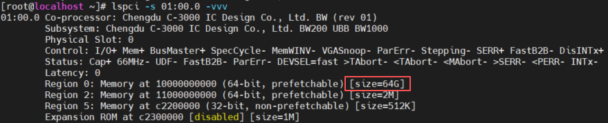
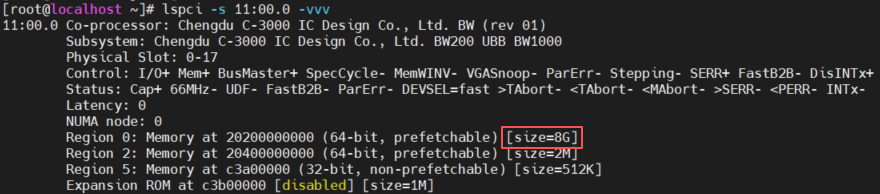
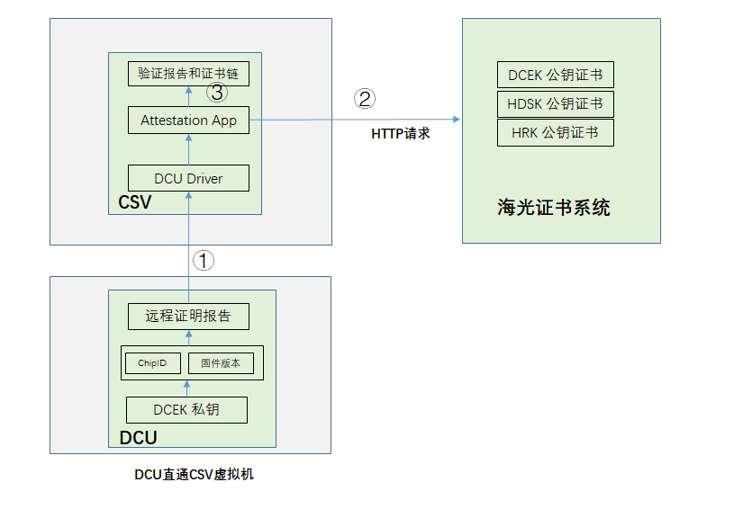

# 1. 功能描述

某些应用场景需要在加密虚拟机中运行图像识别、机器学习等算法，这些场景下使用DCU加速卡可以极大地提高计算性能。加密虚拟机（包括CSV虚拟机、CSV2虚拟机、CSV3虚拟机）支持设备直通，可以将DCU卡直通给机密虚拟机使用。

本文档包含三部分内容：

* DCU直通加密虚拟机（也称半机密模式）
  
  将DCU直通到加密虚拟机，在加密机密环境中运行DCU。

* 全机密模式
  
  作为DCU直通加密虚拟机的增强版，机密虚拟机和DCU卡之间通过PCIE总线传输数据，传输的数据被DCU软件栈加密，密钥由安全处理器管理。DCU支持显存隔离功能，用户数据放在隔离显存中处理，SDMA无法访问。原理参考[异构机密计算全机密模式](<../../01. 技术白皮书/05. 异构机密计算全机密模式技术介绍.md>) 章节的内容。

* DCU attestation
  
  DCU attestation用来向用户证明DCU卡是真实的海光DCU，而不是伪造的DCU。

我们使用qemu启动加密虚拟机，借助vfio将DCU直通给加密虚拟机，就可以在加密虚拟机中直接使用DCU设备。

# 2. 测试环境要求与推荐

**CSV异构机密计算的开启依赖海光CPU、海光DCU硬件环境，同时也要求满足启动CSV虚拟机的软件环境。本节介绍这些依赖，请按要求确认与获取。**

- CPU要求：海光CPU，支持CSV，参考[01.环境部署-01.环境要求](<../01. 环境部署/01. 环境要求.md>)

- DCU要求：BW产品（本文档以BW1000（8卡+8卡互联模组）作为示例）

- 软件环境推荐
  
  龙蜥环境：

| 类别       | 详情                        | 说明                                                         |
| ---------- | --------------------------- | ------------------------------------------------------------ |
| 主机系统   | AnolisOS-8.10               | 参考[01.环境部署-02.安装操作系统](<../01. 环境部署/02. 安装操作系统.md>) 进行获取安装 |
| 主机内核   | 5.10-anolis                 | 获取：https://gitee.com/anolis/cloud-kernel/tree/devel-5.10<br />本文档基于commit id为 a33879e5cc7d 进行验证<br />编译：make anolis\_defconfig \&\& make rpm-pkg -j$(nproc --ignore=4) -s LOCALVERSION=-anolis |
| qemu       | QEMU emulator version 8.2.2 | 获取:  git clone  https://gitee.com/anolis/qemu-kvm.git -b devel-8.2<br />本文档基于commit id为a5a7e87e8280f 进行验证并打上了待合入的patch<br />打patch方式：git fetch https://gitee.com/anolis/qemu-kvm.git pull/97/head:pr\_97 ；git checkout pr\_97<br />编译：mkdir -p build \&\& cd build \&\& ../configure --target-list=x86\_64-softmmu --sysconfdir=/etc/ --audio-drv-list= --disable-docs --disable-curl --enable-kvm --enable-slirp --prefix=/opt/qemu\_anolis --extra-ldflags=-lrt \&\& make -j128 \&\& sudo make install |
| 虚拟机镜像 | AnolisOS-8.10               | 参考[03.测试加密虚拟机-01.安装CSV虚拟机依赖](<01. 安装CSV虚拟机依赖.md>)进行获取 |
| 虚拟机内核 | 5.10-anolis                 | 与主机内核保持一致                                           |
| edk2       | 系统自带最新版本            | 获取：yum install -y edk2-ovmf-20220126gitbb1bba3d77-13.0.1.an8.10.noarch<br />位置：/usr/share/edk2/ovmf/OVMF\_CODE.cc.fd |

​      openEuler环境：

| 类别       | 详情                      | 说明                                                         |
| ---------- | ------------------------- | ------------------------------------------------------------ |
| 主机系统   | openEuler 24.03 (LTS-SP2) | 参考[01.环境部署-02.安装操作系统](<../01. 环境部署/02. 安装操作系统.md>) 进行获取安装 |
| 主机内核   | 6.6.0-euler               | 获取：https://atomgit.com/openeuler/kernel.git<br />本文档基于commit id为adbe47b6cb32进行验证需要<br />需要git revert d57dfffb41b67从而Revert "PCI: Enable ACS after configuring IOMMU for OF platforms"<br />编译：make openeuler\_defconfig; make -j$(nproc) -s LOCALVERSION=-euler rpm-pkg |
| qemu       | qemu-8.2.0                | 获取:  git clone -b qemu-8.2.0 https://gitcode.com/openeuler/qemu.git<br />本文档基于3a3c82a1c8验证<br />编译：mkdir -p build \&\& cd build \&\& ../configure --target-list=x86\_64-softmmu --sysconfdir=/etc/ --audio-drv-list= --disable-docs --disable-curl --enable-kvm --enable-slirp --prefix=/opt/qemu\_euler --extra-ldflags=-lrt \&\& make -j128 \&\& sudo make install |
| 虚拟机镜像 | openEuler 24.03           | 参考[03.测试加密虚拟机-01.安装CSV虚拟机依赖](<01. 安装CSV虚拟机依赖.md>)进行获取 |
| 虚拟机内核 | 6.6.0-euler               | 与主机内核保持一致                                           |
| edk2       | 系统自带最新版本          | 获取：yum install -y edk2-ovmf-202308-45.oe2403sp3.noarch<br />位置：/usr/share/edk2/ovmf.nosb/OVMF\_CODE.nosb.fd |

# 3. 测试DCU直通加密虚拟机

## 3.1. 开启主机IOMMU与配置主机ACS功能

**DCU直通虚拟机依赖主机IOMMU功能的开启与ACS功能的配置。本节介绍这两个功能开启的方式。**

- 开启主机IOMMU
  
  设备直通依赖IOMMU功能，需要分别在BIOS以及主机内核cmdline中进行使能：
  
  1. 参考[01.环境部署-01.环境要求](<../01. 环境部署/01. 环境要求.md>)章节中的DCU直通功能部分，在BIOS开启IOMMU
  
  2. 在主机内核cmdline中设置“amd\_iommu=on”参数

- 配置主机ACS功能
  
  被直通的设备必须位于同一个 IOMMU 组内，或单独处于一个独立的 IOMMU 组中。这要求主机配置PCIe ACS（Access Control Services）功能。
  
  通过如下命令检查每个设备的iommu group：
  
  ```
  #!/bin/bash
  for d in $(find /sys/kernel/iommu_groups/ -type l | sort -n -k5 -t/); do
      n=${d#*/iommu_groups/*}; n=${n%%/*}
      printf 'IOMMU Group %s ' "$n"
      lspci -nns "${d##*/}"
  done;
  ```
  
  如果DCU（含\*\*“Co-processor”**关键字的设备）、hyswtich设备(含**“\[0680\]”\*\*关键字的设备)   和其他设备出现在同一个iommu group中，那么需要：
  
  方式一：
  
  参考[01.环境部署-01.环境要求](<../01. 环境部署/01. 环境要求.md>)章节中的DCU直通功能部分，在BIOS中开启ACS。
  
  > 优先使用方式一，如果BIOS ACS选项找不到，再用方式二
  
  方式二：
  
  1. 在Host内核上参考https://github.com/benbaker76/linux-acs-override 打上该patch，重新编译、安装内核。
  2. 在Host内核的cmdline中添加“pcie\_acs\_override=downstream,multifunction”

## 3.2. Host启动DCU直通的加密虚拟机

**本节介绍在主机环境中如何启动dcu直通的虚拟机，包括：提前安装DCU直通专用的插件；为保证不受主机DCU驱动干扰，移除主机驱动服务；加载直通所需的vfio驱动模块并将待直通的设备与vfio模块绑定；最终利用qemu命令基于vfio接口启动DCU直通的加密虚拟机。**

* Host上安装DCU的fixup header插件
  
  ```sh
  $ wget https://download.sourcefind.cn:65024/directlink/8/c86-devkit/previous-release/csv/dcu/hycu_pci_fixup_header_0.4.4.bin
  $ chmod +x hycu_pci_fixup_header_0.4.4.bin
  $ sudo ./hycu_pci_fixup_header_0.4.4.bin
  ```
  
  安装完成后，验证当前fixup header版本，显示为0.4.4：
  
  ```sh
  $ cat /sys/module/hycu_pci_fixup_header/version
  0.4.4
  ```
  
  > **注意**：如果更改host kernel，如使用其他版本的Kernel，或者重新编译host kernel，必须要重新安装fixup header插件才能生效。

* Host上关闭hylink建联与dcu驱动服务。
  
  如果在主机上安装过DCU驱动，主机启动后会自动加载DCU驱动。在直通DCU到虚拟机时，需要将DCU和主机的驱动先解绑，才能再绑定到vfio驱动。此处，为避免繁琐的解绑操作，我们直接禁止主机上DCU相关服务。
  
  ```
  $ sudo systemctl disable hymgr.service
  $ sudo systemctl disable hfm.service
  ```
  
  服务关闭后，重启物理主机使生效。

* Host加载VFIO驱动
  
  执行下面命令，在Host加载VFIO驱动：
  
  ```sh
  #部分内核上不存在vfio_virqfd，可以不用加载该模块
  $ sudo modprobe vfio_virqfd
  $ sudo modprobe vfio_pci
  $ sudo modprobe vfio_iommu_type1
  $ sudo modprobe vfio
  ```
  
  > **注意**：每次重启host后，启动虚拟机前，需要加载vfio驱动。

* 查看DCU的Vendor ID和Device ID
  
  通过搜索“Co-processor”找到DCU设备的Device ID和Vendor ID：
  
  ```sh
  $ lspci -nn | grep "Co-processor"
  56:00.0 Co-processor [0b40]: Chengdu C-3000 IC Design Co., Ltd. BW [1d94:6320] (rev 01)
  5d:00.0 Co-processor [0b40]: Chengdu C-3000 IC Design Co., Ltd. BW [1d94:6320] (rev 01)
  9f:00.0 Co-processor [0b40]: Chengdu C-3000 IC Design Co., Ltd. BW [1d94:6320] (rev 01)
  b1:00.0 Co-processor [0b40]: Chengdu C-3000 IC Design Co., Ltd. BW [1d94:6320] (rev 01)
  c1:00.0 Co-processor [0b40]: Chengdu C-3000 IC Design Co., Ltd. BW [1d94:6320] (rev 01)
  ca:00.0 Co-processor [0b40]: Chengdu C-3000 IC Design Co., Ltd. BW [1d94:6320] (rev 01)
  e9:00.0 Co-processor [0b40]: Chengdu C-3000 IC Design Co., Ltd. BW [1d94:6320] (rev 01)
  ```
  
  可以看到，DCU设备的PCI地址为**56:00.0**等，VendorID为**1d94**，Device Id为**6320**。
  
  > **注意**：不同机器上的卡的PCI地址不同、不同型号的DCU的Device ID不同，以实际为准。后面将设备直通虚拟机时，请用DCU实际的PCI地址替换56:00.0，用实际的Device Id替换6320。

* 查看hyswitch设备的Vendor ID和Device ID
  
  通过搜索\[0680\]（表示厂商特定桥接设备）找到hyswitch设备的Device ID和Vendor ID：
  
  ```sh
  $ lspci -nn | grep "Bridge \[0680\]:.*"
  10:00.0 Bridge [0680]: Chengdu C-3000 IC Design Co., Ltd. Device [1d94:a110]
  13:00.0 Bridge [0680]: Chengdu C-3000 IC Design Co., Ltd. Device [1d94:a110]
  16:00.0 Bridge [0680]: Chengdu C-3000 IC Design Co., Ltd. Device [1d94:a110]
  19:00.0 Bridge [0680]: Chengdu C-3000 IC Design Co., Ltd. Device [1d94:a110]
  1c:00.0 Bridge [0680]: Chengdu C-3000 IC Design Co., Ltd. Device [1d94:a110]
  1f:00.0 Bridge [0680]: Chengdu C-3000 IC Design Co., Ltd. Device [1d94:a110]
  20:00.0 Bridge [0680]: Chengdu C-3000 IC Design Co., Ltd. Device [1d94:a110]
  ```
  
  可以看到，hyswitch设备的PCI地址为**10:00.0**等，VendorID为**1d94**，Device Id为**a110**。
  
  > **注意**：不同机器上的卡的PCI地址不同、不同型号的DCU的Device ID不同，以实际为准。下面操作中请用DCU实际的PCI地址替换10:00.0，用实际的Device Id替换a110。

* 将DCU和hyswitch设备绑定到VFIO驱动
  
  执行下面命令将DCU与hyswitch设备绑定到VFIO驱动，再次查看示例设备的当前驱动为`vfio-pci`：
  
  ```sh
  #将DCU设备绑定到VFIO驱动， 请将1d94与6320替换成你设备的VendorID与Device Id
  $ echo 1d94 6320 | sudo tee /sys/bus/pci/drivers/vfio-pci/new_id
  
  #将hyswitch设备绑定到VFIO驱动， 请将1d94与a110替换成你设备的VendorID与Device Id
  $ echo 1d94 a110 | sudo tee /sys/bus/pci/drivers/vfio-pci/new_id
  
  #查看其中一个dcu设备的情况
  $ lspci -s 56:00.0 -v | grep "Kernel driver"
  Kernel driver in use: vfio-pci
  
  #查看其中一个hyswitch设备的情况
  $ lspci -s 10:00.0 -v | grep "Kernel driver"
  Kernel driver in use: vfio-pci
  ```
  
  同时也可以看到，在目录`/dev/vfio`下会产生名为DCU、hyswitch设备所在iommu group的ID文件
  
  ```sh
  $ ls /dev/vfio
  107  123  126  129  132  135  138  139  167  208  217  243  36  61  70  vfio
  ```
  
  > **注意**：每次重启Host后，启动虚拟机前，需要重新绑定DCU到VFIO驱动。

* 运行直通DCU卡的加密虚拟机
  
  经过前面的准备工作，我们在Host上将DCU设备绑定到VFIO驱动。现在我们可以通过qemu启动加密虚拟机，将DCU直通到加密虚拟机中。启动直通DCU的加密虚拟机命令如下：（请按照你文件夹的情况调整命令中qemu、vm.qcow2、ovmf\_code.fd组件的位置，可参考本文档`2.测试环境要求与推荐`获得组件）：
  
  ```sh
  $ sudo qemu-system-x86_64 -name csv-vm --enable-kvm -smp 64 -m 128G -nographic \
         -hda /opt/hygon/csv/vm.qcow2 \
         -drive if=pflash,format=raw,unit=0,file=/opt/hygon/csv/OVMF_CODE.fd,readonly=on \
         -object sev-guest,id=sev0,policy=0x1,cbitpos=47,reduced-phys-bits=5 -machine memory-encryption=sev0 \
         -net user,hostfwd=tcp::2222-:22 \
         -net nic \
         -cpu host,host-phys-bits-limit=44 \
         -device vfio-pci,host=0000:05:00.0,rombar=0 \
         -device vfio-pci,host=0000:56:00.0,rombar=0 \
         -device vfio-pci,host=0000:5d:00.0,rombar=0 \
         -device vfio-pci,host=0000:9f:00.0,rombar=0 \
         -device vfio-pci,host=0000:b1:00.0,rombar=0 \
         -device vfio-pci,host=0000:c1:00.0,rombar=0 \
         -device vfio-pci,host=0000:ca:00.0,rombar=0 \
         -device vfio-pci,host=0000:e9:00.0,rombar=0 \
         -device vfio-pci,host=10:00.0 \
         -device vfio-pci,host=13:00.0 \
         -device vfio-pci,host=16:00.0 \
         -device vfio-pci,host=19:00.0 \
         -device vfio-pci,host=1c:00.0 \
         -device vfio-pci,host=1f:00.0 \
         -device vfio-pci,host=20:00.0 \
         -fw_cfg name=opt/ovmf/X-PciMmio64Mb,string=1048576
  ```
  
  其中：
  
  - `-object sev-guest,id=sev0,policy=0x1,cbitpos=47,reduced-phys-bits=5 -machine memory-encryption=sev0` 其中policy=0x1表示启动CSV虚拟机；若是启动普通非加密虚拟机，则可以完全删除这一行；若是启动CSV2虚拟机，修改policy值为0x5；若是启动CSV3虚拟机，修改policy值为0x45
  
  * `-device vfio-pci,host=05:00.0` 指定DCU的PCI地址，示例为`05:00.0`等8个地址，用户需要更改为自己DCU的实际PCI地址
  * `-device vfio-pci,host=10:00.0,id=dev_10_00` 指定hyswitch设备的PCI地址，示例为10:00.0等7个地址，需要更改为自己hyswitch的实际PCI地址
  *  `-fw_cfg name=opt/ovmf/X-PciMmio64Mb,string=131072`指定vfio mmio bar的大小。
  
  > **注意**：
  > 
  > 1. 不同的DCU的VRAM大小可能不同，对于64G的VRAM的DCU，指定`sring=131072`；32G的VRAM的DCU，需要指定更改为`string=65536`。此处我们直通多个DCU卡到虚拟机中，需要将参数`-fw_cfg name=opt/ovmf/X-PciMmio64Mb,string=131072`按照线性比例调整。如示例，我们直通8张64G vram的卡，故使用8x131072=1048576。
  > 2. 本文档使用BW1000作为示例，直通了8张卡，并直通所有hyswtich从而使用了hylink互联功能。多虚拟机各自直通DCU的场景、单卡使用场景、不使用hylink互联场景，不需要直通hyswtich。
  
  虚拟机启动后，登录虚拟机，确认是否正常启动加密虚拟机，如下为CSV3虚拟机显示示例:
  
  ```
  $ dmesg | grep CSV
  [    0.570143]  HYGON CSV
  [    0.571143]  HYGON CSV2
  [    0.572141]  HYGON CSV3
  [   10.384354] kvm_amd: KVM is unsupported when running as an CSV guest
  ```
  
  在虚拟机中查看到DCU与hyswitch设备，说明DCU直通虚拟机成功：
  
  ```
  $ lspci -nn | grep -E "Co-processor|Bridge \[0680\]"
  00:03.0 Bridge [0680]: Chengdu C-3000 IC Design Co., Ltd. Device [1d94:a110]
  00:04.0 Bridge [0680]: Chengdu C-3000 IC Design Co., Ltd. Device [1d94:a110]
  00:06.0 Bridge [0680]: Chengdu C-3000 IC Design Co., Ltd. Device [1d94:a110]
  00:07.0 Bridge [0680]: Chengdu C-3000 IC Design Co., Ltd. Device [1d94:a110]
  00:08.0 Bridge [0680]: Chengdu C-3000 IC Design Co., Ltd. Device [1d94:a110]
  00:09.0 Bridge [0680]: Chengdu C-3000 IC Design Co., Ltd. Device [1d94:a110]
  00:0a.0 Bridge [0680]: Chengdu C-3000 IC Design Co., Ltd. Device [1d94:a110]
  01:00.0 Co-processor [0b40]: Chengdu C-3000 IC Design Co., Ltd. BW [1d94:6320] (rev 01)
  02:00.0 Co-processor [0b40]: Chengdu C-3000 IC Design Co., Ltd. BW [1d94:6320] (rev 01)
  03:00.0 Co-processor [0b40]: Chengdu C-3000 IC Design Co., Ltd. BW [1d94:6320] (rev 01)
  04:00.0 Co-processor [0b40]: Chengdu C-3000 IC Design Co., Ltd. BW [1d94:6320] (rev 01)
  05:00.0 Co-processor [0b40]: Chengdu C-3000 IC Design Co., Ltd. BW [1d94:6320] (rev 01)
  06:00.0 Co-processor [0b40]: Chengdu C-3000 IC Design Co., Ltd. BW [1d94:6320] (rev 01)
  07:00.0 Co-processor [0b40]: Chengdu C-3000 IC Design Co., Ltd. BW [1d94:6320] (rev 01)
  08:00.0 Co-processor [0b40]: Chengdu C-3000 IC Design Co., Ltd. BW [1d94:6320] (rev 01)
  ```

## 3.3. 在CSV3虚拟机中设置预留内存

**本节说明CSV3虚拟机中为dcu驱动预留共享内存的方法。**

为合理规划CSV3虚拟机的共享内存，需要在虚拟机内核cmdline 设置csv3\_guest\_rsv\_mb=16G 参数。

> 注 1. 此16G是CSV3虚拟机预留给dcu驱动用做为CSV3共享内存的大小，根据经验，压测8卡vllm70B模型推理未超出过16G，多卡训练未超过64G。
> 
> ​     2.  虚拟机可以看到的内存大小=qemu启动虚拟机内存参数大小  -  csv3\_guest\_rsv\_mb配置大小。 故建议虚拟机也要保证一定大小的内存，推理8卡建议100G,   训练8卡建议200G。具体也可以通过运行时free -h 查看使用情况。
> 
> ​     3. 此步骤为CSV3虚拟机设置，普通虚拟机/CSV/CSV2虚拟机设置后不会产生效果

设置完成CSV3虚拟机后，在CSV3虚拟机中通过命令可以看到CSV3虚拟机预留内存使用情况，部署时可以根据该信息调整csv3\_guest\_rsv\_mb大小。

```sh
$ cat /sys/kernel/debug/gpu_extra/shmem_info
total_bytes: 0x400000000
free_bytes: 0x226039000
used_bytes: 0x1d9fc7000
max_used_bytes: 0x1d9fc7000
alloc_count: 30235
free_count: 3502
alloc_fail_count: 0
```

如果运行时出现如下报错，也说明需要调大csv3\_guest\_rsv\_mb的值：

```
buddy_mgr： Alloc failed(size=*, order=*)
```

## 3.4. 在加密虚拟机中安装DCU环境

**本节说明如何在虚拟机中安装DCU的运行环境，包括安装驱动、更新vbios，拉取开箱即用的vllm docker容器并替换相应库为TEE库。**

> 为保证环境一致，建议虚拟机使用root权限操作。进入虚拟机终端之前，确保虚拟机网络畅通。

* 虚拟机中安装DCU驱动
  
  > 注意：`CSV_PLATFORM=on` 表示让驱动具备 CSV 平台功能。半机密/全机密都需要使用，非机密模式不用。
  
  ```shell
  $ wget https://download.sourcefind.cn:65024/file/6/csv-tee驱动/dtk-26.04-tee驱动/rock-6.3.32-V1.6.0.run
  $ chmod +x rock-6.3.32-V1.6.0.run
  $ CSV_PLATFORM=on ./rock-6.3.32-V1.6.0.run
  ```

​	安装完成后，禁止虚拟机的selinux。打开`/etc/selinux/config`文件，修改`SELINUX`为`SELINUX=disabled`

- 虚拟机中更新DCU的VBIOS
  
  测试**非机密/半机密模式**，使用命令:
  
  ```shell
  $ /opt/hyhal/firmware/vbios/hyflash_x86 --index a --update /opt/hyhal/firmware/vbios/BW3000/BW3000-6.314.002400Q.998011.bin --hsl
  ```
  
  测试**全机密模式**，增加--sc参数，将即将烧写的vbios开启隐藏VRAM功能：
  
  ```shell
  $ /opt/hyhal/firmware/vbios/hyflash_x86 --index a --update /opt/hyhal/firmware/vbios/BW3000/BW3000-6.314.002400Q.998011.bin --hsl --sc
  ```
  
  > 注意：1. --hsl 表示开启hylink互联模式，在BW1000上，若是多虚拟机各自直通DCU的场景、单卡使用场景、不使用hylink互联场景，不要使用该参数。
  > 
  > ​            2. --sc 表示开启隐藏VRAM功能，使用全机密时使用。
  
  烧写完成后，重启Host使之生效。通过在虚拟机中执行`/opt/hyhal/bin/hy-smi --showvbios` 确认DCU已经烧录我们想要的版本。
  
  **非机密模式/半机密模式**下，dcu设备可见vram大小为如图所示的64G：
  
  
  
  **全机密模式**下，查看dcu设备可见vram大小，为如图所示的8G：
  
  
  
  全机密模式下，DCU卡上的显存被分为普通显存和隔离显存，8G为普通显存（也称共享显存），剩下56G为隔离显存，CSV虚拟机使用隔离显存存放模型数据和用户数据，主机无法读写隔离显存。更详细的介绍可以参考[异构机密计算全机密模式介绍](<../../01. 技术白皮书/05. 异构机密计算全机密模式技术介绍.md>)。
  
  通过如下操作确认DCU驱动已经识别当前为**全机密模式**：
  
  ```shell
  $ cat /sys/devices/virtual/kfd/kfd/topology/nodes/1/properties | grep cc_mode
  ```
  
  输出为2表示开启了**全机密模式**。

- 虚拟机中确认DCU驱动加载正常
  
  在上述驱动安装，vbios烧写，Host重启，虚拟机中确认vram大小后，再在虚拟机中执行下面命令，确认驱动加载正常：
  
  ```
   $ /opt/hyhal/bin/hy-smi
  ================================= System Management Interface ==================================
  ================================================================================================
  HCU     Temp     AvgPwr     Perf     PwrCap     VRAM%      HCU%      Dec%      Enc%      Mode
  0       28.0C    131.0W     auto     800.0W     0%         0.0%      0.0%      0.0%      Normal
  1       24.0C    132.0W     auto     800.0W     0%         0.0%      0.0%      0.0%      Normal
  2       29.0C    132.0W     auto     800.0W     0%         0.0%      0.0%      0.0%      Normal
  3       24.0C    131.0W     auto     800.0W     0%         0.0%      0.0%      0.0%      Normal
  4       28.0C    132.0W     auto     800.0W     0%         0.0%      0.0%      0.0%      Normal
  5       25.0C    129.0W     auto     800.0W     0%         0.0%      0.0%      0.0%      Normal
  6       27.0C    132.0W     auto     800.0W     0%         0.0%      0.0%      0.0%      Normal
  7       24.0C    132.0W     auto     800.0W     0%         0.0%      0.0%      0.0%      Normal
  ================================================================================================
  ======================================== End of SMI Log ========================================
  ```
  
  > 注意：1. 如果未出现该log，请耐心等待几分钟等驱动初始化。
  > 
  > ​            2.每次虚拟机重启后，先确认hy-smi命令log正常（即驱动加载正常），再起docker容器。

- 虚拟机中拉取并启动vllm dtk docker容器
  
  > 注意：1. 由于docker容器和后面的大模型下载占用磁盘空间较大，请提前确保虚拟机磁盘容量足够50G，可参考5.1.虚拟机镜像扩容 对镜像进行扩容。
  > 
  > ​            2. sglang、pytorch、以及其他vllm版本的 docker容器获取地址参考：https://developer.sourcefind.cn/servicelist
  
  ```
  $ docker pull harbor.sourcefind.cn:5443/dcu/admin/base/vllm:0.9.2-ubuntu22.04-dtk26.04-0130-py3.10-20260202
  ```
  
  启动docker容器
  
  ```
  $ docker run -it \
  --name csv_test \
  --pids-limit -1 \
  -u root \
  --privileged \
  --network=host \
  --ipc=host \
  --device=/dev/kfd \
  --device=/dev/mkfd \
  --device=/dev/dri \
  -v /opt/hyhal:/opt/hyhal \
  --group-add video \
  --cap-add=SYS_PTRACE \
  --ulimit stack=-1:-1  --ulimit memlock=-1:-1 \
  --security-opt seccomp=unconfined \
  -v /root:/root \
  harbor.sourcefind.cn:5443/dcu/admin/base/vllm:0.9.2-ubuntu22.04-dtk26.04-0130-py3.10-20260202 \
  /bin/bash
  ```
  
  在docker容器中获取dtk-tee库并替换原有的库：
  
  > 注意：1.  docker容器获取地址参考：https://developer.sourcefind.cn/servicelist
  > 
  > ​           2.  如果不是使用当前版本的vllm docker，例如是sglang或者vllm高版本等，如果容器中存在/opt/dtk/aillvm文件，需要先备份该文件再恢复。
  
  ```shell
  $ cp -r /opt/dtk/aillvm ./ #备份aillvm,如果不存在则不需要执行。
  $ rm -rf /opt/dtk-26.04 /opt/dtk
  $ wget https://download.sourcefind.cn:65024/file/1/DTK-26.04/tee/DTK-26.04-tee-0821-Ubuntu20.04.1-x86_64.tar.gz
  $ tar zxf DTK-26.04-tee-0821-Ubuntu20.04.1-x86_64.tar.gz -C /opt/
  $ ln -s /opt/dtk-26.04 /opt/dtk
  $ cp -r aillvm /opt/dtk/  #恢复aillvm,如果不存在则不需要执行。
  ```

## 3.5. 简易用例的测试

**本节介绍使用一个简单的向量加法示例演示DCU并行计算。需要在虚拟机中下载`HIP-Examples`仓库，编译、运行其中的`vectorAdd`测试程序，并通过此用例触发的log再次确认全机密模式生效**。

- 在容器中下载测试用例并编译测试
  
  ```sh
  $ git clone https://github.com/ROCm-Developer-Tools/HIP-Examples.git
  $ cd HIP-Examples/vectorAdd
  $ make
  $ HIP_LOG_LEVEL=4 HIP_MODULE_MASK=0x7fffffff HIP_ENABLE_LIST=hip HIP_LOG_OUTPUT_PATH="./" ./vectoradd_hip.exe
  System minor 2
  System major 9
  agent prop name K100_AI
  hip Device prop succeeded
  PASSED!
  ```
  
  显示PASSED!表示通过，其中`agent prop name`因卡不同会有差异。

- **全机密模式**检查
  
  如果测试**全机密模式**，需要额外检查log确认全加密模式生效，测试**半机密模式** 不需要进行，测试通过则表示成功。
  
  **全机密模式**检查log的方式：
  
  ```shell
  $ /opt/hyhal/bin/hiplogdump sort "$(ls -t ./*.nano 2>/dev/null | head -n 1)" | grep "transmission"
  thread=0x111abb00 writeBufferEncTrans: h2d using encryption transmission, buf size 0x400000
  thread=0x111abb00 writeBufferEncTrans: h2d using encryption transmission, buf size 0x400000
  thread=0x111abb00 readBufferEncTrans: d2h using encryption transmission, buf size 0x400000
  ```
  
  看到`using encryption transmission`打印表示**全机密模式**下的传输加密功能正常。

## 3.6. 大模型部署与调用

**本节介绍在虚拟机中如何基于已经下载的vllm docker容器对大模型进行部署与调用。**

- 拉取通用大模型
  
  作为演示，我们使用Qwen2.5-7B-Instruct模型，从 https://www.modelscope.cn/models/Qwen/Qwen2.5-7B-Instruct 下载，保存到虚拟机的/root/models目录下，以下操作也都在容器中进行。
  
  ```shell
  $ pip install modelscope
  $ mkdir -p /root/models/Qwen/Qwen2.5-7B-Instruct
  $ modelscope download --model Qwen/Qwen2.5-7B-Instruct --local_dir /root/models/Qwen/Qwen2.5-7B-Instruct
  ```

- 基于vllm部署大模型
  
  ```
  #请在容器中进行调用
  $ vllm serve /root/models/Qwen/Qwen2.5-7B-Instruct --trust-remote-code  --dtype float16 --max-model-len 4096  --served-model-name qwen --disable-log-requests --enforce-eager --gpu-memory-utilization 0.85 -tp 1
  ```
  
  > 注意：使用多卡的话，需要将tp的值做相应修改。同时，需要确保主机cmdline中没有设置 mem\_encrypt=on的参数。
  
  启动完成可以看到如下打印：
  
  ```
  INFO:     Waiting for application startup.
  INFO:     Application startup complete.
  ```

- 基于vllm调用大模型
  
  开一个虚拟机终端，并调用/opt/hyhal/bin/hy-smi可以看到dcu运行状态，在进行后续的对话时可以查看到DCU处于占用状态。
  
  ```
  watch -n 1 "/opt/hyhal/bin/hy-smi"
  ```
  
  重新开启一个虚拟机终端作为client端调用：
  
  ```
  $ http_proxy="" https_proxy="" curl -X POST -H "Content-Type:application/json" http://localhost:8000/v1/chat/completions  -d '{"model": "qwen","messages": [{"role": "user","content": "介绍诗人李白"}],"stream":false }'
  ```
  
  示例输出：
  
  ```
  {"id":"chatcmpl-c897f499efa14f8f8d6ae172876be559","object":"chat.completion","created":1770365636,"model":"qwen","choices":[{"index":0,"message":{"role":"assistant","reasoning_content":null,"content":"李白（701年－762年），字太白，号青莲居士，唐代伟大的浪漫主义诗人，被后人誉为“诗仙”。他与杜甫并称为“李杜”，是盛唐文化的重要代表人物。\n\n李白出生于中亚碎叶城（今吉尔吉斯斯坦境内），幼时随父迁至绵州昌隆县（今四川江油）。他的诗歌以豪放飘逸著称，擅长描绘自然景象和抒发个人情感。李白的诗作题材广泛，风格多样，既有雄奇壮丽的边塞诗，也有清新明快的山水田园诗，更有深沉悲凉的咏怀诗。他的诗歌语言流畅、想象丰富、意境深远，具有极高的艺术价值和历史价值。\n\n李白一生经历了唐玄宗开元盛世到安史之乱的动荡时期，他的诗作也反映了当时社会的变迁和个人的遭遇。李白的诗歌对后世影响深远，不仅在中国文学史上占有重要地位，而且在世界文学史上也有着不可忽视的影响。\n\n李白的代表作品包括《静夜思》、《将进酒》、《望庐山瀑布》等。其中，《静夜思》表达了他对故乡的思念之情；《将进酒》展现了他豪迈不羁的性格和积极乐观的生活态度；《望庐山瀑布》则通过描写壮观的自然景观来表达对自由的向往。\n\n李白的一生虽然短暂，但他留给后世无数珍贵的文化遗产，成为中国乃至世界文学宝库中的瑰宝之一。","tool_calls":[]},"logprobs":null,"finish_reason":"stop","stop_reason":null}],"usage":{"prompt_tokens":32,"total_tokens":360,"completion_tokens":328,"prompt_tokens_details":null},"prompt_logprobs":null}
  ```

# 4. 测试 DCU Attestation

## 4.1. 背景

从深算二号(K100-AI)开始,海光DCU开始支持Attestation(身份认证)功能，DCU Attestation的目的是向DCU加速器的使用者证明，正在使用中的DCU设备具有真实身份，其芯片ID、固件版本、硬件环境等相关数据皆为真实可信，用户可将机密数据下发到DCU中计算，无需担心数据被恶意的加速器窃取。

## 4.2. 认证机制

每一颗DCU芯片拥有唯一的芯片ID(ChipID)，在芯片生产时烧入，以后无法更改。芯片内置一SM2密钥对(DCEK, DCU Chip Endorsement Key)，私钥作为DCU芯片的身份象征，只保存在DCU芯片，永不外泄。公钥被HDSK(海光DCU签名密钥)/HRK(海光根密钥)签名后，存放于海光证书系统中，可公开下载。



如上图所示，认证过程如下：

1. CSV虚拟机启动完毕后，用户加载DCU驱动识别DCU卡。用户运行Attestation App通过DCU驱动向DCU卡请求远程认证报告。DCU卡生成远程认证报告，内容包含DCU芯片ID，固件版本等信息，并使用DCEK私钥签名，返回给用户。
2. 用户从远程认证报告中取出DCU芯片ID，向海光证书系统请求该芯片的DCEK/HDSK/HRK公钥证书。
3. 用户依次验证HRK-\>HDSK-\>DCEK证书链的签名，并使用DCEK证书中的公钥验证远程认证报告的签名。

上述第3步全部验证通过，可认为该DCU芯片为真实的海光芯片，报告中的数据真实可信。验证过程中任一步失败，则验证过程失败。

海光提供了Attestation demo，演示了CSV虚拟机用户向DCU请求认证报告、获取认证报告、下载证书链、验证远程报告、验证证书链的全过程。该demo程序仅做展示，用户可根据需要修改或重新编写。

## 4.3. 测试

假设CSV中直通DCU的环境已经搭建完毕，CSV虚拟机能够访问DCU。拷贝主机中目录`/opt/hygon/csv/attestation`到CSV虚拟机中，其中的`dcu_attestation_demo.c`为演示DCU远程证明的示例程序。拷贝主机中目录/opt/gmssl到CSV虚拟机中的/opt/gmssl目录下作为编译所需库。

> 主机中/opt/hygon/csv/attestation 参考[01.环境要求-01.安装操作系统 ](<../01. 环境部署/02. 安装操作系统.md>)中的“下载测试代码仓库”步骤获取，主机中的/opt/gmssl目录参考[01.环境要求-01.安装公共软件](<../01. 环境部署/03. 安装公共软件.md>) 的“安装devkit”步骤获取。

* 在线远程认证
  
  如果您的CSV虚拟机能够直接连接海光证书服务器( https://cert.hygon.cn/ )，请直接编运行，示例程序将自动完成DCU认证过程。
  
  ```sh
  $ cd attestation
  $ make
  $./dcu_attestation_demo
  ```

* 手动认证
  
  如果您的CSV虚拟机无法连接海光证书服务器，则需要手动下载证书，再将下载的证书放置于dcu\_attestation\_demo程序的所在的目录下，执行下面步骤:
  
  1. 获取DCU ChipID
  
    ```log
    $ /opt/hyhal/bin/hy-smi --showuniqueid
    ================================= System Management Interface ==================================
    ================================================================================================
    HCU[0]          : Unique ID: T1C47501020301
    ================================================================================================
    ======================================== End of SMI Log ========================================
    ```
  
  如上日志所示，该DCU的ChipID为”T1C47501020301”。
  
  2. 手动下载该芯片的HSK\_CEK证书
  
    ```sh
    $ curl -s -f -o hsk_cek.cert https://cert.hygon.cn/hsk_cek?snumber=T1C47501020301
    ```
  
  命令完成后，在当前目录下生成hsk\_cek.cert文件，文件包含HSK证书和CEK证书，再手动传到attestation目录下。
  
  3. 手动下载HRK证书
  
    ```sh
    $ curl -s -f -o ./hrk.cert https://cert.hygon.cn/hrk
    ```
  
  命令完成后，在当前目录下生成hrk.cert，再手动传到attestation目录下。
  
  4. 运行attestation demo程序，完成DCU身份验证
  
    ```sh
    $ ./dcu_attestation_demo
    ```

# 5. 常见问题

## 5.1. 虚拟机镜像扩容操作

由于异构机密计算中需要使用大模型推理，虚拟机空间占用较大，可以提前安装以下操作为虚拟机镜像磁盘扩容

- 在Host上执行下面命令为虚拟机磁盘镜像增加500G的容量
  
  ```
  $ qemu-img resize vm.qcow2 +500G
  ```
  
  > 注意：此处增加的是虚拟容量，并不是文件vm.qcow2 的真实容量。

- 启动虚拟机，在虚拟机内部将扩充的容量加入虚拟机的磁盘分区中。
  
  ```
  $ growpart /dev/sda N
  $ resize2fs /dev/sdaN
  ```
  
  > 注意，将上述命令中的N换成虚拟机中通过lsblk命令查看的真实磁盘分区号。
