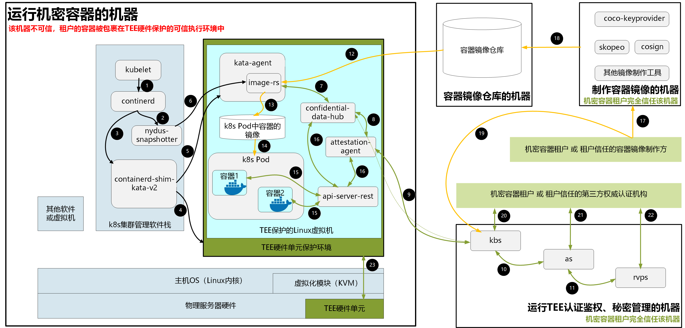
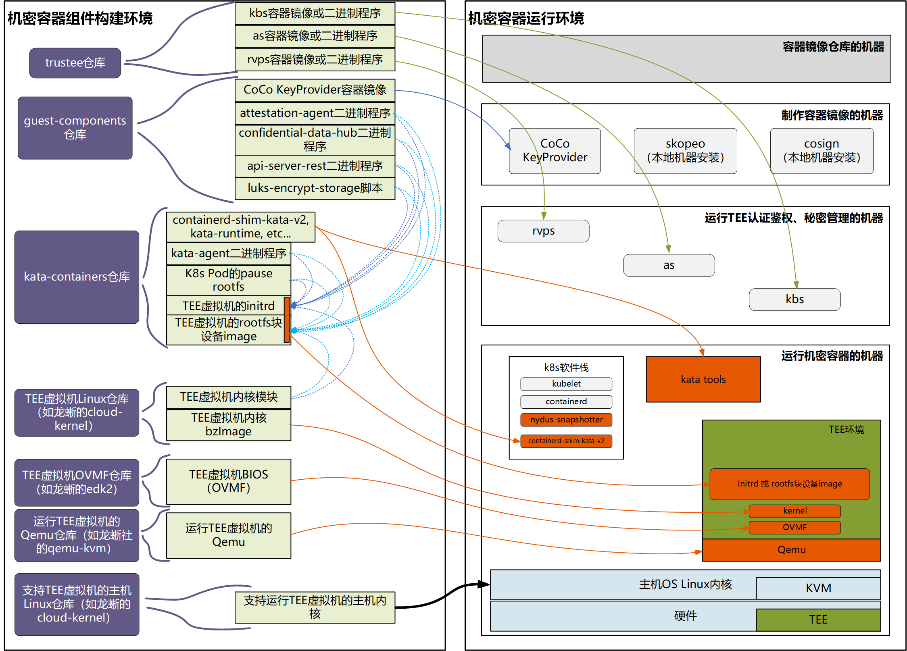
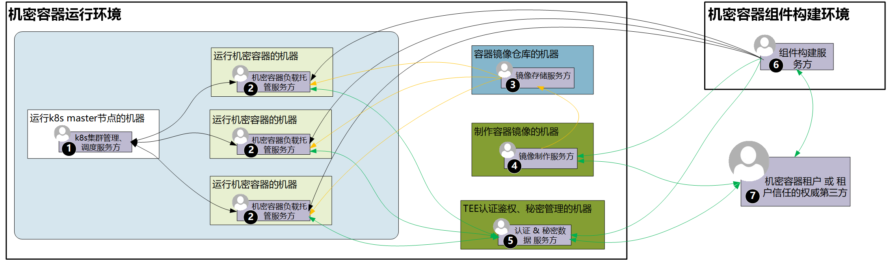

# 引言

> 如对Kata框架不感兴趣，请直接转到[快速测试海光机密容器（纯单机系统）](<03. 快速测试海光机密容器（纯单机系统）.md>)尝试实践。

## Kata使用轻量级虚拟机隔离容器环境

Kata是一种轻量级的容器技术，它将每个容器实例隔离在一个单独的轻量级虚拟机中，利用硬件虚拟化技术为容器提供更强的隔离边界。Kata的主要特点是：

- 安全隔离性高：通过将容器运行在独立的虚拟机中，实现了容器之间以及容器与宿主机之间的强隔离。即使某个容器被攻破，攻击者也难以突破虚拟机的隔离边界，从而保护了其他容器和宿主机的安全。
- 性能接近原生：Kata容器在启动速度和运行性能方面接近传统的Linux容器，同时又具备虚拟机级别的隔离特性。它采用了优化的虚拟化技术和轻量化的虚拟机配置，减少了虚拟化带来的性能开销。
- 与现有生态系统兼容：Kata容器与主流的容器编排工具k8s和容器运行时（如runc、containerd等）兼容。大多数场景下，用户可以轻松地使用Kata部署现有的容器化应用，无需对应用程序和基础设施进行大规模的修改。

## Kata机密容器及其发展史

最开始，Kata只是做到了容器的虚拟机隔离，这在某种程度上提高了容器运行的安全性，却无法做到数据级的安全，因为虚拟机的内存对于主机是可见的。

机密计算通过TEE硬件技术可以实现使用中的数据保护，恰恰现在大部分机密计算产品也都提供虚拟机级别的数据机密性和完整性保护，`Kata机密容器`便是在原Kata容器基础上，结合机密计算TEE硬件发展起来的。

### KATA-2.5只是Kata机密容器的起点

Kata-2.5机密容器主要是在启动虚拟机之前对VMM（如Qemu）命令行进行扩展，使其能够根据Kata配置添加机密计算Qemu对象。例如，用户在Kata配置文件中打开 *机密虚拟机* 相关配置，这是启动Kata容器时，kata容器运行时会自动在创建虚拟机的VMM命令行中添加机密计算Qemu对象。

Kata-2.5机密容器有一个很明显的缺陷。它的容器rootfs是在主机侧创建的，通过`shared fs`设备将容器rootfs共享到虚拟机里，虚拟机里的容器负载动态读写共享的容器rootfs，如果rootfs里有秘密代码和数据，那么这些秘密代码和数据将被暴露无遗。

### [KATA-3](<../01. KATA-3/01. 环境搭建.md>))展示了较完整的Kata机密容器雏形

> 这里的KATA-3指的是Kata CC-v0.5.0版本，这是基于Kata 3.1.0-rc0开发的专门用于支持机密容器的Kata版本。

Kata-3开始将容器的镜像下载和容器rootfs的创建迁移到虚拟机侧进行，确保容器的rootfs只有虚拟机自己可以看到，有效杜绝了`shared fs`的容器rootfs暴露问题。

此外，通过镜像加密和签名等技术确保容器镜像的存储安全及完整性。

- 虚拟机在拉取加密或签名的镜像时，会与`simple-kbs`进行远程认证过程，当远程认证通过时，会从`simple-kbs`请求得到镜像的加密或签名密钥，最终在虚拟机中对签名的镜像验签确认完整性，对加密的镜像layers层层解密并创建出容器的rootfs。

`simple-kbs`是一个微服务，包含了秘密数据存储/提供、远程证明服务、启动度量参考值服务3个重要功能。

- 秘密数据存储/提供：旨在本地存储秘密数据（一般通过后台运行的数据库存储）以及提供秘密数据（通过索引ID从数据库中获取秘密数据）给被证明可信的Kata机密容器/虚拟机
- 远程证明服务：旨在验证Kata机密容器/虚拟机是否是一个可信的TEE
- 启动度量参考值服务：旨在存储预先设定Kata机密容器/虚拟机的启动度量值（即启动度量参考值，一般通过后台运行的数据库存储），如果Kata机密容器/虚拟机想从`simple-kbs`获取秘密数据，那么除了认证报告是可信的，其启动度量值也要与`simple-kbs`存储的对应启动度量值（通过索引ID从数据库中获取启动度量参考值）吻合。

整体上来看，Kata-3已经具备了较完整机密容器的雏形，但是它仍然存在部署和易用性等各方面问题，主要列举如下：

- 主机containerd必须替换成机密容器专有的版本
- `simple-kbs`的使用和访问方式均不够直观
- kata配置文件中关于机密容器的相关配置过于复杂
- Kata虚拟机内拉取的镜像仓库auth配置困难
- Kata机密容器的rootfs必须挂载到虚拟机的tmpfs中，会大量占用虚拟机内存（缺少安全挂载到虚拟机加密盘上的支持）
- 无法持久存储机密容器（容器退出后，容器rootfs就会丢失，无法找回）
- 自签名私有镜像仓库使用困难
- 无法配置镜像仓库Mirror

### [KATA-3.13](<01. KATA-3.13框架和角色介绍.md>)逐渐规范化机密容器，逐步云原生化

[KATA-3.13](<01. KATA-3.13框架和角色介绍.md>)介绍的是Kata-3.13版本，它解决了[KATA-3](<../01. KATA-3/01. 环境搭建.md>))在部署和易用性方面的大多数问题。

- 通过containerd配置nydus snapshotter插件，通过插件引导通知虚拟机内部拉取镜像
- 对机密容器各个功能组件做了细致的边界划分，原来的`simle-kbs`使用`kbs（Key-Broker-Service）`，`as（Attestation-Serveice）`，`rvps（Reference-Value-Provider-Service）`微服务系统进行了替代
- 简化kata配置文件中机密容器相关的字段，大部分关键信息通过agent配置参数传递，直接在pod yaml中添加annotations键/值对信息即可
- 镜像仓库auth json数据可以存放在`kbs`微服务中，并通过在pod yaml中添加annotations告知auth json数据的访问路径，Kata机密容器/虚拟机在与`kbs`远程认证通过后，可以取得auth json数据
- 可以配置k8s存储卷资源到pod yaml，Kata机密容器/虚拟机通过Luks创建加密块设备，并在加密块设备上存储容器镜像以及容器rootfs

此外，随着[operator](https://github.com/confidential-containers/operator)和[trustee-operator](https://github.com/confidential-containers/trustee-operator)的成熟，基于这2个仓库可以实现k8s集群内机密容器环境的快速部署，极大地增加了Kata机密容器的易用性。

当然，目前还剩以下几个问题未解决，但解决相关问题的工作已经在进行了，海光会持续更新相关支持到[KATA-3.13](<01. KATA-3.13框架和角色介绍.md>)。

- 无法持久存储机密容器（容器退出后，容器rootfs就会丢失，无法找回） **TODO**
- 自签名私有镜像仓库使用困难 *（[快速测试海光机密容器（纯单机系统）](<03. 快速测试海光机密容器（纯单机系统）.md>)和[快速测试海光机密容器（复杂多机系统）](<04. 快速测试海光机密容器（复杂多机系统）.md>)中的使用的虚拟机initrd是经过特殊处理的，可以支持自签名私有镜像仓库，特殊处理并不是普遍适用的方法，正面的解决办法正在进行中）* **TODO**
- 无法配置镜像仓库Mirror **TODO**
- 支持DCU **TODO**

# [KATA-3.13](<01. KATA-3.13框架和角色介绍.md>)原理介绍

Kata-3.13机密容器是一个复杂的工作系统，为了让用户更好地理解Kata-3.13机密容器 *各个组件的功能*、*各个组件如何构建*、*各个角色*，这里把Kata-3.13机密容器的整个框架拆分成多个图例进行展示。

- 图1，展示Kata-3.13机密容器**运行环境**的关键执行流、数据流、组件
- 图2，展示Kata-3.13机密容器**构建环境**中构建的关键组件及其关系
- 图3，展示包含Kata-3.13机密容器**运行环境**和**构建环境**的全局角色关系图

## 详解Kata-3.13机密容器运行环境的关键执行流、数据流、组件

图1 Kata-3.13机密容器**运行环境**的关键执行流、数据流、组件

> 为了避免组件过多影响到用户对关键组件的理解，这里没有把运行TEE虚拟机所需的`qemu（虚拟机VMM）`、`bzImage（虚拟机内核）`、`initrd（虚拟机initrd）`、`image（包含虚拟机rootfs的镜像文件）`、`OVMF（虚拟机BIOS）`添加到图1。

图1中的黑色箭头线条表示的是不可信的执行流或数据流，橙色箭头线条表示的是机密容器镜像相关的执行流或数据流，绿色箭头线条表示的是与TEE环境验证和秘密数据通信有关的执行流或数据流。图中，有2个例外，就是标记 *17* 和 *19* 的橙色箭头线条，这2个不仅表示了机密容器镜像相关的执行流或数据流，也包含机密容器镜像有关的秘密数据的执行流或数据流（比如加密镜像的密钥，签名镜像的验签公钥）。

以下是图1中各个标记的箭头线条含义：

1. `kubelet`通过CRI向`containerd`发送Pod/容器的有关请求。
2. `containerd`识别到是Kata机密容器的OCI运行时，则使用`nydus-snapshotter`快照器插件获取快照，`nydus-snapshotter`会创建一个后续提供给TEE虚拟机中kata-agent的`容器镜像下载描述数据包`。
3. `containerd`调用底层的OCI运行时`containerd-shim-kata-v2`来执行Pod/容器有关的具体操作。
4. `containerd-shim-kata-v2`创建并启动一个TEE虚拟机。
5. `containerd-shim-kata-v2`与TEE虚拟机中的`kata-agent`通信，由`kata-agent`执行Pod/容器有关的命令。
6. `nydus-snapshotter`把`容器镜像下载描述数据包`传递给TEE虚拟机中的kata-agent。
7. `kata-agent`集成的`image-rs`针对加密/签名的容器镜像，与`confidential-data-hub`进程交互获取加密/签名容器的密钥。
8. `confidential-data-hub`经由`attestation-agent`去进行远程认证，`confidential-data-hub`只有在远程认证通过后，才能与`kbs`（Key-Broker-Service）通信取得秘密数据。
9. `attestation-agent`发送TEE认证报告给`kbs`，`kbs`将其认证结果返回给`attestation-agent`。这里，`kbs`会有自己的对`as`（Attestation-Service）返回的认证结果的判定策略（resource policy），这会在后续的测试中解释。
10. `kbs`发送TEE认证报告给`as`，`as`把其认证结果返回给`kbs`。这里，`as`会对TEE认证报告进行验证，并依据自己的判定策略（attestation policy）做一个综合评判，其综合评判的结构化数据作为认证结果返回给`kbs`，这会在后续的测试中解释。
11. `as`从`rvps`取得参考值数据。这里，`as`自己的判定策略里会要求TEE认证报告中一些字段必须与`rvps`提供的参考值匹配，这些匹配结果会反映在综合评判的机构化数据中，这会在后续的测试中解释。
12. `image-rs`从`容器镜像下载描述数据包`中提取镜像信息，并从`容器镜像仓库`中拉取镜像manifests，layers等。
13. `image-rs`把镜像存储到虚拟机本地。
14. 基于本地存储的镜像创建k8s Pod中的`容器1`、`容器2`。
15. `容器1`/`容器2`的负载发送秘密数据或TEE认证报告的访问请求给`api-server-rest`，`api-server-rest`把秘密数据或TEE认证报告返回给`容器1`/`容器2`。
16. `api-server-rest`与`confidential-data-hub`交互获取秘密数据，与`attestation-agent`获取TEE认证报告。
17. 机密容器所有者信任的角色登录**制作容器镜像的机器**，并在**制作容器镜像的机器**上制作镜像。
18. 机密容器所有者信任的角色把镜像上传到`容器镜像仓库`。
19. 机密容器所有者信任的角色把加密/签名镜像的密钥上传到`kbs`，`kbs`存储这些密钥，TEE虚拟机中的`kata-agent`/`image-rs`在远程证明通过后，从`kbs`下载这些密钥，对容器镜像进行验签和解密。
20. 机密容器所有者信任的角色与`kbs`交互更新秘密数据、更新`kbs`的判定策略（resource policy）等。
21. 机密容器所有者信任的角色与`as`交互更新`as`的判定策略（attestation policy）等。
22. 机密容器所有者信任的角色与`rvps`交互更新机密容器所在TEE环境的评估参考值，该参考值用于指定TEE环境的预期配置等。
23. TEE硬件单元（包含TEE固件等）为虚拟机提供TEE环境，位于TEE环境下的虚拟机内存受到机密性和完整性保护。

## 详解Kata-3.13机密容器构建环境中构建的关键组件及其关系

图2 Kata-3.13机密容器**构建环境**中构建的关键组件及其关系

从图2可以看出 ***机密容器组件构建环境*** 构建出的各个组件是用于在 ***机密容器运行环境*** 中运行并提供机密容器能力的。

* ***机密容器组件构建环境*** 可以是任意一台C86或X86的主机或虚拟机，构建环境的OS可以是任意OS，经实验在`AnolisOS-23`和`ubuntu-20.04`这2个OS上均是可以实现完全构建的，[KATA-3.13](<01. KATA-3.13框架和角色介绍.md>)的[构建方法](<05. 用户从0开始-编译-制作-安装-机密容器组件.md>)是基于`AnolisOS-23`描述的。
* ***机密容器运行环境*** 涉及到多个运行的机器：
  - **容器镜像仓库的机器**用于作为运行环境所需容器镜像的仓库源。（该机器可以是以下机器的其中一种，只要保持网络连通性即可。）
    - 可以是一台独立的物理机。
    - 可以是一台独立的虚拟机。
    - 也可以是与 ***机密容器运行环境*** 其他机器共用环境的一台机器。
  - **制作容器镜像的机器**用于专门制作加密/签名的容器镜像，并把制作好的镜像上传到**容器镜像仓库的机器**中的镜像管理仓库中。该机器是作为机密容器租户可信的一方存在的。（该机器可以是以下机器的其中一种，只要保持网络连通性即可。）
    - 可以是一台独立的物理机。
    - 可以是一台独立的虚拟机。
    - 也可以是与**运行TEE认证鉴权、秘密管理的机器**共用环境的一台机器。
    -  ***（不建议）*** 也可以是与 ***机密容器运行环境*** 其他机器共用环境的一台机器。（仅限于实验机密容器时这么做，部署环境中建议使用以上3种机器作为**制作容器镜像的机器**，因为**容器镜像仓库的机器**和**运行机密容器的机器**并不被视为是可信的。）
  - **运行TEE认证鉴权、秘密管理的机器**用于对TEE虚拟机（以及TEE虚拟机中的容器）进行身份证明、授权，以及传递秘密数据给TEE虚拟机（以及TEE虚拟机中的容器）。该机器是作为机密容器租户可信的一方存在的。（该机器可以是以下机器的其中一种，只要保持网络连通性即可。）
    - 可以是一台独立的物理机。
    - 可以是一台独立的虚拟机。
    - 也可以是与**制作容器镜像的机器**共用环境的一台机器。
    -  ***（不建议）*** 也可以是与 ***机密容器运行环境*** 其他机器共用环境的一台机器。（仅限于实验机密容器时这么做，部署环境中建议使用以上3种机器作为**运行TEE认证鉴权、秘密管理的机器**，因为**容器镜像仓库的机器**和**运行机密容器的机器**并不被视为是可信的。）
  - **运行机密容器的机器**作为机密容器的宿主机，通过宿主机上的一系列组件托起TEE虚拟机（以及TEE虚拟机中容器）的运行。该机器必须是支持TEE的物理主机，且需要保证与**容器镜像仓库的机器**、**制作容器镜像的机器**、**运行TEE认证鉴权、秘密管理的机器**的连通性。
* ***机密容器构建环境*** 与 ***机密容器运行环境*** 没有强耦合关系，用户可以自己将一台主机或虚拟机作为 ***机密容器构建环境*** 并构建机密容器的组件。

在 ***机密容器组件构建环境*** 中：

- 基于[trustee仓库](https://github.com/confidential-containers/trustee)构建出`kbs`、`as`、`rvps`。
  - 这3个组件最终在**运行TEE认证鉴权、秘密管理的机器**上运行。
  - 这3个组件分别既可以是二进制服务程序形式、也可以是容器形式。
- 基于[guest-components仓库](https://github.com/confidential-containers/guest-components)构建出`CoCo KeyProvider容器镜像`。
  - `CoCo KeyProvider容器`最终在**制作容器镜像的机器**上运行，用于进行机密容器的加密镜像制作。
- 基于[guest-components仓库](https://github.com/confidential-containers/guest-components)构建出`attestation-agent`、`confidential-data-hub`、`api-server-rest`、`luks-encrypt-storage`。
  - `attestation-agent`、`confidential-data-hub`、`api-server-rest`、`luks-encrypt-storage`这4个是TEE虚拟机的关键组件，会被集成到TEE虚拟机的`initrd`和`rootfs块设备镜像image`中。
  - `attestation-agent`就是常说的`AA`，用于生成认证报告，认证报告会被`kbs`、`as`用于验证TEE身份。
  - `confidential-data-hub`即使常说的`CDH`，用于对机密数据进行请求、处理等。
  - `api-server-rest`就是常说的`ASR`，它可与`AA`和`CDH`进行绑定，TEE虚拟机中的容器通过`ASR`获得`AA`和`CDH`的服务。
  - `luks-encrypt-storage`是一个脚本，用于辅助实现块设备安全挂载，这样机密容器需要的容器镜像、容器rootfs、容器动态存储均落盘到安全挂载的块设备中，避免了对TEE虚拟机内存的大量占用。
- 基于[kata-containers仓库](https://github.com/kata-containers/kata-containers)构建出`containerd-shim-kata-v2, kata-runtime, etc...`、`kata-agent`、`k8s Pod的pause rootfs`、`initrd`、`rootfs块设备镜像image`。
  - `containerd-shim-kata-v2, kata-runtime, etc...`包含了`containerd-shim-kata-v2`和`kata-runtime, etc...`。其中，`containerd-shim-kata-v2`最终在**运行机密容器的机器**上运行，作为 *k8s软件栈* 中与containerd交互的shim，实现k8s对机密容器生命周期的管理。`kata-runtime, etc...`最终作为**运行机密容器的机器**上的 *kata tools* ，辅助调试、监控等。
  - `kata-agent`是TEE虚拟机中的Pod/容器代理工具，与 *k8s软件栈* 交互，管理TEE虚拟机中的Pod/容器的整个生命周期。`k8s Pod的pause rootfs`作为TEE虚拟机中Pod的pause镜像的rootfs。`kata-agent`、`k8s Pod的pause rootfs`作为TEE虚拟机中的关键组件，会被集成到TEE虚拟机的`initrd`和`rootfs块设备镜像image`中。
  - `initrd`可作为TEE虚拟机启动的rootfs（见**运行机密容器的机器**中的橙色`initrd 或 rootfs块设备image`），其集成了TEE虚拟机中运行机密容器的关键组件。`initrd`、`rootfs块设备镜像image`是互斥使用的。
  - `rootfs块设备镜像image`也是作为TEE虚拟机启动的rootfs存在的（见**运行机密容器的机器**中的橙色`initrd 或 rootfs块设备image`），只是它是以虚拟机块设备形式存在的，其集成了TEE虚拟机中运行机密容器的关键组件。`initrd`、`rootfs块设备镜像image`是互斥使用的。
- 基于 *TEE虚拟机Linux仓库（如龙蜥的cloud-kernel）* 构建出`虚拟机内核模块`、`虚拟机内核文件bzImage`。
  - `虚拟机内核模块`用于提供TEE虚拟机必须的内核模块，会被集成到TEE虚拟机的`initrd`和`rootfs块设备镜像image`中。
  - `虚拟机内核文件bzImage`是运行TEE虚拟机的Linux内核文件（见**运行机密容器的机器**中的橙色`kernel`）。
- 基于 *TEE虚拟机OVMF仓库（如龙蜥的edk2）* 构建出`虚拟机BIOS（OVMF）`。
  - `虚拟机BIOS（OVMF）`是启动TEE虚拟机的BIOS文件（**运行机密容器的机器**中的橙色`OVMF`）。
- 基于 *运行TEE虚拟机的Qemu仓库（如龙蜥的qemu-kvm）* 构建出`运行TEE虚拟机的Qemu`。
  - `运行TEE虚拟机的Qemu`是虚拟机管理器，运行创建、运行TEE虚拟机等（见**运行机密容器的机器**中的橙色`Qemu`）。
- 基于 *支持TEE虚拟机的主机Linux仓库（如龙蜥的cloud-kernel）* 构建出`支持运行TEE虚拟机的主机内核`。
  - `支持运行TEE虚拟机的主机内核`是**运行机密容器的机器**的主机内核。

## 详解Kata-3.13机密容器运行环境和构建环境的全局角色关系图

图3 Kata-3.13机密容器**运行环境**和**构建环境**的全局角色关系图

为了让用户更清晰地理解在一整套从**构建**到**运行**涉及的所有机器和角色，图3提供了机密容器**运行环境**和**构建环境**的全局角色关系图。以下对所有角色进行着重描述（图3中黑色数字圆圈标记了角色）。

- **角色1**：位于**运行k8s master节点的机器**，是 *k8s集群管理、调度服务方（control-plane node）* 。当然，通过配置 *control-plane node* 可调度启动Pod，并添加`node.kubernetes.io/worker`标签，那么**角色1**也包含了**角色2**，此时，**运行k8s master节点的机器**同时也是**运行机密容器的机器**。
- **角色2**：位于**运行机密容器的机器**，是 *机密容器负载托管服务方* 。机密容器的租户向**角色2**提出运行机密容器的请求，**角色2**在**运行机密容器的机器**上创建并运行机密容器。
- **角色3**：位于**容器镜像仓库的机器**，是 *镜像存储服务方* ，用于为机密容器租户提供容器负载。
- **角色4**：位于**制作容器镜像的机器**，是 *镜像制作服务方* 。**角色7**与**角色4**交互，制作并上传加密/签名镜像到**角色3**。
- **角色5**：位于**TEE认证鉴权、秘密管理的机器**，是 *认证 \& 秘密数据的服务方* 。**角色7**把秘密数据（如镜像解密密钥、镜像验签公钥，等）、认证策略、认证评估参考值等登记到**角色5**，**角色5**对**角色2**上运行的机密容器环境进行身份证明，在证明机密容器环境的身份可信后，将秘密数据传递给**角色2**上的机密容器环境使用。
- **角色6**：位于 ***机密容器组件构建环境*** ，是 *组件构建服务方* 。**角色7**与**角色6**交互，构建所有机密容器运行所需要的组件，这些组件最终安装到 ***机密容器运行环境*** 的各个机器上，各个机器上的对应角色负责完成机密容器的执行流和数据流。
- **角色7**：这里把**角色7**独立于 ***机密容器运行环境*** 和 ***机密容器组件构建环境*** ，主要是说明他是一个执行人或机构。**角色7**既可以是机密容器租户，也可以是租户信任的权威第三方。
  - 通过与**角色4**交互，完成机密容器负载镜像的制作和存储。
  - 通过与**角色5**交互，完成：a. 上传机密容器所须的秘密数据；b. 设置机密容器的身份验证策略；c. 登记机密容器身份的参考值。
  - 通过与**角色6**交互，完成机密容器运行所须所有组件的构建。
