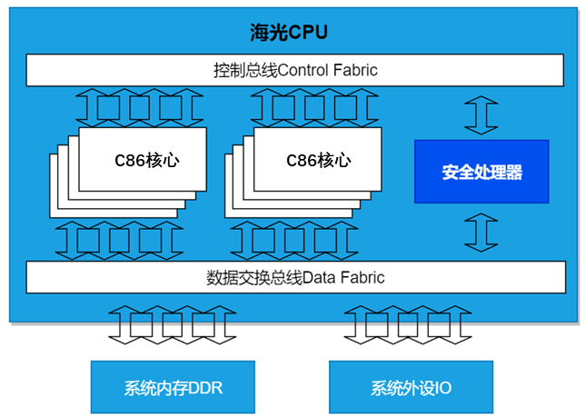
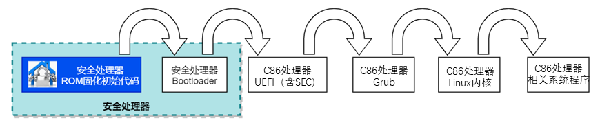
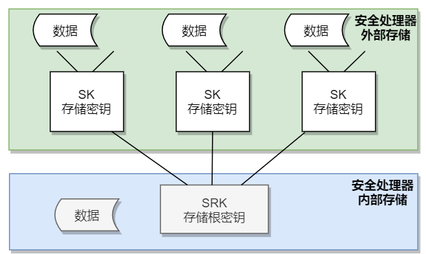
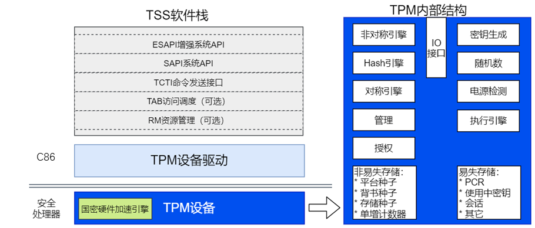
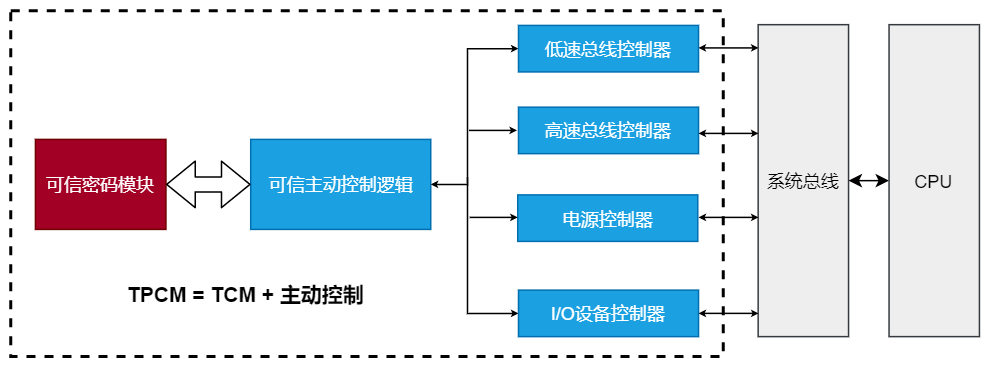
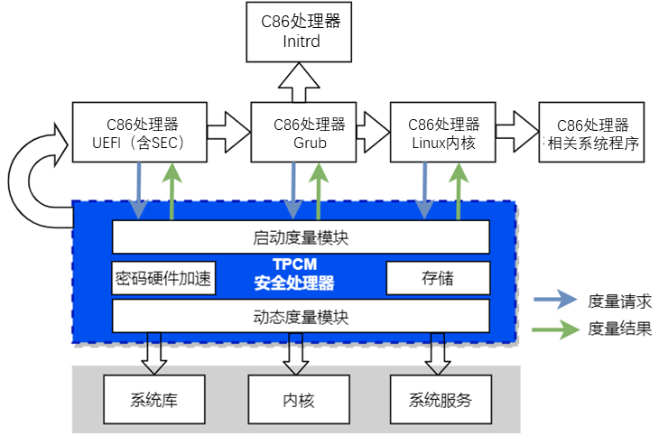
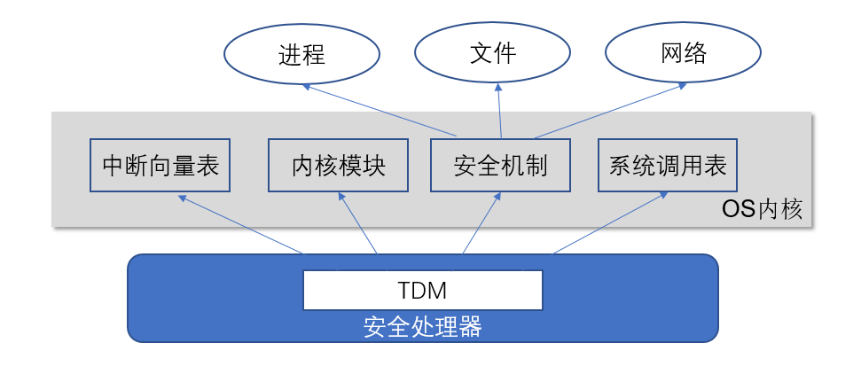
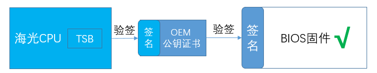
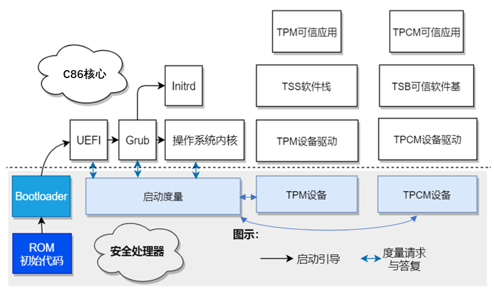
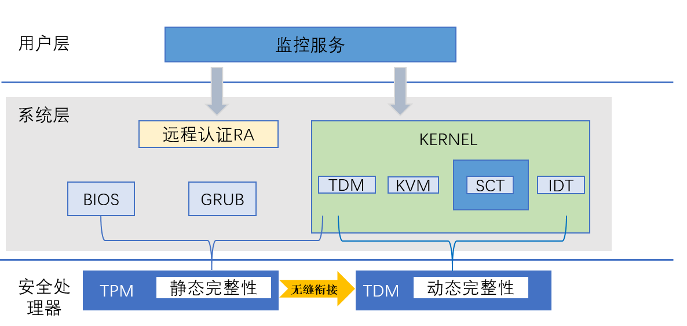

# 一、简介

## 可信计算背景

随着云计算，互联网金融，大数据技术的快速发展，计算机信息安全的重要性正日益为人们所重视。传统的安全防护机制主要是入侵检测，病毒查杀等基于“封堵查杀”的“被动防御”，主要原理是通过提取病毒木马等恶意代码的特征数据建立特征数据库，然后利用特征数据库进行恶意软件的判定。特征数据库类似恶意软件的“黑名单”，由于建立特征数据库基于的是现有代码，只对已知病毒木马等有效，而对变异后或新出现的恶意软件无效。同时，借助与网络，病毒木马等往往具有传播快，隐蔽性高等特点，从生成到被发现研究，然后提出安全修补方案期间，成千上万的系统可能已经受到感染，损失已经造成。这种安全防护上的迟滞性是传统安全机制的一个天生缺陷。

扭转安全防护上的被动局面从根本上解决计算机安全问题，必须从源头上分析，以系统化的方式让计算机系统具有自我保护的免疫功能。

## 什么是可信计算

可信计算是一种与传统安全机制有着本质不同的安全防护机制，克服了传统安全机制具有的迟滞性缺陷，在系统安全保护上具有明显的优势。可信计算监视系统运行状况，使系统能自动识别自我和非我，从而能对恶意程序及时做出响应，阻断其运行。

国际上，1999年10月由Compaq, HP, IBM，Intel，微软等科技公司成立了可信计算平台联盟TCPA（Trusted Computing Platform Alliance）；2003年，TCPA改组成了可信计算组织TCG（Trusted Computing Group），成立当年包括中国联想等超过70家科技公司加入该组织。TCG组织的主要目标是制定可信计算领域相关的标准和规范，推动可信计算技术和产业的发展。TCG制定了TPM（Trusted Platform Module）可信平台模块标准并不断进行升级，TPM最新版本是2.0，密码运算部分增加了中国国密标准支持。

中国国内，2012年国家密码管理局制定了TCM（Trusted Cryptography Module）可信密码模块标准；2014年在沈昌祥院士提议下成立了中关村可信计算产业联盟提出了可信计算3.0的概念，并由此提出了TPCM（Trusted Platform Control Module）可信平台控制模块标准，TPCM相对TPM/TCM等加入了主动防御控制的功能；在2019年底出台的信息系统安全等级保护2.0规范中，增加了大量可信计算相关内容，对可信计算提出了更高要求。

可信计算技术在计算机安全防护上正发挥出越来越重要作用，得到了日益广泛的关注和应用。

# 二、海光CPU原生可信计算优势

传统的可信计算方案通常使用单独的安全芯片，安全芯片外接于主板上，与CPU通过总线连接。传统方案增加硬件成本的同时，加大了主板硬件设计的复杂度，另外往往由于外接模块系统权限受限，无法直接访问系统所有硬件资源，存在一定功能限制也缺乏足够的灵活性。

海光CPU利用内置安全处理器对可信计算做了相关支持与拓展，在CPU内部实现了TPM2.0模块（Trusted Platform Module，国际标准）、TCM2.0模块（Trusted Crypto Module，中国传统标准）、TPCM模块（Trusted Platform Control Module，中国新兴标准）、TDM模块（Trusted Dynamic Measuring, 海光私有）及TSB模块（Trusted Secure Boot，海光私有）五大可信功能模块，相比传统方案具有如下优势：

1. 无需主板硬件支持，通用性强，且无额外硬件成本；
2. 使用芯片内部固化的核心度量根CRTM，系统启动时主动度量BIOS，可信引导更安全；
3. 功能内置于CPU，有效抵抗外部物理攻击；
4. 安全处理器具有高系统优先级，可以对系统进行更多主动控制，功能更强；
5. 可以实现对系统关键部分动态保护，加固了系统的安全性；
6. 集成国密硬件引擎CCP，密码运算更高效；
7. 技术国产化，自主可控

# 三、海光CPU可信计算硬件

## 安全处理器

海光可信计算基于CPU内置安全处理器。如图一所示，海光CPU内置了一个独立的安全处理器，该安全处理器具有以下特点：

- 具有自己独立的资源，外部（包括C86核心）不可访问；
- 具有很高的系统权限，它可以访问所有的系统资源，包括CPU控制，系统内存及外设等；
- 系统上电时先于C86核心首先启动，C86核心何时启动由其决定，受其控制；
- 安全处理器的初始化代码固化在芯片内部，不可更改，初始代码对后续代码进行合法性和完整性验证，确保安全可靠；
- C86核心通过固定的硬件接口与安全处理器通讯。

图一 海光CPU架构图

安全处理器的上述特点非常适合实现可信计算相关应用，尤其是以TPCM为代表的对系统控制有高要求的场景，具有独特的优势。

## 国密硬件引擎CCP

可信计算是密码运算密集型技术，海光CPU内置了国密硬件引擎CCP对密码运算提供硬件加速，支持常用的密码算法，包括对称，非对称，Hash等。对称密码用来进行加解密及计算消息验证码HMAC，非对称密码用来进行签名验签及共享秘钥生成等，Hash用来度量及签名等。

使用CCP进行密码运算不占用CPU资源。海光片内CCP有两种类型，一种供安全处理器使用，支持TPM、TPCM等模块内部的密码运算；一种供C86核心使用，用来支持可信软件基，上层可信应用等内部的密码运算。两种CCP全面为可信计算体系各软件模块密码运算提供加速。

# 四、可信计算的几个核心功能

## 可信启动

可信启动是指系统在启动过程的各阶段，在完成本阶段任务跳转到下一阶段之前，先对下一阶段目标代码或数据进行合法性验证，验证的主要手段为度量，验证通过或将度量值记录在可信存储区域后跳转到目标运行，记录在可信存储区域的度量值可以供后续使用以确认系统可信状态。各阶段被上一阶段验证同时又验证下一阶段，通过这样一级一级的验证过程，系统启动过程的信任链得以建立，实现了系统启动阶段的可信。

在上述可信启动的过程中，初始的第一阶段没有上一阶段，被认为是可信启动的度量根CRTM。传统的可信计算方案度量根CRTM通常为系统上电启动的初始代码，如UEFI的SEC阶段初始代码，CRTM位于芯片外部，存在被篡改的风险。

海光可信启动的度量根为安全处理器上电启动时运行的初始代码，固化在CPU内部的ROM中，一旦芯片生产出来便无法修改，度量根的安全有保证。海光CPU可信启动过程由安全处理器内部固化的度量根（非UEFI的初始SEC代码）开始，一级一级完成各阶段的度量验证及执行，如图二所示，其中C86核心原先无法验证的UEFI初始阶段代码由安全处理器Bootloader度量验证后执行。

图二 海光CPU可信启动示意图

上述可见，海光可信启动天生支持“**启动主动度量**”，即启动时由源于CPU硬件的可信度量根对系统平台固件BIOS进行度量验证后再启动BIOS，完整确保了BIOS固件的安全。

## 动态度量

动态度量是指在系统启动后的运行过程中，由可信根对系统中相关目标进行动态的度量验证，动态体现在这种验证是周期性持续进行的，当检测到异常时及时的进行处理，确保系统的运行时安全。

可信启动及可信动态度量两者互为补充，可信启动确保系统“启动时”安全，可信动态度量确保系统“运行时”安全，两者结合实现系统从启动到运行的全运行周期安全。

## 可信存储

可信存储确保存储数据的安全，数据未授权不可被访问，更不可被篡改。海光安全处理器内部为可信存储提供了易失存储和非易失存储，易失存储具有访问快速特点，但掉电即丢失，用来存储临时需要保存的数据；非易失存储掉电不丢失，用来保存长期数据。可信存储的空间大小有限，当要存储的数据较大时，可以将数据进行加密后存在外部存储设备上，而将加密的秘钥存在安全处理器内部，如图三所示，进而逻辑上扩展了可信存储的范围。

图三 可信存储示意图

## 可信报告

安全处理器内部收集了大量系统的运行时信息，比如度量信息，审计信息等，准确的获取这些信息对系统健康状态的判定非常关键。在对外提供这些信息时，为了防止中间对信息的恶意篡改和攻击，必须对信息进行保护。通过对信息进行签名实现对信息的保护，签名使用国密算法。经过签名后的信息形成了可信报告，可信报告可通过网络提供给远程的可信管理中心，管理中心首先验证报告签名确认报告的真实性，然后通过报告内容可以获知报告的相关信息，进而为相关判定决策提供可靠依据。

# 五、海光CPU可信计算支持

## TPM2.0

TPM2.0是国际可信计算联盟TCG制定的关于可信计算的最新标准，和上一版1.0相比，2.0除了对某些功能进一步丰富和扩展之外（如授权部分中加入了基于策略的授权方式，授权的功能更加强大和灵活），对中国市场而言最重要的是密码计算中加入了中国国密标准支持。TPM2.0规范见https://trustedcomputinggroup.org/resource/tpm-library-specification/。

TPM标准在可信计算领域获得了广泛的支持和流行，围绕TPM标准的开发者众多，经过多年的发展建立了较为丰富的应用生态，其中最知名的当属微软的硬盘加密工具Bitlocker。

海光基于安全处理器以固件的形式实现了TPM2.0设备，命令接口符合TPM2.0规范，TPM命令列表及接口定义参见TPM2.0规范第三部分《Trusted Platform Module Library， Part 3: Commands》。同时，利用内置的密码运算硬件加速引擎CCP实现所有密码运算相关操作，克服传统固件实现TPM的不足，提高了系统性能，硬件加速引擎全面支持中国国密标准。

图四 基于海光TPM可信软件架构示意图

海光基于安全处理器的TPM2.0支持，配合C86侧TPM设备驱动，可以方便的融入TPM生态，快速使能各种基于TPM的上层可信应用。基于海光TPM的可信软件架构如图四所示，从下到上依次为TPM设备，TPM设备驱动，TSS软件栈，各种可信应用，其中TSS软件栈之上为平台无关层，TSS软件栈与TPM设备驱动层之间有规定的标准接口。TSS软件栈参考实现如下：

- https://sourceforge.net/projects/ibmtpm20tss/
- https://github.com/tpm2-software/tpm2-tss

## TCM2.0

TCM是国内传统的可信计算标准，有着广泛的应用。2020年国密局升级了TCM标准，推出了TCM2.0规范《GM/T 0012-2020 可信计算 可信密码模块接口规范》。TCM2.0功能与接口的定义基于TPM2.0，与TPM2.0具有较强的兼容性，TCM2.0只支持中国国密标准。

海光CPU从海光3号开始内置TCM2.0支持，与TPM2.0一样，TCM2.0基于CPU安全处理器以固件的形式实现，海光CPU固件以BIOS PI的形式发布给OEM厂商，因此使用TCM2.0需与OEM厂商确认BIOS已使能该功能支持。

## TPCM

TPCM（Trusted Platform Control Module）是国内新兴的可信计算技术，是中国可信计算3.0的底层芯片标准，实现可信计算的信任根，由中关村可信计算联盟制定。和TPM/TCM相比，TPCM增加了对系统主动监视和控制的功能，如图五所示，可以实现系统启动时的主动启动度量，及程序运行时的动态度量和监控，进一步增强系统的安全性。

图五 TPCM架构示意图

传统的TPM/TCM设备是系统中的从设备，系统访问权限低，无法实现对系统主动监控的功能。海光内置安全处理器具有高系统优先级，可以直接访问系统配置，内存，外设IO等，并在检测到异常时及时对系统进行控制，完整实现了对TPCM的支持。

基于TPCM的启动度量与标准TPM度量相比，除了实现核心度量根CRTM对UEFI初始代码进行度量外，还能在度量时根据度量结果进行控制。如图六所示，启动各阶段对下一阶段进行度量时，根据下一阶段度量目标生成度量请求并发送给TPCM，TPCM根据内部的度量基准值对度量目标进行度量验证，并将度量结果返回给CPU，CPU根据度量结果决定继续或拒绝执行。可见，基于TPCM的可信度量能够及时发现系统启动异常并阻止异常代码的运行，将异常代码对系统的破坏降低到最低限度。

图六 TPCM启动度量与动态度量图

在系统运行时，TPCM根据系统配置的策略，可以对设定的目标，比如内核中断向量表、系统调用表，进行动态度量。通过周期性持续的对目标进行度量，并与度量基准值进行比较判定，动态度量可以及时发现系统运行时异常，以便及时进行预警及处理。动态度量与启动度量相结合有效保证了程序完整运行周期的安全。

## TDM

TDM（Trusted Dynamic Measurement）为海光基于安全处理器实现的轻量级动态度量，是海光的特有功能。如图七所示，通过TDM可以实现对设定内存目标进行持续的周期性度量，及时发现程序异常，保护程序运行时安全；同时TDM通过独有的双重授权保护方式确保非授权用户无法篡改TDM内的度量任务设定，极大的增强了模块的安全性。

图七 TDM动态度量保护图

## TSB

平台固件BIOS的完整性验证是启动信任链可信的关键和基础，传统的CPU由于缺少专门硬件支持无法验证BIOS的完整性。海光TSB（Trusted Secure Boot）是除了上述TPCM/TPM/TCM之外另一个独立的由CPU硬件验证平台固件BIOS完整性的功能，验证基于数字签名。

图八 CPU校验BIOS固件完整性

如图八所示，CPU上电或重启时，TSB首先验证由海光颁发的OEM公钥证书，再用OEM公钥证书中的公钥验证BIOS固件的OEM签名，验证通过后才运行BIOS固件，从而保证BIOS固件的安全以及后续整个启动信任链的源头安全。

海光TSB满足新版标准《GB/T 39680-2020 信息安全技术 服务器安全技术要求和测评准则》中对基于硬件信任根验证平台固件的安全启动要求。

# 六、海光可信计算功能应用场景

由前述可见，海光可信计算技术具有良好的扩展性。基于海光内置安全处理器的可信计算支持包括TPM2.0，TPCM，TDM等。这些功能被集成到一块CPU上，成为CPU的一部分。用户可以根据具体的场景及需要进行配置，可以使用所有的功能，也可以选择部分使用。

如图九所示为基于海光可信计算技术的场景一示例，其中启动度量可以基于TPM，也可以基于TPCM，或者两者都有。

图九 基于海光可信计算技术场景一示例

首先系统上电时由始于海光固化核心度量根CRTM的可信引导机制完成对UEFI，Grub，操作系统内核及相关内核模块的度量验证，确保系统进入一个可信可靠的初始状态；基于TPM的应用和基于TPCM的应用在系统中同时存在，独立运行；同时具体的应用或系统服务启动时根据需要进行启动时度量验证；在系统运行时通过动态度量对系统进行持续周期性度量扫描，包括TSS和TSM等，保证程序全生命周期的安全。

如图十所示为基于海光可信计算技术的场景二示例。

图十 基于海光可信计算技术场景二示例

该场景主要分为两个部分：TPM对服务器启动阶段的启动度量和TDM在服务器启动后的动态度量。

机器上电后，海光TPM从核心度量根开始依次对BIOS, Grub，Kernel进行度量，并将度量值Hash扩展入相应的PCR寄存器，远程监控中心通过获取TPM中经过签名的PCR值与预期值进行对比判断机器身份与状态的可信性，从而保护系统的启动时安全。

TDM通过持续度量动态保护系统中指定的关键应用，比如TDM驱动、系统调用表、中段描述符表等，从而保护系统的运行时安全。当TDM保护的模块出现异常时， TDM将动态监测到异常向外发送异常通知，同时记录该异常供后续可信查询，监控服务定期查询系统状态，监测到异常后进行相应处理。

该可信计算技术场景从TPM启动度量无缝过渡到启动后的TDM动态度量，形成了一条完整的安全信任链，实现了对系统启动时和运行时的全面保护，增强了系统的安全性。
