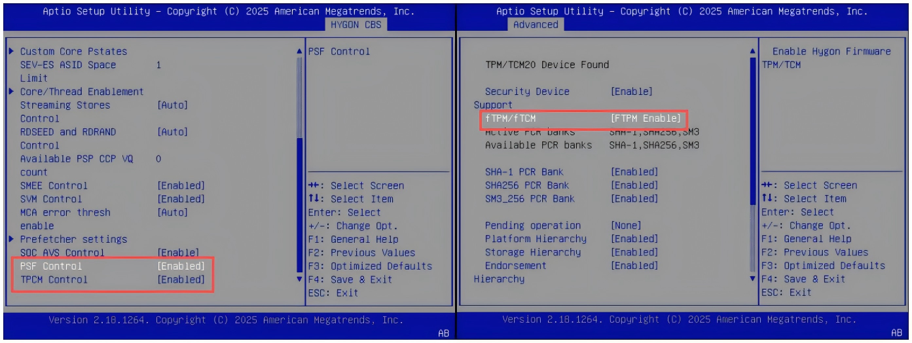
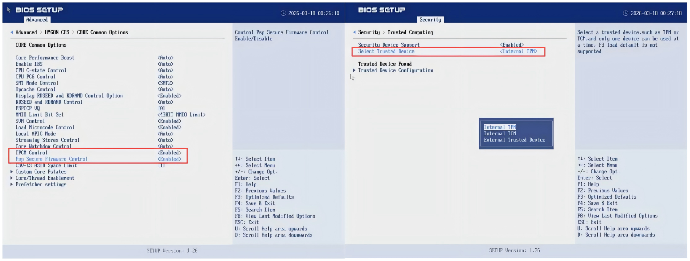

## 配置要求

| 配置           | 要求                                                         | 备注                                                         |
| -------------- | ------------------------------------------------------------ | ------------------------------------------------------------ |
| CPU            | 海光2号及以上                                                |                                                              |
| BIOS           | 海光2号和C86-3G：PI版本 \>= 2.1.0.4 <br/>海光C86-4G：PI版本 \>= 4.2.0.0 | 具体PI版本信息请参考：[PI版本与安全功能对照表](<../../00. C86 DevKit 概览/02. 安全技术概览/01. PI版本与安全功能对照表.md>) |
| BIOS Setup配置 | **必选**：开启加载安全固件的配置<br />可选：使用TPCM功能必须开启加载TPCM固件的配置；<br />可选：使用TPM/TCM功能必须开启相关使能配置； | 下图1、图2配置仅供参考，请以实际BIOS提供的配置为准           |
| 安全固件       | 以BIOS自带的版本为准                                         | 支持动态升级安全固件，请参考：[安全固件动态升级](<../../07. 工具/01. 海光安全工具/03. 安全固件动态升级.md>) |
| OS             | 需要适配可信功能，包括内核、GRUB及软件栈等；<br />如果是未适配的OS，请提出适配需求； | 国产OS支持情况，请参考：[国产OS安全功能支持情况](<../../00. C86 DevKit 概览/02. 安全技术概览/02. 国产OS安全功能支持情况.md>) |
| 证书           | 使用可信功能必须导入海光通用安全证书                         | 导入证书说明，请参考：[导入通用安全证书](<../../07. 工具/01. 海光安全工具/02. 导入通用安全证书.md>) |

图1 海光2号和C86-3G使能加载安全固件、tpcm固件以及使能tpm、tcm配置的示例



> 必选：*HYGON CBS -\> Moksha Common Options* 中设置 *PSF Control* 为 *Enabled* ；
> 
> 可选：使用TPCM功能时，*HYGON CBS -\> Moksha Common Options* 中设置 *TPCM Control* 为 *Enabled* ；
> 
> 可选：使用TPM或者TCM功能时，*Advanced -\> Trusted Computing -\> fTPM/fTCM* 中选择设置为 *FTPM* 或者 *FTCM* ；

图2 海光C86-4G使能加载安全固件、tpcm固件以及使能tpm、tcm配置的示例



> 必选：*Advanced -\> HYGON CBS -\> Core Common Options* 中设置 *Psp Secure Firmware Control* 为 *Enabled* ；
> 
> 可选：使用TPCM功能时，*Advanced -\> HYGON CBS -\> Core Common Options* 中设置 *TPCM Control* 为 *Enabled* ；
> 
> 可选：使用TPM或者TCM功能时，*Security -\> Trusted Computing -\> Select Trusted Device* 中选择设置为 *TPM* 或者 *TCM* ；

## 源码编译示例

如果系统安装的是未适配海光可信功能的OS，则需要适配包括内核、GRUB及软件栈等组件，目前国内开源社区均有前述组件的源码链接，比如龙蜥社区、欧拉社区等，下文以**龙蜥OS**为例介绍如何基于这些源码进行编译。

### 下载测试代码仓库

**如果已将仓库作为zip压缩包下载下来，要将zip包传输到目标机器上再解压，不要解压后再传到目标机器，容易出现文件丢失。**

```
$ sudo chmod a+w /opt
$ cd /opt/
$ git clone --depth 1 https://gitee.com/anolis/hygon-devkit.git
$ mv hygon-devkit hygon
```

### 1. Kernel

```
# 这里使用了龙蜥社区的5.10版本内核，该内核支持完整的可信功能
$ git clone -b devel-5.10 https://gitee.com/anolis/cloud-kernel.git
$ cd cloud-kernel
$ sudo /opt/hygon/build_kernel.sh
```

### 2. TPM2.0/TCM2.0软件栈

TPM2.0/TCM2.0使用的软件栈，包括tpm2-tools、tpm2-tss、tpm2-abrmd，如下是一个生成rpm包的参考示例：

```
$ sudo /opt/hygon/tpm/pkg/tpm-1.0.0-20230331/install.sh
```

> 注：上述编译脚本仅供参考，请根据实际情况调整，比如目前主流的软件都采用高版本，那么可以将上述脚本中的仓库分支切换到a23分支再编译。

### 3. TPCM软件栈

TPCM软件栈目前已开放至龙蜥社区，可根据需要下载使用，参考链接：[anolis/OpenTCSM](https://gitee.com/anolis/opentcsm)；

```
$ git clone https://gitee.com/anolis/opentcsm.git
```

> 注：编译说明参考仓库文档《OpenTCSM-Readme.pdf》，该软件栈目前处于开放初期，还在不断完善，但已可使用大部分基础功能。

### 4. TDM测试模块

按照上述步骤1编译的内核已包含TDM驱动，此外我们提供了TDM功能相应的测试module，编译步骤如下：

```
$ cd /opt/hygon/tdm/pkg/tdm-1.0.0-20230316
$ make LOCAL_KERDIR=/lib/modules/`uname -r`/build
```

编译通过后可在当前目录下生成tdm-verify.ko，之后再按照[TDM功能测试文档](<04. 测试TDM功能.md>)的步骤测试即可。

### 5. GRUB

TPM2.0/TCM2.0以及TPCM的可信启动信任链包含grub度量OS内核，因此系统需要安装符合要求的GRUB。支持TPM2.0/TCM2.0的grub

版本一般需2.04或以上，但TPM/TCM的eventlog等功能需要安装2.06及以上的版本，同时需将grub中的tpm模块安装进grub内核。

拉取龙蜥社区grub编译安装的步骤如下：

```
$ git clone -b a23 https://gitee.com/src-anolis-os/grub2.git
```

参照步骤2软件栈的编译脚本，修改后编译grub rpm包安装即可。安装完成后需将tpm模块安装进grub内核，具体步骤如下：

```
$ sudo mkdir /boot/efi/bak /boot/bak
$ sudo cp -fr /boot/efi/EFI /boot/efi/bak/
$ sudo cp -fr /boot/grub2 /boot/bak/
$ sudo grub2-install --efi-directory=/boot/efi --bootloader-id=anolis --boot-directory=/boot --target=x86_64-efi --modules=tpm
$ sudo grub2-mkconfig -o boot/grub2/grub.cfg
```

> 注：
> 
> 1、上述/boot/efi/bak相关步骤（步骤1~3）是防止安装grub出错导致系统无法启动进行的备份操作，下同；
> 
> 2、不同系统的grub安装命令可能会不同，比如centos系统，一般使用grub2-install、grub2-mkconfig等命令，需要注意区分；
> 
> 3、grub install时参数bootloader-id可根据系统不同进行替换，当前系统可通过/boot/efi/EFI目录查看；
