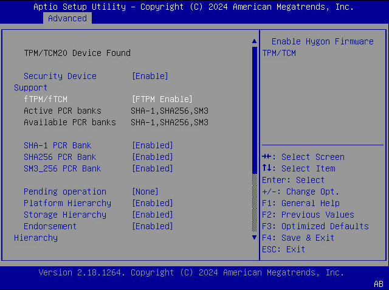
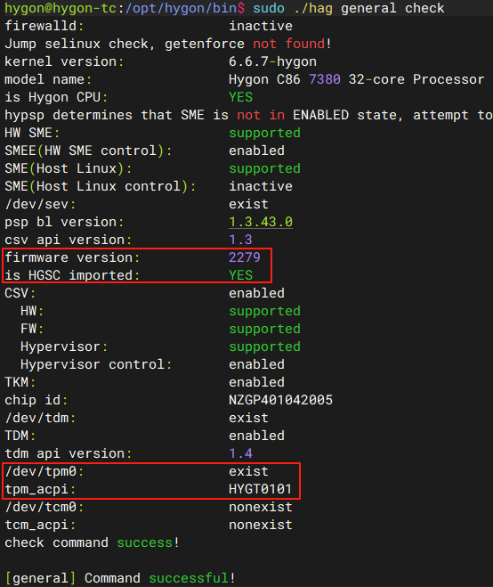
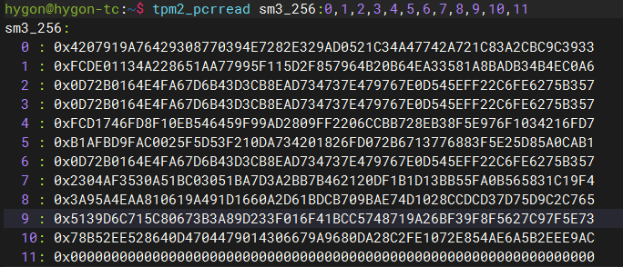
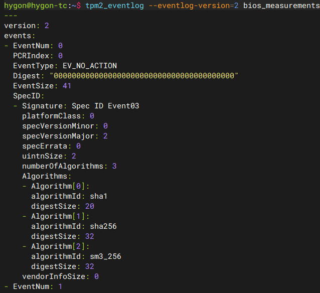
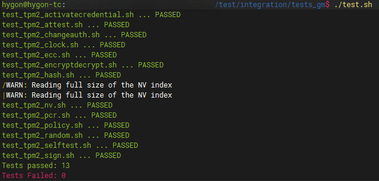
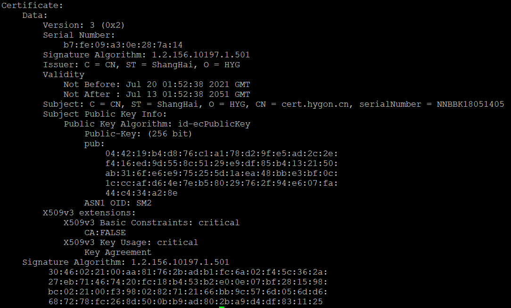
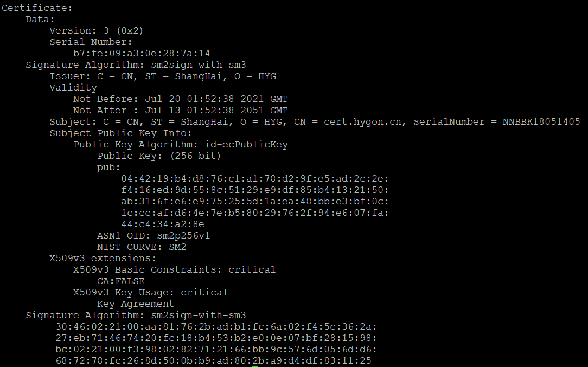

## 1.概述

本文演示了在一台海光CPU服务器上测试TPM2.0功能的完整步骤。测试安装的ISO为龙蜥23.2 GA版本。演示的主要TPM应用包括：BIOS/GRUB/Linux启动度量，功能测试。

**注：**

1）**海光TPM2.0完全符合TCG组织定义的TPM2.0规范**，详见： https://trustedcomputinggroup.org/ ；

2）**当前国内发行的常用OS版本基本都已支持海光TPM2.0**，安装后用户可以直接测试使用，**支持海光TPM2.0的硬件配置要求以及国产OS海光TPM2.0功能支持情况**详见页面：[环境部署](<01. 环境部署.md>) ；

3）**如果安装的是未适配海光TPM2.0的OS**，则需要安装支持TPM的软件栈，包括tpm2-tools、tpm2-tss、tpm2-abrmd，并提出适配需求获取相应的功能补丁。 [环境部署](<01. 环境部署.md>) 这个页面：源码编译示例-\>TPM2.0/TCM2.0软件栈小节提供了生成rpm包的参考示例，deb包的生成类似，不再赘述；另外也可以按照源码的方式编译安装，可参照链接： https://tpm2-tools.readthedocs.io/en/latest/INSTALL/ ；

4）**TPM2.0基础功能要求grub的版本为2.04及以上**，如果grub版本不满足要求请参考 [环境部署](<01. 环境部署.md>) 这个页面：源码编译示例-\>GRUB小节完成grub的安装；但有些OS自带的低版本grub可能会backport高版本的补丁，比如龙蜥8.9中的grub2.02版本支持TPM，具体需要视情况而定；

## 2.BIOS设置

进入BIOS setup界面，在TCG Trusted Computing选项下关于TPM的默认设置如下图1所示，度量支持SHA1、SHA256、SM3三种算法，三个Hierarchy(Platform, Storage, Endorsement)全部使能，如果没特殊需求，使用默认设置即可。

图 1 BIOS设置



注：以上图片示例仅供参考，不同的BIOS配置界面及配置方式都会不同，请以实际页面为主，BIOS中开启TPM的配置具体请咨询BIOS厂商；

## 3.kernel及OS设置

启动完成后可以使用hag工具完成海光TPM2.0的基础信息检查，hag工具下载参考页面： [导入通用安全证书](<../../07. 工具/01. 海光安全工具/02. 导入通用安全证书.md>)) 的下载hag小节内容，查看命令如下：

```
$ cd /opt/hygon/bin/
$ sudo ./hag general check
```



以上结果需要关注如下几点：

1）前述概述章节已提供如何确认支持TPM2.0的硬件配置要求，**安全固件版本属于硬件配置要求，和PI版本号一一对应**，具体请以实际PI版本显示的为准；

2）海光通用证书HGSC需要导入完成，**使用海光TPM2.0功能必须导入通用安全证书，否则TPM功能不工作**。导入通用证书的命令参考页面： [导入通用安全证书](<../../07. 工具/01. 海光安全工具/02. 导入通用安全证书.md>)) ；

3）TPM设备节点和ACPI信息参考上述显示方式，如果显示不正确，可参考页面进行信息确认： [海光TPM或TCM无设备节点问题定位](<../04. 常见问题/03. 海光TPM或TCM无设备节点问题定位.md>) ；

4）海光TPM2.0内核驱动默认以模块的方式集成到kernel中，**如果需要测试Linux IMA功能，则需要将TPM驱动builtin，不能以模块的方式加载，配置CONFIG\_TCG\_HYGON=y和CONFIG\_CRYPTO\_DEV\_CCP\_DD=y即可**。使能Linux IMA功能会对系统性能产生一定影响，因为根据配置策略IMA会在每个文件初次执行时进行度量并将度量值扩展到TPM的PCR 10，如果不需要使用IMA则可以忽略。

## 4.BIOS/Grub/Linux内核启动度量

启动度量对TPM PCR的使用情况如表1：

表1 TPM PCR的使用情况

| PCR编号      | 度量目标                |
|--------------|-----------------------|
| 0            | BIOS，包括作为度量根的初始代码如S-CRTM、H-CRTM等； |
| 1            | BIOS 平台配置，如Setup/变量、微码补丁、SMBIOS/ACPI等； |
| 2            | UEFI 驱动/应用的代码（特别是非主板内置的：扩展卡 Option ROM/外接驱动等）； |
| 3            | UEFI 驱动/应用的配置与数据（如 RAID 配置、外接驱动自带的配置等）； |
| 4            | BIOS选择启动设备的启动过程、尝试的启动设备以及从该设备加载和执行的Boot Manager Code； |
| 5            | Boot Code相关的配置与数据（如GPT/分区表、引导器配置的语言、ExitBootServices 的返回结果等）； |
| 6            | 平台厂商相关控制  |
| 7            | Secure Boot 策略（SecureBoot 是否开启、PK/KEK/DB/DBX 等变量的度量值）； |
| 8            | GRUB 执行的命令字符串，包括配置文件内命令和命令行输入； |
| 9            | GRUB 打开的文件，包括配置文件，efi子模块，Linux内核，Initrd等； |
| 10           | Linux IMA使用               |

OS启动完成后使用tpm2\_pcrread可读取各个PCR值。根据PCR使用分配，在不改变BIOS/Grub相关配置的情况下，每次系统启动后PCR 0~9读值应保持不变，比如读取SM3 PCR bank中的PCR值：

```
$ tpm2_pcrread sm3_256:0,1,2,3,4,5,6,7,8,9,10,11
```

执行结果:

图 2 获取的pcrread值



**注：**

1）**如果PCR8、PCR9均为0，则表明grub中的tpm.mod模块没有嵌入到grub的核心模块core.efi**，因为BIOS只度量grub核心模块，grub核心模块再度量其他的模块，如果tpm.mod不嵌入核心模块则存在度量链的缺失，将tpm.mod嵌入core.efi的方法请参考页面： [环境部署](<01. 环境部署.md>) 这个页面：源码编译示例-\>GRUB小节；

2）**如果启动前后PCR0发生改变**，最常见原因是更新了BIOS固件，也可能是主板上嵌入的外置UEFI驱动有改变，具体的原因需要咨询BIOS厂商时如何扩展PCR0的；

上述PCR是系统启动完成后平台固件扩展的PCR最终值，如果想了解系统各个阶段PCR值，可以获取TPM eventlog查看。可以利用tpm2\_eventlog解析bios eventlog文件，如：

```
$ sudo cat /sys/kernel/security/tpm0/binary_bios_measurements > bios_measurements
$ tpm2_eventlog --eventlog-version=2 bios_measurements
```

图 3 eventlog输出示例（部分）



**注：**

1）**如果安装的是开源版本的grub，则要求grub版本为2.06及以上，否则内核不会创建度量文件/sys/kernel/security/tpm0/binary\_bios\_measurements**；

2）**内核低于5.3版本时，仅支持TPM1.2版本的eventlog，即只包含SHA1算法，内核版本为5.3及以上时，支持TPM2.0版本的eventlog，即包含SHA1、SHA256、SM3算法，所以根据实际场景需要请选择合适的内核版本获取eventlog**；

3）**通过tpm2\_eventlog解析度量文件后，正常情况下底部显示的各个PCR值和tpm2\_pcrread读出的PCR值是一致的，比较常见的场景是PCR0不一致，这种情况下需要联系BIOS厂商确认是否已经支持扩展HCRTM event，如果其他的PCR也不一致，请联系BIOS厂商确认问题**；

4）**当BIOS已经支持HCRTM event后，tpm2-tools版本必须为5.6及以上，才可以正确解析eventlog，否则会出现tpm2\_eventlog解析的日志显示的PCR0和tpm2\_pcrread读出的PCR0不一致的问题**；

## 5.功能测试

### 5.1.安装功能测试脚本

包含功能测试的脚本可参考如下链接，分别对应tpm2-tools-4.1.1和tpm2-tools-5.7，不同版本的tpm2-tools命令格式会存在差异，如果需要特定版本的测试脚本请提出适配需求。

https://download.sourcefind.cn:65024/file/8/patches/security-technology/trusted-computing/tpm/4.x-add-gm-test-case-for-all-commands.patch

https://download.sourcefind.cn:65024/file/8/patches/security-technology/trusted-computing/tpm/5.x-Hygon-add-tpm-test-cases.patch

### 5.2.运行测试

```
$ cd test/integration/tests_gm/
$ ./test.sh
```

命令说明：进行功能测试。

命令正确执行的结果如下图4。

图 4 功能测试结果示例



### 5.3.测试脚本说明

1）每个以test\_开头的脚本是测试TPM的一类脚本,比如测试TPM policy相关命令的脚本名字为test\_tpm2\_policy.sh，里面列举了policy相关命令的用法；

2）脚本涵盖了远程认证、加解密、hash运算、NV操作、PCR、随机数、签名验签、Policy等方面的测试示例，脚本中只列举了关于商密算法的使用，关于美密算法的使用可以参考tpm2-tools仓库下的man目录，里面详细列举了所有tpm命令的用法；

3）脚本中测试命令都是测试商密的命令,TPM算法解析是object:scheme:symdetail 格式的字符串，比如tpm2\_createprimary -C o -g sm3\_256 -G eccsm2:null:sm4128cfb -c /tmp/context,字符串eccsm2:null:sm4128cfb就是在上面格式的基础上添加商密相关的字符串sm2，sm4128cfb以支持商密。在某些命令中需要增加额外的参数支持商密选择，同时保持兼容以前的密码算法，具体命令可参考脚本中tpm2\_certify，tpm2\_createak，tpm2\_createek，tpm2\_createprimary，tpm2\_loadexternal，tpm2\_nvdefine，tpm2\_quote，tpm2\_startauthsession的使用。

## 6.TPM EK证书验证示例

### 6.1.EK证书说明

EK证书（Endorsement Key Certificate）是TPM厂商为TPM内的“背书密钥（EK）”公钥签发的 **X.509 v3 证书**，用来把这把公钥与“真实、合规出厂的某个TPM”绑定起来，作为后续**身份建立与远程证明**的根依据。通过验证EK证书链确认拿到的EK公钥确属某家厂商生产的TPM，从而建立**硬件根信任**。这一步是后续所有”把某台TPM作为可信根”的基础。背书密钥 (EK) 是一个非对称密钥对，由公钥和存储在TPM内部的私钥组成。EK公钥可从TPM读取，而私钥部分绝不能暴露。EK证书最常用的作用就是通过MakeCredential / ActivateCredential把**某把 AK密钥**与**某个 TPM**绑定起来，而AK密钥则常用于远程证明，后续章节将对远程证明进行介绍。

验证TPM EK证书之前需要先介绍几个密钥HRK，HSK，CEK：

HRK：Hygon Root Key，用于签名HSK证书，Hygon的信任根，可以访问 https://cert.hygon.cn/hrk 下载HRK证书，名称是hygon-hrk-cert.bin；

HSK：Hygon CSV Signing Key，用于签名CEK证书；

CEK：Chip Endorsement Key，用于签名TPM EK证书，可以访问 https://cert.hygon.cn/ 下载HSK和CEK证书，会根据输入的芯片序列号返回相应的证书，比如hygon-hsk-cek-cert-xx.bin;

TPM EK：TPM Endorsement Key，TPM的信任根，用于签名AIK；

AIK：Attestation Identity Key；

验证TPM EK证书就是验证整个证书链，从HRK证书，HSK证书，CEK证书，到TPM EK证书，hag工具提供了验证整个证书链的功能。

### 6.2.从TPM NV中读取EK证书并验证证书

由于EK证书使用的是ECC SM2\_P256 EK Certificate，根据TCG的TCG\_IWG\_Credential\_Profile\_EK\_V2.1\_R13.pdf文档，使用的**NV index为0x1c0001a**

从NV中读取EK证书，cert\_file为EK证书文件名:

```
$ tpm2_nvread -o cert_file 0x1c0001a
```

1）使用openssl工具查看EK证书格式，命令如下，结果如图5。

```
$ openssl x509 -in cert_file -inform DER -noout -text
```

图 5 openssl查看的EK证书格式



2）如果系统中安装gmssl，证书的显示格式如图6。

图 6 gmssl查看的EK证书格式



gmssl在国密的签名算法会显示出sm2sign-with-sm3，openssl中没有对应的字符串，显示的是真实的OID。

3）使用hag工具验证EK证书，分为离线和在线验证。

在线验证需要访问Internet，命令如下:

```
$ ./hag tpm verify_cert_chain -in cert_file
```

离线验证命令如下，其中hrk、hsk、cek证书可以在一台可访问Internet的机器上通过访问证书网站下载：

```
$ ./hag tpm verify_cert_chain -in cert_file -hrk_cert hygon-hrk-cert.bin -hsk_cek_cert hygon-hsk-cek-cert-xx.bin -offline
```

4）如果不想用hag工具验证，也可自行实现验证代码，可参考如下链接：[https://gitee.com/anolis/hygon-devkit/blob/master/csv/attestation/csv\_sdk/csv\_status.c](https://gitee.com/anolis/hygon-devkit/blob/master/csv/attestation/csv_sdk/csv_status.c) ，总体的流程是HRK-\>HSK-\>CEK-\>EK逐级验签。

### 6.3.TPM2.0使用EK证书的示例

EK证书和AIK的使用场景一般是远程证明，下面的示例为CA和TPM的交互流程，从TPM中获取EK证书，AK公钥发给CA，CA使用EK公钥和AK公钥加密一个隐私数据，TPM解密出这个隐私数据，发给CA验证，CA验证隐私数据后AK就可以作为TPM远程证明的密钥。可以使用AK对数据签名，然后使用AK公钥验证签名。

**注：龙蜥23.2 GA使用的tpm2-tools-5.7版本，不同版本命令格式可能存在差异，请以实际命令格式为准。**

从NV中读取EK证书，cert\_file为EK证书文件名：

```
$ tpm2_nvread -o cert_file 0x1c0001a
```

读取EK证书的公钥：

```
$ openssl x509 -in cert_file -inform DER -pubkey -noout > cert_pubkey
```

**EK模板存储TPMT\_PUBLIC结构，在NV index为0x1c0001b处存放**，海光TPM EK使用的默认模板（即EK作为加解密密钥），在TPM中创建EK对象并导出公钥：

```
$ tpm2_createek -c ek.ctx -G ecc_sm2 -t -u ekpub.pem -f PEM
```

对比EK证书的公钥和TPM EK导出的公钥，应当一致：

```
$ diff cert_pubkey ekpub.pem
```

创建AK并导出AK的TPMT\_PUBLIC结构（含有AK公钥以及name，name是对AK公共区域的哈希）:

```
$ tpm2_createak -Q -C ek.ctx -c ak.ctx -G ecc_sm2 -g sm3_256 -s sm2 -u ak.pub -n ak.name
```

将AK公钥/Name以及EK证书链发给CA，CA验证EK证书有效。CA读取EK公钥，格式为tss类型：

```
$ tpm2_readpublic -Q -c ek.ctx -o ekpub.tss
```

CA准备隐私数据，使用EK公钥和AK的name对隐私数据加密，绑定AK name可防止攻击者在同一TPM上换成别的对象进行激活：

```
$ echo 12345678 > secret.data
file_size=`ls -l ak.name | awk {'print $5'}`
loaded_key_name=`cat ak.name | xxd -p -c $file_size`
$ tpm2_makecredential -Q -T none -u ekpub.tss -s secret.data -n $loaded_key_name -o mkcred.out
```

本地tpm使用EK私钥和AK的name对隐私数据解密：

```
$ tpm2_activatecredential -Q -c ak.ctx -C ek.ctx -i mkcred.out -o actcred.out
```

将解密后的数据actcred.out发给CA，CA对比源数据和解密后的数据，相同则通过验证，CA确认这把 AK 属于受信 TPM，之后给这把 AK 签发证书（**常称 AK/AIK 证书**）：

```
$ diff secret.data actcred.out
```

后续就可以使用AK对msg签名，生成sig签名文件：

```
$ echo -n "message" > msg
$ tpm2_sign -Q -g sm3_256 -c ak.ctx -o sig -s sm2 msg
```

从外部导入AK公钥到TPM内，使用公钥对msg验签：

```
$ tpm2_loadexternal -Q -g sm3_256 -u ak.pub -c ext.ctx
$ tpm2_verifysignature -Q -g sm3_256 -s sig -c ext.ctx -m msg
```

**上述示例全程不暴露 EK 私钥，也不拿 EK 对外签名，当然TCG规范里面也不建议在常规业务中用 EK 直接签名**；EK 只用于这次绑定。对外长期使用的是 **AK**（可按场景轮换，降低隐私暴露）。

## 7.TPM2.0远程认证的示例

远程认证（Remote Attestation, RA）简单来说就是要证明“这台设备当前运行环境是按受控方式启动起来的，并且测量结果来自一个真实存在的TPM“。

远程认证的标准交互流程：

1）验证方发起挑战

生成随机值 nonce（防重放），告诉证明方需要的PCR（例如 sm3\_256:0,1,2,3,4,5,6,7），可能还要求附带事件日志（UEFI/BIOS Event Log、IMA Log）；

2）证明方在TPM内生成“引用”（Quote）

调用tpm2\_quote命令生成签名文件，包含PCR值、选择的PCR 、nonce、签名文件以及可能的eventlog；

3）验证方验证

用AK公钥验签quote签名，检查nonce 一致（确保是这次远程认证返回的结果），再将quote 里 TPM 报告的PCR值与基准值比对，根据比较结果决定远程认证结果是否可靠。

**如下是示例：**

证明方使用AK生成包含PCR的Quote，其中quote\_msg是生成的Quote消息文件，quote\_sig是生成的签名文件，quote\_pcr是包含PCR值的输出文件：

```
$ echo -n "0123456789" > nonce.bin
$ tpm2_quote -c ak.ctx -l sm3_256:0,1,2,3,4,5,6,7 -m quote_msg -s quote_sig -o quote_pcr -q nonce.bin -g sm3_256 --scheme sm2
```

验证方使用认证密钥AK的公钥验证Quote签名:

```
$ tpm2_checkquote -g sm3_256 -m quote_msg -s quote_sig -u ak.pub -q nonce.bin -f quote_pcr
```

之后验证方使用quote中包含的PCR值(可以从quote\_pcr文件中获取)和基准值再对比，确认证明方状态是否可信。
