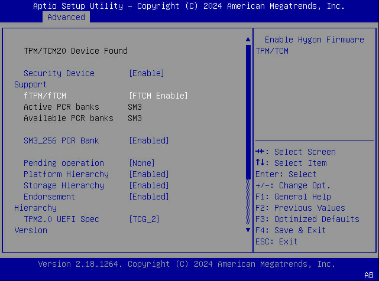
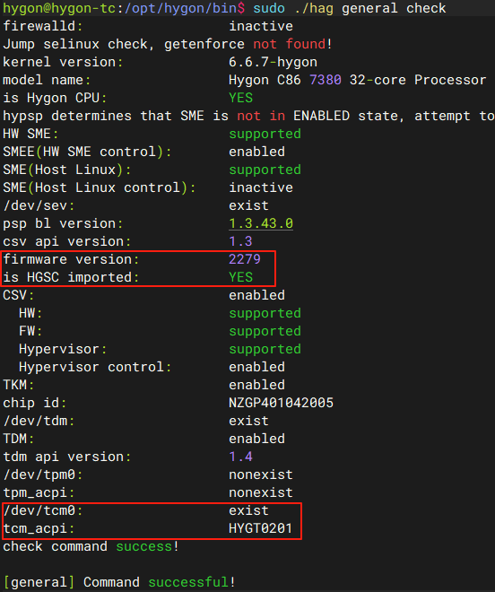
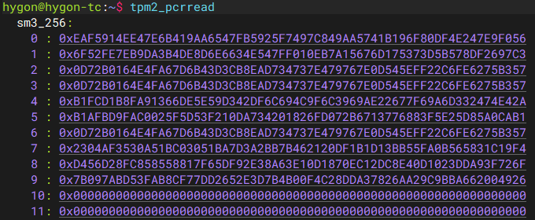
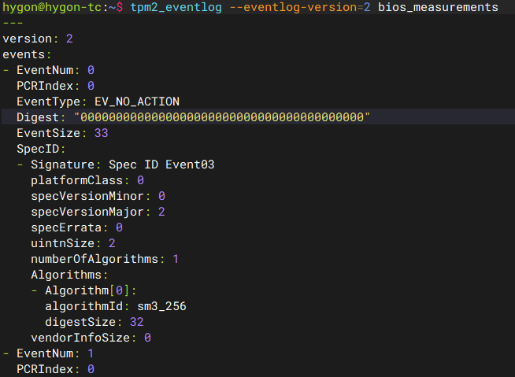
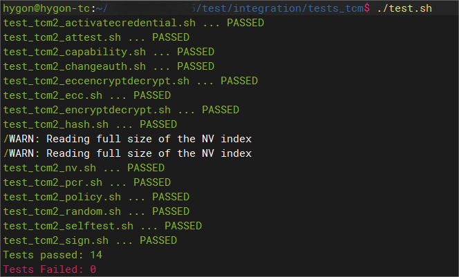

## 1.概述

本文演示了在一台海光CPU服务器上测试TCM2.0功能的完整步骤。测试安装的ISO为龙蜥23.2 GA版本。演示的主要TPM应用包括：BIOS/GRUB/Linux启动度量，功能测试。

**注：**

1）**海光TCM2.0参照GM/T 0012-2020 《可信计算 可信密码模块接口规范》实现**，TCM2.0的命令格式和TPM2.0基本一致，只是删除了部分TPM支持的命令和新增ECC加解密的支持，详细可参阅接口规范： https://std.samr.gov.cn/hb/search/stdHBDetailed?id=C60C676BC20A358AE05397BE0A0AFABB ；

2）**海光TCM2.0使用的TSS软件栈是直接复用的TPM2.0**，已同步向国内各开源社区推送补丁，可以做到同一套软件栈既支持TPM2.0也支持TCM2.0；

2）**当前国内发行的常用OS版本基本都已支持海光TCM2.0**，安装后用户可以直接测试使用，**国产OS海光TCM2.0功能支持情况**详见页面： [环境部署](<01. 环境部署.md>) ；

3）**如果安装的是未适配海光TCM2.0的OS**，则需要安装支持TCM的软件栈，包括tpm2-tools、tpm2-tss、tpm2-abrmd，并提出适配需求获取相应的功能补丁。[环境部署](<01. 环境部署.md>) 这个页面：源码编译示例-\>TPM2.0/TCM2.0软件栈小节提供了生成rpm包的参考示例，deb包的生成类似，不再赘述；另外也可以按照源码的方式编译安装，可参照链接： https://tpm2-tools.readthedocs.io/en/latest/INSTALL/ ；

4）**TCM2.0基础功能要求grub的版本为2.04及以上**，如果grub版本不满足要求请参考 [环境部署](<01. 环境部署.md>) 这个页面：源码编译示例-\>GRUB小节完成grub的安装；但有些OS自带的低版本grub可能会backport高版本的补丁，比如龙蜥8.9中的grub2.02版本支持TCM，具体需要视情况而定；

5）**海光2号开始支持TCM2.0，BIOS的PI版本需要大于DhyanaPatch\_PI2.1.0.4\_200248\_001**，如果不满足请直接联系BIOS厂商升级BIOS解决；

## 2.BIOS设置

进入BIOS setup界面，在TCG Trusted Computing选项下关于TCM的默认设置如下图1所示，度量只支持SM3一种算法，三个Hierarchy(Platform, Storage, Endorsement)全部使能，如果没特殊需求，使用默认设置即可。

图 1 BIOS设置



注：以上图片示例仅供参考，不同的BIOS配置界面及配置方式都会不同，请以实际页面为主，BIOS中开启TCM的配置具体请咨询BIOS厂商；

## 3.kernel及OS设置

启动完成后可以使用hag工具完成海光TCM2.0的基础信息检查，hag工具下载参考页面： [导入通用安全证书](<../../07. 工具/01. 海光安全工具/02. 导入通用安全证书.md>)) 的下载hag小节内容，查看命令如下：

```
$ cd /opt/hygon/bin/
$ sudo ./hag general check
```



以上结果需要关注如下几点：

1）前述概述章节已提供如何确认支持TCM2.0的硬件配置要求，**安全固件版本属于硬件配置要求，和PI版本号一一对应**，具体请以实际PI版本显示的为准；

2）海光通用证书HGSC需要导入完成，**使用海光TCM2.0功能必须导入通用安全证书，否则TCM功能不工作**。导入通用证书的命令参考页面： [导入通用安全证书](<../../07. 工具/01. 海光安全工具/02. 导入通用安全证书.md>)) ；

3）TCM设备节点和ACPI信息参考上述显示方式，如果显示不正确，可参考页面进行信息确认： [海光TPM或TCM无设备节点问题定位](<../04. 常见问题/03. 海光TPM或TCM无设备节点问题定位.md>)  ；

4）海光TCM2.0内核驱动默认以模块的方式集成到kernel中，**如果需要测试Linux IMA功能，则需要将TCM驱动builtin，不能以模块的方式加载，配置CONFIG\_TCM\_HYGON=y和CONFIG\_CRYPTO\_DEV\_CCP\_DD=y即可**。使能Linux IMA功能会对系统性能产生一定影响，因为根据配置策略IMA会在每个文件初次执行时进行度量并将度量值扩展到TPM的PCR 10，如果不需要使用IMA则可以忽略。

## 4.BIOS/Grub/Linux内核启动度量

启动度量对TCM PCR的使用情况如表1：

表1 TCM PCR的使用情况

| PCR编号      | 度量目标                |
|--------------|-----------------------|
| 0            | BIOS，包括作为度量根的初始代码如S-CRTM、H-CRTM等； |
| 1            | BIOS 平台配置，如Setup/变量、微码补丁、SMBIOS/ACPI等； |
| 2            | UEFI 驱动/应用的代码（特别是非主板内置的：扩展卡 Option ROM/外接驱动等）； |
| 3            | UEFI 驱动/应用的配置与数据（如 RAID 配置、外接驱动自带的配置等）； |
| 4            | BIOS选择启动设备的启动过程、尝试的启动设备以及从该设备加载和执行的Boot Manager Code； |
| 5            | Boot Code相关的配置与数据（如GPT/分区表、引导器配置的语言、ExitBootServices 的返回结果等）； |
| 6            | 平台厂商相关控制  |
| 7            | Secure Boot 策略（SecureBoot 是否开启、PK/KEK/DB/DBX 等变量的度量值）； |
| 8            | GRUB 执行的命令字符串，包括配置文件内命令和命令行输入； |
| 9            | GRUB 打开的文件，包括配置文件，efi子模块，Linux内核，Initrd等； |
| 10           | Linux IMA使用               |

OS启动完成后使用tpm2\_pcrread可读取各个PCR值。根据PCR使用分配，在不改变BIOS/Grub相关配置的情况下，每次系统启动后PCR 0~9读值应保持不变，TCM只支持SM3 PCR bank：

```
$ tpm2_pcrread
```

执行结果:

图 2 获取的pcrread值



**注：**

1）**如果PCR8、PCR9均为0，则表明grub中的tpm.mod模块没有嵌入到grub的核心模块core.efi**，因为BIOS只度量grub核心模块，grub核心模块再度量其他的模块，如果tpm.mod不嵌入核心模块则存在度量链的缺失，将tpm.mod嵌入core.efi的方法请参考页面： [环境部署](<01. 环境部署.md>) 这个页面：源码编译示例-\>GRUB小节；

2）**如果启动前后PCR0发生改变**，最常见原因是更新了BIOS固件，也可能是主板上嵌入的外置UEFI驱动有改变，具体的原因需要咨询BIOS厂商时如何扩展PCR0的；

上述PCR是系统启动完成后平台固件扩展的PCR最终值，如果想了解系统各个阶段PCR值，可以获取TCM eventlog查看。可以利用tpm2\_eventlog解析bios eventlog文件，如：

```
$ sudo cat /sys/kernel/security/tcm0/binary_bios_measurements > bios_measurements
$ tpm2_eventlog --eventlog-version=2 bios_measurements
```

图 3 eventlog输出示例（部分）



**注：**

1）**如果安装的是开源版本的grub，则要求grub版本为2.06及以上，否则内核不会创建度量文件/sys/kernel/security/tcm0/binary\_bios\_measurements**；

2）**内核低于5.3版本时，仅支持TPM1.2版本的eventlog，即只包含SHA1算法，内核版本为5.3及以上时，支持TPM2.0版本的eventlog，即包含SHA1、SHA256、SM3算法，所以根据实际场景需要请选择合适的内核版本获取eventlog**；

3）**通过tpm2\_eventlog解析度量文件后，正常情况下底部显示的各个PCR值和tpm2\_pcrread读出的PCR值是一致的，比较常见的场景是PCR0不一致，这种情况下需要联系BIOS厂商确认是否已经支持扩展HCRTM event，如果其他的PCR也不一致，请联系BIOS厂商确认问题**；

4）**当BIOS已经支持HCRTM event后，tpm2-tools版本必须为5.6及以上，才可以正确解析eventlog，否则会出现tpm2\_eventlog解析的日志显示的PCR0和tpm2\_pcrread读出的PCR0不一致的问题**；

## 5.功能测试

### 5.1.安装功能测试脚本

包含功能测试的脚本可参考如下链接，分别对应tpm2-tools-4.1.1和tpm2-tools-5.7，不同版本的tpm2-tools命令格式会存在差异，如果需要特定版本的测试脚本请提出适配需求。

https://download.sourcefind.cn:65024/file/8/patches/security-technology/trusted-computing/tcm/4.x-newfeature-tcm-Add-tcm-test-cases.patch

https://download.sourcefind.cn:65024/file/8/patches/security-technology/trusted-computing/tcm/5.x-Hygon-add-tcm-test-cases.patch

### 5.2.运行测试

```
$ cd test/integration/tests_tcm/
$ ./test.sh
```

命令说明：进行功能测试。

命令正确执行的结果如下图4。

图 4 功能测试结果示例



### 5.3.测试脚本说明

1）每个以test\_开头的脚本是测试TCM的一类脚本,比如测试TCM policy相关命令的脚本名字为test\_tcm2\_policy.sh，里面列举了policy相关命令的用法；

2）脚本涵盖了远程认证、加解密、hash运算、NV操作、PCR、随机数、签名验签、Policy等方面的测试示例，脚本中只列举了关于商密算法的使用，TCM不支持美密算法，命令的详细使用格式可以参考tpm2-tools仓库下的man目录；

3）脚本中测试命令都是测试商密的命令,TPM算法解析是object:scheme:symdetail 格式的字符串，比如tpm2\_createprimary -C o -g sm3\_256 -G eccsm2:null:sm4128cfb -c /tmp/context,字符串eccsm2:null:sm4128cfb就是在上面格式的基础上添加商密相关的字符串sm2，sm4128cfb以支持商密。在某些命令中需要增加额外的参数支持商密选择，同时保持兼容以前的密码算法，具体命令可参考脚本中tpm2\_certify，tpm2\_createak，tpm2\_createek，tpm2\_createprimary，tpm2\_loadexternal，tpm2\_nvdefine，tpm2\_quote，tpm2\_startauthsession的使用。

## 6.TCM EK证书验证示例

关于TCM EK证书的验证可参考TPM功能测试文档，两者类似。

## 7.TCM2.0远程认证的示例

关于TCM 远程认证的验证可参考TPM功能测试文档，两者类似。
