## 1.概述

本文演示了在一台安装定制ISO镜像的CPU服务器上使用TDM功能的步骤，演示的主要TDM应用包括：TDM动态保护任务创建运行销毁流程，TDM动态保护任务更新操作流程，TDM动态保护防字典攻击流程，TDM基于虚拟地址创建运行销毁度量任务流程，TDM度量任务异常触发机器挂机流程，TDM证书获取与证书链验证流程，TDM度量报告获取与验证流程，TDM VPCR获取与重放VPCR值验证流程。

注：1）发行的定制ISO镜像已包含TDM功能在内的安全功能适配支持，安装后用户可以直接测试使用，定制ISO镜像的安装步骤等请参考相关说明文档，本文不再赘述。

表1 配置要求

| 配置         | 要求                   |
|--------------|-----------------------|
| CPU          | 2号、3号               |
| BIOS         | PI 版本为2.1.0.3或以上，支持TDM |
| KERNEL       | 5.10.112              |
| hag          | 1667或以上             |
| TDM固件       | 1.4或以上              |
| TDM驱动       | 0.7或以上              |
| TPM2-tools   | tpm2-tools-4.1.3      |

本次测试安装的ISO镜像名称为centos-7.8.2003-x86\_64-dvd-xxx-csd-20230110-135.iso，具体名称以发布为准。

## 2.TDM测试环境配置

### 2.1.TDM驱动加载

ISO镜像中的内核已包含TDM驱动，机器启动完成后dmesg输出下面log则表示TDM驱动已正常加载。

图 1 TDM驱动加载成功

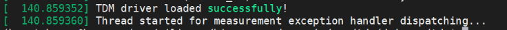

### 2.2.使用hag查看TDM设备信息

```
$ hag tdm show_tdm_device  //要访问/dev/tdm节点，因此需要使用root权限
```

输出如下图2所示，可以看到成功获取TDM设备信息

图 2 TDM设备信息

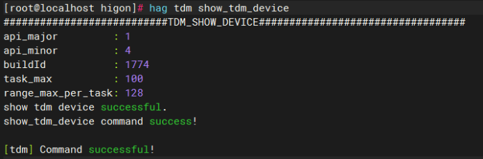

### 2.3.tpm2\_tools配置

Tpm2\_tools工具主要用来读取PCR的值，VPCR需要使用到fTPM，tpm2\_tools工具已默认集成到ISO镜像，不需额外配置。

## 3.TDM动态保护任务创建运行销毁流程

该场景主要测试《PSP动态度量接口规范》中的第七部分“度量任务创建及运行”，实现了度量任务的创建、注册异常回调、启动度量、停止度量、销毁度量任务的完成过程，在验证各个命令正常的情况下同时测试了正常启动度量的流程。

参考用例场景0测试主流程逻辑如下图3所示，详细细节可阅读参考用例tdm\_verify.c的代码逻辑：

图 3 TDM场景0测试流程

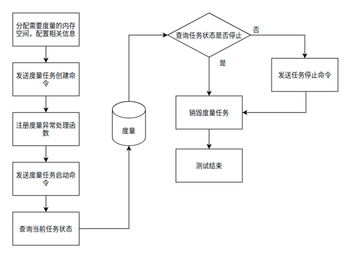

```
$ cd /lib/modules/`uname -r`/kernel/drivers/crypto/ccp/
```

test\_scene表示测试场景，0表示该场景测试，1表示更新操作场景，2表示防字典攻击场景，3表示虚拟地址任务场景

安装本次测试模块

```
$ sudo insmod tdm-verify.ko test_scene=0
```

移除本次测试模块（相较于以前版本增加了证书链验证与度量报告支持，后续测试需要使用该模块的度量任务，因此在移除模块时才释放度量任务）

```
$ sudo rmmod tdm-verify.ko
```

查看Log信息

```
$ dmesg
```

输出下面的log则表示TDM测试场景0测试成功，若出现error字样，表示该场景测试失败。

图 4 正常度量流程打印信息

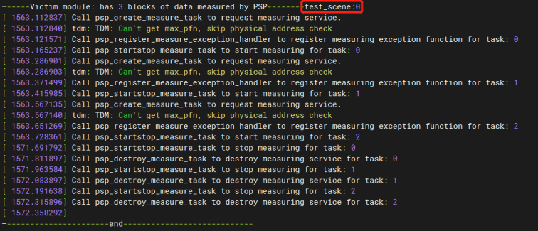

## 4.TDM动态保护任务更新操作流程

该场景主要测试《PSP动态度量接口规范》中的第八部分“度量任务基准值更新”，实现了对正在正常运行的度量任务的基准值更新，通过更新后基准值与实际度量结果不匹配而出发异常回调，同时验证了更新命令与异常触发回调的流程。

参考用例场景1测试主流程如下图5所示：

图 5 TDM场景1测试流程

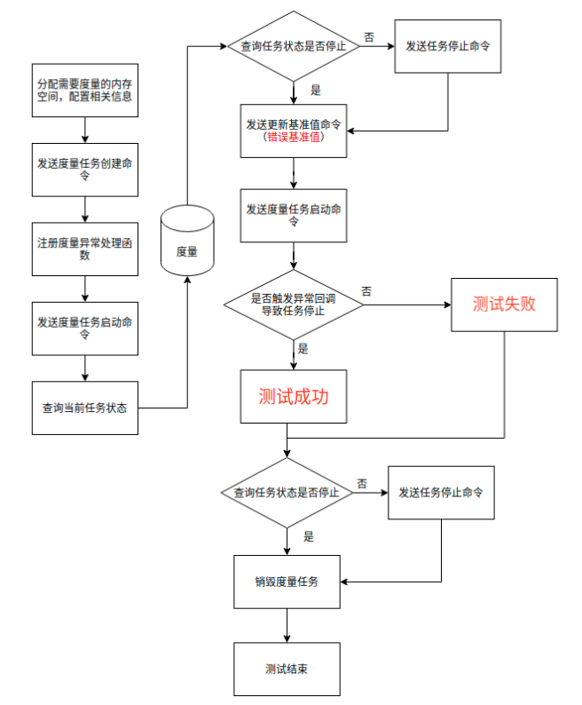

```
$ cd /lib/modules/`uname -r`/kernel/drivers/crypto/ccp/
```

test\_scene表示测试场景，0表示正常创建场景测试，1表示更新操作场景，2表示防字典攻击场景，3表示虚拟地址任务场景

安装本次测试模块

```
$ sudo insmod tdm-verify.ko test_scene=1
```

移除本次测试模块（相较于以前版本增加了证书链验证与度量报告支持，后续测试需要使用该模块的度量任务，因此在移除模块时才释放度量任务）

```
$ sudo rmmod tdm-verify.ko
```

查看Log信息

```
$ dmesg
```

输出下面的log则表示TDM测试场景1测试成功，默认demo测试触发三次异常度量，在内核空间将有三个对应任务id的异常函数被触发。

图 6 更新操作流程打印信息

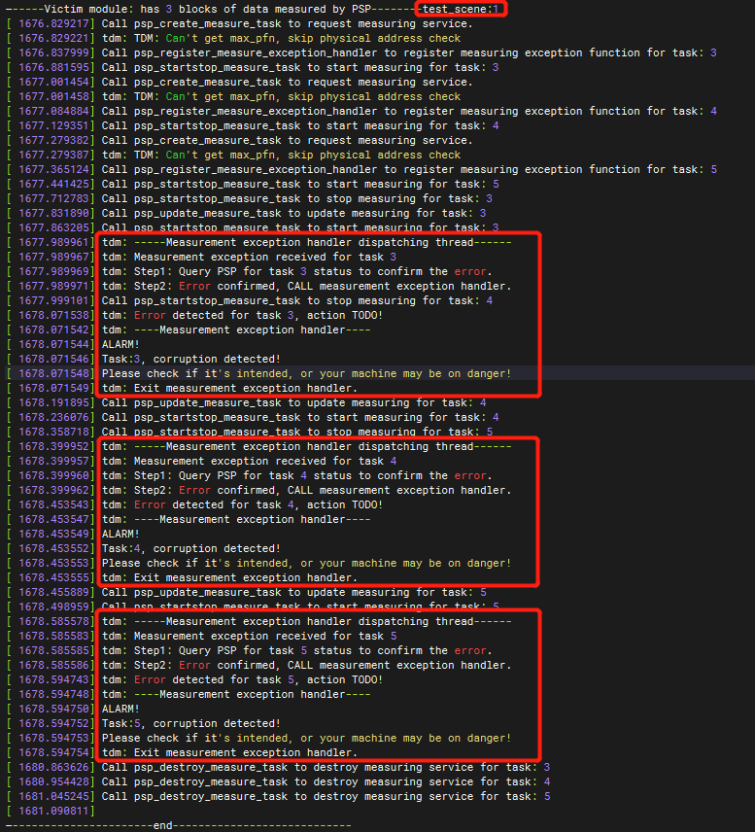

## 5.TDM动态保护防字典攻击流程

该场景主要测试《PSP动态度量接口规范》中的第四部分“防字典攻击”，实现了尝试对正在运行度量任务授权码暴力破解，进而触发DA保护启动的逻辑。

参考用例场景2测试主流程如下图7所示，流程中尝试两次错误的授权，将DA保护时间延长至2^(2-1)=2秒，并在DA保护的2秒区间内使用正确的授权码执行命令，由于DA保护，将返回在DA保护的状态，2秒保护结束后，使用正确的授权码授权执行命令，将恢复正常，详细逻辑可以参考用例代码。

图 7 TDM场景2测试流程

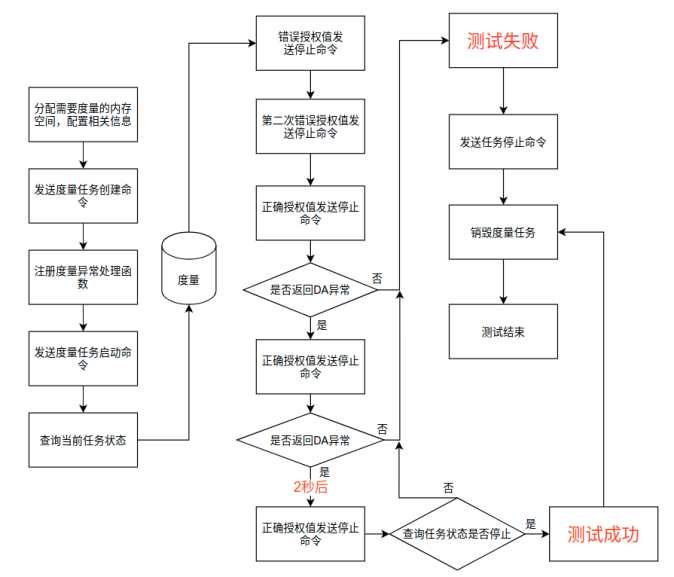

```
$ cd /lib/modules/`uname -r`/kernel/drivers/crypto/ccp/
```

test\_scene表示测试场景，0表示正常创建场景测试，1表示更新操作场景，2表示防字典攻击场景，3表示虚拟地址任务场景

安装本次测试模块

```
$ sudo insmod tdm-verify.ko test_scene=2
```

移除本次测试模块（相较于以前版本增加了证书链验证与度量报告支持，后续测试需要使用该模块的度量任务，因此在移除模块时才释放度量任务）

```
$ sudo rmmod tdm-verify.ko
```

查看Log信息

```
$ dmesg
```

输出下面的log则表示TDM测试场景2测试成功，默认demo测试三个任务的DA攻击 ，在DA保护期间发送命令将拒绝服务返回错误。

图 8 防DA流程打印信息

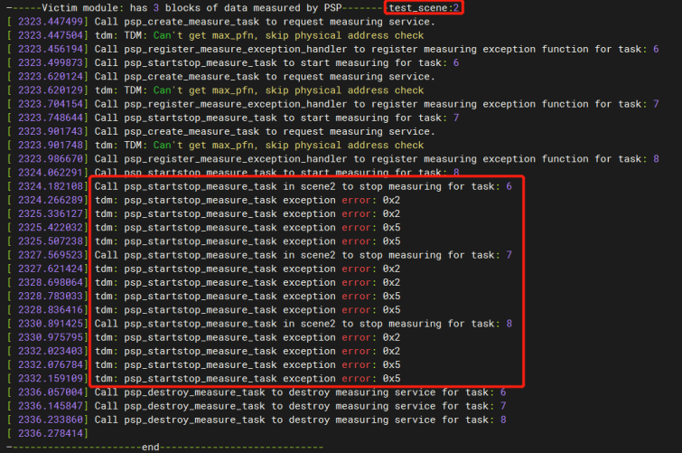

## 6.TDM度量任务通过虚拟地址创建运行销毁流程（1.3固件版本后支持）

参考用例场景3测试主流程逻辑与场景0基本相同，主要调整为度量任务创建改用虚拟地址进行创建，详细细节可阅读参考用例tdm\_verify.c的代码逻辑。

```
$ cd /lib/modules/`uname -r`/kernel/drivers/crypto/ccp/
```

test\_scene表示测试场景，0表示正常创建场景测试，1表示更新操作场景，2表示防字典攻击场景，3表示虚拟地址任务场景

安装本次测试模块

```
$ sudo insmod tdm-verify.ko test_scene=3
```

移除本次测试模块（相较于以前版本增加了证书链验证与度量报告支持，后续测试需要使用该模块的度量任务，因此在移除模块时才释放度量任务）

```
$ sudo rmmod tdm-verify.ko
```

查看Log信息

```
$ dmesg
```

输出下面的log则表示TDM测试场景3测试成功.

图 9 虚拟地址创建度量任务打印信息

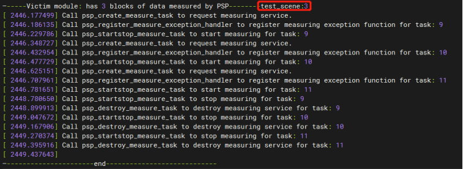

## 7.TDM度量任务异常触发机器挂机流程（1.4固件版本后支持）

参考用例场景4测试主流程逻辑与场景1基本相同，主要调整为度量任务创建时flag配置增加TASK\_EXCEPTION\_CRASH属性配置，当度量异常触发时，机器将挂机，详细细节可阅读参考用例tdm\_verify.c的代码逻辑。

```
$ cd /lib/modules/`uname -r`/kernel/drivers/crypto/ccp/
```

test\_scene表示测试场景，0表示正常创建场景测试，1表示更新操作场景，2表示防字典攻击场景，3表示虚拟地址任务场景，4表示异常挂机场景

安装本次测试模块

```
$ sudo insmod tdm-verify.ko test_scene=4
```

该命令运行后，系统触发度量任务异常，若机器此时挂机，表明该机制验证成功，仅可通过BMC硬重启或断电重启恢复，用户可根据verify的代码逻辑参考该机制的实现，否则该机制验证失败。

## 8.TDM AK证书获取与证书链验证流程（1.2固件版本后支持）

该场景演示了获取TDM的AK证书与验证AK证书的证书链的例子，通过该场景，可以熟悉并验证TDM模块的证书导出接口，同时通过hag完成对证书的导出、解析、验证来实现对整个TDM证书系统的了解。hag提供了证书获取以及从AK证书逐步验证整个证书链的过程，用户可以通过使用hag工具来熟悉TDM AK证书的使用。

基本验证流程如下：

（1）hag工具已默认集成到/usr/bin/目录（具体路径请以发布为准）

（2）检查hag支持的TDM命令

```
$ hag tdm -help
```

输出如下图所示：

图 10 TDM在hag支持的命令

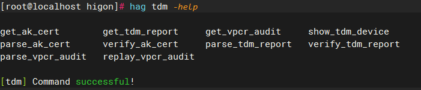

（3）可以看到TDM支持get\_ak\_cert、parse\_ak\_cert、veriry\_ak\_cert三个与证书相关的命令，获取名字为cert的AK证书

```
$ hag tdm get_ak_cert -out ak.cert  //要访问/dev/tdm节点，因此需要使用root
$ ls -l
```

结果如下图所示，可以看到成功获取ak.cert的证书

图 11 获得TDM的AK证书

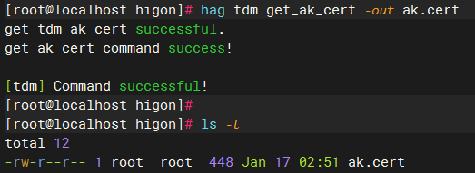

（4）解析证书，主要将证书中的版本、chip\_id、curve\_id、公钥信息、证书签名等信息进行解析显示，方便用户了解证书中的内容。

```
$ hag tdm parse_ak_cert -in ak.cert
```

结果如下：

图 12 TDM的AK证书解析（篇幅限制，截取关键部分）

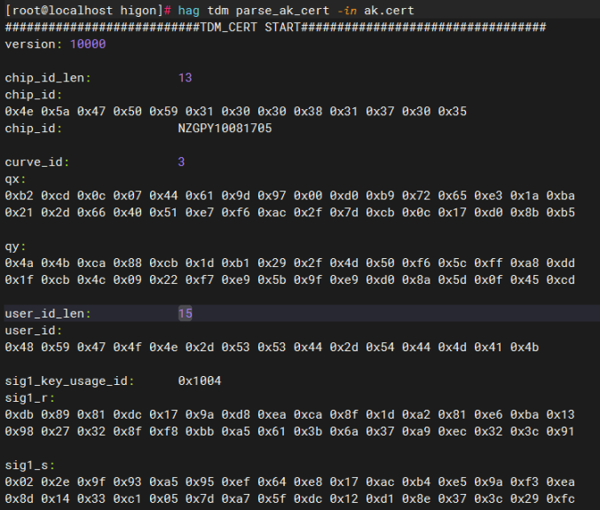

（5）验证证书链

```
$ hag tdm verify_ak_cert -in ak.cert
$ ls -l
```

结果如下：

图13 TDM的AK证书链验证

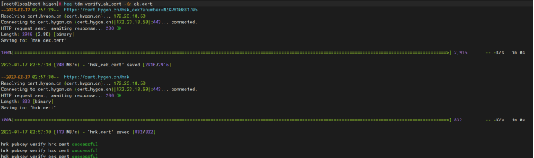
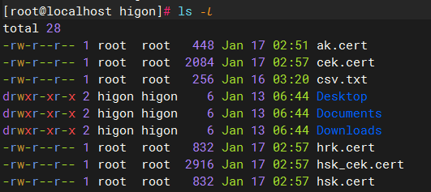

（6）可以看到成功验证了TDM的证书链，该验证方式主要通过从AK证书中获取的chip\_id，到证书服务器下载其对应的CEK证书、HSK证书、HRK证书，通过从根证书一级一级验证到AK证书。

## 9.TDM度量报告获取与使用AK证书验证度量报告流程（1.2固件版本后支持）

该场景演示了获取TDM度量报告与使用AK证书验证报告的例子，通过该场景，可以熟悉并验证TDM模块的度量报告导出接口，同时通过hag完成对报告的导出、解析、验证来实现对整个TDM度量报告系统的了解。hag工具提供了度量报告获取以及使用AK证书验证度量报告的过程，用户可以通过使用hag工具来熟悉TDM度量报告接口的使用。

基本验证流程如下：

（1）根据图10可知，TDM支持get\_tdm\_report、parse\_tdm\_report、verify\_tdm\_report三个与报告相关的命令，其中get\_tdm\_report命令需要三个参数，第一个为报告名字，这里以report.bin为例，第二个为报告类型，分别为总结报告（0对应）与详细报告（1对应），第三个为用户提供的数据的文件名字，这里以user\_data.bin为例，第四个为可选的任务号（默认为所有任务）。verify\_tdm\_report需要两个参数，第一个为验签的AK证书，第二个为被验证的度量报告文件。

（2）目前最新的tdm\_verify经过调整后，可以支持TDM报告验证，调整为加载verify模块创建启动度量任务后不销毁，待到移除该模块时才销毁，因此加载verify模块后再调用度量报告获取命令可以获取实际TDM中运行的度量报告，这里以获取tdm\_verify的场景1任务更新操作流程中的度量任务的详细报告为例进行说明。

（3）加载tdm\_verify的场景1模块

```
$ cd /lib/modules/`uname -r`/kernel/drivers/crypto/ccp/
$ sudo insmod tdm-verify.ko test_scene=1
```

在hag工具的目录下获取名为report.bin的详细度量报告，可以看到成功获取report.bin的证书

获取并查看用户提供的随机数文件：

```
$ dd if=/dev/random of=user_data.bin bs=32 count=1
$ hexdump user_data.bin
```

获取度量报告：

```
$ hag tdm get_tdm_report -report_file report.bin -report_type 1 -user_data_file user_data.bin
$ ls -l
```

结果如下：

图14 获得TDM的度量报告

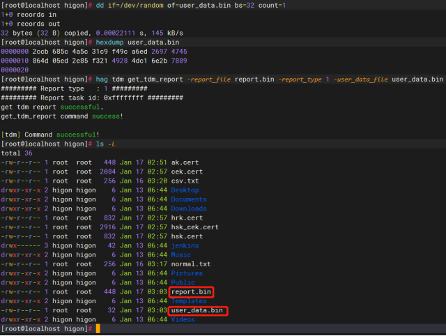

（4）解析度量报告，主要将报告中的版本、任务状态位映射、用户提供数据（与user\_data.bin中数据相同）、度量任务哈希值、当前所有度量任务的状态信息（详细报告时才存在）进行解析显示，方便用户了解报告中的内容。

```
$ hag tdm parse_tdm_report -report_file report.bin
```

结果如下：

图15 TDM的度量报告解析（篇幅限制，截取关键部分）

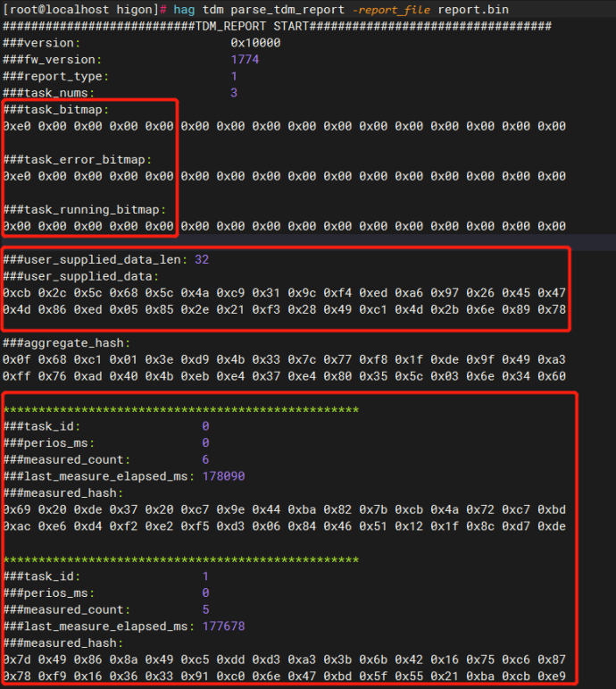

（5）验证报告

```
$ hag tdm verify_tdm_report -ak_cert ak.cert -report_file report.bin
```

结果如下：

图16 TDM使用AK证书验证度量报告

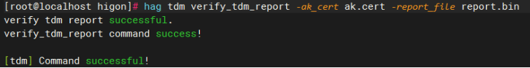

（6）可以看到成功使用AK证书验证了度量报告，由于AK证书已在上一个场景中经过验证，可以确定是可信的，这里使用可信的AK继续验证度量报告，验证通过后，可以确定报告也是可信的，用户可以根据此报告获取到TDM内的各种状态信息；该演示为其中的一种场景，用户也可以根据自己需求，来获取其他的各种场景下的度量报告进行验证。

（7）卸载tdm\_verify的模块，度量报告验证演示完成

```
$ cd /lib/modules/`uname -r`/kernel/drivers/crypto/ccp/
$ sudo rmmod tdm-verify.ko
```

## 10.TDM VPCR获取与审计重放VPCR值验证流程（1.3固件版本后支持）

该场景演示了获取VPCR值以及VPCR审计信息的原始TDM度量值与fTPM原始PCR值获取，以及根据审计信息重放VPCR值的验证流程。通过该场景，可以熟悉并验证VPCR机制的应用，理解TDM利用fTPM的PCR实现VPCR从而利用fTPM成熟的PCR远程认证的过程。hag工具提供了VPCR审计信息获取的具体流程以及使用根据审计信息重放VPCR值的过程，用户可以通过使用hag来熟悉TDM基于VPCR的使用与审计信息接口的使用。

基本验证流程如下：

（1）根据图10可知，TDM支持get\_vpcr\_audit、parse\_vpcr\_audit、replay\_vpcr\_audit三个与VPCR报告相关的命令，其中get\_vpcr\_audit命令需要两个参数，第一个为放置VPCR审计信息的文件名字，这里以audit.bin为例，第二个为需要获取对应PCR的编号，这里以PCR11为例。parse\_vpcr\_audit命令用来解析get\_vpcr\_audit命令获取的audit.bin文件，获取原始TDM度量任务度量值与fTPM的原始PCR值。replay\_vpcr\_audit命令用于重放VPCR，第一个参数为需要重放的VPCR文件，这里为audit.bin，第二个参数可选，为重放生成文件，可以根据需求选择。

（2）目前最新的tdm\_verify经过调整后，可以支持VPCR的相关测试，目前tdm\_verify共创建了三个度量任务，这里三个任务分别对应PCR编号的PCR10，PCR11，PCR12，这里以获取tdm\_verify的场景1任务更新操作流程中对应PCR11的审计信息为例进行说明。

（3）首先通过tpm2\_tools命令查看原始PCR的值（这里版本为tpm2\_pcrread命令，其他版本可能为tpm2\_pcrlist，根据机器装的tpm2\_tools的版本确定）

```
$ tpm2_pcrread
```

结果如下：

图17 Ftpm原始PCR值

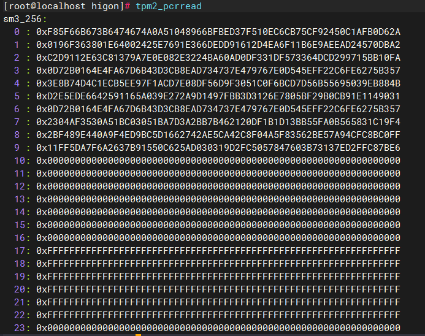

（4）可以看到原始PCR11的值为全0，加载tdm\_verify的场景1模块来创建带VPCR属性的TDM度量任务

```
$ cd /lib/modules/`uname -r`/kernel/drivers/crypto/ccp/
$ sudo insmod tdm-verify.ko test_scene=1
```

重新查看PCR值

```
$ tpm2_pcrread
```

结果如下：

图18 加载带VPCR属性TDM任务后的PCR值

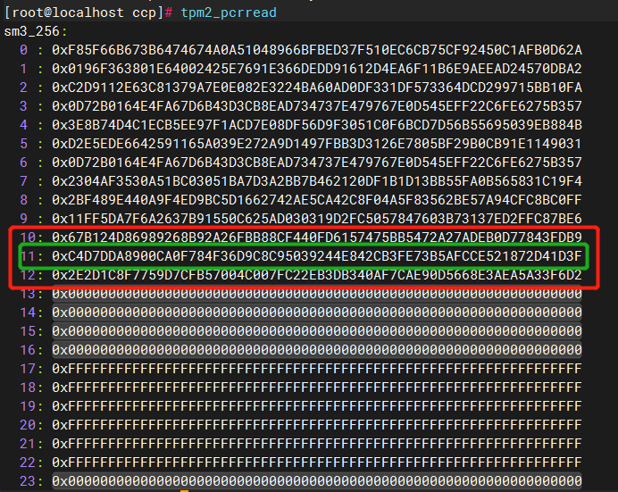

（5）可以看到由于tdm\_verify的三个任务分别对应PCR10、PCR11、PCR12，分别拓展出了VPCR的PCR10、PCR11、PCR12值。

（6）在hag工具的目录获取PCR11对应的TDM度量任务度量值与fTPM的原始PCR值，可以看到成功获取bin的审计文件。

```
$ hag tdm get_vpcr_audit -audit_file audit.bin -pcr_num 11
```

结果如下：

图19 获取VPCR对应的审计信息

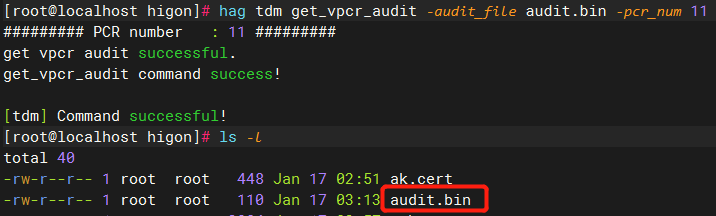

（7）解析审计信息，主要获取原始TPM的PCR值与PCR对应TDM度量任务的信息。可以看到TPM原始信息与图17获取到的原始信息一致。

```
$ hag tdm parse_vpcr_audit -audit_file audit.bin
```

结果如下：

图20 VPCR对应的审计信息解析

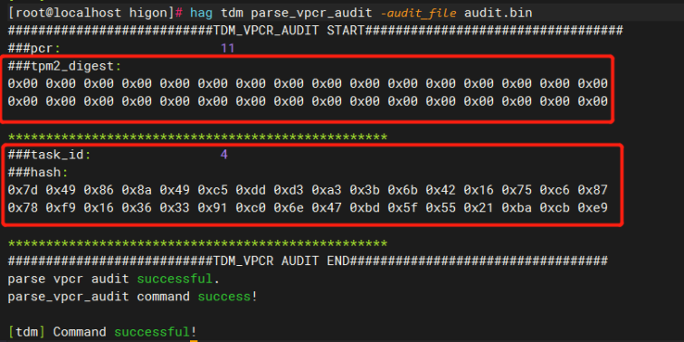

（8）重放VPCR，如图21所示，重放出的VPCR值与图18中PCR11的值一致，重放成功。

执行命令：

```
$ hag tdm replay_vpcr_audit -vpcr_file audit.bin
```

结果如下：

图21 VPCR值重放

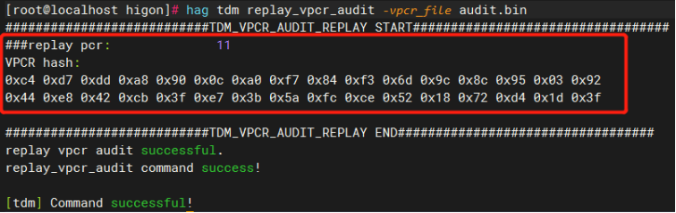

（9）VPCR审计主要用来获取度量的详细信息且确保审计信息不被篡改，至此，VPCR属性的度量基本验证流程结束。

（10）卸载tdm\_verify的模块

```
$ cd /lib/modules/`uname -r`/kernel/drivers/crypto/ccp/
$ sudo rmmod tdm-verify.ko
```
