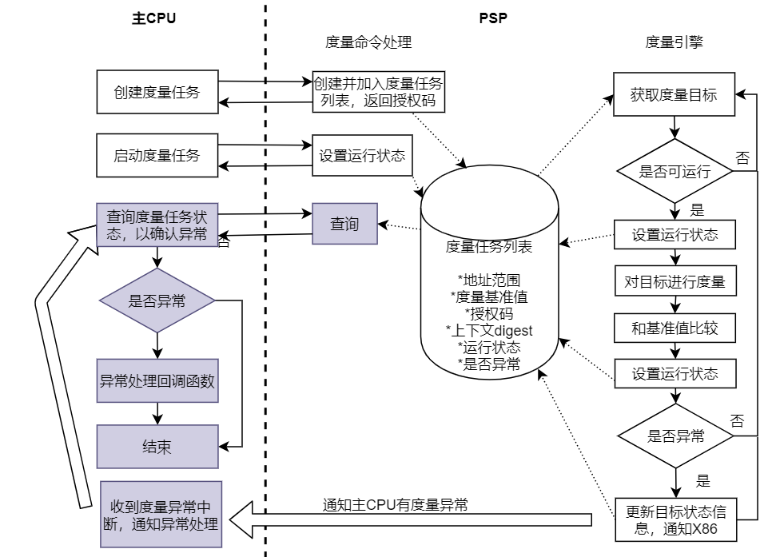
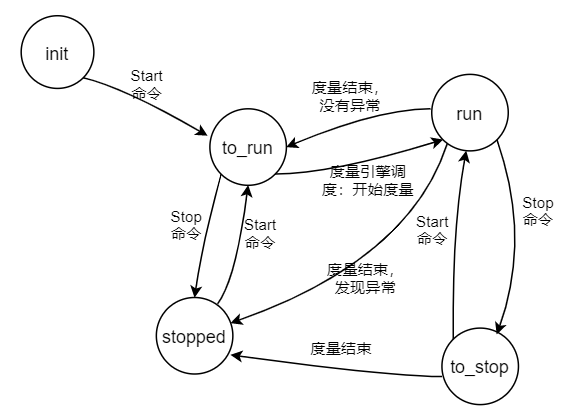
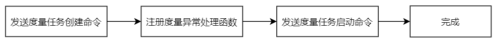
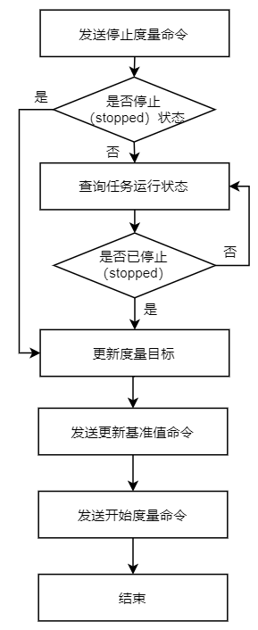
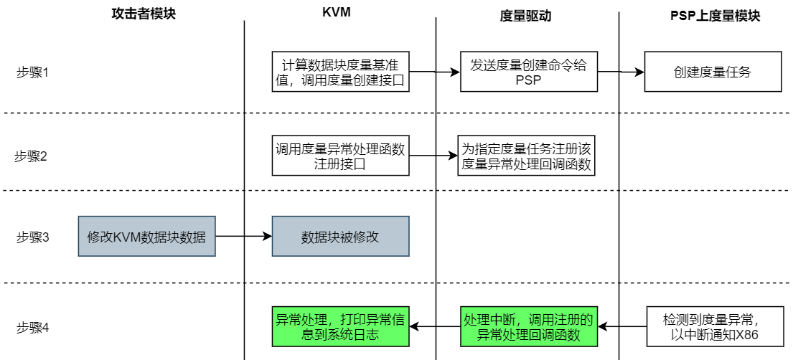
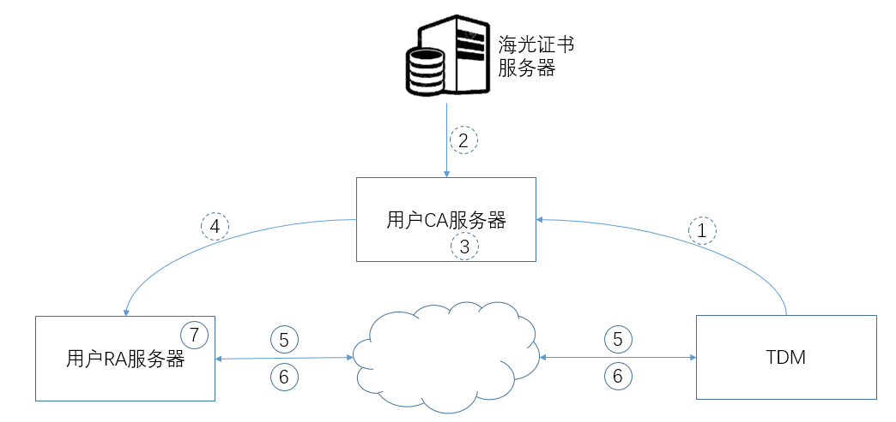
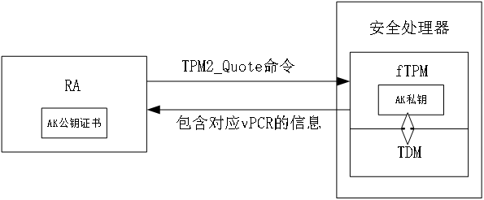
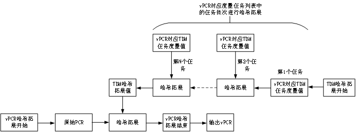

## 1.TDM功能介绍

系统运行时，TDM动态度量模块按设定频率对主机上指定内存范围数据进行持续度量，并与基准值进行比较，当检测到度量异常时，TDM能够通知主机进行处理。同时TDM固件处于PSP安全处理器，具有完整的证书链体系，TDM内置了支持国密算法SM2的AK秘钥，可以用来对TDM度量报告进行签名形成可信度量报告并用于TDM自身的远程认证，AK证书可以通过证书链体系进行逐级验签，来确保证书链的安全。同时，为了支持TDM可以使用TPM成熟的远程认证方案，TDM也增加了与fTPM结合的VPCR技术，用于将TDM的度量信息拓展到VPCR中，使用TPM的远程认证技术实现同时对TDM与TPM的远程认证。

目前TDM主要支持的功能如下：

（1） 通过物理地址与虚拟地址创建动态度量任务；

（2） 命令接口双重授权机制；

（3） 防字典攻击机制；

（4） 度量异常处理机制；

（5） AK秘钥支持的远程认证技术；

（6）与FTPM结合的VPCR远程认证技术；

## 2.TDM动态度量工作模型

需要保护的软件启动时，将要度量的代码段或数据段地址范围，度量基准值，及度量频率生成度量请求，调用创建度量任务命令接口发送给PSP中的TDM固件。

如图1所示，TDM收到后为该度量请求生成度量任务并加入度量任务列表，同时TDM生成并返回随机授权码给主CPU调用侧，主CPU根据需要注册中断异常处理函数，然后发送启动度量命令给TDM，TDM将该度量任务运行状态设置为等待运行状态。TDM内度量执行线程从度量任务列表依次获取各度量任务，并检查度量频率和度量状态标记，在任务可运行时运行该度量任务。度量结果与度量基准值比较，如不一致，则表示发生度量异常，将该度量任务状态标记置为异常，同时设置任务状态置为停止状态，后续该度量任务将不再运行，然后通过PSP中断X86机制通知主机该异常。

主机收到中断通知后记录该异常，同时可以通过状态查询命令进一步查询该度量任务状态信息以确认该异常，并调用异常处理回调函数进行处理，如在日志中记录该异常事件。

图 1 TDM度量流程

## 3.TDM命令访问授权

为保护TDM上度量任务的安全，需要对相关命令访问进行授权验证，验证通过命令才会执行。验证包括两部分：

（1）随机授权码：由TDM在创建度量任务时随机生成并返回给用户，由用户负责安全保管，后续对于该度量任务的操作需要提供该授权码才能进行；TDM生成的随机授权码长度设置为16字节；

（2）上下文环境信息：包括进程号PID，命令名，模块名等。由用户在创建任务时根据需要指定，可以选择一个或多个相关信息，也可以不选。驱动获取到上下文环境信息后进行Hash处理，然后将digest发送给TDM进行记录，TDM只记录digest，而不记录具体的上下文信息。

## 4.防字典攻击

为了防止针对授权码的暴力攻击，TDM内部需要实现防字典攻击DA（Dictionary Attack）机制。具体为：

（1）以度量任务为单位，授权码错误1次，则必须间隔AUTH\_TRY\_DELAY秒后才能进行下一次尝试；

（2）以度量任务为单位，授权码连续错误N次，则必须间隔AUTH\_TRY\_DELAY \* (2 ^ (N-1))秒后才能进行下一次尝试；

（3）以度量任务为单位，授权码一旦输入正确后，错误次数计数器清零；

注：AUTH\_TRY\_DELAY目前设为1。

## 5.TDM度量任务运行状态

为支持对度量任务的更新和管理，系统为TDM内的度量任务定义了5种状态：

（1）初始（init）：任务刚创建时的状态；

（2）等待运行（to\_run）：任务没有运行，但随时可以被度量引擎调度运行；

（3）运行（run）：任务正在运行；

（4）停止中（to\_stop）：任务正在运行，但收到了用户停止的命令；

（5）停止（stopped）：任务停止运行，不能被度量引擎调度；

5种状态转化的状态机如下图2所示。

图2 TDM度量任务状态机

状态机主要用来处理针对度量任务的特定操作，将操作限制在允许的状态内，比如任务在init和stopped状态时允许对任务的更新和销毁操作。

## 6.TDM度量命令接口

度量命令接口由X86侧度量驱动模块提供，内核代码可以调用该接口对需要动态度量的目标进行度量。

### 6.1.固件信息查询

该命令向PSP查询TDM固件的相关信息，包括API版本号和buildID号等，API版本号可以方便将来API扩展与兼容。API版本号用来标记当前固件支持的所有接口，接口不发生改变该版本号保持不变；buildID由postcheckin维护，每次提交postcheckin时会自动增加buildID。

API如下：

int psp\_get\_fw\_info(struct tdm\_version \*version);

功能：向PSP查询TDM固件的相关信息。

**参数：**

| version | 输出 | 查询返回的版本信息。结构体tdm\_version的定义如下： struct tdm\_version {         uint8\_t api\_major; //API主版本号         uint8\_t api\_minor; //API次版本号         uint32\_t buildId;         uint32\_t task\_max; //最大支持的度量任务数         uint32\_t range\_max\_per\_task; //每个任务最大支持的地址范围数 }； 注：第一版1.0，对应主版本号为1，次版本号为0 |
| ------- | ---- | :----------------------------------------------------------- |

返回值：0表示函数调用成功，若为负，表示函数发生错误。

### 6.2.度量任务创建

该命令用来向TDM申请一个度量请求，TDM为该请求创建一个度量任务，创建后的度量任务处于初始（init）状态，度量引擎不会调度运行。

API如下：

int psp\_create\_measure\_task(struct addr\_range\_info \*range, struct measure\_data \*data, uint32\_t flag，struct authcode\_2b \*code);

功能：在TDM中创建度量任务。

**参数：**

| **range** | **输入** | **要度量的目标代码或数据地址范围，地址为物理地址，可以不连续。 结构体addr\_range\_info定义如下： Struct addr\_range\_info {         uint32\_t count;  //不连续地址范围数量，最大支持RANGE\_CNT\_MAX         struct addr\_info addr\[0\]; } #define RANGE\_CNT\_MAX 0x80 结构体addr\_info定义如下： Struct addr\_info {         Uint64\_t addr\_start;  //地址范围起始地址，默认为物理地址，参数flag属性TASK\_CREATE\_VADDR置位时为内核态虚拟地址，此时创建任务仅支持一段连续的内核态虚拟地址，仅取range-\>addr\[0\]中的数据作为虚拟地址空间进行处理。         Uint64\_t length;   //地址范围长度 }** |
| --------- | -------- | ------------------------------------------------------------ |
| **data**  | **输入** | **度量目标的相关控制信息，包括度量算法、度量基准值等。结构体measure\_data定义如下： Struct measure\_data {         Uint32\_t hash\_algo;  //度量hash算法，目前仅支持SM3         Uint8\_t expected\_measurement\[32\]; //度量基准值，用来比较判断目标是否篡改         Uint32\_t period\_ms; //度量周期；当度量任务多，系统性能不足时实际度量周期可能会比设定的长。         Uint32\_t pcr; //该度量任务对应拓展的PCR号，当参数flag的TASK\_SUPPORT\_VPCR置位时有效。 } #define HASH\_ALGO\_SM3 0 #define HASH\_ALGO\_SHA1 1 #define HASH\_ALGO\_SHA256 2 #define HASH\_ALGO\_SHA384 3 #define HASH\_ALGO\_SHA512 4** |
| **flag**  | **输入** | **bit 0-15指定是否需要获取相关上下文环境信息并送给PSP， 后续执行相关命令时PSP将增加对上下文信息的检查，若与记录的信息不一致则不执行命令。上下文信息包括PID，命令名，模块名等。Bit 16指定是否阻止后续更新操作，若置位，则创建后无法进行更新操作，包括更新、停止、及销毁三种操作。Bit 17指定是否支持VPCR拓展，若置位，创建任务时将参数2的PCR值传入TDM任务上下文进行维护，当TPM需要读取对应PCR时，符合条件的TDM度量任务与TPM对应PCR值拓展为VPCR并返回到TPM。Bit18指定创建度量任务的传入地址是否为虚拟地址，若置位，range只使用第一个地址且未虚拟地址，否则，range中依然为物理地址。Bit19表示该度量任务是否在异常时直接挂机，若置位，任务异常时将机器挂机。 数据类型为bit-mapped，已定义bit如下： #define CONTEXT\_CHECK\_PID 0x1 #define CONTEXT\_CHECK\_COMM 0x2 #define CONTEXT\_CHECK\_MODNAME 0x4 #define TASK\_ATTR\_NO\_UPDATE 0x10000 #define TASK\_SUPPORT\_VPCR 0x20000 #define TASK\_CREATE\_VADDR 0x40000 #define TASK\_EXCEPTION\_CRASH 0x80000** |
| **code**  | **输出** | **用来接收返回的授权码，指针不能为空。授权码由TDM随机生成，后续访问该度量任务时须提供该授权码。结构体authcode\_2b定义如下： struct authcode\_2b {         uint16\_t len;  //输入时表示val的长度，输出时表示val中存放的授权码长度。TDM随机授权码长度为PSP\_AUTHCODE\_LEN, 输入val长度必须不小于该长度。         uint8\_t val\[0\]; }** |

返回值：非负为TDM内分配的度量任务ID，若为负，表示发生错误。

### 6.3.度量状态查询

该命令向TDM查询某个度量任务的具体度量状态，是否发生度量错误等。该命令不需要授权。

API如下：

int psp\_query\_measure\_status(uint32\_t task\_id, struct measure\_status \*status);

功能：向TDM查询某个度量任务的具体度量状态。

**参数：**

| **task\_id** | **输入** | **创建度量任务时返回的度量任务ID**                           |
| ----------- | -------- | ------------------------------------------------------------ |
| **status**  | **输出** | **status: 查询返回的度量任务状态信息。结构体measure\_status的定义如下： struct measure\_status {         uint8\_t status; //任务当前运行状态，为5中状态之一。         uint8\_t error; //是否检测到度量错误         uint64\_t count; //总共已度量次数 }； #define MEASURE\_TASK\_STATUS\_INIT 0x0 #define MEASURE\_TASK\_STATUS\_TO\_RUN 0x1 #define MEASURE\_TASK\_STATUS\_RUN 0x2 #define MEASURE\_TASK\_STATUS\_TO\_STOP 0x3 #define MEASURE\_TASK\_STATUS\_STOPPED 0x4** |

返回值：0表示函数调用成功，若为负，表示函数发生错误。

### 6.4.度量异常处理函数注册

该命令向TDM度量驱动模块注册指定度量任务的度量错误处理函数，在TDM检测到度量任务错误时，会以中断形式通知X86，X86再调用相应的度量错误处理函数进行处理，比如日志中记录该异常等。

API如下：

int psp\_register\_measure\_exception\_handler(uint32\_t task\_id, struct authcode\_2b \*code, measure\_exception\_handler\_t handler);

功能：注册指定度量任务的度量错误处理函数。

**参数：**

| **task\_id** | **输入** | **创建度量任务时返回的度量任务ID**                           |
| ----------- | -------- | ------------------------------------------------------------ |
| **code**    | **输入** | **该任务的授权码，由创建度量任务时PSP返回。PSP驱动将该授权码与实时获取的上下文环境信息digest一起发送给PSP以验证授权。** |
| **handler** | **输入** | \**度量错误处理回调函数。函数类型measure\_exception\_handler\_t的定义如下： typedef int (*measure\_exception\_handler\_t)(uint32\_t task\_id); 如果为NULL，则表示取消该度量任务关联的错误处理回调函数。** |

返回值：0表示函数调用成功，若为负，表示函数发生错误。

### 6.5.度量任务销毁

TDM上结束并销毁已经创建的度量任务，同时TDM驱动释放相关资源，如关联的度量异常回调函数，上下文信息检查标记等。

API如下：

int psp\_destroy\_measure\_task(uint32\_t task\_id, struct authcode\_2b \*code);

功能：TDM上结束并销毁已经创建的度量任务。

**参数：**

| **task\_id** | **输入** | **创建度量任务时返回的度量任务ID**            |
| ----------- | -------- | --------------------------------------------- |
| **code**    | **输入** | **该任务的授权码，由创建度量任务时TDM返回。** |

**返回值**：0表示函数调用成功，若为负，表示函数发生错误。

### 6.6.度量任务更新

度量任务创建后进行更新度量任务属性，如度量频率，度量基准值等；**不能更新正在运行中的任务，更新度量任务时，度量任务必须处于初始（init）或停止（stopped）状态。**

API如下：

int psp\_update\_measure\_task(uint32\_t task\_id, struct authcode\_2b \*code，struct measure\_update\_data \*data);

功能：更新度量任务属性。

**参数**

| **task\_id** | **输入** | **创建度量任务时返回的度量任务ID**                           |
| ----------- | -------- | ------------------------------------------------------------ |
| **code**    | **输入** | **该任务的授权码，由创建度量任务时TDM返回。**                |
| **data**    | **输入** | **需要更新的度量相关信息。结构体measure\_update\_data定义如下： Struct measure\_update\_data {         Uint32\_t update\_flag; //需要更新的数据成员标记，bit-mapped;         Uint32\_t algo;         Uint8\_t expected\_measurement\[32\];         //Uint32\_t period\_ms; //修改为不支持更新周期，设计上没有需求，另外考虑安全。 }; Update\_flag位定义如下： #define MEASURE\_UPDATE\_ALGO 0x1 #define MEASURE\_UPDATE\_EXPECTED\_MEASUREMENT 0x2 //#define MEASURE\_UPDATE\_PERIOD 0x4** |

**返回值**：0表示函数调用成功，若为负，表示函数发生错误。

### 6.7.度量任务启停StartStop

启动或停止度量任务，以便对度量任务进行某些更新操作，如更新TDM内度量任务基准值时，需要先停止度量任务，更新完后再启动度量任务。

API如下：

int psp\_startstop\_measure\_task(uint32\_t task\_id, struct authcode\_2b \*code，boolean start);

**功能**：启动或停止度量任务。

**参数：**

| **task\_id** | **输入** | **创建度量任务时返回的度量任务ID**            |
| ----------- | -------- | --------------------------------------------- |
| **code**    | **输入** | **该任务的授权码，由创建度量任务时TDM返回。** |
| **start**   | **输入** | **true为启动操作，false为停止操作。**         |

**返回值**：非负：返回度量任务的当前运行状态；若为负：表示函数发生错误。\*\*

### 6.8.导出认证密钥AK证书

AK密钥用来签名TDM生成的度量状态可信报告。TDM第一次使用时利用TRNG随机生成AK密钥对，并利用内置的芯片背书密钥CEK对AK证书进行签名。AK私钥不出PSP，外部任何人无法知道，AK证书可以导出以支持外部验证TDM的度量报告。

API如下：

int tdm\_export\_cert(uint32\_t key\_usage\_id, struct tdm\_cert \*cert);

**功能**：导出认证密钥AK证书。

**参数：**

| **Key\_usage\_id** | **输入** | **要导出证书的密钥类型id，目前仅支持TDM\_VENDOR\_AK，其它为无效;  #define TDM\_VENDOR\_AK 0x2001;** |
| :--------------- | -------- | ------------------------------------------------------------ |
| **cert**         | **输出** | **接收导出的证书。证书格式定义见附录。**                     |

**返回值**：0表示函数调用成功，若为负，表示函数发生错误。

### 6.9.获取度量可信报告

将TDM内部的度量任务信息生成度量报告，并利用AK进行签名，形成可信报告。

API如下：

int tdm\_get\_report(uint32\_t task\_id, struct task\_selection\_2b \*selection, struct data\_2b \*user\_supplied\_data, uint8\_t report\_type, uint32\_t key\_usage\_id, uint8\_t \*report\_buffer, uint32\_t \*length);

**功能**：获取TDM度量可信报告。

**参数：**

| **task\_id**            | **输入**       | **要查询的度量任务ID，ID在创建度量任务时有TDM返回。当ID为0xffffffff时，度量任务由参数2中的位图选定，否则，参数2无效。 #define TASK\_ALL 0xffffffff;** |
| ---------------------- | -------------- | ------------------------------------------------------------ |
| **Selection**          | **输入**       | **当参数1为0xffffffff时选定要查询的度量任务。若为NULL，则选定存在的所有任务；否则，选定置位bit对应的度量任务，度量任务按创建先后顺序排序。注：允许置位bit对应度量任务不存在，度量报告中的度量任务bitmap为最终实际选定的度量任务。 struct task\_selection\_2b {         uint16\_t len; //表示bitmap数据的实际长度，最大为16B，即128bit，//最多选定128个度量任务；         uint8\_t bitmap\[0\]; }** |
| **User\_supplied\_data** | **输入**       | **用户提供的数据，通常为一串随机数，用来确保报告的新鲜度，防重放攻击。 struct data\_2b {         uint16\_t len; //表示val中数据的实际长度，目前最大长度为32B。         uint8\_t val\[0\]; }; #define MAX\_NONCE\_SIZE 32;** |
| **Report\_type**        | **输入**       | **请求的报告类型。0 – 总结报告；1-总结加各任务详细报告。 #define TDM\_REPORT\_SUMMARY 0; #define TDM\_REPORT\_DETAIL 1;** |
| **Key\_usage\_id**       | **输入**       | **指定用来签名报告的密钥。目前仅支持TDM\_VENDOR\_AK，其它为无效; #define TDM\_VENDOR\_AK 0x2001;** |
| **report\_buffer**      | **输出**       | **接收度量报告的缓存。度量报告格式见本文档附录。**           |
| **length**             | **输入、输出** | **输入时表示度量报告缓存（参数report\_type）的大小，输出时表示缓存中度量报告的实际大小。如果输入时length过小，则函数返回错误（ERR\_SIZE\_SMALL），同时length中写入需要的缓存大小。** |

**返回值**：0表示函数调用成功，若为负，表示函数发生错误。

### 6.10.获取虚拟PCR的审计信息

将TPM与TDM计算VPCR的相关信息导出供审计使用。

API如下：

int tdm\_get\_vpcr\_audit(struct pcr\_select pcr, struct tpm2b\_digest \*digest, struct tdm\_pcr\_value\_2b \*pcr\_values);

功能：获取虚拟PCR的审计信息。

**参数：**

| **pcr**        | **输入** | **请求获取TPM的选中的PCR编号对应算法bank的数据 struct pcr\_select {         uint16\_t hash; //请求pcr编号对应的哈希算法         uint32\_t pcr;  //请求的pcr编号 }** |
| -------------- | -------- | ------------------------------------------------------------ |
| **Digest**     | **输入** | **为读取的TPM对应PCR的原始摘要值，该数据与TDM对应PCR的数据一起用作审计VPCR的结果。 struct tpm2b\_digest{         uint16\_t size; //摘要长度         uint8\_t buffer\[sizeof(union tpmu\_ha)\]; //对应摘要算法存储摘要值 }; Union tpmu\_ha{  //该结构与TPM中保持兼容      Uint8\_t sha1\[SHA1\_DIGEST\_SIZE\];      Uint8\_t sha256\[SHA256\_DIGEST\_SIZE\];      Uint8\_t sha384\[SHA384\_DIGEST\_SIZE\];      Uint8\_t sha512\[SHA512\_DIGEST\_SIZE\];      Uint8\_t sm3\_256\[SM3\_256\_DIGEST\_SIZE\]; };** |
| **pcr\_values** | **输出** | **TDM度量任务对应PCR的数据，用作审计 Struct tdm\_pcr\_value\_2b {         uint32\_t task\_nums; //当前PCR对应度量任务个数。         Struct tdm\_task\_data  task\_data\[0\];//每个PCR寄存器对应TDM度量任务数据,当前每个PCR最大支持度量任务为TDM支持的最大度量任务数 }; Struct tdm\_task\_data {         Uint32\_t task\_id;//度量任务的任务ID号         Uint8\_t hash\[32\];//度量任务当前的度量值 };** |

**返回值**：0表示函数调用成功，若为负，表示函数发生错误。

## 7.TDM度量任务创建及运行

用户开始一个新的度量任务的流程如下图3所示：

图3 度量任务创建流程

## 8.TDM度量任务基准值更新

当度量目标需要主动更新时，TDM内度量任务基准值也需要相应更新。显然，进行更新时该度量任务不能正在被运行，否则会导致度量目标和基准值不一致。需要切换度量任务状态到停止（stopped）状态后进行更新。更新流程如下图4所示：

图4 基准值更新流程图

## 9.TDM系统资源限制

受限于PSP的资源，系统资源限制设置如下表1：

表1 系统资源限制设置

| **编号** | **资源名称**     | **上限**      |
| -------- | ---------------- | ------------- |
| 1        | 度量任务列表大小 | 100个度量任务 |
| 2        | 度量吞吐量       | 5.6Gb/s       |

关于吞吐量的说明：

（1）正常情况下，系统会满足所有度量任务设定的度量周期需求，当度量所有任务需要的性能总和超出系统吞吐量上限时，各度量任务实际的度量周期会比设定的周期要长。

（2）度量需要读取内存，会占用内存访问带宽，因此需要根据需求为度量任务设置合理的度量周期。

## 10.TDM攻击演示模型

模型选择虚拟机管理器KVM为度量保护的对象，该演示模型由四个部分组成：

（1）KVM：假设KVM内部有一块大小为4KB的重要数据块，KVM需要TDM动态度量对该数据块进行保护。KVM启动时计算该数据块的度量基准值，然后调用TDM度量驱动提供的接口请求TDM对该数据块进行动态度量，并向度量驱动注册度量异常处理函数，异常处理函数实现相关异常信息的打印。

（2）TDM度量驱动：提供上述TDM度量相关接口，同时响应TDM发送过来的度量异常中断，并调用注册的异常处理函数进行处理。

（3）攻击者模块：在KVM运行时，通过某种方式修改KVM内部4KB数据块中的数据，触发TDM度量异常。

（4）TDM上度量模块：持续对接收到的度量任务进行度量，并在检测到异常时通知到X86，触发度量驱动进行响应。

攻击步骤如图5所示，异常处理回调函数仅打印异常信息，最终在系统日志看到相关异常打印信息。

图5 攻击演示流程

## 11.TDM基于内置AK的远程认证

为支持度量状态的远程认证，需要使用密钥（AK）对度量状态报告进行签名，形成可信度量状态报告。

AK为非对称密钥，使用非对称密码算法，如SM2、ECDSA、RSA等。TDM内置了支持SM2国密算法的AK密钥，相关特性如下：

1）该密钥非出厂时设置，而是在用户首次使用TDM时由TDM动态生成，过程用到的随机数完全由硬件真随机数发生器TRNG生成。

2）AK公钥（证书）可以导出，但私钥不出TDM，外部任何人无法知道，包括海光。密钥安全有保证。

3）导出的AK公钥（证书）默认由海光芯片内置的CEK芯片背书密钥进行签名，若需要用户可以通过验证该签名确认公钥的真实性，CEK证书可以根据chip\_id在海光证书服务器查询下载。导出的AK公钥证书格式见附录，其中签名1即为CEK签名，签名2通常为空，导出后留给用户进行签名。TDM内部无需基于AK证书与外部进行交互，因此用户是否对证书签名完全取决于用户实际应用需求，用户签名后的AK证书也无需导入回TDM。

一个典型的用户签名AK及远程认证TDM报告的场景如图6所示。

图6 AK公钥认证及TDM远程认证示例

准备阶段（通常为安全性较高的可信环境）：

1）从TDM导出AK公钥证书；

2）根据chip\_id从海光证书服务器下载对应CEK证书；

3）验证AK公钥证书的CEK签名，验证通过后用户CA服务器完成AK证书上的用户签名Sig2，或者按用户格式生成新的AK证书。

4）将用户认证过的AK证书分发给用户网络上的RA远程认证服务器，供后续TDM远程认证时使用。

基于AK的TDM远程认证阶段：

5）RA远程认证服务器请求指定计算节点TDM的度量状态报告；

6）TDM根据请求生成并返回经过AK签名的可信度量报告；

7）RA远程认证服务器找到对应AK证书并验证证书真实性，然后使用AK公钥验证度量报告的真实性，最后检查报告内容确认节点是否可信。

## 12.TDM基于TPM vPCR的远程认证

为支持TDM的远程认证，使TDM可以使用TPM成熟的远程认证方案，设计了如图7的基于TPM vPCR的TDM远程认证框架及流程。主要有远程认证服务器RA，本地fTPM及本地TDM组成。该框架仅限于使用安全处理器内置的fTPM结合TDM实现。

图7 基于TPM vPCR的TDM远程认证框架及流程示意图

vPCR认证流程步骤说明如下：

1）RA给fTPM发送远程认证请求，会调用TPM2\_Quote命令接口，认证请求包含要读取的PCR编号，用来保持请求新鲜度的Nonce值等；

2）如果要读取的PCR列表中包含vPCR对应的PCR，fTPM通过安全处理器内部通道请求TDM提供度量状态信息；

3）TDM将生成的度量状态信息通过安全处理器内部通道给到fTPM；

4）fTPM使用接收到的TDM度量状态信息以特定的方式实时生成需要的vPCR值，vPCR值包含了TDM度量状态的特征信息，保证了只要TDM度量信息输入发生改变，则vPCR值也必定改变。

5）fTPM把经过签名的PCR报告返回给RA；

6）RA验证报告签名，检查各PCR值是否正常从而确定被认证的机器是否可信。

vPCR审计过程：

由于vPCR里只记录了TDM度量信息的特征值，只能用来判断是否有度量异常发生。当度量异常发生时，往往还需要查看详细的度量信息以确定异常的具体原因，即对度量信息进行审计。

TDM对外增加一个普通的度量信息导出接口，导出的度量信息无需复杂的签名保护，而通过使用TPM远程认证信息来确认导出信息的完整性。主要过程如下：

1） 首先通过导出接口导出详细的TDM度量信息；

2） 然后使用与TPM远程认证时动态生成vPCR一样的算法重新计算vPCR的值（见图8 vPCR重放）；

3）然后将重放值与TPM远程认证得到的PCR报告中对应的vPCR值进行对比确认是否一致，如果一致，则导出的TDM度量信息是真实的，接下来可以进行度量信息审计以查找异常的原因；否则说明导出的度量信息被篡改了，导出路径可能存在攻击，可以进行相关检查处理。

图8 审计重放vPCR方法

## 13.附录

本章节中整数数据类型字节序均为小端（little-endian），如各种长度、公钥、签名等；各保留字段均为0.

### 13.1.TDM证书格式

表2 TDM证书格式

| **偏移** | **大小（B）** | **名字**          | **说明**                                                     |
| -------- | ------------- | ----------------- | ------------------------------------------------------------ |
| 000h     | 4             | Version           | 4字节整数（小端），各字节定义为：0.<major>.<minor>.<fix>。初始版本0x00010000，major为1，minor和fix均为0. |
| 004h     | 2             | 保留              | 全0                                                          |
| 006h     | 2             | Chip\_id\_len       |                                                              |
| 008h     | 40            | Chip\_id           | 各芯片唯一ID，可用来在海光证书服务器查询芯片的CEK证书。      |
| 030h     | 4             | Key\_usage\_id      | 该证书的密钥使用类型ID，TDM AK的id为0x2001.                  |
| 034h     | 8             | 保留              | 全0                                                          |
| 03Ch     | 4             | Curve\_id          | 椭圆曲线ID，SM2的曲线ID为0x3                                 |
| 040h     | 32            | Pubkey\_Qx         |                                                              |
| 060h     | 32            | Pubkey\_Qy         |                                                              |
| 080h     | 2             | User\_id\_len       |                                                              |
| 082h     | 126           | User\_id           | 用户ID，用来生成Z值，见SM2算法标准。                         |
| 100h     | 28            | 保留              |                                                              |
| 11Ch     | 4             | Sig1\_key\_usage\_id | 签名1的密钥使用类型。签名1通常为CEK签名，CEK类型为0x1004     |
| 120h     | 32            | Sig1\_R            |                                                              |
| 140h     | 32            | Sig1\_S            |                                                              |
| 160h     | 28            | 保留              |                                                              |
| 17C      | 4             | Sig2\_key\_usage\_id | 签名2的密钥使用类型。签名2通常为平台用户签名。0x1000为无效类型，表示签名不存在。 |
| 180h     | 32            | Sig2\_R            |                                                              |
| 1A0h     | 32            | Sig2\_S            |                                                              |

### 13.2.TDM度量报告格式

表3 TDM度量报告格式

| **偏移** | **大小（B）** | **名字**                | **说明**                                                     |
| -------- | ------------- | ----------------------- | ------------------------------------------------------------ |
| 000h     | 4             | Version                 | 4字节整数（小端），各字节定义为：0.<major>.<minor>.<fix>。初始版本0x00010000，major为1，minor和fix均为0. |
| 004h     | 4             | Fw\_version              | 安全固件版本，即BUILD\_ID。                                   |
| 008h     | 1             | Report\_type             | 报告类型，0（总结报告），1（总结加各任务详细报告）。         |
| 009h     | 5             | 保留                    | 全0                                                          |
| 00Eh     | 2             | Task\_nums               | 报告选中的度量任务总数，对应task\_bitmap中有多少个bit置位。   |
| 010h     | 16            | Task\_bitmap             | 选中的度量任务位图，位图对应现存度量任务按创建时间先后排序。 |
| 020h     | 16            | Task\_error\_bitmap       | 选中的度量任务中发生错误的度量任务位图。                     |
| 030h     | 16            | Task\_running\_bitmap     | 选中的度量任务中正在运行的度量任务位图，包括run和to\_run两种状态。 |
| 040h     | 30            | Reserved                |                                                              |
| 05Eh     | 2             | User\_supplied\_data\_len  |                                                              |
| 060h     | 32            | User\_supplied\_data      | 用户提供的数据，通常为随机数序列，确保报告新鲜度。           |
| 080h     | 32            | Aggregate\_hash          | Task\_bitmap选中的度量任务度量值的hash扩展。与TPM PCR类似，初始值为全0。 |
| +(00h)   | 4             | Task\_id                 | 度量任务创建时TDM返回的task\_id。                             |
| +(04h)   | 4             | Period\_ms               | 度量任务设定的度量周期，以毫秒ms为单位。                     |
| +(08h)   | 8             | Measured\_count          | 总共已度量次数。                                             |
| +(10h)   | 4             | Last\_measure\_elapsed\_ms | 上次度量已过去时间。                                         |
| +(14h)   | 12            | 保留                    |                                                              |
| +(20h)   | 32            | Measured\_hash           | 当前度量值。                                                 |
| 0A0h + L | 28            | 保留                    |                                                              |
| 0BCh + L | 4             | Sig\_key\_usage\_id        | 该签名密钥使用类型id。默认TDM AK为0x2001。                   |
| 0C0h + L | 32            | Sig\_R                   |                                                              |
| 0E0h + L | 32            | Sig\_S                   |                                                              |

注：

1. 上述单个度量任务报告（从task\_id到measured\_hash，共64B）只在report\_type为1（总结加各任务详细报告）时包含，总数为task\_nums.
2. 若report\_type为1时，L = 0x40 \* task\_nums，否则L = 0.
