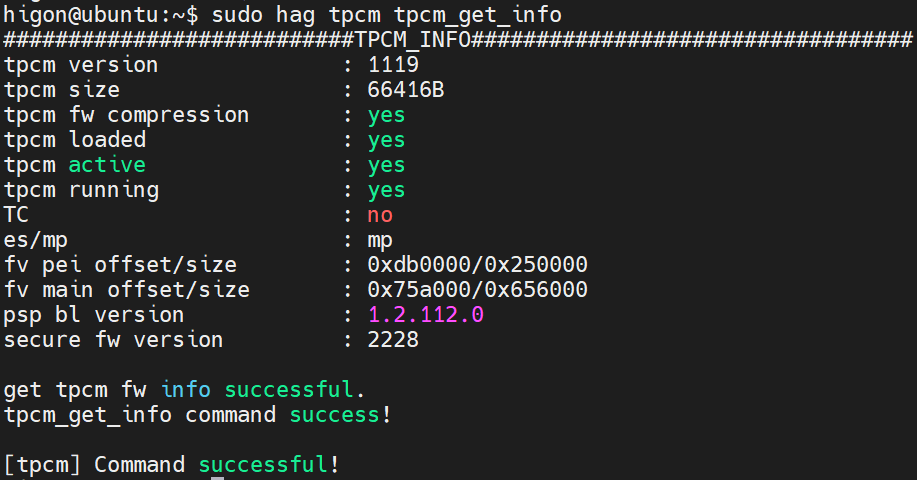
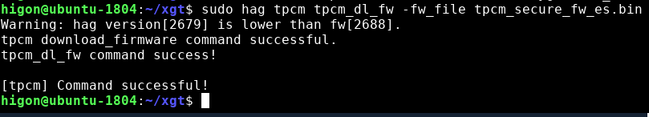

# 01.TPCM快速部署手册

## 1. 部署流程

在海光 C86 平台上跑通 TPCM，需要两部分齐备：**TPCM 固件** 与 **OpenTCSM 软件栈**。

整体顺序为：确认固件就绪 → 内核/用户态软件栈安装 → 通路验证；即先验固件、再装软件、最后验证通路。

### 1.1 hag 工具安装

hag安装参考: <../../../07. 工具/01. 海光安全工具/01. 海光安全工具简介.md>

### 1.2 查询 TPCM 固件信息

安装后用hag命令查看：

```shell
sudo hag tpcm tpcm_get_info
```



查看 `tpcm version`：若固件版本 ≥ 100 则说明正常；否则需动态更新 TPCM 固件，更新方法见 1.3 节。若出现问题，联系海光人员获取帮助。

### 1.3 TPCM 固件更新方法

当 1.2 查询到 `tpcm version` \< 100（或收到海光升级通知）时，用 `hag` 将新的 TPCM 固件文件下载写入 PSP Flash：

```shell
sudo hag tpcm tpcm_dl_fw -fw_file <固件文件名>
```



固件文件由海光提供，可向海光人员获取。更新完成后重新执行 1.2 的 `tpcm_get_info`，确认 `tpcm version` 已更新为新版本号。

### 1.4 TPCM 证书导入

导入海光通用证书（hgsc）后，TPCM 功能方可激活。导入后检查：

```shell
sudo hag general check
```

`TPCM_TC` 应为 `enabled`。若为 `disabled`，说明证书未生效，需先完成证书购买与导入（购买与导入说明见 [海光 C86 文档](<../../../07. 工具/01. 海光安全工具/02. 导入通用安全证书.md>)）再继续。

### 1.5 OpenTCSM 软件栈安装

OpenTCSM 是由**北京同创可信**开源的可信计算支撑项目，围绕 TPCM 提供访问通道与上层可信服务能力。项目整体介绍、架构与基础使用可参照仓库根目录下的 `OpenTCSM-Readme.pdf`，本节仅说明驱动与软件栈的编译安装。整体顺序为：获取源码 → CCP 驱动检测 → 编译 tcsm/tsb → 解压安装 → 验证。

#### 1.5.1 获取源码

```shell
git clone https://gitee.com/anolis/opentcsm.git
```

#### 1.5.2 CCP 驱动检测

OpenTCSM 依赖内核的 CCP 驱动支持可信能力。编译前先检测当前 CCP 驱动是否可用：

```shell
cd opentcsm/src/tcs/scripts
sh ccp-probe.sh
```

若提示 `No available CCP version!`，说明当前内核自带的 CCP 驱动不支持可信功能，需向海光获取包含可信 CCP 驱动的内核版本并予以更换。

#### 1.5.3 编译 tcsm

编译成功后，当前脚本目录下生成 tar 安装包（即 OpenTCSM 安装包）：

```shell
cd opentcsm/src/tcs/scripts
sh tcsproc.sh release hygon
```

#### 1.5.4 编译 tsb

在当前目录生成 tar 安装包，即为可信控制代理安装包：

```shell
cd opentcsm/src/tsb
sh pack_tsb.sh
```

#### 1.5.5 安装

切换到 root 用户，将 tcsm 安装包解压到 `/usr/local/opentcsm/` 后执行安装脚本（文件名以 `opentcsm-hygon-6.6.0-x86_64-v2.0.1-release.tar.gz` 为例）：

```shell
mkdir -p /usr/local/opentcsm
tar -zxvf opentcsm-hygon-6.6.0-x86_64-v2.0.1-release.tar.gz -C /usr/local/opentcsm
cd /usr/local/opentcsm/tcsm
sh install.sh
```

`install.sh` 会按依赖顺序自动加载内核模块（`tckxtdd → tckxtddl → otcsk`，可选 `tckxtcs-ex`）并创建设备节点。安装完成后，通过以下命令判断是否成功：

```shell
lsmod | grep -E "tckxtdd|tckxtddl|otcsk"
ls -l /dev/tckxtcs /dev/tckx_tddl_tcm /dev/tckx_tddl_tpcm
```

`lsmod` 能列出上述模块、且三个设备节点均已存在，即表明软件栈安装成功。如节点缺失或模块未加载，查看 `install.sh` 输出与 `dmesg` 日志。

## 2. 常见部署问题排障

### 2.1 环境适配与 CCP 驱动

支持海光 TPCM 的 OS 版本详见 [海光 C86 文档](<../../../00. C86 DevKit 概览/02. 安全技术概览/02. 国产OS安全功能支持情况.md>)；可参考[核外编译指南](<../../04. 常见问题/04. 海光 CCP-可信驱动核外编译指南.md>)做完整核外编译。其他需要适配的情况请联系海光人员。

`ccp-probe.sh` 报 "No available CCP version!"：脚本检查 `/proc/kallsyms` 中是否存在 `psp_do_cmd`。若不存在，说明当前内核的 CCP 驱动不支持可信功能，可对照上文 OS 支持列表更换受支持内核，或按核外编译指南对 CCP 可信驱动做核外编译。

### 2.2 证书未激活（`TPCM_TC=disabled`）

`hag general check` 显示 `TPCM_TC: disabled` 或 `is HGSC imported: NO`：先完成证书购买与导入，证书未生效前不应继续 TPCM 初始化与业务验证。

### 2.3 编译报 `/usr/bin/ld: 找不到 -ltcm`

`libtcm.so` 由 `tcsproc.sh` 中 `tcm_proc()` 编译生成，产物位于 `src/tcm/lib/.libs/libtcm.so*`。确认 `tcm_proc` 执行成功，并检查链接时的 `-L` 路径。

### 2.4 非 Hygon TCKX 固件或固件版本不满足

在非 Hygon TCKX 固件或固件版本不满足情况下加载驱动，`tdd_init` 与固件通信会失败（`Send shmem address result` 非 0）。确认运行环境为支持 TPCM 的海光平台与 BIOS PI，支持海光 TPCM 的 PI 详见 [海光 C86 文档](<../../../00. C86 DevKit 概览/02. 安全技术概览/01. PI版本与安全功能对照表.md>)；更新 TPCM 时同样需要满足 PI 版本号需求。

## 3. 下一步

- 进行TPCM功能与状态验证 → **02 TPCM 快速测试手册**

---
