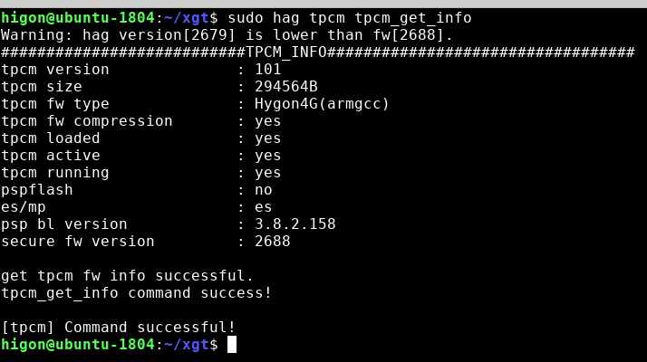
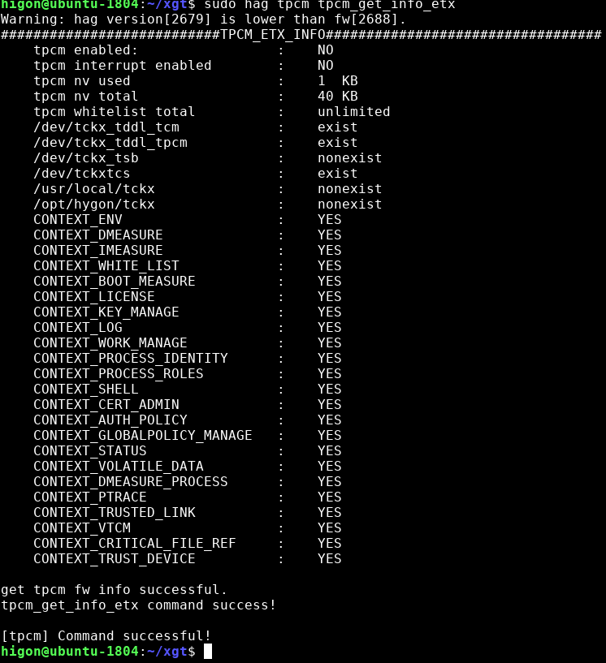
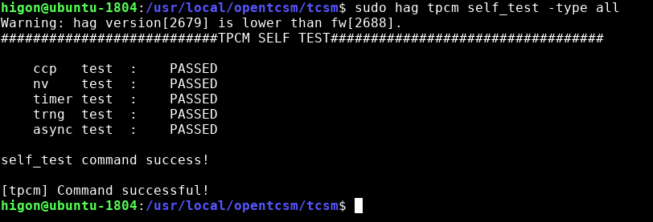
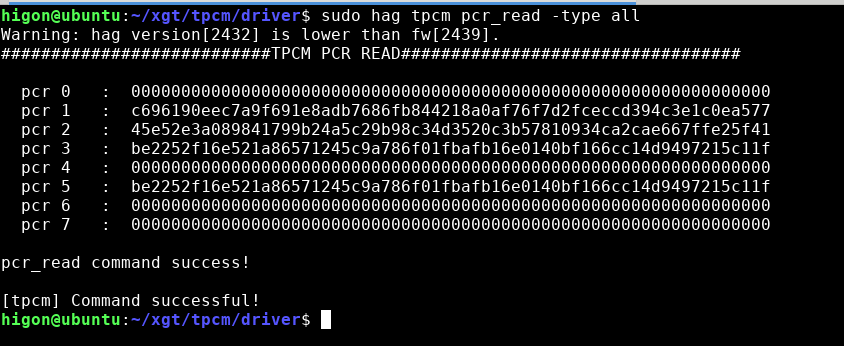
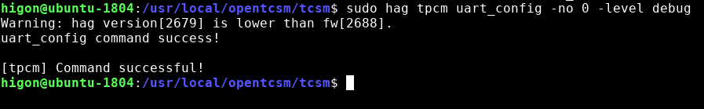
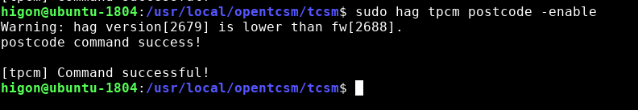

# TPCM 快速测试手册

## 1. 概述

本文承接 **01 TPCM 快速部署手册**。

确保前置条件——`hag` 工具安装、hgsc 证书导入、TPCM 固件就绪、OpenTCSM 软件栈安装——均已完成。

本文档包含 TPCM 固件、TCSM软件栈测试项及测试建议，按两类标注：

| 测试类别 | 测试项 | 说明 | 是否建议 |
|------|--------|------|----------|
| 固件状态 | [状态查询](#21-状态查询) | 读取固件运行状态 | ✅ 建议 |
| 固件状态 | [状态查询（扩展）](#22-状态查询扩展) | 读取固件扩展状态（中断/NV/白名单等） | 可选 |
| 固件状态 | [基础功能自测](#23-基础功能自测) | 主动发命令触发固件响应，验证基础功能 | ✅ 建议 |
| 固件状态 | [读取度量PCR](#24-读取度量pcr) | 读取各度量阶段 PCR 值 | 可选 |
| 固件状态 | [串口调试](#25-打开串口调试) | 出问题时抓固件串口详细日志 | 可选 |
| 固件状态 | [postcode 调试](#26-打开-postcode-调试) | 出问题时开启 postcode 码输出 | 可选 |
| 软件栈通路 | [TCSM 软件栈测试](#31-tcsm通路) | 对用户态/内核态接口做整体业务通路自测 | ✅ 建议 |
| 软件栈通路 | [TSB 及 UI 软件栈测试](#32-tsb-及-ui-软件栈测试) | 通过 GUI 验证白名单/关键文件/动态度量等 TSB 功能 | 可选 |

## 2. 固件状态检验

### 2.1 状态查询

```shell
sudo hag tpcm tpcm_get_info
```



| 字段 | 含义 |
|------|------|
| `tpcm version` | TPCM 固件版本 |
| `tpcm size` | TPCM 固件大小（未压缩），字节单位 |
| `tpcm fw compression` | 固件是否压缩；`yes` 已压缩 / `no` 未压缩 |
| `tpcm fw type` | 固件类型；`Hygon2G/3G(armcc)` 表示海光 2/3 号机型且用 armcc 编译 |
| `tpcm loaded` | 固件启动时是否加载并初始化成功；`yes` 成功 / `no` 未成功 |
| `tpcm active` | 通用安全证书是否下载成功（激活）；`yes` 已激活 / `no` 未激活 |
| `tpcm running` | 固件是否正常运行。以首条 TPCM 命令（BIOS 发来的 OS Loader 度量命令）是否成功为判据；`yes` 正常 / `no` 异常 |
| `pspflash` | 当前服务器是否可信服务器（携带 PSP Flash，固件与数据均位于 PSP Flash 内）；`yes`/`no` |
| `es/mp` | 当前 CPU 是否工程样片；`es` 工程样片（固件未加密签名）/ `mp` 正式产品 |
| `psp bl version` | PSP Bootloader 版本号 |
| `secure fw version` | 海光安全固件版本 |

### 2.2 状态查询（扩展）

```shell
sudo hag tpcm tpcm_get_info_etx
```



| 字段 | 含义 |
|------|------|
| `tpcm enabled` | 老版本 TPCM 证书使能位；最新版本以 `hag general check` 中 `TPCM_TC` 是否使能为准 |
| `tpcm interrupt enabled` | TPCM 中断是否正常（⚠ 依赖 `/dev/hygon_psp_resource2` 设备节点，不存在则为 NO） |
| `tpcm nv used` | TPCM NV 空间已使用量 |
| `tpcm nv total` | TPCM NV 总空间 |
| `tpcm whitelist total` | 白名单空间总大小（`unlimited` 表示白名单存储在数据库中） |
| `/dev/tckx_xxx` | tckx 可信服务设备节点是否存在（⚠ 安装 tckx 模块后生成） |
| `/usr/local/tckx` | tckx 可信服务安装默认路径是否存在 |
| `/opt/hygon/tckx` | 海光 OS 中是否包含 tckx 可信服务文件夹 |
| `CONTEXT_XXX` | 固件中动态度量、白名单、密钥管理等可信服务是否正常；`YES` 正常 / `NO` 不正常 |

### 2.3 基础功能自测

```shell
sudo hag tpcm self_test -type [all|nv|timer|trng|ccp|async]
```



包含 5 个测试子项：

| 子项 | 内容 |
|------|------|
| `ccp test` | sm2/sm3/sm4 相关接口测试 |
| `nv test` | NV 读写擦除相关接口测试 |
| `timer test` | 时钟定时器相关接口测试 |
| `trng test` | 随机数相关接口测试 |
| `async test` | 异步相关接口测试 |

⚠ 务必先检查 `/dev/tpcm_test` 设备节点是否存在；该节点由 OpenTCSM 提供的测试驱动 `tpcm_manage.ko` 创建，需确保该模块已加载。

### 2.4 读取度量PCR

```shell
sudo hag tpcm pcr_read -type [all|0~7]
```



按不同度量阶段读取 8 个 PCR 值：

| PCR | 含义 |
|-----|------|
| pcr0 | Not save |
| pcr1 | BIOS |
| pcr2 | BOOTLOADER |
| pcr3 | KERNEL |
| pcr4 | TSB（已废弃） |
| pcr5 | BOOT\_ALL |
| pcr6 | DMEASURE\_STATE |
| pcr7 | APP\_LOAD\_STATE |

### 2.5 打开串口调试

当上述测试命令无法发掘当前问题时，需使用串口获取固件更详细的打印日志。串口连接后：

```shell
sudo hag tpcm uart_config -no [0|1] -level [debug|release]
```



- `-no`：当前串口号，一般为串口 0。
- `-level`：调试等级，选 `debug` 有更多日志。

### 2.6 打开 postcode 调试

选择是否开启 postcode 日志，开启后会有相应 postcode 码输出。

```shell
sudo hag tpcm postcode -[enable|disable]
```



## 3. OpenTCSM软件栈通路测试

### 3.1 TCSM通路

OpenTCSM 软件栈及设备节点已部署完成，运行其自带的一键测试脚本，对用户态/内核态软件栈做整体自测：

```shell
cd /usr/local/opentcsm/tcsm
sh tcs-test.sh
```

按提示选项输入 `92 ──► 1` 即可一键测试所有接口。

### 3.2 TSB 及 UI 软件栈测试

OpenTCSM 的 TSB（可信软件基）模块提供白名单、关键文件管控、动态度量等运行期增强能力，并通过基于 Tkinter 的 GUI 工具 `tckx_app.py` 暴露为图形化管理界面。

#### 3.2.1 测试前置

- 已按《01 TPCM 快速部署手册》完成 OpenTCSM 软件栈安装，确保内核模块已加载。

- 确保已安装 `python3` 与 `tkinter`。

- 将 TCSM、TSB 安装包置于 `opentcsm/src/app/` 目录下后启动：
  
  ```shell
  cd opentcsm/src/app
  python3 tckx_app.py
  ```
  
  需在支持图形界面的本地终端执行；若环境不支持图形显示（如无 X Server / 远程纯文本终端），程序会因无法初始化 Tkinter 窗口而报错退出。

#### 3.2.2 测试项与结果

| 测试项 | 预期结果 |
|--------|----------|
| 初始化可信环境 | 首次启动先执行「初始化可信环境」（预计耗时几分钟），完成后可信环境就绪 |
| 启动/停止可信服务 | 点击「启动可信服务」启用服务，「停止可信服务」可停止 |
| 白名单功能 | 新建的 shell 脚本、二进制程序默认不允许运行；加入白名单后可正常运行。 |
| 关键文件管控 | 将程序添加为关键文件后，被修改即不可查看；查看会触发失败日志上报，日志见「审计信息」 |
| 动态度量功能 | 可配置 `kernel_section` / `syscall_table` / `idt_table` 的度量周期 |
| 日志审计 | 「审计信息」可切换查看三类日志：白名单 / 关键文件 / 动态度量 |
| 可信报告 | 实时获取并展示 TPCM 报告（启动度量、各种非法访问计数） |
| 启动度量 | 显示启动度量记录（阶段 / 时间 / hash / 结果） |

上述各项均通过即表明 TSB 及 UI 软件栈功能正常。该套测试已在 4.19 / 5.10 / 6.6 内核上已经验证通过。

## 4. 常见测试问题排障

### 4.1 软件栈初始化失败（认证失败）

软件栈初始化向 TPCM 认证，证书（hgsc）必须在此之前导入激活，否则认证失败导致初始化中断。先 `hag general check` 确认 `TPCM_TC: enabled` / `is HGSC imported: YES`，再 `hag tpcm tpcm_get_info` 确认 `tpcm active: yes`（证书导入见《01 TPCM 快速部署手册》1.4）；证书生效后方可安装并初始化 OpenTCSM 软件栈。仍失败则查 `tpcm running: yes`、设备节点 `/dev/tckx_tddl_tpcm` 存在、内核模块加载顺序正确（见《03 TPCM 架构设计手册》第 3 节）。

### 4.2 基础功能自测失败（设备节点缺失）

运行 2.3 基础功能自测（`hag tpcm self_test -type ...`）失败时，先检查 `/dev` 目录下 `tpcm_test` 设备节点是否存在（`ls -l /dev/tpcm_test`）。该节点由 OpenTCSM 测试驱动 `tpcm_manage.ko` 创建（见 2.3）；若不存在，说明当前环境未加载该模块或平台不支持此项测试，自测无法继续，直接判定为不支持，无需再排查后续子项——可回到《01 TPCM 快速部署手册》确认 `tpcm_manage.ko` 是否已随软件栈加载。若节点存在仍失败，再按子项（`nv`/`timer`/`trng`/`ccp`/`async`）报错逐项定位，必要时辅以 2.5 串口调试或 2.6 postcode 调试抓固件日志。

## 5. 下一步

- 理解分层、模块职责与数据流 → **03 TPCM 架构设计手册** （可选）
- 基于对外 API 二次开发 → **[接口文档](https://gitee.com/anolis/opentcsm/tree/master/doc)**

---
