# 03.TPCM架构设计手册

本文承接 **02 TPCM 快速测试手册**。

OpenTCSM 的整体架构与模块解析，可参考本手册。

## 1. TPCM 介绍

TPCM（Trusted Platform Control Module，可信平台控制模块）是可信计算体系中的可信根模块，在海光平台上集成于 CPU/平台的安全处理器内部，作为平台启动与运行阶段的可信度量根、可信报告根和可信存储根。TPM（Trusted Platform Module）/TCM 除独立芯片形态外，也有内置芯片内的固件实现（fTPM/fTCM，海光平台的 TPM/TCM 即为此形态）；TPCM 与之的本质区别不在形态，而在**主动度量与控制**。

### 1.1 从 TPM/TCM 到 TPCM

可信平台模块的演进大致经历三代：

| 标准 | 代际 | 代表 | 形态 | 特点 |
|------|------|------|------|------|
| 国际TCG | 第一代 | TPM 1.2 / TPM 2.0 |  独立芯片或固件型（fTPM） | **被动度量**，从 BIOS 内 CRTM 起逐级度量，结果写入 PCR，仅记录不阻断，事后远程证明验证 |
| 中国国密 | 第一代 | TCM | 独立芯片或固件型（fTCM） | **被动度量**，采用国密算法（SM2/SM3/SM4），符合 GB/T 系列 |
| 中国国密 | 第二代 | TPCM | 平台内置（集成于安全处理器）或独立板卡 | **主动度量+控制**：CPU 复位后、BIOS 执行前即介入，先度量后放行，可阻断异常组件并控制外设接口 |

TPCM 相比 TPM/TCM 的关键提升即**主动度量**：把可信链起点从 OS 提前到平台上电，实现"先度量、后执行"。

### 1.2 TPCM 的核心能力

- **可信度量根（RTM）**：在启动各关键节点（BIOS PEI/MAIN、OS Loader、内核、应用）计算并扩展 PCR（Platform Configuration Register），形成完整可信链。
- **可信报告根（RTR）**：以内部密钥对平台配置进行签名，向验证方提供可信报告。
- **可信存储根（RTS）**：提供 NV 受控存储，封存密钥与受保护数据。
- **主动度量与控制**：上电即介入，对启动链各组件（BIOS 固件、OS Loader（GRUB）、内核）分段度量，篡改即阻断。
- **密码服务**：内置 SM2/SM3/SM4 等国密算法接口。

### 1.3 TPCM 在可信计算体系中的位置（以海光 C86 为例）

```
应用 / 管理工具 / 测试程序
        │
  可信服务层（TCSU / TCF / 内核 TCSK TSB）   ← OpenTCSM 提供
        │
  驱动封装层（TDDL）/ 设备驱动层（TDD）   ← OpenTCSM 提供
        │
  C86 平台安全处理器（PSP / CCP）          ← 海光 C86 硬件
        │
  TPCM 固件（可信根：RTM / RTR / RTS）    ← 内置于 C86 PSP
```

- **硬件侧**：PSP 是集成在 C86 CPU 内部的独立安全核，**TPCM 固件运行在 PSP 上**（可动态更新），作为硬件可信根提供度量根、报告根与存储根。
- **软件侧**：打通"用户态 → 内核驱动（TDD/TDDL/TCSK）→ C86 PSP → TPCM 固件"的访问通道，并在其上叠加白名单、静态度量、动态度量等运行期可信软件基（TSB）能力。这部分是 OpenTCSM 项目要编译安装的软件栈。
- **管理入口**：海光 `hag` 工具暴露 TPCM 管理命令（状态查询、self\_test、PCR 读取、串口调试等）。
- **激活前提**：需导入海光通用证书（hgsc）并使 `TPCM_TC` 处于 `enabled`，TPCM 功能方可激活。

### 1.4 专业术语

| 术语 | 全称 | 含义 |
|------|------|------|
| TPCM | Trusted Platform Control Module | 可信平台控制模块，内置于平台安全处理器的硬件可信根，提供度量、报告、存储与密码服务 |
| TPM | Trusted Platform Module | 可信平台模块，独立芯片或固件实现（fTPM）的可信根，被动度量 |
| TCM | Trusted Cryptography Module | 可信密码模块，中国标准可信模块，采用国密算法 |
| RTM | Root of Trust for Measurement | 可信度量根，启动各阶段计算并扩展 PCR |
| RTR | Root of Trust for Reporting | 可信报告根，对平台配置签名后向验证方报告 |
| RTS | Root of Trust for Storage | 可信存储根，提供 NV 受控存储，封存密钥与受保护数据 |
| PCR | Platform Configuration Register | 平台配置寄存器，累积记录各阶段度量值，构成可信链 |
| PSP | Platform Security Processor | 平台安全处理器，海光 C86 内集成 TPCM 固件的硬件单元 |
| CCP | Cryptographic Coprocessor | 密码协处理器，海光平台提供密码与命令通道的硬件 |
| TDD | Trust Device Driver | 可信设备驱动层，与 PSP/CCP 硬件通信 |
| TDDL | Trust Device Driver Layer | 可信驱动封装层，提供通信队列、命令同步 |
| TCSK | Trusted Computing Services Kernel | 内核可信服务层 |
| TCSU | Trusted Computing Services User | 用户态可信服务库，封装 TPCM/TCM 命令组包与解析 |
| TCF | Trusted Computing Function | 可信功能接口，在 TCSU 基础上提供更高层封装 |
| TSB | Trusted Software Base | 可信软件基，提供白名单、静态度量、动态度量、关键文件保护、审计日志等增强能力 |

---

## 2. 海光C86可信计算架构

### 2.1 硬件架构

TPCM 的硬件架构遵循可信计算节点模型：一颗物理 CPU 内部并存**计算部件**与**防护部件**两套隔离的执行环境——前者是被度量的对象，后者是度量与防护的执行者，两者经**连接总线**交互。

海光 C86 把两侧做进同一颗 CPU：x86 主核跑业务（被度量），PSP 独立安全核跑 TPCM 固件（度量者）。

可信度量正源于此：PSP 独立上电、先于 x86 运行，在 CPU 复位后、BIOS 执行前率先取得控制，对 BIOS→Bootloader→Kernel 全链路先度量后放行；运行期由 TPCM 固件主动度量 x86 内核关键区（IDT、系统调用表、代码段），计算封闭在 PSP 侧，x86 无法干预或伪造结果。

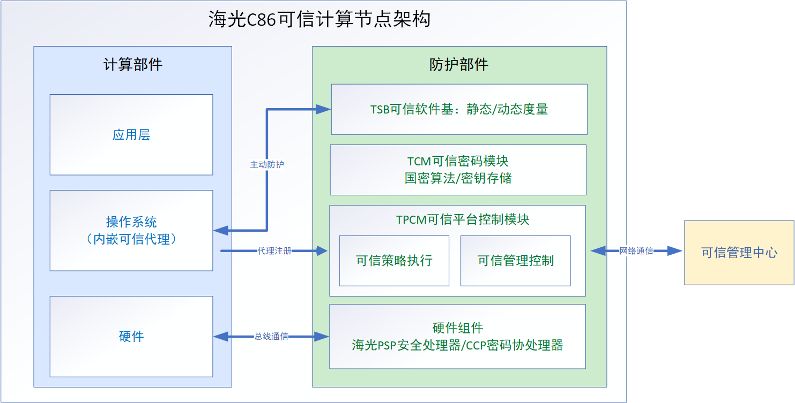

#### 计算部件（被防护侧）

承载正常业务的主执行环境，是**被度量、被防护**的对象：

- **应用层**：用户态业务程序与管理工具；
- **操作系统**：Linux 内核及系统服务；
- **硬件**：x86 计算核及其外设。

计算部件的各级代码在启动与运行期都要接受防护部件的度量；一旦它自身被攻破，攻击者能改动的只是被度量的内容，**改动不了度量者**。

#### 防护部件（可信根侧）

独立于计算部件的可信执行环境，提供度量、报告、存储与密码服务，是整机的**可信根**：

- **TSB**：运行于计算部件内核侧，承担静态/动态度量与审计通知，是防护部件伸入计算部件的策略执行体；
- **TPCM**：自身运行支撑与不可变固件，运行于独立安全核，是度量的发起者与 PCR 的持有者；
- **TCM**：提供国密算法与受控密钥存储，作为防护部件的密码基座。
- **硬件组件**：独立安全核硬件（海光平台即 PSP/CCP）；

### 2.2 TCSM 软件栈架构

TCSM 软件栈是运行在 x86 侧的整套可信软件：向上对接应用与管理工具，向下经内核跨异构边界与 TPCM 固件通信，把度量、证明、密码运算等请求逐层封装送达固件，再把执行结果与主动通知取回用户态,下图给出整体框架。

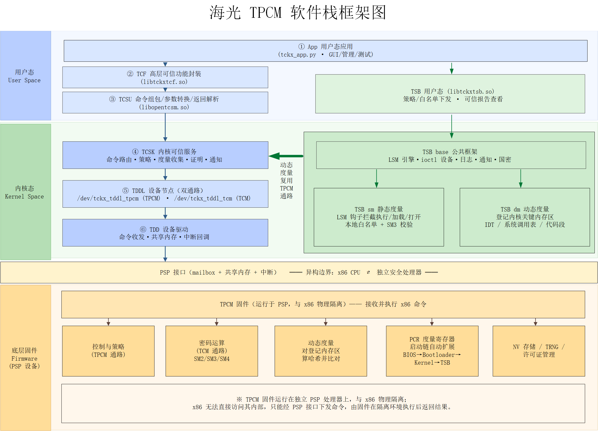

#### 分层详解（自下而上）

**TDD（可信设备驱动，`tdd.ko`）** —— x86 内核访问 PSP 上 TPCM 固件的唯一出口，对用户态不可见、不创建设备节点。以共享内存 + 中断回调与固件交换数据：同步命令就地回填，异步命令挂等待表、由中断按序号唤醒。

**TDDL（驱动封装层，`tddl.ko`）** —— 把 TDD 包成两路字符设备 `/dev/tckx_tddl_tpcm`（TPCM 通路）与 `/dev/tckx_tddl_tcm`（TCM 通路），靠 ioctl magic number 区分；两路共用同一条 TDDL→TDD 通路。

**TCSK（内核可信服务层，`otcsk.ko`）** —— 在 TDDL 之上做命令路由、策略落地、度量收集与证明。创建 `/dev/tckxtcs`，并把它作为大块数据的 mmap 辅助通道，避免 ioctl 逐字节拷贝。

**TSB 内核（可信软件基，`tckx_base`/`tckx_sm`/`tckx_dm`）** —— 运行期增强层，创建 `/dev/tckx_tsb`，做拦截、度量、日志与通知。**base** 是公共底座，提供 ioctl 框架、通知子系统、LSM 引擎与国密算法。**sm** 静态度量：经 LSM 钩子拦截执行/加载/打开，本地 SM3 算哈希再比对白名单，不回调固件。**dm** 动态度量：登记 IDT/系统调用表/代码段等内核关键区，借 TCSK/TDD 通路把内存区交回 TPCM 侧固件进行动态周期度量。

**TSB 用户态（`libtckxtsb.so`）** —— TSB 的用户态出入口：经 `/dev/tckx_tsb` 下发白名单、关键文件、全局联动等策略，并读取内核上报的异常/匹配事件与审计日志，与 TSB 内核构成"策略下发、事件上报"的上下联动。

**TCSU（可信服务接口，`libopentcsm.so`）** —— TPCM 命令的用户态封装：组包/参数转换/返回解析，覆盖度量、密钥树、NV 存储、可信报告、策略、SM2/3/4 。依赖两个库：`libtcm.so`与 `libtcutils.so`。

**TCF（可信功能接口，`libtckxtcf.so`）** —— 在 TCSU 之上再封一层完整业务：把防重放、签名、下发等多步组合成单接口（管理员证书下发、策略下发、可信报告、PIK 生成等）。

**App（`tckx_app.py`）** —— Tkinter GUI 主控台。可一键初始化TPCM服务，并起守护线程每秒从内核拉日志落盘。GUI 分初始化/白名单/关键文件/动态度量/审计/可信报告/启动度量七页。

### 2.3 功能形态

TPCM 固件为上层软件（内核驱动、TCSM 软件栈）提供整体可信支撑，其组成如下图所示。

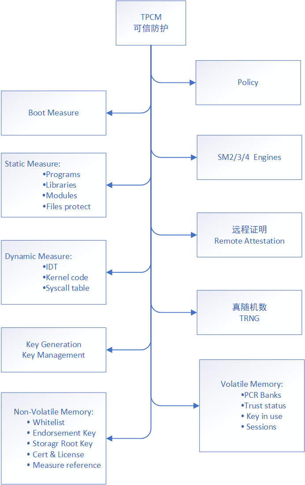

如图，固件向上层提供的能力分三类：**度量**、**服务**与**管理**；数据存放分两类：**非易失存储**与**易失存储**。

| 类别 | 能力 |
|---|---|
| **度量** | 启动度量：CPU 复位后、BIOS 执行前主动度量，结果写入 PCR<br>运行度量：程序/文件 SM3 比对白名单（静态）；IDT/系统调用表/代码段周期性度量（动态） |
| **服务** | 远程证明、可信存储与数据密封、SM2/3/4 密码运算、密钥管理 |
| **管理** | 白名单/基准值/度量策略等配置下发（落固件 NV）；固件主动通知 |

非易失存储保存白名单、度量基准值、证书与许可、EK/SRK 根密钥等长期资产；易失存储保存 PCR、可信状态、在用密钥与会话等运行期数据。

## 3. 数据流

**TCF 是 TCS 的透传薄封装**——同名接口逐层透传，数据流走向由 TCS 决定；第 4 章各节只描述各类业务自己的落点与逻辑。

**对外设备节点**

| 设备节点 | 通路 | 用途 |
|---|---|---|
| `/dev/tckx_tddl_tcm` | TCM | 密码运算（密钥/SM4/封印/PCR/NV） |
| `/dev/tckx_tddl_tpcm` | TPCM | 控制度量/认证/策略 |
| `/dev/tckxtcs` | 大块数据 | mmap 共享内存，免 ioctl 拷贝 |
| `/dev/tckx_tsb` | TSB | 通知环 + 审计 |

用户态经字符设备节点进内核；TDDL 按 ioctl magic 分流命令，最终都路由到固件。

另有独立的 **TSB 通路**：用户态 `libtckxtsb.so` 经 `/dev/tckx_tsb` 的 ioctl 直接与 TSB 内核模块交互，用于策略下发、事件上报与审计读写。其中动态度量登记内核关键区后，借 TCSK/TDD 通路将内存区交回 TPCM 固件计算哈希。

**用户态 → 固件:**

```
tcf接口 → 用户态 lib库 → /dev/tckx_tddl_{tcm,tpcm} → tckxtddl.ko → tckxtdd.ko → TPCM 固件
```

- `tckxtddl.ko`：包括两个字符设备，按 ioctl magic 分流 TCM/TPCM命令。
- `tckxtdd.ko`：硬件通道，共享内存投递命令 + 中断等待回填。
- `otcsk.ko`：路由/策略/远程证明，提供 `/dev/tckxtcs` mmap 通道。
- `tckx_base.ko`：LSM hook + `/dev/tckx_tsb` 通知环 + 审计。

TCM、TPCM 是两套独立命令集，共用同一条硬件通道访问 PSP 上的 TPCM 固件，由 TDDL 在两个设备节点上按 magic 区分。

## 4. 功能模块

**功能层次与策略支持总览**

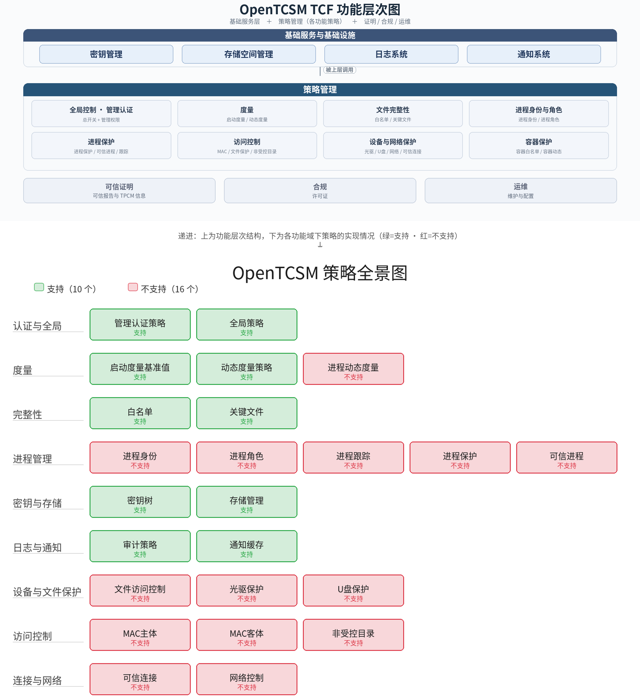

上图给出 TCF 功能层次：基础服务层之上为策略管理域，包含全局控制、度量、文件完整性、进程身份与角色、进程保护、访问控制、设备与网络保护、容器保护等策略；另有可信证明、合规、运维。下半标注各策略实现情况（绿=支持，红=不支持），后续小节分述各域数据通路。

**关于“不支持”的模块**：这些策略的上层接口与存储逻辑已具备，但 TSB 尚未实现，故配置后不生效。底层通路与固件均已支持，仅缺 TSB 一层；用户自行实现 TSB 部分后即可在运行时生效。

### 4.1 密钥管理

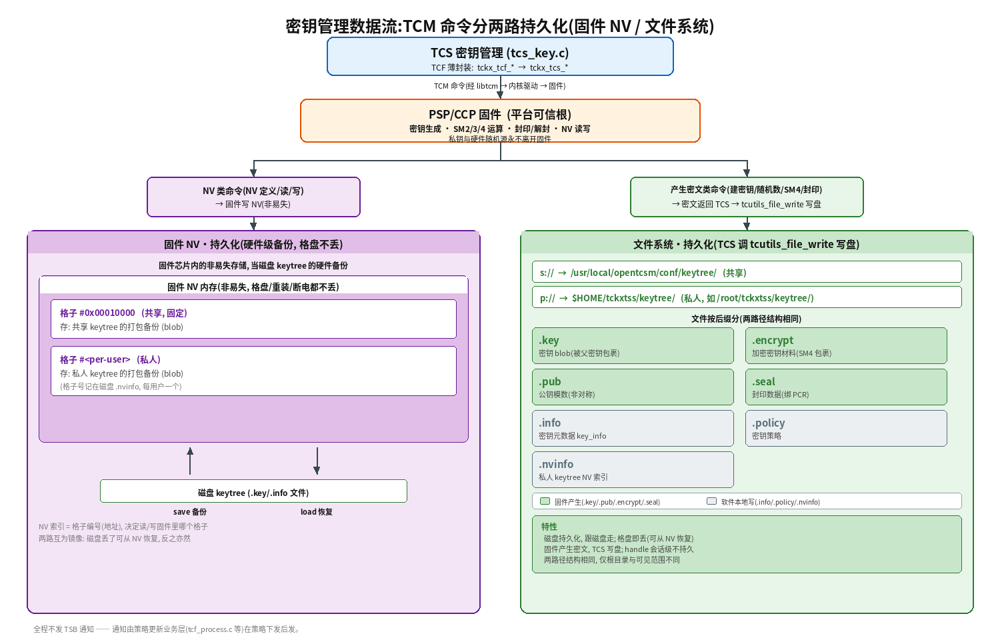

持久化落点三个：磁盘、固件 NV、固件会话内存（handle，断电即失，只有 blob 持久化）。全程不发 TSB 通知（由策略更新业务层发）。

**两路持久化（按命令类型分）**

- **NV 类命令**（NV 定义/读/写）→ **固件写 NV**（非易失，格盘不丢），存整棵 keytree 序列化 blob 作为磁盘备份。
- **产生密文类命令**（建密钥/随机数/SM4/封印）→ 密文返回 TCS → **TCS 调 `tcutils_file_write` 写文件系统**。

**为什么落磁盘也要固件**

磁盘只是仓库，存的密钥 blob/随机材料/封印块都是固件加密生成出来的密文。固件会话即加载密钥树到固件 RAM 拿 handle，handle 会话级不持久，只有 blob 落盘。

**磁盘路径与文件**

两条路径结构相同，仅根目录与可见范围不同：

- `s://` → `/usr/local/opentcsm/conf/keytree/`（共享，全用户）
- `p://` → `$HOME/tckxtss/keytree/`（私人，per-user）

文件按后缀分：

| 后缀 | 内容 | 谁产生 |
|---|---|---|
| `.info` | 密钥元数据 | 软件本地写 |
| `.key` | TCM 密钥 blob（被父密钥包裹） | 固件 |
| `.pub` | 公钥模数 | 固件 |
| `.encrypt` | 加密密钥材料（SM4 包裹随机密钥） | 固件 |
| `.seal` | 封印数据（绑 PCR） | 固件 |
| `.policy` | 密钥策略 | 软件本地写 |
| `.nvinfo` | 私人 keytree 的 NV 索引号 | 软件本地写 |

`.key` 与 `.encrypt` 区别：前者是 TCM 密钥本身，用时要加载进固件拿 handle，私钥不暴露；后者是对称密钥的原始字节（被 SM4 包过），用时解出裸字节给软件直接用。

**固件 NV**

- NV 索引 = 固件 NV 内存的格子号（地址），决定读写哪个格子。
- 共享固定 `0x00010000`；私人 per-user，号存磁盘 `.nvinfo`。
- 存储内容 = 整棵 keytree 的序列化 blob（从磁盘 `.key`/`.info` 汇出）。
- `save` 磁盘→NV 备份，`load` NV→磁盘 恢复；两路互为镜像，格盘/重装/断电都不丢。

**三类持久化**

- 纯磁盘：绝大多数密钥操作（建/用密钥、封印存取）。
- 纯 NV：NV 空间的定义/删除。
- NV+磁盘：keytree 在两处之间搬运（save/load）。

### 4.2 数据持久化

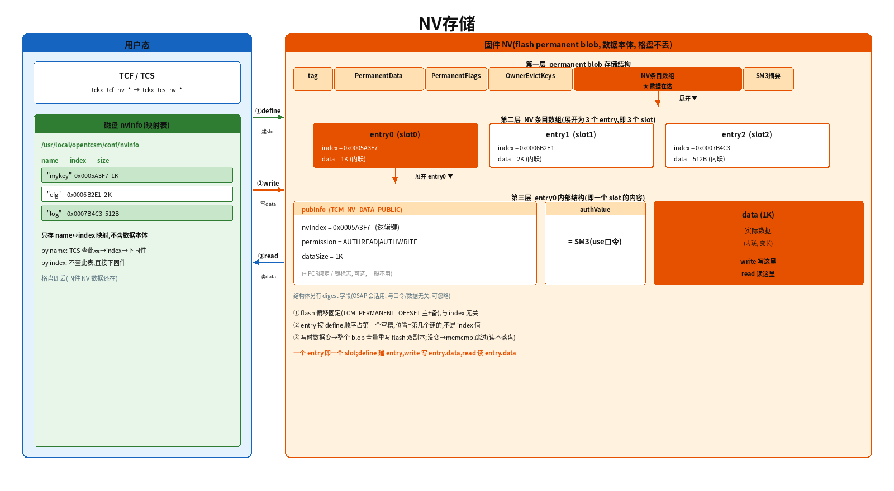

持久化落点两个加一条侧支：固件 NV（非易失）、TPCM 易失内存（断电即失），以及 named 操作时落磁盘的 `nvinfo` 映射（图中蓝色虚线侧支）。全程不发 TSB 通知。

**两个落点 + 一条侧支**

- **固件 NV**（TPCM 固件 NV 空间）：NV 空间数据，非易失，格盘不丢。走 TCM 通路。
- **TPCM 易失内存**（TPCM 固件内部 RAM）：临时数据，断电即失。走 TPCM 通路。
- **磁盘 `nvinfo`**（`/usr/local/opentcsm/conf/nvinfo`）：name↔index 映射记录，格盘即丢。仅 named 操作时作为侧支落盘，本身不存业务数据。

**by index 与 by name：两条下发路径**

NV 操作按下发方式分两类，区别在于"index 怎么来"：

- **by index**（按索引：定义 / 删除 / 读 / 写 / 查询）：调用方直接给 index，查 `nvinfo` 取定义时存的认证策略后，用该 index 走 `TCM_NV_*` **直接下固件**。
- **by name**（按名字：定义 / 删除 / 读 / 写 / 查询 / 批量设置）：调用方只给 name，先遍历 `nvinfo` 按 name 匹配**取出 index**，再走 `TCM_NV_*` 下固件。

查找逻辑读 `nvinfo` 全文逐条遍历映射记录，name 非空按名字匹配、为空按 index 匹配，命中即返回 index 与认证策略。两条路径最终都落到 NV 定义 / 读 / 写固件命令，只是 index 的来源不同。

**named 定义的 index 生成**

命名空间定义时自动分配一个未占用 index，并把 `{index, size, name}` 追加写进 `nvinfo`。后续按名字操作时，靠这条记录把"人读的名字"翻译成"固件认识的 index"。

**`nvinfo` 映射记录内容**

`nvinfo` 是一条条连续的映射记录，每条记录含：

| 字段 | 含义 |
|---|---|
| NV 索引 | 固件 NV 的格子号（named 定义时生成） |
| 空间大小 | NV 空间大小 |
| 名字 | 命名空间名 |
| 认证策略 | 策略标志、用户/组 |
| 变长数据 | 可选的进程/角色绑定信息 |

读取命名空间列表、释放列表只读写这个文件、不碰固件，属于纯磁盘操作。

**持久性总结**

- **固件 NV**：by index 与 by name 的数据都落这里，非易失，格盘不丢。
- **磁盘 `nvinfo`**：仅 named 操作的映射落这里，格盘即丢——丢了映射等于丢了"名字怎么找 index"，但固件 NV 里的数据仍在。
- **TPCM 易失内存**：易失内存存取的临时数据，断电即失。

### 4.3 日志与通知

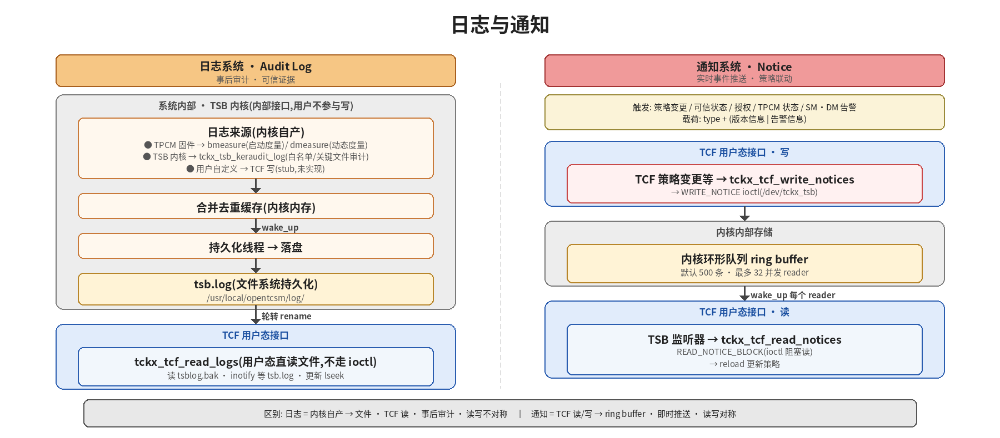

两套独立系统，均走 TSB 旁路（经 `/dev/tckx_tsb`），不经 TCM/TPCM 命令通路。日志落文件用于事后审计，通知走内核环形队列用于实时推送；两者读写模型不同——日志读写不对称，通知读写对称。

**日志系统（事后审计）**

- 来源三类，均系统内部产生：TPCM 固件（启动/动态度量）、TSB 内核（LSM 拦截的白名单/关键文件校验）、用户自定义（预留，当前未实现）。
- 落点：内核内存缓存（合并去重）→ 文件系统 `/usr/local/opentcsm/log/tsb.log`（持久化）。
- 读写不对称：写由内核持久化线程落盘（系统内部行为，用户不参与）；读由用户态经 TCF 接口直接读轮转备份 `tsblog.bak`，不经 ioctl。
- 用途：事后审计、可信证据。

**通知系统（实时推送）**

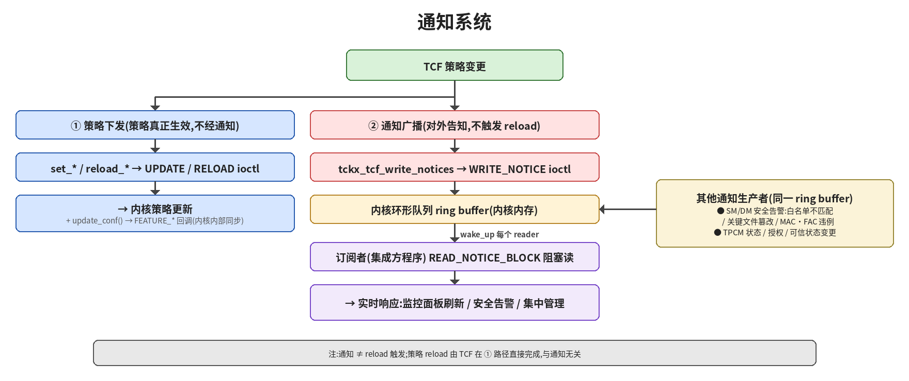

事件广播总线——内核只发布不消费，订阅者为集成方的用户态程序（OpenTCSM 不提供内置订阅者）。策略变更时走两条独立路径，通知只负责其中对外告知的一条，不触发策略重载：

- ① 策略下发：TCF 直接经 ioctl 把新策略下发/重载进内核（策略真正生效），并触发内核内部各模块同步；不经通知。
- ② 通知广播：TCF 写通知进内核环形队列，供订阅者读取。

其他通知生产者：SM/DM 安全告警（白名单不匹配、关键文件篡改、访问控制违例）、TPCM 状态/授权/可信状态变更，均进同一环形队列。订阅者经 `/dev/tckx_tsb` 建队列、阻塞读通知，实时响应（监控刷新、安全告警、集中管理）；最多 32 个并发订阅者。

**两系统区别**

| 维度 | 日志 | 通知 |
|---|---|---|
| 落点 | 文件系统 | 内核环形队列 |
| 性质 | 事后审计 | 实时推送 |
| 读写 | 不对称（内核写/用户态文件读） | 对称（都经 ioctl） |
| 容量 | 文件轮转，无上限 | 环形队列，容量有限 |

### 4.4 文件完整性

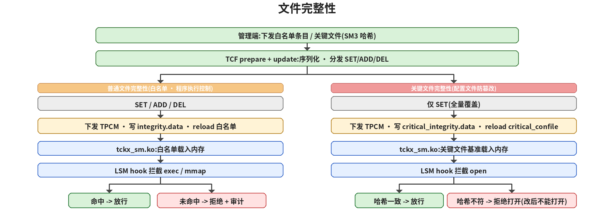

白名单机制,分两路:普通文件完整性(程序执行控制)与关键文件完整性(配置文件防篡改)。管理端下发可信程序 SM3 哈希或关键文件清单,经 TCF 打包校验后,既落盘本地,又下发 TPCM 固件作为基准库,同时通知 TSB 内核重载以做运行时拦截。

**更新流程(两路共用)**

- TCF 将条目序列化为更新包(含操作类型 SET/ADD/DEL、版本号、鉴权信息)。
- TCF 做版本校验(防回退),按操作类型分发;鉴权为管理员权限,在下发 TPCM 时由固件验证。
- 经 `/dev/tckx_tddl_tpcm` 下发 TPCM(基准库 + 增量校验),走 TPCM 通路。

**普通文件完整性(白名单)**

- 数据文件 `/usr/local/opentcsm/conf/integrity.data`;支持 SET 全量覆盖、ADD 增量追加、DEL 零填充占位。
- 每次更新做四件事:① 下发 TPCM(基准库 + 增量校验)② 写 `integrity.data` ③ SM3 摘要同步 TPCM(供可信报告)④ 经 `/dev/tckx_tsb` 通知 TSB 内核重载白名单。
- TSB 侧 `tckx_sm.ko` 从 `integrity.data` 加载白名单哈希表,LSM 拦截 `exec`/`mmap` 时查表:命中放行,未命中拒绝并写审计日志。

**关键文件完整性**

- 数据文件 `/usr/local/opentcsm/conf/critical_integrity.data`;仅支持 SET。
- 更新同样下发 TPCM、写盘、通知 TSB 重载关键文件基准。
- TSB 侧比对配置文件当前哈希与基准哈希,不符即判定被篡改(告警/审计)。

**可靠性与防篡改**

- TSB 重载白名单时不校验 integrity.data 的摘要,运行时拦截只查内存白名单。

- 磁盘可靠性不靠 reload 时的摘要校验,而是两道防线:① integrity.data 仅 root 与受信 TCF 更新通路可写,普通进程改不了;② 若被篡改,可通过 TPCM 可信报告中持有的白名单摘要做远程证明事后发现。

### 4.5 启动度量

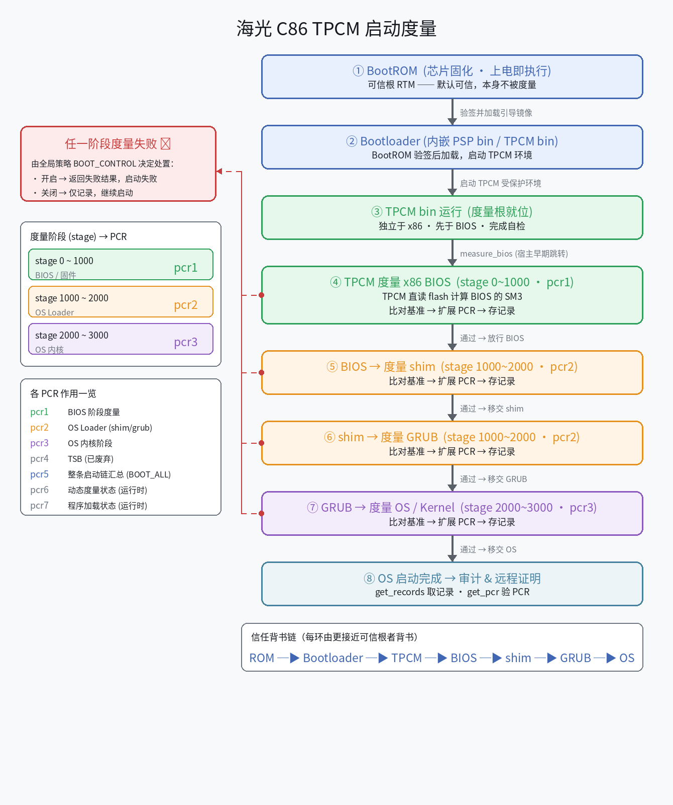

启动度量建立从硬件到操作系统的**信任链**:TPCM 固件运行在 PSP 侧、先于 x86 主核启动,在 BIOS→Bootloader→Kernel→TSB 逐级移交控制权时对下一阶段映像做 SM3 度量、扩展 PCR,并与预先下发的基准比对——匹配则放行,不匹配则按基准条目的阻断标志决定阻断启动或仅告警。全程走 TPCM 通路,不经 TSB。OpenTCSM 分三段介入:启动前用 TCF 预置基准、启动中由各级 loader 经度量接口提交映像、启动后用 TCF 取回度量记录与可信状态。

**1. 基准预置(启动前,用户态)**

管理员经 TCF 把各启动阶段的可信 SM3 哈希下发到 TPCM 固件基准库:

- **组包**:TCF 将条目序列化为更新报文;每条目带度量阶段、启用、阻断三标志,单条目最多 8 个哈希版本,支持多版本灰度。
- **下发**:先落盘到 `record` 目录,再经 `/dev/tckx_tddl_tpcm` 下发 TPCM;固件鉴权失败则回滚删盘上文件,并写版本号防回退。
- **查询**:可取回当前基准库,也可取回启动期已采集的度量记录。
- **管控**:可凭口令临时关闭阻断控制;可设定度量 Flash 区间。

**2. 逐级度量(启动中,固件驱动)**

启动链按四个 PCR 阶段逐级推进,每级度量下一级映像并扩展对应 PCR:

| PCR 阶段 | 累计范围 |
|---|---|
| BIOS | PCR1:初始至 BIOS 阶段 |
| Bootloader | PCR2:初始至 Bootloader 阶段 |
| Kernel | PCR3:初始至 Kernel 阶段 |
| TSB | PCR4:初始至 TSB 阶段 (已废弃)|

- **度量接口**:各级 loader 在移交控制权前,经 `/dev/tckx_tddl_tpcm` 将下一阶段映像(多段内存或预算摘要)提交 TPCM。BIOS/Bootloader 阶段在内核就绪前由固件层直接调用,Kernel/TSB 阶段经内核接口调用。
- **PCR 扩展**:`新PCR = SM3(旧PCR || 摘要)`,扩展是累计的。
- **比对与放行**:TPCM 固件将度量值与同阶段基准比对,匹配则扩展 PCR 并移交控制权;不匹配且阻断标志开启则阻断启动,否则仅记录、不阻断。

**3. 度量记录与可信状态(启动后,用户态)**

- **度量记录**:每级度量后 TPCM 写入记录,含时间戳、阶段、度量结果(合法/不合法/未度量)、SM3 摘要与对象名,可经 TCF 取回审计。
- **可信状态**:TPCM 汇总整条信任链得出启动可信状态——可信、不可信、状态未知一并进入可信报告,供远程证明判定启动链是否完整。

### 4.6 动态度量

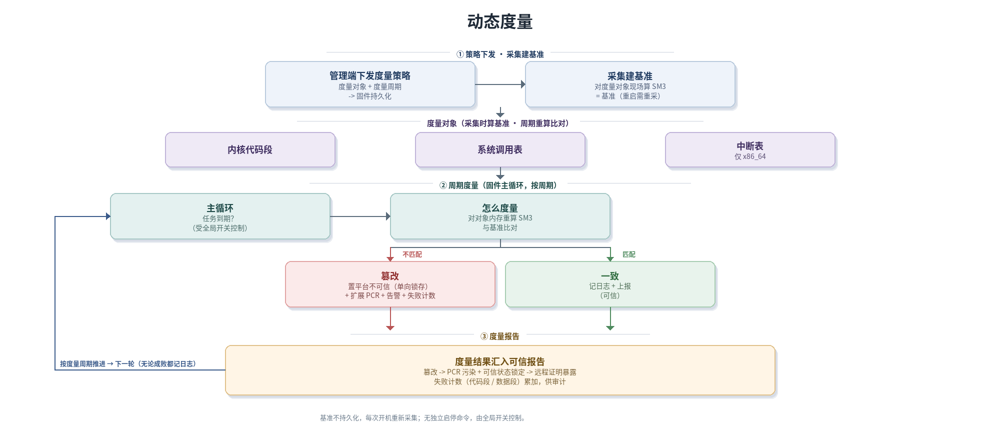

动态度量是运行时的周期性度量机制:TPCM 固件按管理员下发的度量周期,自主对内核关键内存区域重新计算 SM3 并与基准比对,检测运行时篡改。与启动度量建立启动信任链不同,动态度量贯穿系统运行期,由 TPCM 固件主循环驱动--**主机侧无定时器、无内核线程**,周期调度完全在固件内承担。三件事分工:策略下发(用户态)、区域注册建立基准(模块加载时一次性)、周期度量(固件主循环)。

**1. 策略下发(用户态)**

管理员经 TCF 下发度量策略,告知固件"度量哪些对象、多久度量一次":

- **组包**:TCF 将策略条目序列化为更新报文,每条含度量对象名、度量周期(interval)、类型。
- **下发**:先落盘到 record 目录,再经 `/dev/tckx_tddl_tpcm` 下发 TPCM;固件鉴权(管理员权限)通过后持久化到固件 NV,失败则回滚删盘并写版本号防回退。
- **查询**:可取回当前已下发的度量策略。

**2. 区域注册·基准建立(模块加载时一次性)**

TSB 加载时,把内核关键内存区域注册给 TPCM 并建立度量基准:

| 度量对象 | 说明 |
|---|---|
| 中断描述符表(IDT) | 仅 x86\_64 |
| 内核代码段 | `_stext`~`_etext` |
| 系统调用表 | - |

各区域经 TSB 基座接口累积(转物理地址,最多 6 个),由模块加载末尾显式 flush 一次性提交 TPCM;固件对每个区域现场计算 SM3 作为**基准哈希**,存于固件易失内存--**不持久化,每次开机重新采集**。区域上限 6 来自 TSB 基座接口 `tcs_if.c` 中的 `MAX_MEASURE_ZONE` 宏(定义为 6):累积数组 `ctx[6]` 只有 6 个槽位且累积时无越界检查;固件代码目前最多测量区域不超过 10 个，超过会报错。

**3. 周期度量(固件主循环)**

TPCM 固件主循环在处理命令的空闲时间片内,按各策略的 interval 到期触发度量:

- **重算比对**:对区域内存重新计算 SM3,与基准哈希比对。
- **一致**:记度量日志,平台保持可信。
- **篡改**:置平台不可信(单向锁存,不可恢复)→ 扩展 PCR6 → 发告警通知 → 失败计数累加(按内核代码段与其余区域分类)。
- **无论成败**:都记一条度量日志并发日志通知,按 interval 推进下一周期。

**度量结果出口**

度量失败计数汇入可信报告与可信证据,供远程证明判定;篡改导致的 PCR6 污染与不可信状态锁定,会使运行时篡改在远程证明中暴露。基准不持久化、每次开机重新采集;动态度量无独立启停命令,由全局控制策略开关控制。

**与启动度量对比**

| 维度 | 启动度量 | 动态度量 |
|---|---|---|
| 时机 | 启动链逐级 | 运行时周期 |
| 对象 | 下一阶段映像 | IDT / 内核代码段 / 系统调用表 |
| 驱动 | 各级 loader 提交 | TPCM 固件主循环(主机无定时器) |
| 基准 | 预先下发 | 加载时现场采集(不持久化) |
| 失败响应 | 阻断启动 / 告警 | 置不可信 + 扩 PCR6 + 告警 |

### 4.7 可信凭证

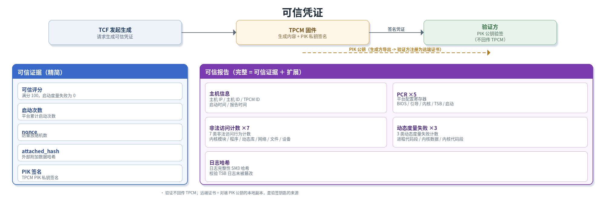

可信凭证分两种：**可信报告**（完整远程证明包）与**可信证据**（精简度量数据），均由 TPCM 固件以 PIK 私钥签名。生成走 TPCM 通路，由固件填充度量内容并签名；验证在验证方本地用对端 PIK 公钥做 SM2 验签，不回传 TPCM。

**生成（走 TPCM 通路）**

- TCF 发起生成请求，附带本地主机标识 host\_id。
- TPCM 固件填充度量内容（评分、PCR、非法计数、度量失败、日志哈希等），用 PIK 私钥签名后返回。
- 经 `/dev/tckx_tddl_tpcm` 下发。报告额外收集主机 IP 与时间；证据不收集，仅附外部附加哈希。

**验证（本地，不回传 TPCM）**

- 验证方按报告来源方的 TPCM ID 查本地远端证书，取出对端 PIK 公钥。
- 本地做 SM2 验签，并校验 nonce 一致、可信评分 == 100，三者全过判可信。
- 全程不调用 TPCM 固件，验证完全在本地完成。

**PIK 平台身份密钥**

- PIK 是 TPCM 固件生成的 SM2 密钥对，私钥封存于固件、不可导出，用于签名可信凭证；生成需管理员口令。
- 公钥可导出，交给对端平台注册为远端证书，作为验证方的验签钥匙--跨平台互信链：生成方导出 PIK 公钥 -\> 验证方注册为本地远端证书 -\> 验证时按来源 TPCM ID 查用。

**远端证书与主机标识（本地文件，不经 TPCM）**

- 远端证书：对端 PIK 公钥的本地副本，存 `/usr/local/opentcsm/conf/remote-cert/<tpcm_id>.cert`，增删查均为本地文件操作。
- 主机标识 host\_id：本地随机生成，存 `/usr/local/opentcsm/conf/host.id`，嵌入可信凭证标识来源机器，非 TPCM 返回。

**可信证据与可信报告内容**

可信证据精简，可信报告是证据的超集（证据全部内容 ＋ 扩展字段）：

| 凭证 | 内容 |
|---|---|
| 可信证据（精简） | 可信评分、启动次数、nonce（防重放）、外部附加哈希、PIK 签名 |
| 可信报告（完整） | 证据全部内容 ＋ 主机信息（IP/主机ID/TPCM ID/时间）、PCR×5、非法访问计数×7、动态度量失败×3、日志完整性哈希 |

- 可信评分满分 100，启动度量失败则置 0；nonce 防重放，验证时校验一致性。
- 报告中的非法访问计数、动态度量失败计数、日志哈希汇自 TSB 运行时拦截与度量结果，使运行时篡改在远程证明中暴露。

---

*下一步：基于对外 API 二次开发 → **[接口文档](https://gitee.com/anolis/opentcsm/tree/master/doc)**。*
