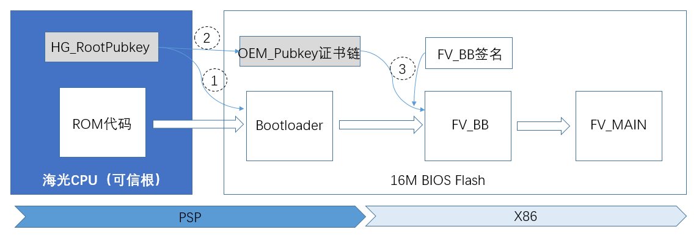
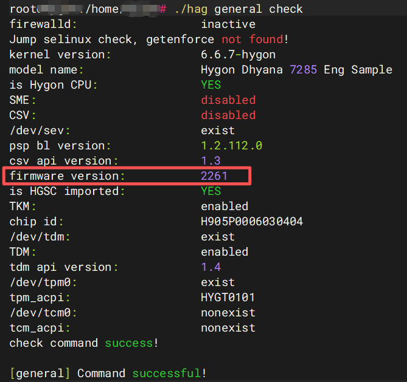
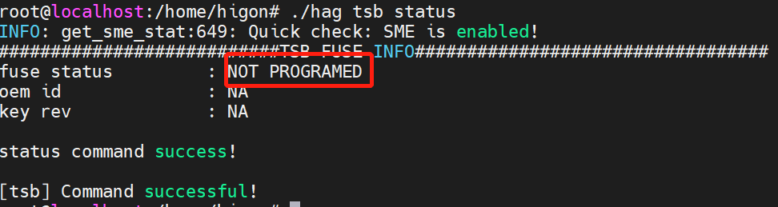
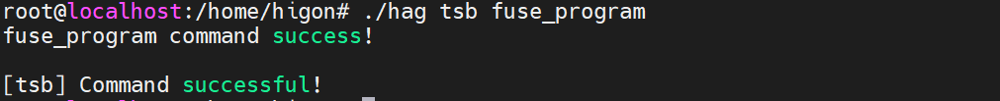
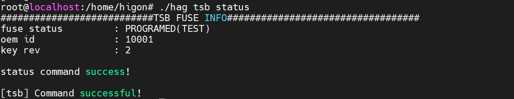
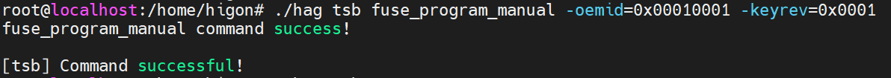
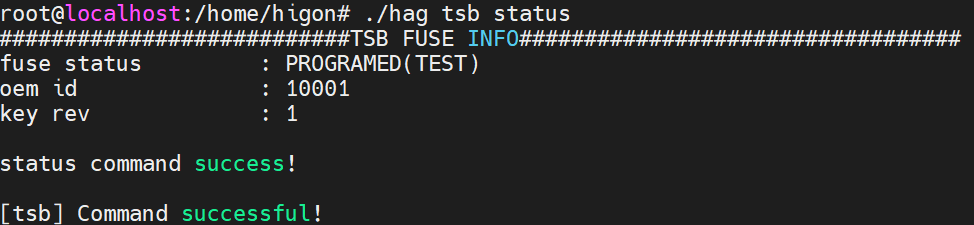
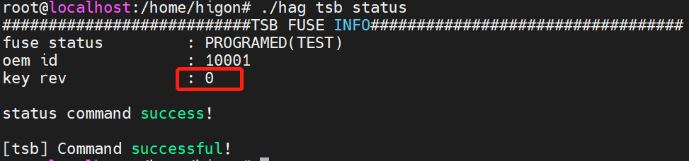
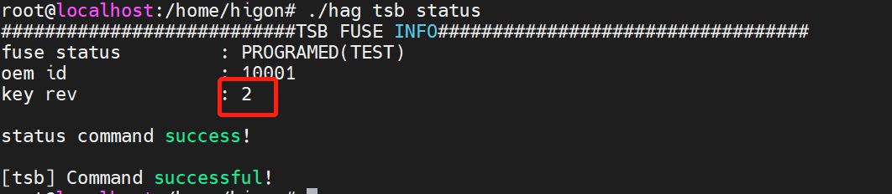
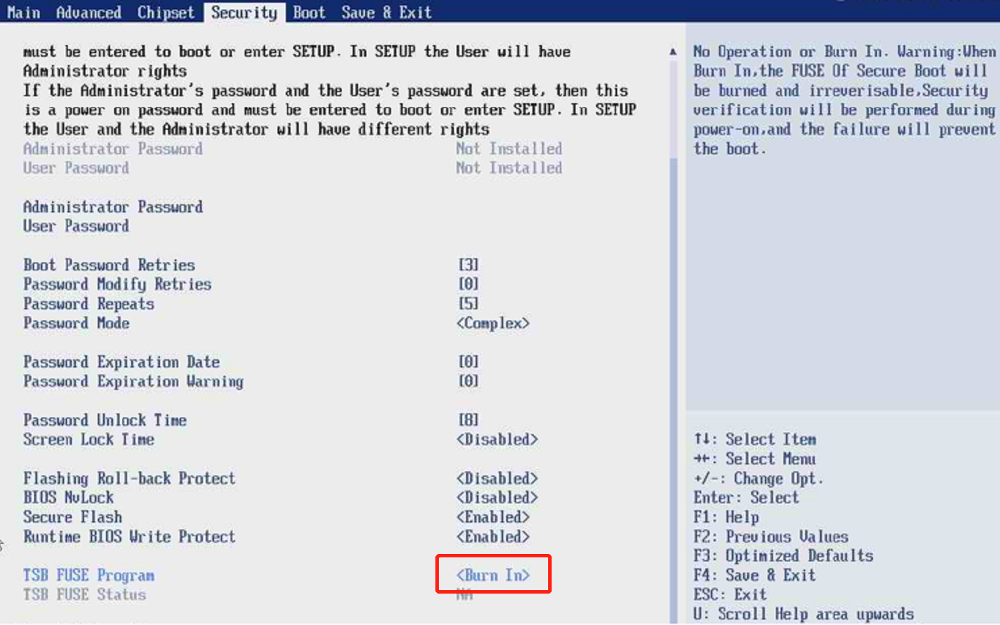

# 一、概述

海光可信安全启动（TSB）是一种“编译时通过使用经过授权的私钥给BIOS固件进行签名然后启动时由CPU可信根验证固件签名以确认固件的真实性和完整性“的系统启动方案。如下图所示，海光CPU内有固化的ROM代码及海光根公钥HG\_RootPubkey，CPU上电时内置的PSP安全处理器首先启动，从固化的ROM代码开始执行。



主要执行步骤如下：

（1）ROM代码加载并验证片外flash上的PSP bootloader固件，验证过程使用CPU内的海光根公钥HG\_RootPubkey。

（2）Bootloader固件使用HG\_RootPubkey验证Flash上的OEM\_Pubkey公钥证书链，该证书链由海光颁发，OEM\_Pubkey对应的私钥掌握在OEM手中。

（3）Bootloader固件加载并验证BIOS固件中的FV\_BB段，FV\_BB段由OEM使用OEM\_Pubkey对应的私钥进行签名，Bootloader使用OEM\_Pubkey验证签名。

（4）FV\_BB验证完成后，后续阶段的安全启动过程由X86 BIOS实现。

本文档主要描述测试和验证海光安全启动的步骤，主要章节分布如下：

| 章节 | 内容                                           |
| ---- | ---------------------------------------------- |
| 一   | 概述                                           |
| 二   | TSB相关概念说明                                |
| 三   | 测试环境                                       |
| 四   | 使能TSB并验证正常启动（测试模式）              |
| 五   | 使能TSB并验证安全启动中的BIOS校验（测试模式）  |
| 六   | 在已使能TSB的机器上升级OEM公钥版本（测试模式） |
| 七   | 使能TSB并验证启动（正式模式）                  |

# 二、TSB相关概念说明

### 1、OEM\_Pubkey公钥证书链

OEM\_Pubkey公钥证书链用于验证OEM公钥的有效性。该证书链由海光颁发，**OEM公钥对应的私钥掌握在OEM手中**。生成的OPK证书链文件将被包含在BIOS镜像中，并保存在片外的Flash上。OEM\_Pubkey公钥证书链为打包进BIOS镜像中的一个单独文件（需增加类型0x72）。

OEM\_Pubkey公钥证书链文件里实际包含两张证书，一张为OEM公钥证书（OPK），另一张为海光证书签名公钥证书（CSK）。验证证书链时先使用CPU内的HG\_RootPubKey验证CSK证书的签名，再由CSK公钥验证OPK证书签名，证书链验证通过后OPK证书内的公钥用于验证BIOS签名文件。

OEM需要自行生成密钥对，可以使用Windows下的CryptoUtility工具或者Linux下的openssl工具生成。申请OEM公钥证书时需提供公钥及user\_id等信息，关于**OEM公钥证书的申请**，请参照页面：[TSB OPK证书申请说明](<02. TSB OPK证书申请说明.md>)。

### 2、BIOS签名

OEM厂商使用**OEM私钥对BIOS固件进行签名**，签名使用国密SM2算法。生成的签名文件将被包含在BIOS镜像中，并保存在片外的Flash上。BIOS签名为BIOS镜像中的一个单独的文件（需增加类型0x73），签名文件总共192字节。

海光提供hag工具（见下一章节hag的介绍）对指定BIOS固件生成上述签名文件，签名密钥由用户输入（可以是PEM格式，也可以是字符串形式）。

用法如下：

```
$ ./hag tsb sign -help
Usage: sign [options]
Valid options are:
 -help            Display this summary
 -in val          Input file
 -out outfile     Output file
 -outsig outfile  Output sig file
 -id val          SM2 key owner's identity, default id is 1234567812345678
 -key format      Input pem sm2 private key file or sm2 private key
sign command success!

[tsb] Command successful!
```

示例：

```
$ ./hag tsb sign -in fv_bb.bin -out fv_bb_sig_new.bin -key cda0144a3* -id hygon
$ ./hag tsb sign -in fv_bb.bin -out fv_bb_sig_new.bin -key prikey.pem -id hygon
```

### 3、TSB安全启动使能

TSB安全启动是通过在CPU FUSE中刷写TSB OEM信息来使能的。

CPU FUSE是CPU内部的一块一次性编程存储芯片，x86 core和其它低安全等级的IP无法访问，且其中的数据位只能被一次性刷写。TSB安全启动在FUSE中预留了两个域：一个是OEMID，一个是KEYREV。前者标识OEM，后者表示当前OEM公钥的版本。

在启动过程中会依据FUSE中OEMID信息是否为空来判断TSB安全启动是否启用。如果为空，则使用传统方式启动BIOS。如果不为空，则启用TSB安全启动。

<span style="color:red">**当TSB被使能后（即FUSE被刷写），将不再允许禁止TSB启动。**</span>

### 4、测试模式

使能TSB需要刷写CPU FUSE中的OEM信息。由于FUSE一旦被修改，物理上将无法再恢复原来状态，所以这里提供了一种测试模式，用于不熟悉TSB的用户做前期验证。在测试模式下，OEM信息将被刷入NV中（而不是FUSE中），重刷BIOS可以覆盖测试时刷写的OEM信息。

> 注：对于不熟悉TSB功能的用户，建议先在测试模式验证。

### 5、正式模式

<span style="color:red">**在正式模式下，OEM信息将会被刷写到CPU FUSE中，重刷BIOS等操作无法刷写OEM信息。**</span>

> 注：OEM的两个信息中OEMID不可更新，KEYREV可以升级，但最多只能升级15次。

# 三、测试环境

| 类型        | 要求                                                         | 备注                                                         |
| ----------- | ------------------------------------------------------------ | ------------------------------------------------------------ |
| CPU         | 海光二号及以上                                               |                                                              |
| BIOS        | 海光2号和C86-3G：PI版本 \>= 2.1.0.4<br/>海光C86-4G：PI版本 \>= 4.2.0.0 | 具体PI版本信息请参考：[PI版本与安全功能对照表](<../../../00. C86 DevKit 概览/02. 安全技术概览/01. PI版本与安全功能对照表.md>) |
| 安全固件    | 以BIOS自带的版本为准                                         | 支持动态升级安全固件，请参考：[安全固件动态升级](<../../../07. 工具/01. 海光安全工具/03. 安全固件动态升级.md>) |
| Linux发行版 | 无                                                           | 对Linux发行版无特殊要求，主流发行版即可                      |
| Hag         | 使用最新版本即可                                             | hag的获取及使用方法请参考：[海光安全工具简介](<../../../07. 工具/01. 海光安全工具/01. 海光安全工具简介.md>) |
| 证书        | 使用TSB必须导入海光通用安全证书                              | 测试TSB需重复刷写BIOS，**刷写BIOS后必须重新导入通用证书**，导入证书的步骤请参考：[导入通用安全证书](<../../../07. 工具/01. 海光安全工具/02. 导入通用安全证书.md>) |

# 四、使能TSB并验证正常启动（测试模式）

如果已熟悉TSB相关功能，请直接跳到最后一节进行正式模式下的测试。

### 1、刷新OEM提供的带TSB支持的BIOS镜像，重启后重新进入OS

进入OS后，可用hag查看安全固件版本：

```
$ hag general check
```



### 2、打开测试模式，并使能TSB安全启动

先确认当前TSB状态：

```
$ hag tsb status
```



fuse status 为 “NOT PROGRAMED”，表示当前TSB安全启动未使能。

打开TSB测试模式：

```
$ hag tsb test_mode -enable
```

> **注: 测试模式时不要遗漏此步骤，否则将刷写物理FUSE。**

导入通用证书：

```
$ hag general hgsc_import
```

使能TSB：

```
$ hag tsb fuse_program
```



此命令将把OPK证书中OEM信息刷写到NV中。

再次查看 TSB状态：

```
$ hag tsb status
```



这里fuse status 为 “PROGRAMED(TEST)” 表示当前TSB已使能，并且处于测试模式(非正式模式)；oem id 为 0x10001，是海光测试ID（每个OEM有自己的ID，用户可咨询OEM厂商关于他们OEMID的信息）；key rev为OEM公钥版本号。

### 3、重启系统

**所有校验都通过，系统正常启动。**

# 五、使能TSB并验证安全启动中的BIOS校验（测试模式）

### 1、刷新OEM提供的带TSB支持的BIOS镜像，重启后重新进入OS

### 2、获取BIOS镜像中FVBB段的偏移和大小

可以询问OEM厂商，fv pei（即FVBB）的偏移和大小。

### 3、用二进制工具编辑BIOS镜像，篡改BIOS中以上FVBB区块中的某个字节

### 4、在测试机上刷写被篡改的BIOS镜像，重启后重新进入OS

### 5、打开测试模式，并使能TSB安全启动

```
$ hag tsb test_mode -enable
$ hag general hgsc_import
```

这里，由于BIOS内容已被篡改，导致fuse\_program命令无法通过安全检查，无法执行 fuse\_program命令。所以采用手工编辑NV中的OEM信息来使能。

```
$ hag tsb fuse_program_manual -oemid=0x00010001 -keyrev=0x0001
```



这里，0x00010001为海光测试ID。用户可咨询OEM厂商关于他们OEMID的信息。

查看 TSB状态：

```
$ hag tsb status
```



### 6、重启系统

**系统启动过程中，会因为BIOS校验失败而使启动挂机，无法正常启动系统。结果显示达到了TSB安全启动校验BIOS的目的。**

### 7、通过篡改BIOS镜像中的BIOS签名文件，也可以达到同样的结果

可向OEM获取BIOS镜像中BIOS签名文件的偏移，并用二进制工具修改，按照上述的测试步骤，同样会因为BIOS校验失败而使启动挂机，无法正常启动系统。

# 六、在已使能TSB的机器上升级OEM公钥版本（测试模式）

### 1、刷新OEM提供的带TSB支持的BIOS镜像，重启后重新进入OS

### 2、刷写低版本公钥

这里，我们可以通过手工编辑NV中的OEM信息来达到模拟的效果。

```
$ hag tsb fuse_program_manual -oemid=0x00010001 -keyrev=0x0000
$ hag tsb status
```



这里，0x00010001为海光测试ID。用户可咨询OEM厂商关于他们OEMID的信息。key rev设置为0（最小值）是方便后面的升级。

### 3、打开测试模式，并升级OEM公钥

```
$ hag tsb test_mode -enable
$ hag general hgsc_import
$ hag tsb fuse_program
```

确认TSB 状态：

```
$ hag tsb status
```



### 4、重启系统

**所有校验都通过，系统仍然可以正常启动，说明升级成功。**

# 七、使能TSB并验证启动（正式模式）

正式模式下，使能TSB需要在BIOS代码中通过触发Tsb Fuse Program命令来实现。这块不是属于BIOS PI的代码，每个OEM有各自的实现方式。这里仅示例说明，具体触发方式请咨询OEM厂商。

### 1、刷新OEM提供的带TSB支持的BIOS镜像，重启后重新进入OS

### 2、导入HGSC证书

```
$ hag general hgsc_import
```

### 3、重启系统，在BIOS Setup界面触发Tsb Fuse Program，以使能TSB安全启动

<span style="color:red">**警告：因为没有打开测试模式，以下操作会实际刷写物理FUSE。FUSE被修改后，将无法被撤销。**</span>



这里，TSB FUSE Program选择 “Burn In“。每个OEM的界面和实现会有不同，请咨询各OEM。

### 4、重启系统，启动完成后，TSB FUSE已刷写完毕

确认下tsb 状态：

```
$ hag tsb status
```

此时fuse status 应显示为 “PROGRAMED“，表示当前TSB已使能，并且处于正式模式。Oem id 和 key rev 也显示对应的OEM信息。

### 5、再次重启系统

**所有校验都通过，系统正常启动。**

### 6、用二进制工具篡改OEM提供的BIOS镜像中的BIOS内容，刷写到测试机后重启

系统启动过程中会因为BIOS校验失败而使启动挂机，无法正常启动系统。结果显示达到了TSB安全启动校验BIOS的目的。

### 7、如果OEM拥有升级版本OPK证书，可让OEM提供带升级版公钥的BIOS镜像

重复以上测试步骤，验证OEM公钥可升级成功。
