# 1. 问题分析

无TPM/TCM设备节点是个常见问题，原因也比较多，BIOS和OS都可能导致问题的出现。由于海光只提供PI，BIOS是由OEM厂商提供，OS一般也是由OS厂商提供，虽然他们之前都已经适配过海光的驱动，但也可能存在不可控因素。海光可能根据现象对问题进一步定位。一般是从BIOS到OS的思路定位问题，先确认BIOS的问题，然后再确认OS的问题。

# 2. TPM

## 2.1.  BIOS fTPM的设置确认

在BIOS的setup界面确认fTPM的选项是否enable。

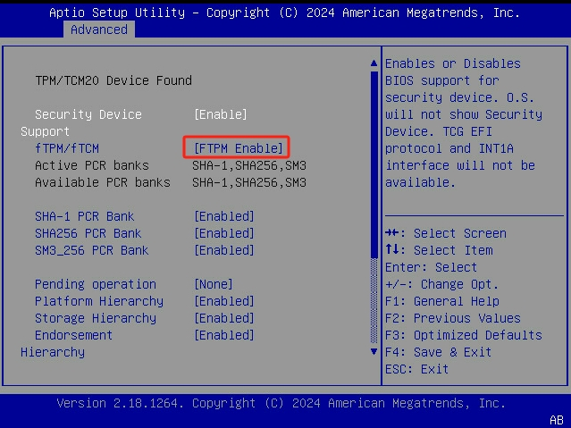

这个页面只是个示例，如果在此页面没有海光fTPM选项，此BIOS应该不支持fTPM，此时可以联系OEM厂商，向OEM厂商提供BIOS版本信息做进一步确认。

## 2.2.  TPM ACPI的设备确认

首先运行下面命令：

```
$ ls /sys/bus/acpi/devices/HYGT0101\:00
```

如果没有此目录:

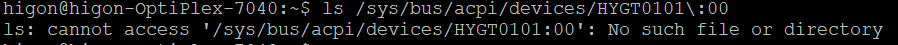

大概率是BIOS的问题，可以联系OEM厂商，向OEM厂商提供BIOS版本信息做进一步确认。

如果上面存在上面目录:

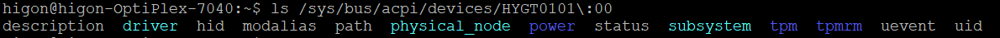

再运行下面命令：

```
$ ls /sys/devices/platform/HYGT0101\:00/
```

如果没有此目录:

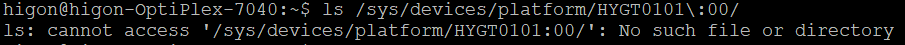

需要客户提供TPM的acpi的table，这张表一般是/sys/firmware/acpi/tables/DSDT这个文件，这张表需要acpica-tools工具解析，如果系统中没有此工具可以先安装此工具：

Ubuntu系统：

```
$ sudo apt-get install acpica-tools
```

Centos系统：

```
$ sudo yum install acpica-tools
```

安装工具后：

```
$ sudo cp  /sys/firmware/acpi/tables/DSDT ~/   #将DSDT这个文件拷贝到主目录  
$ sudo iasl ~/DSDT    #在主目录下生成DSDT.dsl  
```

这张表（例如：DSDT.dsl）因OEM厂商不同差异较大，下面举例说明这张表需要关注的点：

\_HID方法必须要配置，并且值为HYGT0101


\_CRS方法在表中可以没有，但是如果有，要配置正确，正确配置如下图：

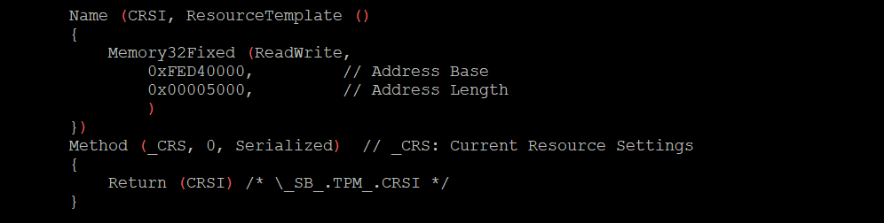

\_STA方法在表中可以没有，但是如果有，要配置正确，正确配置如下图：


如果还没有找到问题的原因，也可以将这张表提供给海光进一步确认问题的原因。

如果存在此目录:


BIOS一般是适配好了，下面进一步确认OS的信息。

## 2.3.  OS是否适配海光TPM驱动

OS的确认需要客户提供系统启动后的dmesg完整信息。

海光TPM驱动如果正常加载会有Hygon TPM2 detected的日志。

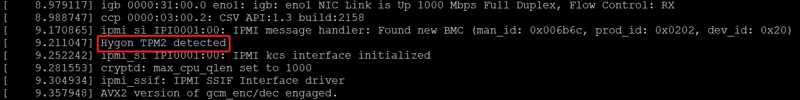

如果没有此日志，并且也没有加载TPM的报错日志，此时可以联系OS厂商，向OS厂商提供操作系统版本信息做进一步确认此版本是否支持TPM驱动。

## 2.4.  加载TPM驱动报错

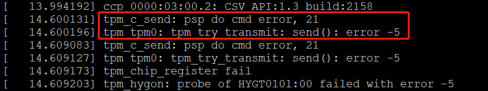

如果出现类似这种错误，可以确认下海光通用证书是否已经导入。海光通用证书可参考如下网址：

[导入通用安全证书](<../../07. 工具/01. 海光安全工具/02. 导入通用安全证书.md>)

## 2.5.  SME的配置确认

由于tpm驱动依赖ccp，如果SME的配置出错也会导致CSV初始化失败，进而导致tpm驱动加载出错。


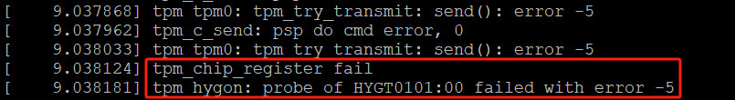

如果出现此问题可以确认BIOS的setup页面SME是否使能，如果使能需要联系BIOS厂商SME的支持是否有问题。

# 3. TCM

## 3.1.  BIOS fTCM的设置确认

在BIOS的setup界面确认fTCM的选项是否enable。

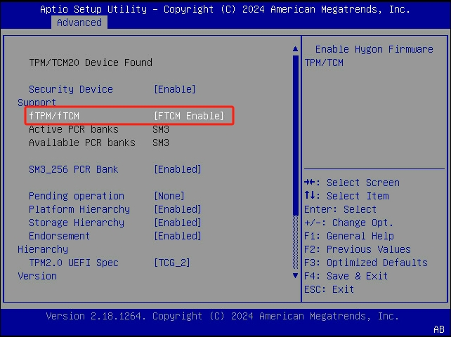

这个页面只是个示例，如果在此页面没有海光fTCM选项，此BIOS应该不支持fTCM，此时可以联系OEM厂商，向OEM厂商提供BIOS版本信息做进一步确认。

## 3.2.  TCM ACPI的设备确认

首先运行下面命令：

```
$ ls /sys/bus/acpi/devices/HYGT0201\:00
```

如果没有此目录:

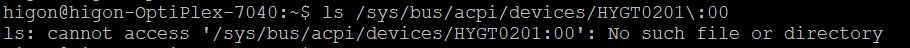

大概率是BIOS的问题，可以联系OEM厂商，向OEM厂商提供BIOS版本信息做进一步确认。

如果上面存在上面目录:

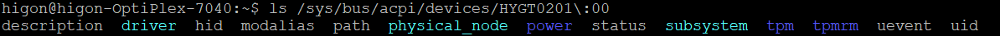

再运行下面命令：

```
$ ls /sys/devices/platform/HYGT0201\:00/
```

如果没有此目录:

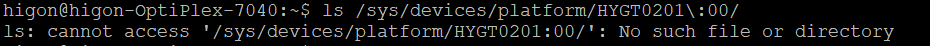

需要客户提供TCM的acpi的table，这张表一般是/sys/firmware/acpi/tables/DSDT这个文件，这张表需要acpica-tools工具解析，如果系统中没有此工具可以先安装此工具：

Ubuntu系统：

```
$ sudo apt-get install acpica-tools
```

Centos系统：

```
$ sudo yum install acpica-tools
```

安装工具后：

```
$ sudo cp  /sys/firmware/acpi/tables/DSDT ~/   #将DSDT这个文件拷贝到主目录  
$ sudo iasl ~/DSDT     #在主目录下生成DSDT.dsl  
```

这张表（例如：DSDT.dsl）因OEM厂商不同差异较大，下面举例说明这张表需要关注的点：

\_HID方法必须要配置，并且值为HYGT0201

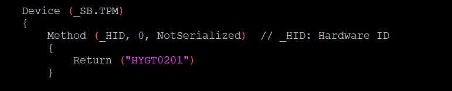

\_CRS方法在表中可以没有，但是如果有，要配置正确，正确配置如下图：


\_STA方法在表中可以没有，但是如果有，要配置正确，正确配置如下图：


如果还没有找到问题的原因，也可以将这张表提供给海光进一步确认问题的原因。

如果存在此目录:

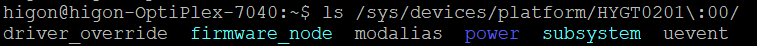

BIOS一般是适配好了，下面进一步确认OS的信息。

### 3.3.  OS是否适配海光TCM驱动

OS的确认需要客户提供系统启动后的dmesg完整信息。

海光TCM驱动如果正常加载会有Hygon TCM2 detected的日志。

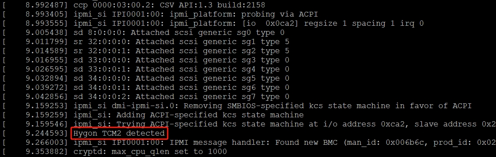

如果没有此日志，并且也没有加载TCM的报错日志，此时可以联系OS厂商，向OS厂商提供操作系统版本信息做进一步确认此版本是否支持TCM驱动。

## 3.4.  加载TCM驱动报错

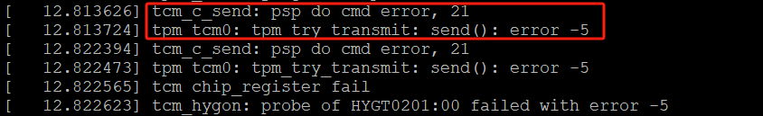

如果出现类似这种错误，可以确认下海光通用证书是否已经导入。海光通用证书可参考如下网址：

[导入通用安全证书](<../../07. 工具/01. 海光安全工具/02. 导入通用安全证书.md>)

## 3.5.  SME的配置确认

由于tcm驱动依赖ccp，如果SME的配置出错也会导致CSV初始化失败，进而导致tcm驱动加载出错。


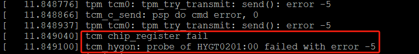

如果出现此问题可以确认BIOS的setup页面SME是否使能，如果使能需要联系BIOS厂商SME的支持是否有问题。
