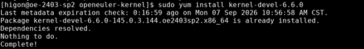
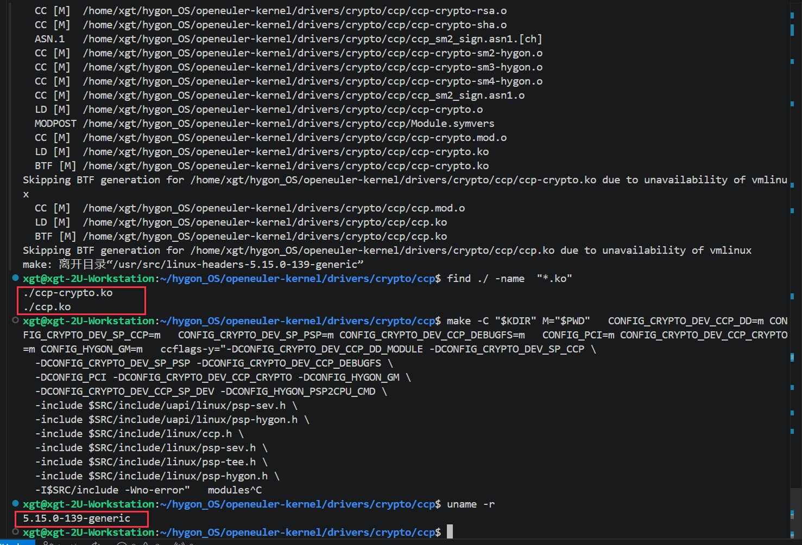
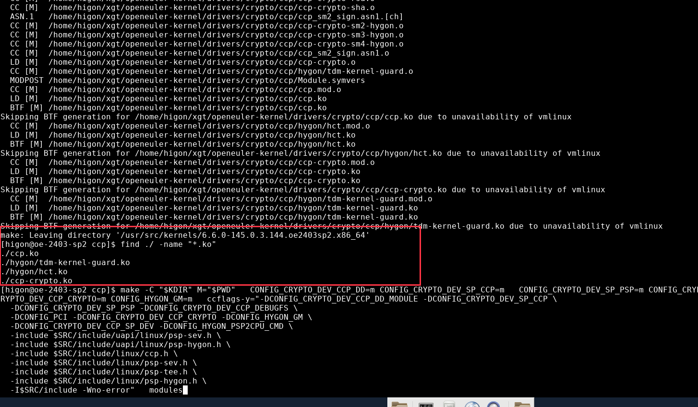
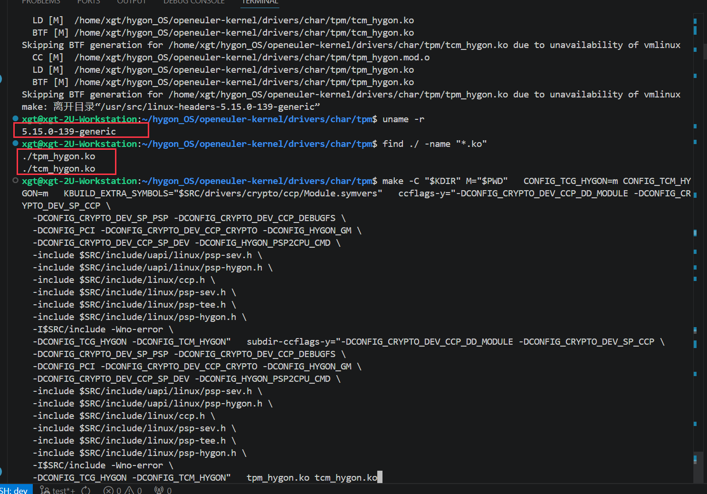
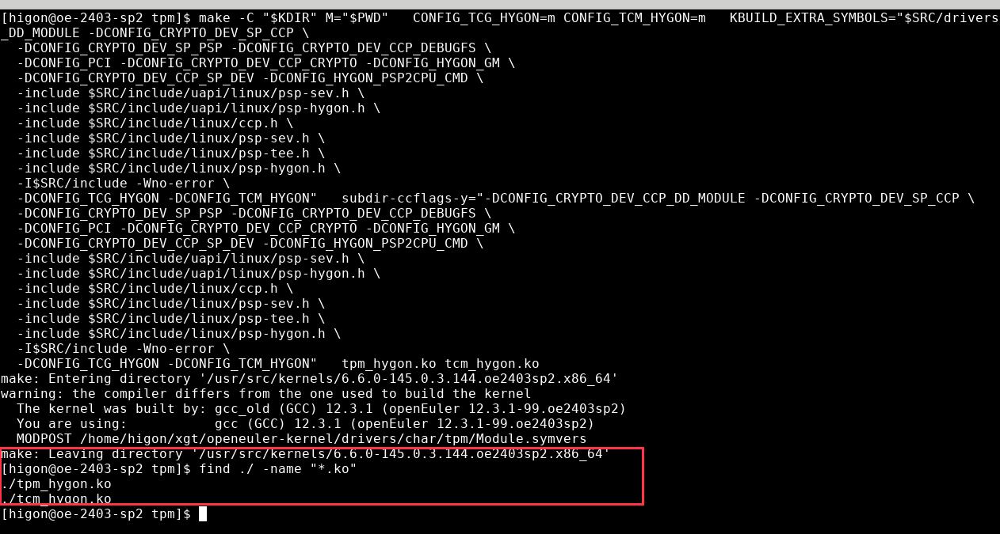
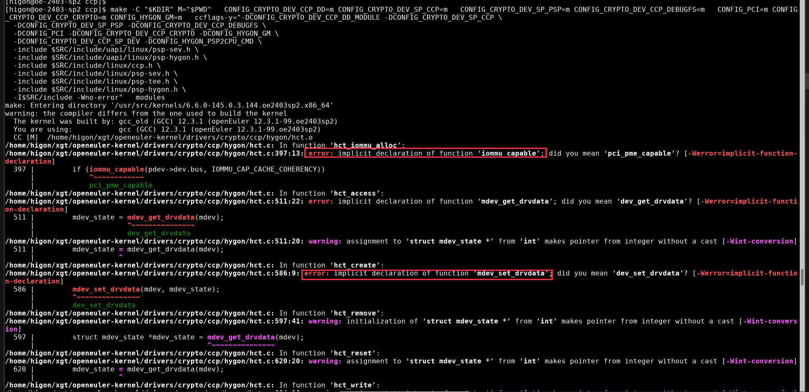
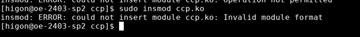

# 海光 CCP-可信驱动核外编译指南

客户 OS 未内置海光 CCP 驱动时，可在**不更换、不修改内核**的前提下，用含海光补丁的
社区内核源码核外编译（out-of-tree build）驱动模块并加载：

| 模块 | 功能 |
|---|---|
| `ccp.ko` | CCP/PSP 硬件基础驱动 |
| `ccp-crypto.ko` | CCP 国密/加解密算法加速 |
| `tpm_hygon.ko` | TPM2 可信驱动 |
| `tcm_hygon.ko` | TCM2 国密可信驱动 |

本指南以 **openEuler OLK-5.10 / OLK-6.6** 源码分支为例进行演示。
内核模块与内核强绑定，**源码分支与目标内核大版本必须一致**，不支持跨大版本组合。

## 1. 先确认驱动是否已安装

编译前先看系统里是否已有海光驱动模块，避免重复劳动。

```bash
# 查看 ccp 驱动是否已经builtin
cat /proc/kallsyms |grep psp_do_cmd

# 查 ccp 与 tpm_hygon 模块是否已随系统安装（有输出即已安装）
find /lib/modules/$(uname -r) -name 'ccp.ko' -o -name 'tpm_hygon.ko' 2>/dev/null

# 或模块已在运行
lsmod | grep -E 'ccp|hygon'
```

- **已内置**：无需编译
- **已安装**：直接加载即可（`modprobe ccp`、`modprobe tpm_hygon`）。
- **未找到**：继续下面的核外编译。

## 2. 准备工作

编译依赖本机内核构建目录 `/lib/modules/$(uname -r)/build`，需安装与 `uname -r`
**完全一致**的内核开发包（yum 系 `yum install -y gcc make kernel-devel-$(uname -r)`，
apt 系 `apt install -y build-essential linux-headers-$(uname -r)`）。客户环境中源里
常常没有同版本开发包，需自行解决：从厂商归档源/历史仓库找同版本包，或取同版本内核
源码执行 `make modules_prepare` 后把 build 软链接过去。**不能用版本接近的包顶替**，
vermagic 不一致加载时会报 `Invalid module format`。



### 2.1 拉取含海光补丁的社区内核源码

海光 CCP 驱动需从含海光补丁的国内社区内核仓库拉取，按本机内核的**大版本**选择对应分支：

| 社区 | 代码仓库 | 内核版本 | 分支 |
|---|---|---|---|
| openEuler | https://atomgit.com/openeuler/kernel | 5.10 | `OLK-5.10` |
|  |  | 6.6 | `OLK-6.6` |
| Anolis | https://gitee.com/anolis/cloud-kernel | 5.10 | `devel-5.10` |
|  |  | 6.6 | `devel-6.6` |
| Deepin | https://gitee.com/deepin-kernelsig/kernel | 6.6 | `linux-6.6.y` |
| OpenCloudOS | https://gitee.com/OpenCloudOS/OpenCloudOS-Kernel | 6.6 | `linux-6.6/devel` |
| openKylin | https://gitcode.com/openkylin/linux | 7.0 | `linux-7.0-next` |

本指南以 openEuler 分支为例，CCP 驱动源码位于 `drivers/crypto/ccp/`，可信驱动位于 `drivers/char/tpm/`：

```bash
git clone -b OLK-5.10 https://atomgit.com/openeuler/kernel.git   # 6.6 内核改用 OLK-6.6
cd kernel

ls drivers/crypto/ccp/ | grep -i hygon    # 含海光 CCP 驱动时有命中（hygon 目录）
ls drivers/char/tpm/ | grep -i hygon      # 应有 tpm_hygon.c / tcm_hygon.c
```

> - **大版本必须配对**：5.10 内核拉 5.10 系分支，6.6 内核拉 6.6 系分支。跨大版本因
>   内核 API 变化通常编译失败。
> - **发行版最好一致**：优先拉与目标系统同源的社区分支。各发行版 backport 补丁和内核配置不同，
>   同源分支的内部 API 与目标内核最贴合；跨发行版同大版本一般也能编，但遇到差异需
>   自行按报错适配。
> - **表中之外的内核版本**（如 4.19 系——公开社区无含海光补丁分支）本指南不覆盖，需自行适配海光补丁，或联系海光人员支持。

## 3. 编译 ccp.ko 与 ccp-crypto.ko

OLK-5.10 与 OLK-6.6 两个分支的编译命令相同，均已在对应大版本内核上实测通过：

```bash
cd drivers/crypto/ccp
SRC=$PWD/../../../                       # 源码根（绝对路径）
KDIR=/lib/modules/$(uname -r)/build      # 目标内核头目录

make -C "$KDIR" M="$PWD" \
  CONFIG_CRYPTO_DEV_CCP_DD=m CONFIG_CRYPTO_DEV_SP_CCP=m \
  CONFIG_CRYPTO_DEV_SP_PSP=m CONFIG_CRYPTO_DEV_CCP_DEBUGFS=m \
  CONFIG_PCI=m CONFIG_CRYPTO_DEV_CCP_CRYPTO=m CONFIG_HYGON_GM=m \
  ccflags-y="-DCONFIG_CRYPTO_DEV_CCP_DD_MODULE -DCONFIG_CRYPTO_DEV_SP_CCP \
  -DCONFIG_CRYPTO_DEV_SP_PSP -DCONFIG_CRYPTO_DEV_CCP_DEBUGFS \
  -DCONFIG_PCI -DCONFIG_CRYPTO_DEV_CCP_CRYPTO -DCONFIG_HYGON_GM \
  -DCONFIG_CRYPTO_DEV_CCP_SP_DEV -DCONFIG_HYGON_PSP2CPU_CMD \
  -include $SRC/include/uapi/linux/psp-sev.h \
  -include $SRC/include/uapi/linux/psp-hygon.h \
  -include $SRC/include/linux/ccp.h \
  -include $SRC/include/linux/psp-sev.h \
  -include $SRC/include/linux/psp-tee.h \
  -include $SRC/include/linux/psp-hygon.h \
  -I$SRC/include -Wno-error" \
  modules
```

编译成功后，本目录生成 `ccp.ko`、`ccp-crypto.ko`。其他社区分支或更新内核若报缺
头文件/宏，对照报错自行增删`-include`/`-D`/`CONFIG_*=m` 即可。

OLK-5.10 源码编译 ccp.ko / ccp-crypto.ko



OLK-6.6 源码编译 ccp.ko / ccp-crypto.ko



**编译原理**——上面的编译命令较长，了解原理有助于排错：

1. 社区 `drivers/crypto/ccp/Makefile` 里对象全部由 `obj-$(CONFIG_XXX)` 门控；目标内核
   的 `auto.conf` 中这些 CONFIG 全为空 → 直接编译什么都不会编。**所以要在 make 命令行
   强制 `CONFIG_XXX=m`。**
2. 源码里的 `#ifdef CONFIG_XXX` 靠预处理宏判断，make 变量到不了 C 代码，**所以
   ccflags 要补 `-DCONFIG_XXX`**。其中 `CRYPTO_DEV_CCP_DD` 被源码用 `IS_BUILTIN()`
   判断，必须写 `_MODULE` 形态模拟 =m，裸宏会被当成 =y，把内建专有代码编进模块。
3. 不含海光补丁的目标内核，其头文件缺海光定义（国密 SM2/3/4 等）。**所以要 `-include`
   源码树同名头**，末尾再加 `-I` 兜底海光独有头。

## 4. 编译 tpm\_hygon.ko 与 tcm\_hygon.ko

5\.10/6.6 命令相同，均已实测通过。**必须等第 3 步编完 ccp 后再执行**：可信驱动调用
ccp 导出的 `psp_do_cmd` 等符号，需要通过 `KBUILD_EXTRA_SYMBOLS` 指向 ccp 的
`Module.symvers`（modpost 不回读符号表，顺序反了会报 `Unknown symbol`）。

```bash
cd drivers/char/tpm/
SRC=$PWD/../../../
KDIR=/lib/modules/$(uname -r)/build

make -C "$KDIR" M="$PWD" \
  CONFIG_TCG_HYGON=m CONFIG_TCM_HYGON=m \
  KBUILD_EXTRA_SYMBOLS="$SRC/drivers/crypto/ccp/Module.symvers" \
  ccflags-y="-DCONFIG_CRYPTO_DEV_CCP_DD_MODULE -DCONFIG_CRYPTO_DEV_SP_CCP \
  -DCONFIG_CRYPTO_DEV_SP_PSP -DCONFIG_CRYPTO_DEV_CCP_DEBUGFS \
  -DCONFIG_PCI -DCONFIG_CRYPTO_DEV_CCP_CRYPTO -DCONFIG_HYGON_GM \
  -DCONFIG_CRYPTO_DEV_CCP_SP_DEV -DCONFIG_HYGON_PSP2CPU_CMD \
  -include $SRC/include/uapi/linux/psp-sev.h \
  -include $SRC/include/uapi/linux/psp-hygon.h \
  -include $SRC/include/linux/ccp.h \
  -include $SRC/include/linux/psp-sev.h \
  -include $SRC/include/linux/psp-tee.h \
  -include $SRC/include/linux/psp-hygon.h \
  -I$SRC/include -Wno-error \
  -DCONFIG_TCG_HYGON -DCONFIG_TCM_HYGON" \
  subdir-ccflags-y="-DCONFIG_CRYPTO_DEV_CCP_DD_MODULE -DCONFIG_CRYPTO_DEV_SP_CCP \
  -DCONFIG_CRYPTO_DEV_SP_PSP -DCONFIG_CRYPTO_DEV_CCP_DEBUGFS \
  -DCONFIG_PCI -DCONFIG_CRYPTO_DEV_CCP_CRYPTO -DCONFIG_HYGON_GM \
  -DCONFIG_CRYPTO_DEV_CCP_SP_DEV -DCONFIG_HYGON_PSP2CPU_CMD \
  -include $SRC/include/uapi/linux/psp-sev.h \
  -include $SRC/include/uapi/linux/psp-hygon.h \
  -include $SRC/include/linux/ccp.h \
  -include $SRC/include/linux/psp-sev.h \
  -include $SRC/include/linux/psp-tee.h \
  -include $SRC/include/linux/psp-hygon.h \
  -I$SRC/include -Wno-error \
  -DCONFIG_TCG_HYGON -DCONFIG_TCM_HYGON" \
  tpm_hygon.ko tcm_hygon.ko
```

编译成功后，本目录生成 `tpm_hygon.ko`、`tcm_hygon.ko`。

OLK-5.10 源码编译 tpm\_hygon.ko / tcm\_hygon.ko



OLK-6.6 源码编译 tpm\_hygon.ko / tcm\_hygon.ko



## 5. 编译产物自检

```bash
# vermagic 必须与运行内核一致
modinfo -F vermagic \
  $SRC/drivers/crypto/ccp/ccp.ko $SRC/drivers/crypto/ccp/ccp-crypto.ko \
  $SRC/drivers/char/tpm/tpm_hygon.ko $SRC/drivers/char/tpm/tcm_hygon.ko
```

说明：

- vermagic 全部与 `uname -r` 一致才可加载；不一致通常是开发包版本与运行内核不符，
  重装与运行内核完全一致的 kernel-devel/linux-headers 后重编。

## 6. 加载与验证

以下操作需 root，回到**源码根目录**按依赖顺序加载（tpm\_hygon 与 tcm\_hygon 按需其一）：

```bash
insmod drivers/crypto/ccp/ccp.ko
insmod drivers/crypto/ccp/ccp-crypto.ko
insmod drivers/char/tpm/tpm_hygon.ko     # TPM2 可信
insmod drivers/char/tpm/tcm_hygon.ko     # TCM2 国密可信
```

> 若报模块已存在（系统自带上游 ccp，常被 `kvm_amd` 占用），先 `rmmod ccp_crypto ccp`；
> 被占用时连带 `rmmod kvm_amd kvm`，请先检查使用情况并停止相关业务。

验证：

```bash
lsmod | grep -E  'ccp|hygon|tcm'                   # 模块已加载
dmesg | grep -iE 'ccp|psp|hygon|tpm|tcm' | tail    # 驱动探测/初始化日志，无报错
ls /sys/class/tpm/                                 # TPM2 正常时出现 tpm0,TCM2正常出现 tcm0
grep -iE 'ccp|hygon' /proc/crypto                  # 国密由 CCP 加速时 driver 字段含 ccp/hygon
```

## 7. 常见问题

### 7.1 Secure Boot 导致加载失败

现象：开启 Secure Boot 的主机上，insmod/modprobe 报 `Required key not available` /
`Operation not permitted`，dmesg 有模块签名校验失败记录。

原因：Secure Boot 下内核只信任用可信密钥签名的模块，自编译的 .ko 没有受信签名，
因此被拒绝加载。可先用 mokutil 工具确认 Secure Boot 是否开启。

处理思路（任选其一）：

- **关闭 Secure Boot**：进 BIOS 设置直接禁用；或在系统内登记关闭请求，重启后在
  开机出现的 MOK Manager 界面确认关闭。简单直接，但部分客户环境出于安全策略
  不允许关闭。
- **给模块签名**（推荐）：先生成一对 MOK 签名密钥并把公钥导入 MOK 数据库——导入时
  设置一次性密码，重启后在 MOK Manager 界面完成 Enroll；之后用内核构建目录自带的
  模块签名工具（scripts/sign-file）对四个 .ko 逐个签名即可加载。个别开发包未预置
  该工具时，先在内核构建目录下把 scripts 编译出来即可。

### 7.2 编译与加载常见报错

| 阶段 | 现象 | 原因 | 处理 |
|---|---|---|---|
| 编译 | 报缺 `linux/psp-hygon.h`、`CCP_ENGINE_SM2` 等海光头文件/符号 | 拉取的分支不含海光补丁 | 换含补丁分支（`grep -rli hygon drivers/crypto/ccp/` 有命中） |
| 编译 | 大量 C 语法错误、隐式函数声明、`redefinition of ...` | 分支与内核大版本不匹配，API 不兼容 | 换与本机内核**相同大版本**的分支重编 |
| 编译 | `make: *** /lib/modules/xxx/build: 没有那个文件或目录`（或该目录本身不存在）；软件源里也找不到同版本开发包 | 未装开发包；内核版本过旧已移出主源，或为厂商定制内核 | 安装与 `uname -r` **完全一致**的 kernel-devel/linux-headers，**不能用接近版本顶替**（vermagic 必不符）；主源没有时从厂商归档源、Launchpad、vault 获取，或取同版本内核源码执行 `make modules_prepare` 后把 build 软链接过去 |
| 编译 | `Skipping BTF generation ... due to unavailability of vmlinux` | 内核开发包不带 vmlinux 的 BTF 信息 | 无害警告，不影响加载 |
| 加载 | `Invalid module format` | vermagic 校验失败：开发包与运行内核版本不一致，或 .ko 并非本机编译 | 用与 `uname -r` 一致的开发包重编 |
| 加载 | `Unknown symbol`（如 `psp_do_cmd`） | 依赖模块未先加载；或 tpm 先于 ccp 编译、`KBUILD_EXTRA_SYMBOLS` 未指对 ccp 的 `Module.symvers` | 按依赖顺序加载（ccp → ccp-crypto → tpm/tcm）；按第 3→4 节顺序重新编译 |
| 加载 | `insmod ccp.ko` 报 `File exists`/模块已存在，或加载后 dmesg 无海光日志 | 系统已自带**上游社区版** ccp.ko 并加载（Ubuntu 等常见，常被 `kvm_amd` 占用） | `lsmod \| grep ccp` 确认；`rmmod ccp_crypto ccp` 卸掉上游版（被占用先 `rmmod kvm_amd kvm` 或重启），再 `insmod` 编译出的海光版 |

重点关注版本不一致时的报错示例：

编译期报错（vermagic 不一致）



加载期 insmod 报错（Invalid module format）


