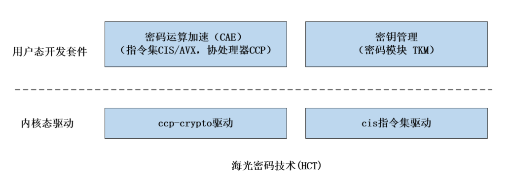
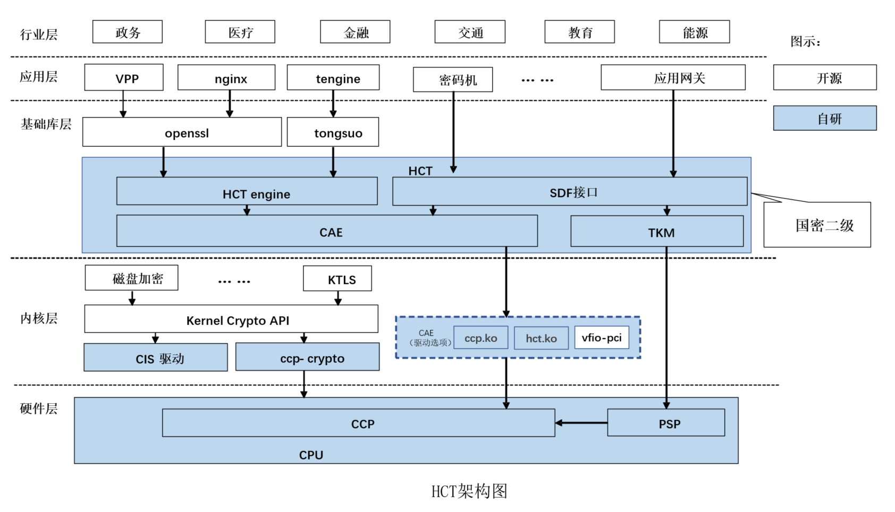
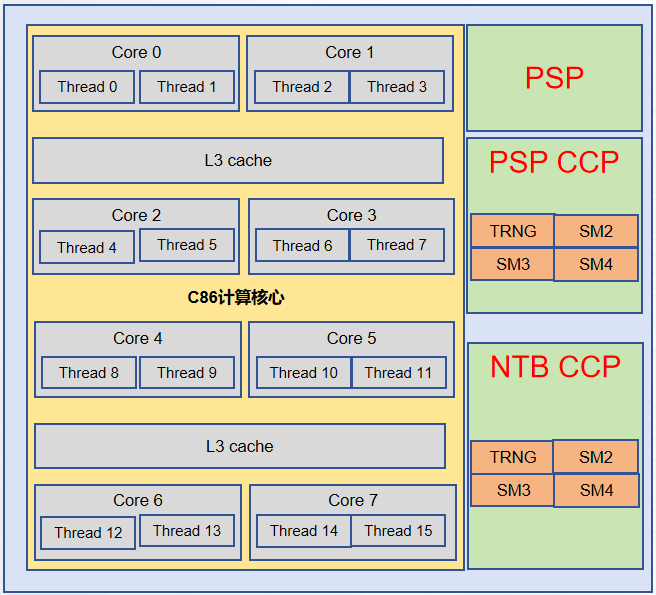
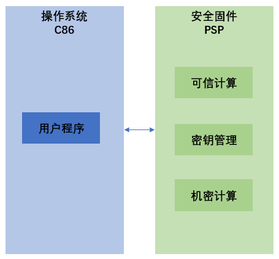
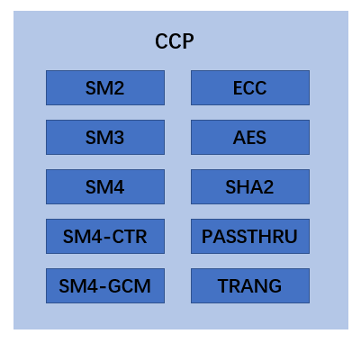
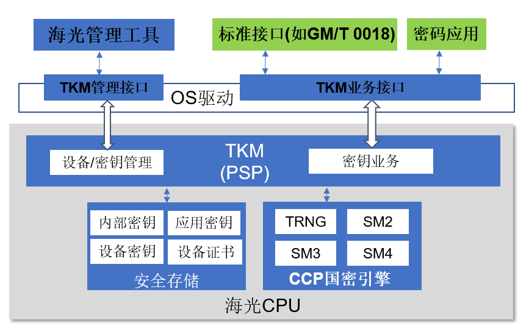
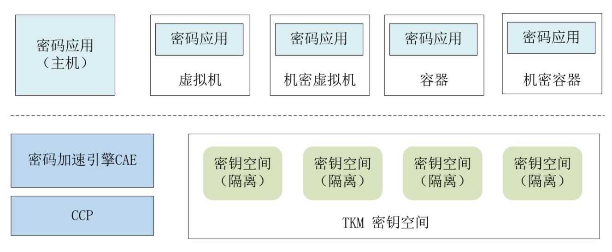

## 一、技术概述

海光密码技术（HCT）是基于硬件密码协处理器（CCP）及密码指令集（CIS、AVX）构建的密码开发解决方案，包含用户态密码开发套件（CAE 密码运算加速引擎、TKM 可信密钥管理模块）与内核密码驱动。

- CAE (Crypto Accelerate Engine）密码运算加速引擎是基于 AVX 指令集、国密指令集（CIS）及密码协处理器（CCP）开发的密码加速模块，兼容 OpenSSL、Tongsuo、Kernel Crypto API 接口。
- TKM (Trusted Key Management Module）可信密钥管理模块负责海光 CPU 内部的密钥管理，遵循 GM/T 0018 密码设备应用接口规范。
- 内核密码驱动包括CCP驱动和CIS驱动，对接 Kernel Crypto API，支持XFRM，磁盘加密应用场景。

**海光密码技术HCT**



**海光密码技术架构**



## 二、详细介绍

### 2.1 海光CPU的芯片硬件基础架构

C86计算核心提供密码指令集能力，PSP提供核心密钥管理功能，CCP提供密码运算功能。

**海光CPU的芯片硬件基础架构**



#### 2.1.1 密码指令集（CIS）

海光CPU加入了一系列密码学运算加速指令，这些指令集被设计用于加速加密和解密操作，提高数据处理的安全性和效率，指令集具体如下:

- 支持AES、SHA指令集（海光2号/C86-3G/C86-4G）；
- 支持随机数读取指令(RDRAND)和随机数种子读取指令（RDSEED）；
- 支持国密（SM3、SM4）指令集，降低SM3/SM4软件实现复杂度（C86-4G）。

#### 2.1.2 平台安全处理器（PSP）

海光CPU内置了独立的平台安全处理器。如下图所示，该平台安全处理器具有以下特点：

- 具有自己独立的资源，外部（包括C86核心）不可访问；
- 具有很高的系统权限，它可以访问所有的系统资源，包括CPU控制，系统内存及外设等；
- 系统上电时先于C86核心首先启动，C86核心何时启动由其决定，受其控制；
- 安全处理器的初始化代码固化在芯片内部，不可更改，初始代码对后续代码进行合法性和完整性验证，确保安全可靠；
- C86核心通过固定的硬件接口与安全处理器通讯。

**平台安全处理器与C86核心**



平台安全处理器的上述特点非常适合实现密钥管理等相关应用。

#### 2.1.3 密码协处理器（CCP）

海光CPU内部包含密码协处理器(CCP)，它是独立的硬件模块，密码协处理器分为两类，其中一类是PSP-CCP，另一类是NTB-CCP。PSP-CCP供PSP安全处理器使用，提供CPU内密钥生成、安全启动、可信计算等，支持TKM等模块内部的密码运算；而NTB-CCP供C86计算核心使用，用来支持纯算力的密码学运算。芯片支持通过配置将PSP-CCP提供C86核心使用，完成NTB-CCP类似的功能。其具体功能如下：

- 支持SM2、SM3、SM4算法（海光2号/C86-3G/C86-4G）；
- 支持ECC、SHA、AES算法（C86-4G）；
- 内置真随机数发生器（TRNG）；
- 使用平衡指令分支（SM2）、掩码（SM4）等技术，抵御时间、功耗等侧信道分析；
- 支持SM4加密算法 ECB/CBC/OFB/CTR/CFB模式。

**C86-4G密码协处理器CCP**



### 2.2 密码运算加速引擎CAE

#### 2.2.1 海光密码运算加速引擎CAE介绍

密码运算加密引擎CAE利用密码协处理器和密码指令集，以OpenSSL、Tongsuo、Kernel Crypto API等标准接口为系统应用提供标准密码算法接口，极大提升接口密码算法性能。密码协处理器（CCP）作为独立计算资源，从硬件层面支持密码学运算和真随机数生成，不仅可以减轻中央处理器的计算负担，同时还能为密码运算提供硬件加速；密码指令集（CIS）也支持密码学运算加速。通过综合利用密码协处理器和密码指令集，结合软件优化，可以有效地提升TLS、IPSec等密码协议的性能。

#### 2.2.2 CAE提供的密码接口

CAE提供了完备的国密sm2/sm3/sm4接口，并基于这些接口封装了标准的OPENSSL引擎，用户可以基于OPENSSL EVP接口，加载hct引擎来调用海光CPU内置的密码算力，以此来快速完成密码应用的开发和改造。hct 引擎典型的使用步骤如下：

```
…
ENGINE_load_builtin_engines();
e = ENGINE_by_id(“hct”);
EVP_CIPHER_CTX *ctx = EVP_CIPHER_CTX_new();
EVP_CipherInit_ex(ctx, EVP_sm4_ecb(), e, key, NULL, enc);
…
```

此外，CAE还提供了丰富的底层接口，支持批处理，用户可根据项目需求直接调用。

### 2.3 海光可信密钥管理模块TKM

#### 2.3.1 海光可信密钥管理模块TKM介绍

CPU基于安全处理器PSP和密码协处理器CCP实现了“可信密钥管理模块”TKM，用户把密钥存储在TKM内部，外部不可见。用户使用时只需指定密钥在TKM内部的索引或句柄，通过调用TKM提供的业务接口高效的完成密码运算。TKM可以达到用户对密钥“可用不可见”的效果，实现对密钥的保护。

**海光可信密码模块TKM**



TKM的功能特性：

1. 模块内支持多种类型的密钥；
2. 对外提供业务接口和管理接口两大类接口，业务接口主要提供密码运算支持，管理接口提供对设备及密钥的管理；
3. 主要业务接口全部支持批处理，最大程度的提高系统性能；
4. 支持与系统可信状态进行绑定，只有当系统完整性度量符合预期时才能使用模块内密钥，进一步保证了密钥的安全；
5. 密钥管理功能
    - 密钥生成：支持密钥由内部随机生成，采用TRNG硬件真随机数源。
    - 密钥协商：支持密钥协商的方式生成共享密钥
    - 密钥派生：支持基于HMAC算法派生模式的密钥派生
    - 密钥导出：支持密钥以密文形式导出
    - 密钥更新：支持内部密钥的更新，包括对称非对称密钥
    - 密钥销毁：支持销毁除设备密钥外所有密钥
    - 密钥备份与恢复：支持以安全的方式备份所有内部密钥为密钥镜像，以及从密钥镜像恢复所有密钥。备份恢复支持三种方式：
        - （1）仅支持同一个设备上备份恢复；
        - （2）仅支持同一代CPU间备份恢复；
        - （3）支持不同代CPU间备份恢复。
6. 密码运算功能
    - 对称加解密：支持SM4/AES对称加解密，支持ECB、CBC、CFB、OFB、CTR模式
    - 非对称加解密：支持SM2/RSA算法加解密
    - 签名验签：支持SM2/RSA算法签名验签
    - 哈希计算：支持SM3算法的哈希计算
    - 消息鉴别码：支持基于SM3/SHA算法的HMAC产生与验证
    - CMAC运算：支持基于SM4/AES算法的CMAC运算
    - 数字信封：支持数字信封的方式对数据进行加解密
    - 随机数产生：支持基于硬件的真随机数产生
7. 支持物理主机使用TKM的同时，通过TKM虚拟化技术虚拟出多个vTKM实例，支持虚拟机内使用vTKM，主要特性如下：
    - 虚拟机内使用vTKM，vTKM提供与主机TKM相同的密钥管理与密码运算功能；
    - vTKM实例之间相互隔离，每个vTKM实例代表一个独立的密钥空间。
    - 支持每个虚拟机独占一个vTKM实例，拥有自己独立的密钥资源，相互之间不可访问，也支持多个虚拟机共享同一个vTKM实例，共享同一个密钥空间；

#### 2.3.2 TKM提供的密码接口

海光密码模块TKM遵循 GM/T 0018 密码设备应用接口规范，也可为客户提供扩展接口定制。

## 三、海光密码技术优势

### 3.1 高性能

密码运算加密引擎包括密码指令集和密码协处理器，海光CPU的各项密码运算性能均远高于市面上的中高端密码卡，能够达到传统加密卡的数倍左右，在大批量数据处理场景下密码运算优势明显。

### 3.2 适用性强

海光在信创安全领域具备丰富的技术应用经验，并且对国密等技术能力进行了统筹升级，其 CPU 可适配于信创全场景需求。同时，其C86指令集兼容X86的各种云平台管理工具和软件，方便用户进行系统的部署和管理。

### 3.3 安全稳定

密钥管理是密码技术的关键环节，通过将密钥管理功能内置于CPU，减少了外部设备的依赖，使使用过程变得更安全、更稳定，能够有效抵御外部攻击和干扰，实现全生命周期密钥管理，做密码编程时不用担心密钥泄露在内存软件中，保证密钥的 “可用不可见”，为数据的加密和解密提供了安全的密钥保障。

### 3.4 兼容性好

兼容X86指令集，无需进行大量修改适配工作，大大降低用户在密码应用方面的迁移成本和技术难度。此外，支持容器和虚拟机等部署场景，且兼容K8S、OpenStack等云平台管理工具，可实现快速灵活的动态扩容。

### 3.5 软件生态良好

海光密码技术提供GM/T 0018标准接口，并通过HCT 引擎封装了密码协处理器的用户接口，可支持主流的密码套件，这使其能够与现有的密码软件生态系统进行良好的兼容，方便用户使用已有的密码软件和工具，在海光CPU平台上实现密码技术的应用，实现无缝迁移，进一步降低了用户的使用成本和技术门槛。

### 3.6 成本优势

海光CPU的密码技术可以降低额外的采购成本，方案迁移的成本，开发维护的成本。

## 四、应用开发支撑

1. 环境搭建请参考《用户指南》目录内容
2. 工具相关请参考《通用指南》目录内容
3. TKM密钥管理，性能测试等可参考《实践与案例》目录内容

## 五、海光密码技术应用场景

### 5.1 密码设备开发

HCT的应用场景包括密码机服务器、工控系统以及各种通用系统中的密码管理等，基于HCT软件可以进一步封装符合多项标准的接口，可提供基于TKM实现的GM/T 0018标准接口，即SDF接口，可以替换现有的硬件密码卡，作为一些专用的密码设备来应用，比如密码机服务器、签名验签服务器、VPN服务器等。

### 5.2 分布式密码运算

利用CPU自身具有TKM密钥管理的特性，取代原有通过网络访问密码卡资源池的方式，优化为通过分布式密码供给方式完成密码服务，进而降低成本、优化性能。

### 5.3 虚拟化密码能力

CAE 与 TKM 均支持在虚拟机及容器环境中部署使用。通过向虚拟机透传 vCCP 设备，并搭配 HCT 开发套件，可在虚拟机内直接调用宿主机的 CCP 密码加速能力；依托虚拟机的 vTKM 能力，可为虚拟机提供独立的密钥空间与标准密码接口，保障虚拟化场景下密码应用的合规使用。整体方案具备密码能力弹性扩容、高兼容性及部署成本低等优势。

**HCT虚拟化密码能力**


