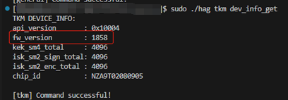

# 1. 软件依赖安装

以下列出主机HCT部署的基本环境要求（注意：若是虚拟化部署， 主机条件可能会有特别要求，具体请参考具体章节）

```
操作系统：无特殊要求，但建议内核4.15或更新
gcc: >=7.5.0
python: >= python3.6 以及 python2.7
```

## 1.1 证书和固件(hag工具)

使用HCT密码套件，主机需使用hag工具，安装安全证书。工具下载和证书安装方法链接如下

hag下载：https://download.sourcefind.cn:65024/8/main/c86-devkit/previous-release/bin

证书安装： <../../../07. 工具/01. 海光安全工具/02. 导入通用安全证书.md>

固件升级：<../../../07. 工具/01. 海光安全工具/03. 安全固件动态升级.md>

## 1.2 安装软件依赖

```
sudo apt install libnuma-dev uuid-dev
或
sudo yum install numactl libuuid-devel -y
```

## 1.3 安装openssl/Tongsuo库

HCT套件支持用户基于底层接口直接调用，因此openssl库并不是必须的，但我们还是强烈建议用户在开发阶段安装openssl，便于后续基础环境验证。

HCT支持openssl-1.1.1x、openssl3.x以及对应的Tongsuo版本，其中openssl-1.1.1x要求openssl-1.1.1c或更新。需要注意的是，如用户使用的是麒麟系统，其系统自带的openssl接口与标准版本有兼容性问题，建议用户通过官方yum源升级或重新安装。安装openssl-1.1.1c示例：

```
wget "https://github.com/openssl/openssl/releases/download/openssl-1.1.1c/openssl-1.1.1c.tar.gz"
tar -zxvf openssl-1.1.1c.tar.gz
cd openssl-1.1.1c
./config --prefix=/usr/local
make
sudo make install
```

## 1.4 安装HCT开发套件

hct安装包下载：https://download.sourcefind.cn:65024/8/main/c86-devkit/previous-release/hct

安装命令：

```
sudo dpkg -i hct-2.1.0-2024-1030-release.x86_64.deb
或
sudo rpm -i hct-2.1.0-2024-1030-release.x86_64.rpm
(如果安装过旧版本hct，先执行rpm -e hct卸载旧版本)
```

# 2. CAE 开发环境

## 2.1 安装HCT内核模块

**注意：** 编译安装HCT内核模块要求内核版本在4.10及以上。

1. 请在任意目录创建Makefile文件，并将以下内容复制到Makefile文件中

```
########################################
#                                      #
#        Makefile for HCT module       #
#                                      #
########################################
MCFLAGS ?=
obj-m := hct.o
KSRC := /lib/modules/`uname -r`/build
KDIR := /lib/modules/`uname -r`/kernel/drivers/crypto/ccp

IS_GUEST := $(shell grep -q hypervisor /proc/cpuinfo && echo 1 || echo 0)

ifeq ($(IS_GUEST),1)
	MCFLAGS := -DHCT_GUEST
endif

all: hct.c
	make -C $(KSRC) M=`pwd` modules EXTRA_CFLAGS="$(MCFLAGS)"

clean:
	make -C $(KSRC) M=`pwd` clean

install:
	@echo "Searching and removing old hct.ko..."
	@find $(KDIR) -type f -name "hct.ko*" -print -delete
	@echo "Installing..."
	@if [ ! -d /lib/modules/`uname -r`/extra ] ; then \
		mkdir -p /lib/modules/`uname -r`/extra; \
	fi
	@cp ./hct.ko /lib/modules/`uname -r`/extra/ && depmod

hct.c:
	@cp /opt/hygon/hct/src/module/hct.c ./
```

2. cd到Makefile同级目录，执行如下命令编译和安装驱动模块

```
make
sudo make install
```

3. 通过命令`modinfo hct`检查模块是否正确安装，安装成功后，应该有hct模块的信息显示

```
$ modinfo hct
filename:       /lib/modules/6.6.7+/extra/hct.ko
author:         HYGON Corporation
version:        0.6
license:        GPL v2
srcversion:     76DFE31445F07C4FECE0DEF
depends:        vfio,mdev
retpoline:      Y
name:           hct
vermagic:       6.6.7+ SMP preempt mod_unload
```

## 2.2 开启IOMMU模块

hct依赖系统iommu模块，需配置以下两项：

```
• BIOS设置路径：HYGON CBS → NBIO Common Options → NB Configuration → IOMMU
• 内核启动项：GRUB_CMDLINE_LINUX 添加 `amd_iommu=on`设置完成后，请更新grub并重启机器。
```

## 2.3 绑定驱动

用户可使用如下命令绑定驱动：

```
sudo /opt/hygon/hct/hct/script/hctconfig start
```

**注意:** 部分海光处理器（如C86-4G 3000系列）需要系统管理员手动将CCP配置为C86系统可访问之后（参考[PSP-CCP配置VQ指导文档](<../06. PSPCCP配置VQ指导文档.md>)），才能将CCP绑定到HCT驱动使用。

## 2.4 查看CCP绑定状态

```
sudo /opt/hygon/hct/hct/script/hctconfig status
```

```
------------>>>  H C T  I N F O D U M P  <<<--------------

HCT Version:                    2.1.0-2024-1030-release
HCT engine Dir:                 /usr/local/lib64/engines-1.1/
HCT lib Dir:                    /usr/local/lib64/
HCT script Dir:                 /usr/local/hct/script
HCT function test tool Dir:     /usr/local/bin/
HCT performance tool Dir:       /usr/local/bin/
HCT created 1920 mdev devices to support max 128 progress

HCT CCP effective Binding info :
0000:04:00.1 'NTBCCP 1468' drv=hct unused=ccp,vfio-pci
0000:11:00.2 'PSPCCP Command DMA Processor 1456' drv=hct unused=ccp,vfio-pci
...
-----------------------------------------------------------------------------
```

## 2.5 测试环境：

```
sudo /opt/hygon/hct/bin/hct_test
```

```
[info] __pci_vfio_scan(756): 15 ccp mdev devices are probed
[info] bind_hygonccp(6266): the used mode: auto select software or ccp for sm2/sm3/sm4
1..8
[info] clarify_cis_actually_used_by_config(151): SW instruction set is not configured, actually use AVX
PASS 1 - sm2enc_vfio_ccp_test
PASS 2 - sm2sign_vfio_ccp_test
PASS 3 - sm3_vfio_ccp_test
PASS 4 - sm3_vfio_sw_test
PASS 5 - sm4_vfio_ccp_test
PASS 6 - sm4_vfio_sw_test
PASS 7 - sm3_hmac_vfio_ccp_test
```

## 2.6 NOIOMMU模式

CAE支持关闭IOMMU（即NOIOMMU）的场景下使用，支持2M大页和1G大页两种模式，这个模式下，驱动应该绑定为vfio-pci的noiommu模式，绑定方法如下：

```
提示：
    （1）确保内核CONFIG_VFIO_NOIOMMU配置为打开状态
    （2）关闭iommu，内核启动项：GRUB_CMDLINE_LINUX 添加 `amd_iommu=off`设置完成后，请更新grub并重启机器。
    （3）若使用2M大页模式，本步骤可跳过。若使用1G大页模式，内核启动项：GRUB_CMDLINE_LINUX 添加 `mem_encrypt=off default_hugepagesz=1G hugepagesz=1G hugepages=4`设置完成后，请更新grub并重启机器(可与第2部操作一并执行)。
    （4）打开noiommu模式: echo 1 > /sys/module/vfio/parameters/enable_unsafe_noiommu_mode
    （5）以vfio-pci模式绑定ccp: ./hctconfig start -m vfio-pci
    （6）若开启了内存加密，即在grub中配置了sme=on，则需要加载hct.ko，否则该功能无法正常使用
```

# 3. TKM 开发环境

海光HCT密码技术提供了运行在海光CPU平台上的符合《GMT 0018-2012 密码设备应用接口规范》API（即SDF）接口，调用这些API接口，需部署TKM开发环境。

## 3.1 环境依赖

TKM依赖CAE，因此请先参考本文CAE环境搭建部分完成CAE环境部署。以下列出TKM开发环境的基本要求

| **配置** | **要求** | **备注** |
|----|----|----|
| CPU | Hygon C86-3G及以上 |  |
| BIOS | 海光BIOS PI2.1.0.4，并且安全固件版本大于1881 | 安全固件动态升级参考：[安全固件动态升级方法](<../../../07. 工具/01. 海光安全工具/03. 安全固件动态升级.md>) |
| hag | 1881或以上 | https://download.sourcefind.cn:65024/8/main/c86-devkit/previous-release/bin |
| SDF | sdf-2.3.0-20250130 | https://download.sourcefind.cn:65024/8/main/c86-devkit/previous-release/tkm |
| TKM | tkm-3.3.0-20250130 | https://download.sourcefind.cn:65024/8/main/c86-devkit/previous-release/tkm|
| HCT | hct\_2.1.0.20241030\_release | 部署方式见本文CAE部署部分|
| glibc | 2.17或以上 |  |
| python | 系统中必须存在python2命令 |  |

### 不同版本的功能支持情况

1.  安全固件版本

| **版本号** | **支持的功能**                 |
|------------|--------------------------------|
| 1881       | 基本功能                       |
| 2070       | 支持虚拟化密钥隔离             |
| 2131       | 支持海光CSV虚拟机中运行SDF接口 |
| 2210       | 性能优化                       |

2.  libhypsp

| **版本号** | **支持的功能** |
|----|----|
| 3.0.1 | 基本版本，支持所有0018定义的标准接口。 |
| 3.1.0 | 在固件也满足条件的情况下，支持HYSDF\_BackupKey、HYSDF\_RestoryKey、HYSDF\_DeviceFactoryReset接口 |
| 3.2.0 | 密钥隔离虚拟化支持 |
| 3.3.0 | 增加CSV虚拟机使用TKM支持 |

### 安全固件版本的检查方式

安全固件版本的检查方式，可以通过hag命令进行检查：

```
$ sudo hag tkm dev_info_get
```



图中输出的fw\_version字段表示安全固件的版本。而hag工具的版本检查方式为：

```
$ sudo hag general version
```

输出的Version字段表示hag工具的版本

## 3.2 软件包安装

一共需要安装三个组件，HCT，TKM，SDF，其中HCT安装包在CAE环境部署章节中已介绍，TKM和SDF安装包请通过链接[TKM和SDF软件包](https://download.sourcefind.cn:65024/8/main/c86-devkit/previous-release/tkm)下载安装

## 3.3 SDF测试验证

测试tkm/sdf环境，请务必先完成CAE环境部署，以跑通`hct_test`为准。

将以下代码保存为hysdf\_test.c

```c
// hysdf_test.c

#include <stdio.h>
#include <hysdf.h>

int main ()
{
    int ret = 0;
    DEVICEINFO devinfo = { 0 };
    void *hDeviceHandle = NULL;
    void *hSessionHandle = NULL;
    ret = SDF_OpenDevice(&hDeviceHandle);
    if (ret) {
        printf("SDF_OpenDevice failed %x\n", ret);
        goto out;
    }

    ret = SDF_OpenSession(hDeviceHandle, &hSessionHandle);
    if (ret) {
        printf("SDF_OpenSession failed %x\n", ret);
        goto out;
    }

    ret = SDF_GetDeviceInfo(hSessionHandle, &devinfo);
    if (ret) {
        printf("SDF_GetDeviceInfo failed %x\n", ret);
        goto out;
    }

    printf("issuer name:%s\n", devinfo.IssuerName);
    printf("device name:%s\n", devinfo.DeviceName);
    printf("device serial:%16.16s\n", devinfo.DeviceSerial);
    printf("device version:0x%x\n", devinfo.DeviceVersion);
    printf("standard version:0x%x\n", devinfo.StandardVersion);
    printf("asym algo:0x%x 0x%x\n", devinfo.AsymAlgAbility[0], devinfo.AsymAlgAbility[1]);
    printf("sym algo:0x%x\n", devinfo.SymAlgAbility);
    printf("hash:0x%x\n", devinfo.HashAlgAbility);
    printf("buffer size:0x%x\n", devinfo.BufferSize);

    ret = SDR_OK;
out:
    if (hSessionHandle)
        SDF_CloseSession(hSessionHandle);
    if (hDeviceHandle)
        SDF_CloseDevice(hDeviceHandle);
    return ret;
}
```

编译命令：

```
gcc hysdf_test.c -o hysdf_test -lhysdf
```

执行：

```
sudo ./hysdf_test
```

输出内容参考：

```
[info]  __pci_mdev_scan(697): 1 ccp mdev devices are probed
issuer name:HYGON
device name:7285
device serial:   NN4Y604082105
device version:0x8b5
standard version:0x20203
asym algo:0x30100 0x800
sym algo:0x10000400
hash:0x7
buffer size:0x100000
```

## 3.4 基本说明

### 操作权限

目前使用海光sdf接口必须具备root权限。

### 用户密钥的操作

标准的0018规范没有对SDF接口所使用的用户密钥如何管理进行定义。这里提供了两种方式进行管理。

（1）通过hag工具操作用户密钥

hag工具安装方式参考：[海光安全工具简介](<../../../07. 工具/01. 海光安全工具/01. 海光安全工具简介.md>)
hag命令创建密钥的命令参考：

```
$ sudo hag tkm intl_key_gen -idx 1 -password 12345678 -type sm2sign
$ sudo hag tkm intl_key_gen -idx 1 -password 12345678 -type sm2enc
$ sudo hag tkm intl_key_gen -idx 1 -password 12345678 -type sm4
$ sudo hag tkm intl_key_gen -idx 1 -password 12345678 -type rsa2048sign
$ sudo hag tkm intl_key_gen -idx 1 -password 12345678 -type rsa2048enc
```

hag命令销毁密钥的命令参考：

```
$ sudo hag tkm key_destroy -idx 1 -password 12345678 -type sm2sign
$ sudo hag tkm key_destroy -idx 1 -password 12345678 -type sm2enc
$ sudo hag tkm key_destroy -idx 1 -password 12345678 -type sm4
$ sudo hag tkm key_destroy -idx 1 -password 12345678 -type rsa2048sign
$ sudo hag tkm key_destroy -idx 1 -password 12345678 -type rsa2048enc
```

注意：在调用SDF\_GetPrivateKeyAccessRight时，无法区分密钥类型，只能根据索引来填充密钥授权码。因此在创建用户密钥时，**相同类型的索引必须使用相同的password**。

更多hag tkm的使用示例可参考：[TKM密钥管理测试](<../../03. 实践与案例/02. TKM密钥管理测试.md>)

（2） 通过API接口操作用户密钥

从SDF的2.1.0版本开始，已在API层面支持用户密钥的操作，可以不再使用hag命令来对用户密钥进行操作，详情参考《海光SDF扩展接口说明》。

### 返回值说明

根据《GMT 0018-2012 密码设备应用接口规范》中，定义了一组以 SDR\_ 开头的错误码。在实际实现中，不一定能完全满足需求，因此从sdf 2.2.0版本开始，额外定义了一组错误码，以HYSDR\_开头，具体定义参考hysdf.h文件。

### 关于设备系统口令

SDF 2.1.0版本开始，新增了一组扩展接口用于操作用户密钥，某些接口可能要求输入pucSysPassword参数，即系统口令。

默认的系统口令为字符串形式的”12345678”，长度为8字节。如需修改，请按以下方式进行调用修改密钥访问权限的接口：

```
HYSDF_ChangePrivateKeyAccessRight(hSessionHandle, 0, ISK_SM2_SIGN, (unsigned char*)"12345678", 8, (unsigned char*)"87654321", 8);
```

或者通过hag工具进行修改

```
sudo hag tkm change_sys_auth -role dev -password 12345678 -new_password 87654321
```

上述两种方式均能将设备的系统口令从”12345678”修改为”87654321”。

**注意，如不慎遗忘系统口令，需要清空设备所有密钥进行初始化操作才能恢复**。
