# 宿主机环境准备

参照[《主机环境搭建》](<01. 主机环境搭建.md>)在宿主机中搭建开发环境，当主机HCT环境验证通过后，请通过下列命令重新绑定HCT驱动：

```
$ sudo /opt/hygon/hct/hct/script/hctconfig stop
$ sudo /opt/hygon/hct/hct/script/hctconfig start -p 16 -q 128
```

此处-p 16是创建16个宿主机使用的mdev设备，-q 128是创建128个虚拟机使用的mdev，用户可根据需求自行修改。

# 编译安装qemu

安装qemu编译所需的软件。

```
$ sudo apt install libnuma-dev libpixman-1-dev -y
```

从如下链接获取支持HCT虚拟化功能的qemu源码，本文档以qemu-6.2.0为例，用户可根据需求切换qemu的版本号：https://gitee.com/anolis/hygon-qemu
Tips：当前支持的版本有：2.12.0, 4.1.0, 6.2.0, 7.2.0。支持hct虚拟化功能的commit-id如下：

|      版本       |     commit-id       |
|-----------------|-----------------------|
|2.12.0	| 4647a04c4d18101bac28f1f4b565ff4030f1a1ae  <br>949469447da28932384cfa8a3dfe9b567806320c <br> f105775ec610cff1982a14ec766d236ad55b5109 |
|4.1.0	| 5e27416a21450f54f4d4eb040532069771f1b5d3  <br>32097e5ec58f70d59022321ad5752e4c46863c2b <br> a841c63f46321d1937d0e41c5cc76076b5bad2be|
|6.2.0	| 1886abda05f878303b140a345d53ffd899675be6  <br>b046474dbc2560434dc1d2f4485b8b474d7d23e0 <br> 77e0f539ef8daacd27ea0f77dfed4b3a5c35d610|
|7.2.0	| 6e868fb05ab96a27d26aaa71ecbf99352f29a5e5  <br>950ae0538455f3505e9935807f4c1d1511674eb4 <br> 21e118a70be9fac634f9910aa0029e4cdcdc94f1|

**如需使用vTKM完整功能，请获取如下patch（当前仅支持6.2.0版本）**

|      版本       |     commit-id       |
|-----------------|-----------------------|
|6.2.0	|9b4396f8c8db6ebef8bd0b315d6649365123db0e（支持密钥隔离）<br> 76a47a90f9ecee19f86039fdea992c7d5c1f4d22  （CSV虚拟机功能支持）<br>c5b9286549f37f14e8ddbfb7831a6b7d125b1f65（CSV虚拟机功能支持）<br>da768933bfcec318425f788524b792e58bdf51ad （CSV虚拟机功能支持）|

qemu源码下载完成后执行如下命令进行编译安装。如使用7.2.0版本，请安装libslirp-dev，并在./configure后加上--enable-slirp参数。

```
$ cd hygon-qemu
$ mkdir ../output
$ ./configure --target-list=x86_64-softmmu --prefix="`pwd`/../output/qemu-output"
$ make -j$(getconf _NPROCESSORS_ONLN) --print-directory
$ make -j$(getconf _NPROCESSORS_ONLN) install
```

编译完成之后可以在output中看到相关的文件。

```
$ tree ../output
```

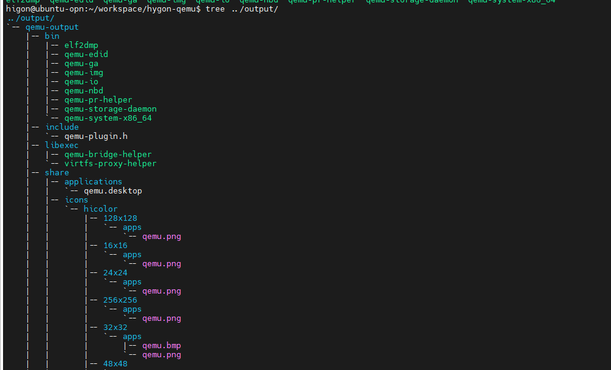

# 虚拟机准备与启动

用户若已有Guest镜像，可忽略下一节`制作虚拟机镜像`。HCT虚拟化对Guest OS无特别要求，Ubuntu，CentOS，麒麟，龙蜥等均可。

## 制作虚拟机镜像

下载操作系统镜像。

```
$ cd ..
$ mkdir iso
$ cd iso
$ wget http://mirrors.aliyun.com/ubuntu-releases/18.04/ubuntu-18.04.6-live-server-amd64.iso
```

用如下命令创建一个大小为20G的虚拟磁盘。

```
$ ../output/qemu-output/bin/qemu-img create -f qcow2 hct.qcow2 20G
```

启动虚拟机，在创建好的虚拟磁盘中安装操作系统。

```
$ sudo ../output/qemu-output/bin/qemu-system-x86_64 -enable-kvm -m 4096 -smp 8 -boot d -drive file=hct.qcow2,if=virtio,index=0,media=disk,format=qcow2 -drive file=ubuntu-18.04.6-live-server-amd64.iso,index=1,media=cdrom -vnc localhost:1
```

另外打开一个终端，通过VNC软件连接到虚拟机，这里用的是Mobaxterm终端软件 + xtightvncviewer，用户可自行选择。

```
$ sudo apt install xtightvncviewer
$ xtightvncviewer
```

在弹出的窗口中输入localhost:1。

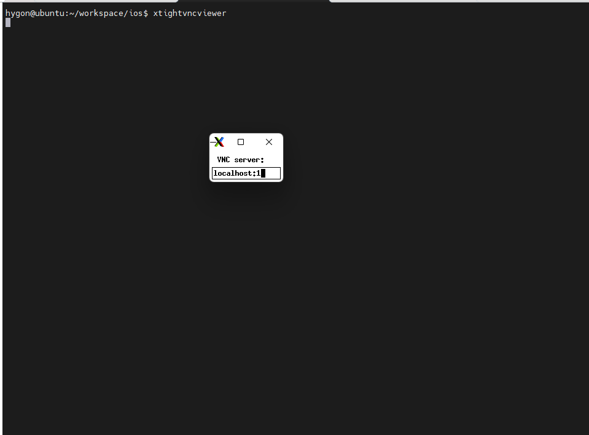

进入虚拟机的界面后开始安装操作系统。

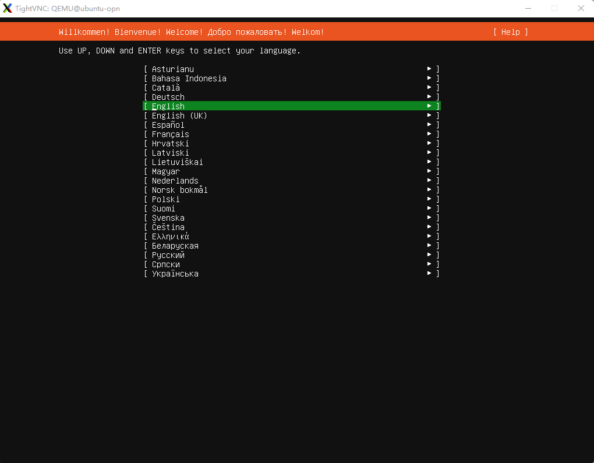

## 启动带CAE功能的虚拟机

操作系统安装完成后先关闭原来的虚拟机，并通过如下命令开启虚拟机。

```
$ /opt/hygon/hct/hct/script/start_qemu.py -q ../output/qemu-output/bin/qemu-system-x86_64 -n 1 -i hct.qcow2
```

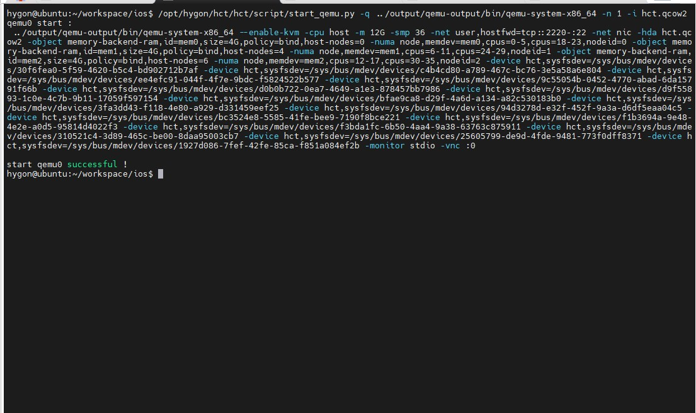

start\_qemu.py关键参数：

```
-q 指定qemu可执行程序，默认为系统目录下的qemu-system-x86_64；
-n 指定启动虚拟机的数量
-i 后的参数为装有操作系统的虚拟镜像文件
```

## 启动带vTKM功能的虚拟机

如需启动带vTKM功能的虚拟机，先使用hag工具创建vid。并在脚本后请加--vid {vid\_num} 参数。

```
$ cd /opt/hygon/bin
$ sudo ./hag tkm vtkm_create -mode shared //若需要使用密钥隔离vTKM，模式配置为exclusive
$ /opt/hygon/hct/hct/script/start_qemu.py -q ../output/qemu-output/bin/qemu-system-x86_64 -n 1 -i hct.qcow2 --vid 1
```

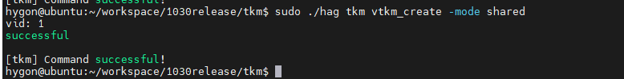

虚拟机成功启动后，使用如下命令查询虚拟机状态及对应端口号。

```
$ /opt/hygon/hct/hct/script/start_qemu.py -s
```

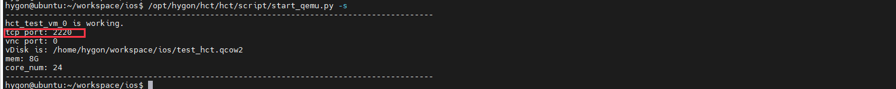

通过ssh，指定2220端口，登录到虚拟机。

```
$ ssh -p 2220 hygon@localhost
```

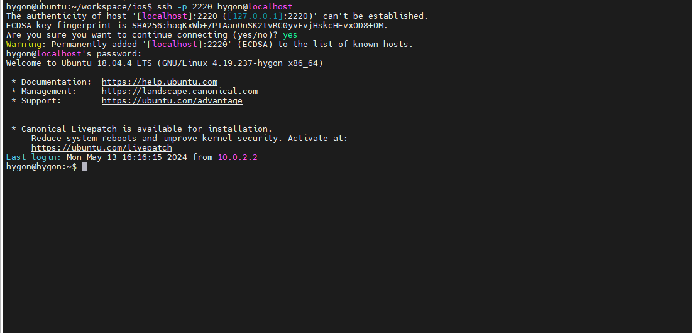

# Guest环境部署

将HCT开发包拷贝到虚拟机，并安装。

```
sudo dpkg -i hct-2.1.0-2024-1030-release.x86_64.deb
或
sudo rpm -i hct-2.1.0-2024-1030-release.x86_64.rpm
```

编译安装HCT内核模块(参考主机编译方法)。

```
$ make
$ sudo make install
$ sudo modprobe hct
```

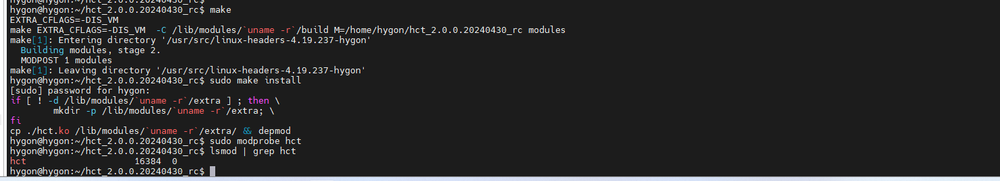
配置noiommu功能。

```
$ sudo modprobe vfio
$ sudo modprobe vfio-pci
$ sudo bash -c "echo 1 > /sys/module/vfio/parameters/enable_unsafe_noiommu_mode"
```

用如下命令检查是否设置成功。

```
$ cat /sys/module/vfio/parameters/enable_unsafe_noiommu_mode
```

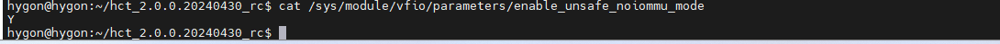

**如需验证vTKM功能，虚拟机中安装TKM和SDF，链接[TKM和SDF软件包](https://download.sourcefind.cn:65024/8/main/c86-devkit/previous-release/tkm)**

## CAE功能测试

将CCP设备绑定到vfio-pci驱动。

```
$ sudo /opt/hygon/hct/hct/script/hctconfig start -m vfio-pci
```

执行基本功能测试。

```
$ sudo /opt/hygon/hct/bin/hct_test
```

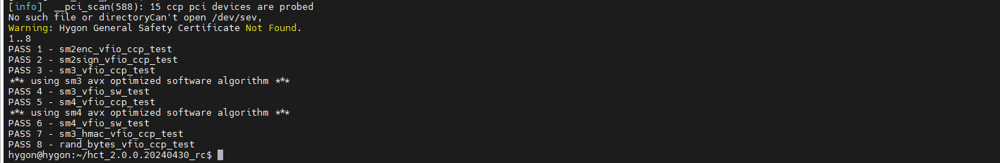

## vTKM功能测试

如无vTKM功能需求，可跳过。

### vTKM基本环境验证

执行任意一个TKM命令，确认在虚拟机环境下已可以使用TKM，这里以hag tkm dev\_info\_get为例，执行成功可以说明vTKM基本环境已搭建完成。

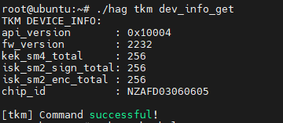

### SDF基本环境验证

虚拟机中使用SDF接口与物理机并无差异，请参考[主机环境搭建](<01. 主机环境搭建.md>)3.3节，在虚拟机中验证基本SDF接口，执行成功可以说明虚拟机下SDF环境已搭建完成。

## 虚拟机启动参数说明

start\_qemu.py启动虚拟机的参数为 ../output/qemu-output/bin/qemu-system-x86\_64 --enable-kvm -cpu host -name hct\_test\_vm\_0 -net user,hostfwd=tcp::2220-:22 -net nic -vnc :0 -hda /home/lixin/workspace/qemu\_hct/sys\_image/hct.qcow2 -m 12G -smp 36 -object memory-backend-ram,id=mem0,size=4G,policy=bind,host-nodes=2 -numa node,memdev=mem0,cpus=0-5,cpus=18-23,nodeid=0 -object memory-backend-ram,id=mem1,size=4G,policy=bind,host-nodes=4 -numa node,memdev=mem1,cpus=6-11,cpus=24-29,nodeid=1 -object memory-backend-ram,id=mem2,size=4G,policy=bind,host-nodes=6 -numa node,memdev=mem2,cpus=12-17,cpus=30-35,nodeid=2 -device hct,sysfsdev=/sys/bus/mdev/devices/e6cba2aa-7778-4f87-a962-7e3953ce2367 -device hct,sysfsdev=/sys/bus/mdev/devices/60b0cf7e-9a95-4dfb-956a-d2b5b23d0fcd -daemonize

**若使用带vTKM的虚拟机，则需要包含-device psp,vid=1参数，vid值根据实际vid号输入**

|      参数          |     解释        |
|--------------------|-----------------------|
|--enable-kvm	     |启用KVM加速，可以提高虚拟机的性能|
|-cpu host	         |指定虚拟机中的CPU与宿主机CPU相同 |
|-name hct\_test\_vm\_0 |设置虚拟机别名为 hct\_test\_vm\_0|
|-net user,hostfwd=tcp::2220-:22|为虚拟机设置网络，将宿主机的2222端口映射到虚拟机的22端口（用于SSH连接）|
|-net nic	         |为虚拟机添加一个网络接口|
|-hda {yourpath}/hct.qcow2	|虚拟机的硬盘|
|-m 12G              |为虚拟机分配12GB的内存|
|-smp 36	         |设置虚拟机的CPU核心数为36|
|-object memory-backend-ram,id=mem0,size=4G,policy=bind,host-nodes=2	|创建一个内存对象，分配4G内存，并将它绑定在宿主机的numa2上|
|-numa node,memdev=mem0,cpus=0-5,cpus=18-23,nodeid=0	|创建一个numa节点，关联内存，并指定与vcpu关联|
|-device hct,sysfsdev=/sys/bus/mdev/devices/{uuid}	|虚拟机中添加一个hct设备 |
|-daemonize |后台运行虚拟机  |
|-device psp,vid=1 |启动带vTKM的虚拟机，该虚拟机绑定vid为1对应的密钥空间  |

## libvirt中使用虚拟机

使用前请自行安装4.5及以上版本的libvirt。可参考官方文档https://libvirt.org/docs.html

### 配置文件修改

编辑/etc/libvirt/qemu.conf，并设置用户参数。

```
user = "root"
group = "root"
```

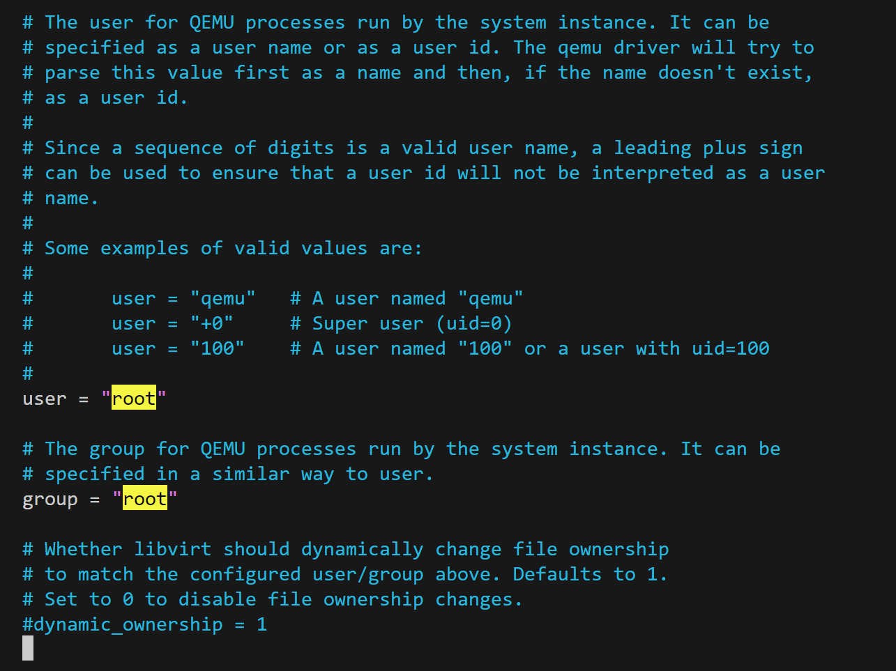

安装libvirt及lxml的python插件。

```
$ sudo pip3 install libvirt-python
$ sudo pip3 install lxml
```

更新/etc/libvirt/qemu.conf中的cgroup\_device\_acl设备列表。

```
$ sudo /opt/hygon/hct/hct/script/start_qemu.py --update_qemu_conf
```

如需使用vTKM功能，请在cgroup\_device\_acl中加入"/dev/hygon\_psp\_config"设备。

重启libvirt服务。

```
$ sudo service libvirtd restart
```

### 导入虚拟机

导入新的虚拟机，并查看状态。

```
$ sudo virsh define test.xml
$ sudo virsh list --all
```

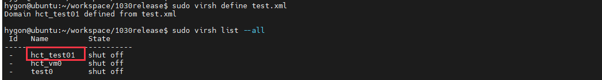

如需使用vTKM功能，请在test.xml中的\</qemu:commandline\>部分加入\<qemu:arg value='-device' /\>
\<qemu:arg value='psp,vid={vid\_num}' /\>。

### 更新xml配置

更新xml中的hct设备。

```
$ sudo /opt/hygon/hct/hct/script/start_qemu.py --update_xml hct_test01
```

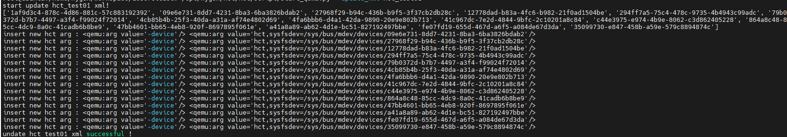

启动虚拟机。

```
$ sudo virsh start hct_test01
```

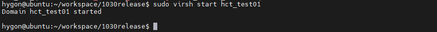

虚拟机开启后可通过ssh或是vnc登录。

### xml示例配置

如下为启动一个hct功能虚拟机的基本配置，仅供参考。注意将配置中<font color=red>emulator</font>及<font color=red>source file</font>中的{your\_path}替换成真实路径。如需在其他虚拟机配置中使用hct，确保配置文件中存在<font color=red>qemu:commandline</font>即可。

```
<domain type="kvm" xmlns:qemu='http://libvirt.org/schemas/domain/qemu/1.0'>
  <name>hct_test01</name>
  <memory unit='GiB'>16</memory>
  <currentMemory unit='GiB'>16</currentMemory>
  <vcpu placement='static'>32</vcpu>
  <resource>
    <partition>/machine</partition>
  </resource>
  <os>
    <type arch='x86_64' machine='pc'>hvm</type>
    <boot dev='hd'/>
  </os>
  <clock offset='utc'/>
  <on_poweroff>destroy</on_poweroff>
  <on_reboot>restart</on_reboot>
  <on_crash>destroy</on_crash>
  <devices>
    <emulator>/{your_path}/qemu-system-x86_64</emulator>
    <disk type='file' device='disk'>
      <driver name='qemu' type='qcow2'/>
      <source file='/{your_path}/hct.qcow2'/>
      <backingStore/>
      <target dev='vda' bus='virtio'/>
      <alias name='virtio-disk0'/>
      <address type='pci' domain='0x0000' bus='0x00' slot='0x05' function='0x0'/>
    </disk>
    <controller type='usb' index='0' model='piix3-uhci'>
      <alias name='usb'/>
      <address type='pci' domain='0x0000' bus='0x00' slot='0x01' function='0x2'/>
    </controller>
    <controller type='pci' index='0' model='pci-root'>
      <alias name='pci.0'/>
    </controller>
    <graphics type='vnc' port='5900' autoport='yes' listen='127.0.0.1'>
      <listen type='address' address='127.0.0.1'/>
    </graphics>
    <audio id='1' type='none'/>
    <video>
      <model type='cirrus' vram='16384' heads='1' primary='yes'/>
      <alias name='video0'/>
      <address type='pci' domain='0x0000' bus='0x00' slot='0x04' function='0x0'/>
    </video>
    <memballoon model='virtio'>
      <alias name='balloon0'/>
      <address type='pci' domain='0x0000' bus='0x00' slot='0x03' function='0x0'/>
    </memballoon>
  </devices>
  <seclabel type='none' model='none'/>
  <seclabel type='dynamic' model='dac' relabel='yes'>
    <label>+0:+0</label>
    <imagelabel>+0:+0</imagelabel>
  </seclabel>
  <qemu:commandline>
    <qemu:arg value='-net'/>
    <qemu:arg value='user,hostfwd=tcp::2220-:22'/>
    <qemu:arg value='-net'/>
    <qemu:arg value='nic'/>
    <qemu:arg value='-cpu'/>
    <qemu:arg value='host'/>
    <qemu:arg value='-device'/>
    <qemu:arg value='hct,sysfsdev=/sys/bus/mdev/devices/740da7c5-3b51-4da6-8a22-2a59d11f3fde'/>
  </qemu:commandline>
</domain>
```
