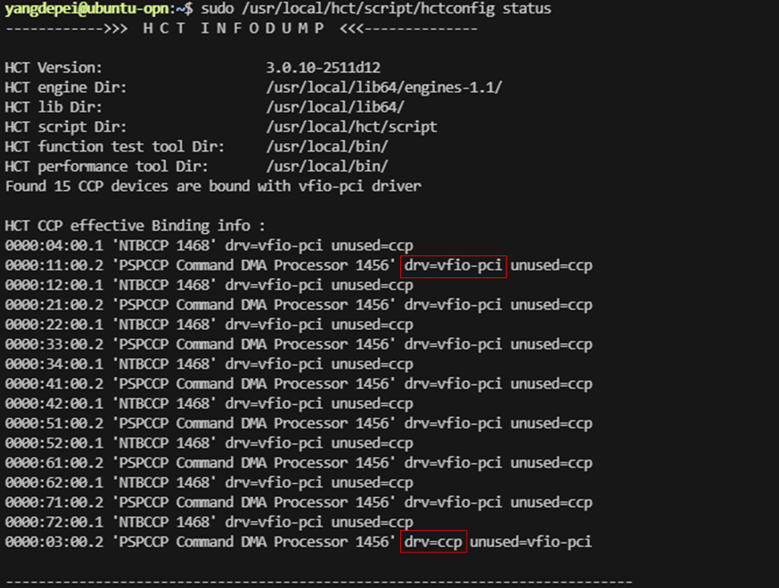
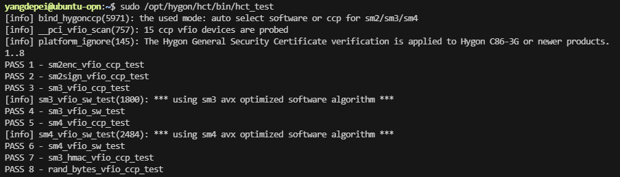
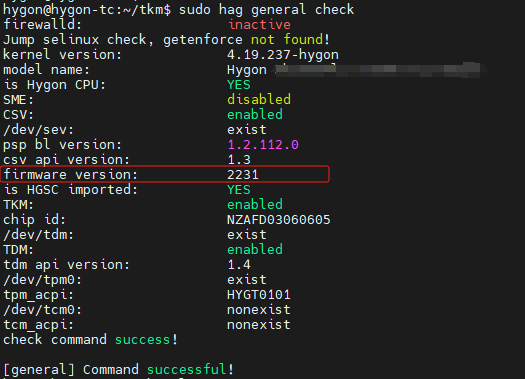
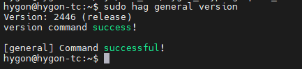
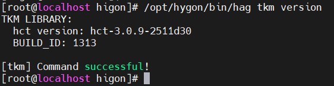
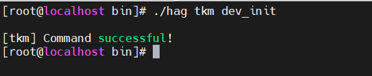

# 1. 软件依赖安装

以下列出主机HCT部署的基本环境要求（注意：若是虚拟化部署， 主机条件可能会有特别要求，具体请参考具体章节）

```
操作系统：无特殊要求，但建议内核4.15或更新
gcc: >=7.5.0
python: >= python3.6
```

## 1.1 证书和固件(hag工具)

hag下载：https://download.sourcefind.cn:65024/8/main/c86-devkit/latest/tools

证书安装： <../../../07. 工具/01. 海光安全工具/02. 导入通用安全证书.md>

固件升级：<../../../07. 工具/01. 海光安全工具/03. 安全固件动态升级.md>

## 1.2 安装软件依赖

```
sudo apt install libnuma-dev
或
sudo yum install numactl -y
```

## 1.3 安装openssl/Tongsuo库

HCT套件支持用户基于底层接口直接调用，因此openssl库并不是必须的，但我们还是强烈建议用户在开发阶段安装openssl，便于后续基础环境验证。

HCT支持openssl-1.1.1x、openssl3.x以及对应的Tongsuo版本，其中openssl-1.1.1x要求openssl-1.1.1c或更新。需要注意的是，如用户使用的是麒麟系统，其系统自带的openssl接口与标准版本有兼容性问题，建议用户通过官方yum源升级或重新安装。安装openssl-1.1.1c示例：

```
wget "https://github.com/openssl/openssl/releases/download/openssl-1.1.1c/openssl-1.1.1c.tar.gz"
tar -zxvf openssl-1.1.1c.tar.gz
cd openssl-1.1.1c
./config --prefix=/usr/local
make
sudo make install
```

## 1.4 安装HCT开发套件

hct安装包下载：https://download.sourcefind.cn:65024/8/main/c86-devkit/latest/hct

安装命令：

```
sudo dpkg -i hct-3.0.10-2601d26.x86_64.deb
或
sudo rpm -i hct-3.0.10-2601d26.x86_64.rpm --nodeps
(如果安装过旧版本hct，先执行rpm -e hct卸载旧版本)
```

# 2. CAE开发环境

HCT开发环境包括CAE基本开发环境和TKM开发环境两大块，其中CAE环境是TKM环境的前提，因此建议先部署和验证CAE环境，再部署验证TKM环境。

## 2.1 驱动模式说明

HCT3.0开始，支持2种驱动模式使用，用户可基于使用场景选择对应的驱动方式。

以下列出驱动模式区别：

| 驱动 | 特点 |
|:----- | :-----|
| ccp（推荐） | • 无需用户绑定，开机即可使用HCT，但需内核支持。<br>• 支持虚拟化部署，虚拟机热迁移<br>• 可用全部CCP |
| vfio-pci    |  •  linux自带驱动，需用户手动绑定<br>• 支持虚拟化部署，虚拟机热迁移<br>• 只能用N-1个CCP，保留一个绑定内核驱动|

## 2.2 开启 IOMMU

两种模式均需要确保系统IOMMU开启，需配置以下两项：

```
• BIOS设置路径：HYGON CBS → NBIO Common Options → NB Configuration → IOMMU
• 内核启动项：GRUB_CMDLINE_LINUX 添加 `amd_iommu=on`设置完成后，请更新grub并重启机器。
```

## 2.3 绑定驱动

用户可使用如下命令绑定驱动：

```
sudo /opt/hygon/hct/hct/script/hctconfig start
```

hctconfig工具，将自动检查系统中是否满足ccp驱动的使用条件，如果不满足，工具将会把HCT配置为vfio-pci驱动模式。

## 2.4 查询驱动绑定

查询驱动绑定

```
sudo /opt/hygon/hct/hct/script/hctconfig status
```

如下图所示，drv=vfio-pci表示绑定的是vfio-pci驱动，drv=ccp表示绑定的是ccp驱动。



## 2.5 测试环境

测试环境：

```
sudo /opt/hygon/hct/bin/hct_test
```



## 2.6 驱动部署方案说明

<small><span style="font-family: KaiTi, STKaiti, serif;">
说明：
使用 HCT 套件存在两种部署方案，ccp驱动并非强制依赖：
</span></small>
<br>
<small><span style="font-family: KaiTi, STKaiti, serif;">
（1） 优先方案（ccp 驱动）
<br>
基于ccp驱动使用HCT套件，内核需带ccp-mdev功能，目前我们已将对应patch推送到龙蜥社区，欧拉社区，也正向各主要国产OS厂商推送中。
</span></small>
<br>
<small><span style="font-family: KaiTi, STKaiti, serif;">
（2） 兼容备选方案（vfio-pci 驱动）
<br>
若用户现有操作系统内核未适配ccp-mdev，可直接使用vfio-pci驱动完成整套 HCT 部署，无内核补丁依赖。
</span></small>
<br>
<small><span style="font-family: KaiTi, STKaiti, serif;">
ccp驱动具有以下优点：
</span></small>
<br>
<small><span style="font-family: KaiTi, STKaiti, serif;">
• 内核默认绑定，无需解绑和绑定操作。
</span></small>
<br>
<small><span style="font-family: KaiTi, STKaiti, serif;">
• HCT可以使用全部CCP，无需为TPM/CSV等安全功能保留CCP，性能最大化。
</span></small>
<br>
<small><span style="font-family: KaiTi, STKaiti, serif;">
• HCT和ccp-crypto（内核态）可以同时使用CCP，满足各种场景需求。
</span></small>
<br>
<small><span style="font-family: KaiTi, STKaiti, serif;">
用户可通过查看/dev/目录是否有ccp\_share以及ccpx文件来确认当前系统是否支持该模式
</span></small>


<small><span style="font-family: KaiTi, STKaiti, serif;">
查询无对应的文件，说明内核还没有对应功能适配，若需要强制基于ccp驱动部署，可以拉取龙蜥社区devel-5.10或devel-6.6分支代码编译安装内核，该版本内核已适配ccp-mdev功能。
</span></small>

https://gitee.com/anolis/cloud-kernel/tree/devel-5.10

https://gitee.com/anolis/cloud-kernel/tree/devel-6.6

# 3. TKM 开发环境

## 3.1 环境依赖

TKM功能基本配置要求:
| 配置 | 要求 | 备注 |
|:----- | :-----| :-----|
|CPU|Hygon C86-3G及以上|-|
|BIOS|海光BIOS PI2.1.0.4，并且安全固件版本大于1881|固件版本升级方法参考：<br><../../../07. 工具/01. 海光安全工具/03. 安全固件动态升级.md>|
|hag|1881或以上|需要使用与hct开发包同一日期发布的hag工具，否则可能会产生兼容性问题|
|glibc|2.17或以上|-|

## 3.2 安全固件版本与功能支持

安全固件版本决定了tkm的功能支持情况，以下是对应关系：
| 版本 | 支持功能 |
|:----- | :-----|
|1881|基本功能|
|2070|支持虚拟化密钥隔离|
|2131|支持海光CSV虚拟机中使用TKM|
|2210|性能优化|
|2309|支持GM/T 0018-2023|
|2366|HCT热迁移支持|
|2726|支持同厂商CPU间（含跨代）备份恢复密钥镜像|

## 3.3 版本检查方式

安全固件版本的检查方式：

```
sudo hag general check
```



图中输出的firmware\_version字段表示安全固件的版本。而hag工具的版本检查方式为：

```
sudo hag general version
```



输出的Version字段表示hag工具的版本。

hag工具中静态包装了一个TKM组件，通过以下命令查看hag自带的TKM版本

```
sudo hag tkm version
```



请确保应用程序使用的hct库版本和hag工具中自带的hct版本保持一致，否则可能会产生兼容性问题。同一系统内多个容器场景下，也应保持使用相同版本。

## 3.4 TKM 开发环境初始化

```
hag tkm dev_init
```



执行./hag tkm dev\_init，上述输出表示TKM开发环境已经准备完成。

## 3.5 密钥管理

TKM提供了丰富的密钥管理功能，具体可参考[TKM密钥管理测试](<../../03. 实践与案例/02. TKM密钥管理测试.md>)

# 4. SDF 开发环境

SDF开发环境依赖TKM与CAE基础开发环境，当两者部署好之后，SDF开发环境已基本部署完毕，可以通过以下方式验证SDF基础环境。

## 4.1 SDF 基础环境验证

- 出厂基础用例测试：

```
/opt/hygon/hct/bin/sdf_test -idx 10 -password 11223344
```

所有用例均success表示测试通过。

- 性能测试工具使用：

```
/opt/hygon/hct/bin/sdf_speed
```

通过以上命令可以输出测试方法与支持的接口，根据实际需要进行性能测试。

## 4.2 SDF 基础 C 代码示例

除命令行工具外，用户也可直接调用SDF C接口验证环境。将以下代码保存为 `hysdf_test.c`：

```c
// hysdf_test.c

#include <stdio.h>
#include <hct/hysdf.h>

int main ()
{
    int ret = 0;
    DEVICEINFO devinfo = { 0 };
    void *hDeviceHandle = NULL;
    void *hSessionHandle = NULL;
    ret = SDF_OpenDevice(&hDeviceHandle);
    if (ret) {
        printf("SDF_OpenDevice failed %x\n", ret);
        goto out;
    }

    ret = SDF_OpenSession(hDeviceHandle, &hSessionHandle);
    if (ret) {
        printf("SDF_OpenSession failed %x\n", ret);
        goto out;
    }

    ret = SDF_GetDeviceInfo(hSessionHandle, &devinfo);
    if (ret) {
        printf("SDF_GetDeviceInfo failed %x\n", ret);
        goto out;
    }

    printf("issuer name:%s\n", devinfo.IssuerName);
    printf("device name:%s\n", devinfo.DeviceName);
    printf("device serial:%16.16s\n", devinfo.DeviceSerial);
    printf("device version:0x%x\n", devinfo.DeviceVersion);
    printf("standard version:0x%x\n", devinfo.StandardVersion);
    printf("asym algo:0x%x 0x%x\n", devinfo.AsymAlgAbility[0], devinfo.AsymAlgAbility[1]);
    printf("sym algo:0x%x\n", devinfo.SymAlgAbility);
    printf("hash:0x%x\n", devinfo.HashAlgAbility);
    printf("buffer size:0x%x\n", devinfo.BufferSize);

    ret = SDR_OK;
out:
    if (hSessionHandle)
        SDF_CloseSession(hSessionHandle);
    if (hDeviceHandle)
        SDF_CloseDevice(hDeviceHandle);
    return ret;
}
```

编译命令（头文件与库路径请按实际安装目录调整，请以实际安装为准）：

```
gcc hysdf_test.c -o hysdf_test -I/opt/hygon/hct/include -L/opt/hygon/hct/lib64 -lhct
```

执行：

```
sudo ./hysdf_test
```

输出内容参考：

```
[info]  __pci_mdev_scan(697): 1 ccp mdev devices are probed
issuer name:HYGON
device name:7285
device serial:   NN4Y604082105
device version:0x8b5
standard version:0x20203
asym algo:0x30100 0x800
sym algo:0x10000400
hash:0x7
buffer size:0x100000
```

## 4.3 基本说明

### 操作权限

目前使用海光sdf接口既支持root也支持普通用户权限，但仅支持同时使用其中一种，不支持两种权限混用。

### 用户密钥的操作

标准的0018规范没有对SDF接口所使用的用户密钥如何管理进行定义。这里提供了两种方式进行管理。

（1）通过hag工具操作用户密钥

hag工具安装方式参考：[海光安全工具简介](<../../../07. 工具/01. 海光安全工具/01. 海光安全工具简介.md>)
hag命令创建密钥的命令参考：

```
$ sudo hag tkm intl_key_gen -idx 1 -password 12345678 -type sm2sign
$ sudo hag tkm intl_key_gen -idx 1 -password 12345678 -type sm2enc
$ sudo hag tkm intl_key_gen -idx 1 -password 12345678 -type sm4
$ sudo hag tkm intl_key_gen -idx 1 -password 12345678 -type rsa2048sign
$ sudo hag tkm intl_key_gen -idx 1 -password 12345678 -type rsa2048enc
```

hag命令销毁密钥的命令参考：

```
$ sudo hag tkm key_destroy -idx 1 -password 12345678 -type sm2sign
$ sudo hag tkm key_destroy -idx 1 -password 12345678 -type sm2enc
$ sudo hag tkm key_destroy -idx 1 -password 12345678 -type sm4
$ sudo hag tkm key_destroy -idx 1 -password 12345678 -type rsa2048sign
$ sudo hag tkm key_destroy -idx 1 -password 12345678 -type rsa2048enc
```

注意：在调用SDF\_GetPrivateKeyAccessRight时，无法区分密钥类型，只能根据索引来填充密钥授权码。因此在创建用户密钥时，**相同类型的索引必须使用相同的password**。

更多hag tkm的使用示例可参考：[TKM密钥管理测试](<../../03. 实践与案例/02. TKM密钥管理测试.md>)

（2） 通过API接口操作用户密钥

从HCT3.x版本开始，已在API层面支持用户密钥的操作，可以不再使用hag命令来对用户密钥进行操作，详情参考《海光SDF扩展接口说明》。

### 返回值说明

根据《GMT 0018-2012 密码设备应用接口规范》中，定义了一组以 SDR\_ 开头的错误码。在实际实现中，不一定能完全满足需求，因此额外定义了一组错误码，以HYSDR\_开头，具体定义参考hysdf.h文件。

### 关于设备系统口令

HCT3.x版本开始，新增了一组扩展接口用于操作用户密钥，某些接口可能要求输入pucSysPassword参数，即系统口令。

默认的系统口令为字符串形式的”12345678”，长度为8字节。如需修改，请按以下方式进行调用修改密钥访问权限的接口：

```
HYSDF_ChangePrivateKeyAccessRight(hSessionHandle, 0, ISK_SM2_SIGN, (unsigned char*)"12345678", 8, (unsigned char*)"87654321", 8);
```

或者通过hag工具进行修改

```
sudo hag tkm change_sys_auth -role dev -password 12345678 -new_password 87654321
```

上述两种方式均能将设备的系统口令从”12345678”修改为”87654321”。

**注意，如不慎遗忘系统口令，需要清空设备所有密钥进行初始化操作才能恢复**。

# 5. 常见问题

如在部署或使用过程中遇到问题，可参考以下常见问题文档：

- [密码运算加速引擎（CAE）常见问题](<../../04. 常见问题/01. 密码运算加速引擎.md>)
- [可信密钥管理（TKM/SDF）常见问题](<../../04. 常见问题/02. 可信密钥管理.md>)
