虚拟化环境部署，需要依赖主机的基本环境（参考[HCT主机环境搭建](<01. 主机环境搭建.md>)）。因此在进行虚拟化部署前，请确认主机环境是否已满足对应功能：

- 部署CAE虚拟化功能，需确保主机CAE环境可用，以hct\_test能跑通为准
- 部署TKM虚拟化功能，需确保主机CAE环境，TKM环境可用

hct3.0虚拟化方案也是基于ccp驱动或vfio-pci驱动实现（hct2.1以及之前依赖的是hct驱动），部署步骤如下：

# 1. QEMU和Guest镜像准备

## 1.1 QEMU编译和安装

（1）安装QEMU编译依赖：

```
sudo apt install libnuma-dev libpixman-1-dev -y
```

（2）编译QEMU ：

首先Clone hygon-qemu 仓库：

```
git clone https://gitee.com/anolis/hygon-qemu
```

hygon-qemu仓库各个分支均适配了CAE以及TKM功能，用户可以直接编译该仓库进行测试，下面将以6.2分支为例进行编译部署：

编译：

```
cd hygon-qemu
git checkout -b 6.2.0 --track origin/6.2.0
mkdir ../output
./configure --target-list=x86_64-softmmu --prefix="`pwd`/../output/qemu-output"
make -j$(getconf _NPROCESSORS_ONLN) --print-directory
make -j$(getconf _NPROCESSORS_ONLN) install
```

编译完成之后可以在output中看到相关的文件

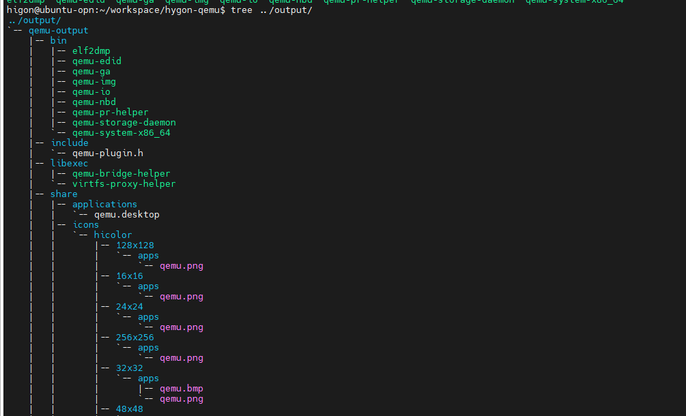

若用户基于自己维护的QEMU源码进行适配，请参考我们推往龙蜥、欧拉社区对应的PR列表，详见[《HCT附录》](HCT附录.md)。

## 1.2 Guest 镜像准备

用户请自行准备Guest镜像文件(可参考HCT2.x版本文档[虚拟化部署](<../HCT-2.x 指南/02. 虚拟化部署.md>)制作虚拟机镜像一节)。HCT对Guest OS无特别要求，Ubuntu，CentOS，麒麟，龙蜥等均可。

# 2. 虚拟化部署

本节介绍基础的虚拟化功能部署，不涉及热迁移功能。部署会涉及到QEMU补丁适配，编译安装，以及启动方式。

## 2.1 主机创建vCCP：

（1）首先主机绑定驱动。hctconfig会自动选择使用ccp驱动还是vfio-pci驱动。

```
sudo /opt/hygon/hct/hct/script/hctconfig start
```

（2）创建vCCP设备：

```
sudo /opt/hygon/hct/hct/script/hctconfig vccp_create 2
```

参数2表示在目标端机器上也创建了2组vccp设备，可供2个虚拟机启动使用。用户可根据实际情况指定个数。命令执行成功后，/dev/hct/目录下会生成对应的vccp节点，如下图所示。


## 2.2 主机创建vid（仅vTKM需要，可选）

这一步是主机上，为启动的虚拟机创建一个隔离的密钥空间。

```
cd /opt/hygon/bin
sudo ./hag tkm vtkm_create -mode shared //若需要使用密钥隔离vTKM，模式配置为exclusive
```

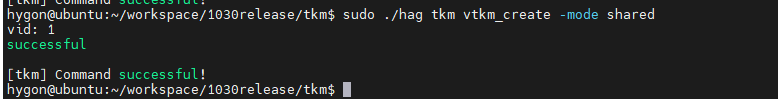

## 2.3 启动虚拟机

若只使用CAE虚拟化功能，通过如下命令开启虚拟机：

```
cd /path/to/hygon-qemu
/opt/hygon/hct/hct/script/start_qemu.py -q ../output/qemu-output/bin/qemu-system-x86_64 -n 1 -i hct.qcow2

```

若需要TKM虚拟化功能，qemu启动需进一步添加vid参数，具体为：

```
/opt/hygon/hct/hct/script/start_qemu.py -q ../output/qemu-output/bin/qemu-system-x86_64 -n 1 -i hct.qcow2 --vid 1
```

上述命令中，使用了海光提供的`start_qemu.py`脚本，自动构建qemu启动参数并启动qemu，脚本参数含义如下:

- \-q 参数为qemu可执行程序，可根据安装位置自行指定，默认为系统目录下的qemu-system-x86\_64
- \-n 参数为启动虚拟机的数量
- \-i 参数为装有操作系统的qcow2文件，需要指定路径

更多参数，请通过`start_qemu.py -h`查看。

以下为start\_qemu.py脚本自动生成的典型 QEMU 启动参数，供手动配置虚拟机的用户参考：

```
qemu-system-x86_64 --enable-kvm -cpu host -m 16G -smp 32 -hda ubuntu20_2M.qcow2 \
-net user,hostfwd=tcp::2220-:22 -net nic \
-object memory-backend-ram,id=mem0,size=2G,policy=bind,host-nodes=0 \
-object memory-backend-ram,id=mem1,size=2G, \
...
-device hct,dev=/dev/hct/vccp0_0 \
-device hct,dev=/dev/hct/vccp0_1 \
-device hct,dev=/dev/hct/vccp0_2 \
-device hct,dev=/dev/hct/vccp0_3 \
...
-device psp,vid=1 \
-monitor stdio
```

手动配置时，以下两类设备参数为必选项：

|设备|参数格式|对应功能|
|:---|:---|:---|
|vCCP|-device hct,dev=/dev/hct/vccp{M}\_{N}|vCCP|
|vTKM|-device psp,vid=1|vTKM|

其余参数（CPU、内存、网络、内存后端、监控等）均为可选，用户可根据实际场景自行调整。

`-device hct,dev=/dev/hct/vccp{M}_{N}`中引用的 vCCP 设备节点，是由本节第二步`hctconfig vccp_create 2`命令创建。

**注意:** 手动配置 QEMU 参数时，请严格按照 vCCP 与虚拟机的映射关系选取对应编号，避免资源错配。具体对应关系如下图所示：
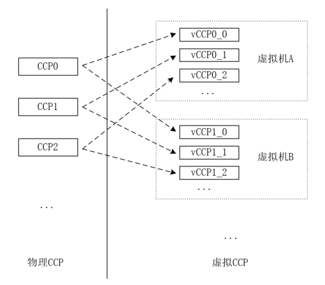

## 2.4 libvirt启动虚拟机（可选）

若通过 libvirt 启动虚拟机，需根据业务使用场景修改 `/etc/libvirt/qemu.conf` 文件，在 `cgroup_device_acl` 配置项中补充对应设备节点权限，否则虚拟机无法加载vTKM或vCCP。

（1）使用vTKM，需追加:

```
cgroup_device_acl = [
    ...
    "/dev/hygon_psp_config",
    "/dev/sev",
]
```

（2）使用vCCP，且基于ccp驱动（ccp-mdev，非 vfio-pci ），需追加:

```
cgroup_device_acl = [
    ...
    "dev/ccp_share",
    "dev/ccp0",
    "dev/ccp1",
    "dev/ccp2",
    ...
]
```

约束说明：

- `dev/ccp{n}`，为物理CCP硬件一一映射的设备节点，需挨个添加，不支持`dev/ccp*`通配符语法添加
- `/dev/`目录下的 `ccp{n}` 设备节点，必须逐条完整填写至配置项中

## 2.5 登录虚拟机

通过ssh，指定虚拟机启动时对应的端口登录

```
ssh -p 2220 hygon@localhost
```

查询虚拟机对应的端口，可通过以下命令查询：

```
/opt/hygon/hct/hct/script/start_qemu.py -s
```

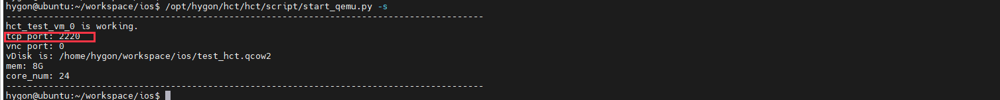

## 2.6 虚拟机内HCT部署

（1）安装HCT开发包

和主机一样，安装HCT3.0最新版本的deb或rpm包

（2）编译安装hct驱动

HCT3.0虽然在主机上，已经不推荐使用hct驱动，但是虚拟机中，热迁移，性能等问题依然需要hct驱动模块解决。虚拟机中，hct驱动依然需要加载（但无需绑定）。

```
cd /opt/hygon/hct/src/module
make
sudo make install
```

（3）驱动绑定

Guest中使用HCT套件，vCCP需要绑定为vfio-pci noiommu驱动模式，hctconfig工具会检查虚拟化环境并自动做相应的配置。

```
sudo /opt/hygon/hct/hct/script/hctconfig start
```

（4）CAE环境验证

```
sudo /opt/hygon/hct/bin/hct_test
```

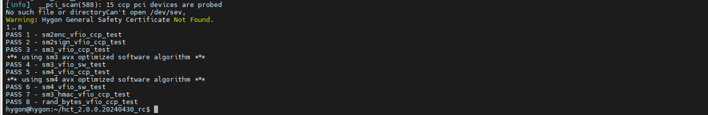

注意，hct\_test依赖openssl，因此参考主机环境，需确保Guest中openssl支持国密。
hct\_test成功允许表示CAE虚拟化环境部署完成。

（5）TKM环境验证

通过hag命令验证虚拟机环境，测试命令

```
cd /opt/hygon/bin
./hag tkm dev_info_get
```

若执行成功，表示vTKM的环境搭建完成

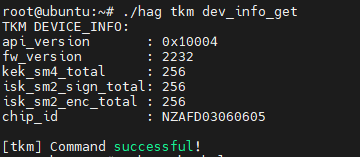

虚拟机中，使用TKM的API，与主机一样。

（6）SDF环境验证

SDF开发环境依赖TKM与CAE基础开发环境，当两者部署好之后，SDF开发环境已基本部署完毕，可以通过以下方式验证SDF基础环境。

- 出厂基础用例测试：

```
/opt/hygon/hct/bin/sdf_test -idx 10 -password 11223344
```

所有用例均success表示测试通过。

- 性能测试工具使用：

```
/opt/hygon/hct/bin/sdf_speed
```

通过以上命令可以输出测试方法与支持的接口，根据实际需要进行性能测试。

# 3. 热迁移支持

HCT3.0开始支持CAE和TKM的虚拟机热迁移，测试热迁移功能，请务必先完成本章前两节基本虚拟化功能验证。

热迁移的支持，需要基础虚拟化环境的基础上，升级部分依赖，具体包括可参考下文说明。

HCT热迁移，基本环境要求如下：
| 组件/模块 | 要求 | 备注 |
|:----- | :-----| :-----|
|QEMU|最新的hygon-qemu仓库编译|也可以使用添加了对应的HCT热迁移patch（详见[HCT附录-QEMU Patch清单](HCT附录.md)）|
|主机驱动|ccp或vfio-pci|可通过hctconfig status查询确认|
|HCT套件|hct3.0.10版本或更新|主机和虚拟机|

若进一步需要TKM热迁移功能，环境还需进一步满足：

| 组件/模块 | 要求 | 备注 |
|:----- | :-----| :-----|
|主机内核|需适配vTKM热迁移功能patch|-|
|安全固件|版本大于2366|-|

考虑到OS厂家正式发布带vTKM热迁移的版本还需一段时间，因此用户需要编译安装开源内核代码来测试，以下社区仓库我们均已适配。

https://gitee.com/anolis/cloud-kernel/tree/devel-5.10

https://gitee.com/anolis/cloud-kernel/tree/devel-6.6

测试HCT热迁移功能，请准备2台物理机，一台作为源端机器，另一台作为目标端机器。

以下是测试步骤：

## 3.1 主机创建vCCP和vid

**源端机器**和**目标端机器**都需要先创建vCCP：

```
/opt/hygon/hct/hct/script/hctconfig vccp_create 2
```

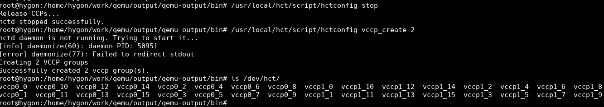

若考虑TKM功能，同样还需在主机上创建vid

```
hag tkm vtkm_create -mode exclusive
```

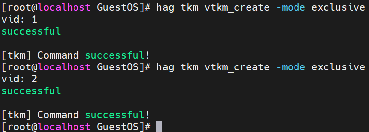

如图所示，创建了2个独占模式的vid分别为1和2。**注意，热迁移下，必须使用独占模式的vid。**

## 3.2 源端虚拟机启动

在源端机器上启动的qemu命令行如下：

```
qemu-system-x86_64 --enable-kvm -cpu host -m 16G -smp 4 -hda ubuntu20_2M.qcow2 \
-net user,hostfwd=tcp::2220-:22 -net nic \
-device vhost-vsock-pci,guest-cid=9,id=vhost-vsock-pci0 \
-device hct,dev=/dev/hct/vccp0_0,vsock-device=vhost-vsock-pci0 \
-device hct,dev=/dev/hct/vccp0_1 \
-device hct,dev=/dev/hct/vccp0_2 \
-device hct,dev=/dev/hct/vccp0_3 \
-device hct,dev=/dev/hct/vccp0_4 \
-device hct,dev=/dev/hct/vccp0_5 \
-device hct,dev=/dev/hct/vccp0_6 \
-device hct,dev=/dev/hct/vccp0_7 \
-device hct,dev=/dev/hct/vccp0_8 \
-device hct,dev=/dev/hct/vccp0_9 \
-device hct,dev=/dev/hct/vccp0_10 \
-device hct,dev=/dev/hct/vccp0_11 \
-monitor stdio
```

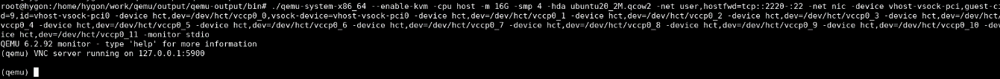

与普通CAE虚拟机相比，新增vsock相关的命令参数。它的作用主要是为Guest和QEMU建立通信机制，以此来实现热迁移阶段的状态通信。

详细命令说明：

- 通过命令行`-device vhost-vsock-pci,guest-cid=9,id=vhost-vsock-pci0`创建了一个vsock device设备。其中`guest-cid`必须指定为**大于2**的数字，且同一主机下不同虚拟机应该指定为不同的值。
- 通过命令行`-device hct,dev=`配置了0组的12个vccp设备，会在虚拟机里创建12个虚拟ccp设备。
- `-monitor`使终端进入monitor命令行接口，后续发起热迁移需要。

参数使用，还需遵循如下注意事项：

- 在命令行里，一般需要`-device vhost-vsock-pci`放在`-device hct,dev`的前面，即先创建vsock device设备，再创建ccp设备。
- `-device vhost-vsock-pci,guest-cid=9,id=vhost-vsock-pci0 -device hct,dev=/dev/hct/vccp0_0,vsock-device=vhost-vsock-pci0`参数中，`vsock-device=vhost-vsock-pci0`是对`id=vhost-vsock-pci0`的引用，因此这两者配置的字符串要相同。
- vccp设备必须是同一组,跨组使用，如vccp0\_1和vccp1\_2会导致异常；vccp设备必须是`/dev/hct`目录中存在的设备。

若需要测试TKM热迁移功能，qemu启动参数中，请添加`-device psp,vid=1`参数，其中`vid`为虚拟机所指定的密钥空间索引，此时启动参数为：

```
qemu-system-x86_64 --enable-kvm -cpu host -m 16G -smp 4 -hda ubuntu20_2M.qcow2 \
-net user,hostfwd=tcp::2220-:22 -net nic \
-device vhost-vsock-pci,guest-cid=9,id=vhost-vsock-pci0 \
-device hct,dev=/dev/hct/vccp0_0,vsock-device=vhost-vsock-pci0 \
-device hct,dev=/dev/hct/vccp0_1 \
-device hct,dev=/dev/hct/vccp0_2 \
-device hct,dev=/dev/hct/vccp0_3 \
-device hct,dev=/dev/hct/vccp0_4 \
-device hct,dev=/dev/hct/vccp0_5 \
-device hct,dev=/dev/hct/vccp0_6 \
-device hct,dev=/dev/hct/vccp0_7 \
-device hct,dev=/dev/hct/vccp0_8 \
-device hct,dev=/dev/hct/vccp0_9 \
-device hct,dev=/dev/hct/vccp0_10 \
-device hct,dev=/dev/hct/vccp0_11 \
-monitor stdio -device psp,vid=1
```

## 3.3 目标端虚拟机启动

在目标端机器上启动的qemu命令行如下：

```
qemu-system-x86_64 --enable-kvm -cpu host -m 16G -smp 4 -hda ubuntu20_2M.qcow2 \
-net user,hostfwd=tcp::2220-:22 -net nic \
-device vhost-vsock-pci,guest-cid=9,id=vhost-vsock-pci0 \
-device hct,dev=/dev/hct/vccp0_0,vsock-device=vhost-vsock-pci0 \
-device hct,dev=/dev/hct/vccp0_1 \
-device hct,dev=/dev/hct/vccp0_2 \
-device hct,dev=/dev/hct/vccp0_3 \
-device hct,dev=/dev/hct/vccp0_4 \
-device hct,dev=/dev/hct/vccp0_5 \
-device hct,dev=/dev/hct/vccp0_6 \
-device hct,dev=/dev/hct/vccp0_7 \
-device hct,dev=/dev/hct/vccp0_8 \
-device hct,dev=/dev/hct/vccp0_9 \
-device hct,dev=/dev/hct/vccp0_10 \
-device hct,dev=/dev/hct/vccp0_11 \
-monitor stdio -incoming tcp:0:6666
```

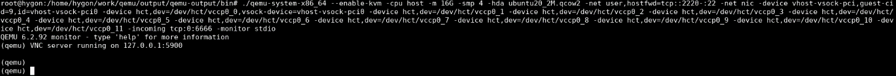

目标端机器启动，同样需要配置vsock的参数，这对目标端机器热迁移恢复，以及再次迁移发起至关重要。

同样，所涉及到TKM热迁移，目标虚拟机请务必参加`-device psp,vid=<id>`参数。
和源端机器上的命令行相比，新增`-incoming tcp:0:6666`，执行命令行后，目标端机器停留在等待源端机器进行热迁移通知的阶段。其中，`0`是指本地机器IP，`6666`是端口号，即源端机器通过`"目标机器IP + 端口"`的形式和目标机器上的对应虚拟机进行通信。

## 3.4 源端机器启动CAE测试程序

用户可以一个测试程序，通过openssl加载hct引擎，循环运行加密算法。在程序运行过程中，发起热迁移，如果热迁移一切顺利，到目标机器后，我们能看到测试程序依然正常运行。

测试程序参考流程：

```
e = ENGINE_by_id("hct"); // 加载hct engine

ctx = EVP_CIPHER_CTX_new(); // 创建EVP Cipher ctx

loop:
    EVP_CipherInit_ex(ctx, EVP_sm4_ecb(), e, ...); // ctx绑定engine
    EVP_CipherUpdate(ctx, ...);
    EVP_CipherFinal_ex(ctx, ...);
    sleep(1);
```

完整代码用户可参考[HCT附录-CAE热迁移Demo用例](HCT附录.md)

注意启动脚本时，请务必使用setsid启动脚本，防止热迁移过程中，终端关闭导致测试程序自动退出。

```
setsid ./hct_migration_test  // 替换成你的测试程序名
```

进一步，若需要测试TKM功能，源端虚拟机还可以如下操作（可选）：

（1）虚拟机中创建密钥

```
./hag tkm intl_key_gen -idx 1 -password 12345678 -type sm2sign
./hag tkm get_key_usage
```

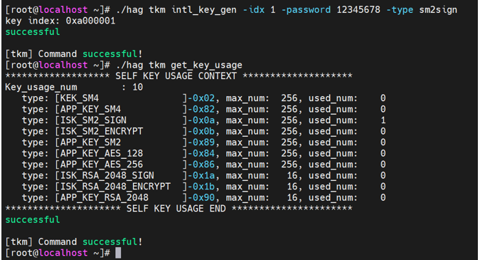

（2）运行测试程序

```
/opt/hygon/hct/bin/sdf_speed SDF_InternalSign_ECC -idx 1 -password 12345678 -seconds 10
```

## 3.5 发起热迁移

上面的步骤，我们已经在源虚拟机中，运行着hct相关的应用程序，接下来通过源端机器QEMU终端的monitor命令行接口输入:

```
(qemu) migrate tcp:10.65.43.16:6666
```

即开始了热迁移流程。

其中，`10.65.43.16`替换为目标端机器的IP地址值，`6666`替换为目标虚拟机启动时qemu命令行里设置的端口号。

当在源端机器的终端的monitor命令行接口输出以下信息时，表示源虚拟机和目标虚拟机已经建立了通信，开始了热迁移流程。

```
qemu-system-x86_64: info: hct_migrate_precopy_notifier: recieved HCT_MIG_MSG_ACK.
```

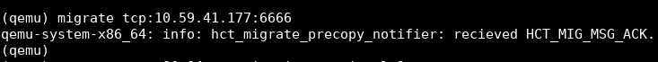

当在源端机器的终端的monitor命令行接口再次输出：(qemu)时，表示热迁移结束，此时源虚拟机被停止运行，ssh登录界面会卡主。

在目标端机器的终端的monitor命令行接口输出以下信息，表示热迁移完成，目标虚拟机已经在正常运行，可以ssh登录。


## 3.6 热迁移结果检查

在目标端机器上通过ssh登录到目标虚拟机，并在虚拟机中查询迁移前的测试进程

```
ps -aux | grep hct_migration_test // 替换成你的测试程序名
```

用户也可以在程序中，打印日志，并将输出重定向到文件中，迁移完成后，通过程序日志状态判断。

TKM热迁移后，也可以查询sdf\_speed是否正在正常运行

```
ps -aux | grep sdf_speed
```

一切顺利的情况下，我们可以看到sdf\_speed正在运行中。

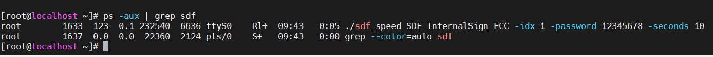

在目标机器使用以下命令可查询密钥使用情况是否与迁移前一致：

```
./hag tkm get_key_usage
```

以下输出ISK\_SM2\_SIGN类型已使用一个密钥槽位，与迁移前生成了一个sm2sign类型密钥的行为相符。

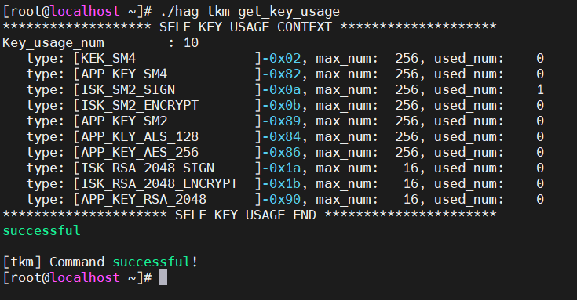
