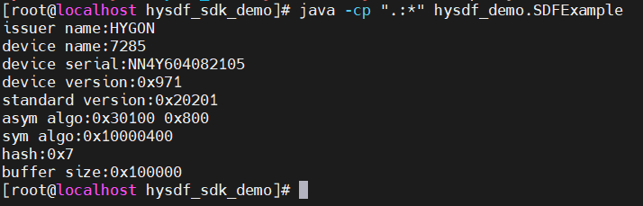

# SDF JAVA部署

## 1. 海光 Java SDF 接口

海光的 HCT 库提供符合 **GMT 0018-2023** 标准的 C 语言接口。为便于 Java 程序使用，基于 JNA 封装了 `hysdf.jar`，用于调用上述 C 接口能力。

调用层级关系如下所示：

```text
Java 应用程序
    ↓
hysdf-<version>.jar
    ↓
jna-5.18.1.jar
    ↓
libhct.so
```

---

## 2. 安装 HCT 开发套件

请按实际运行环境选择对应文档完成部署，并确保基础环境部署与验证通过。

> **重要：** Java（`hysdf.jar`）能力自 **`hct-3.0.12-2603d14`** 起提供，请使用不低于该版本的 HCT 套件。

| 环境 | 文档链接 |
| --- | --- |
| 主机 | [主机部署说明](<01. 主机环境搭建.md>) |
| 虚拟机 | [虚拟机部署说明](<02. 虚拟化部署.md>) |
| 容器 | [容器部署说明](<03. 容器化部署.md>) |

---

## 3. 使用示例

为便于理解，下文以**命令行**方式说明 `hysdf.jar` 的基本使用流程。若在 IDE 中开发，请自行配置正确的 JAR 依赖。

### 3.1 示例源码

将以下内容保存为 `SDFExample.java`：

```java
package hysdf_demo;

import com.sun.jna.Pointer;
import com.sun.jna.ptr.PointerByReference;
import hysdf.*;

public class SDFExample {

    private final SDFLibrary hysdf_instance = SDFLibrary.INSTANCE;

    public void GetDevinfo() {
        PointerByReference hDeviceHandleRef = new PointerByReference();
        PointerByReference hSessionHandleRef = new PointerByReference();
        try {
            int result = hysdf_instance.SDF_OpenDevice(hDeviceHandleRef);
            if (result != 0) {
                return;
            }
            Pointer deviceHandle = hDeviceHandleRef.getValue();
            result = hysdf_instance.SDF_OpenSession(deviceHandle, hSessionHandleRef);
            if (result != 0) {
                return;
            }
            Pointer sessionHandle = hSessionHandleRef.getValue();
            SDFStructures.DEVICEINFO dev_info = new SDFStructures.DEVICEINFO();
            result = hysdf_instance.SDF_GetDeviceInfo(sessionHandle, dev_info);
            if (result != 0) {
                return;
            }
            System.out.printf("issuer name:%s%n", new String(dev_info.IssuerName));
            System.out.printf("device name:%s%n", new String(dev_info.DeviceName));
            System.out.printf("device serial:%16.16s%n", new String(dev_info.DeviceSerial));
            System.out.printf("device version:0x%x%n", dev_info.DeviceVersion);
            System.out.printf("standard version:0x%x%n", dev_info.StandardVersion);
            System.out.printf("asym algo:0x%x 0x%x%n", dev_info.AsymAlgAbility[0], dev_info.AsymAlgAbility[1]);
            System.out.printf("sym algo:0x%x%n", dev_info.SymAlgAbility);
            System.out.printf("hash:0x%x%n", dev_info.HashAlgAbility);
            System.out.printf("buffer size:0x%x%n", dev_info.BufferSize);
        } finally {
            if (hSessionHandleRef.getValue() != null) {
                hysdf_instance.SDF_CloseSession(hSessionHandleRef.getValue());
            }
            if (hDeviceHandleRef.getValue() != null) {
                hysdf_instance.SDF_CloseDevice(hDeviceHandleRef.getValue());
            }
        }
    }

    public static void main(String[] args) {
        new SDFExample().GetDevinfo();
    }
}
```

### 3.2 目录与依赖说明

`hysdf-<version>.jar`与 `jna-5.18.1.jar`默认位于 `/opt/hygon/hct/lib64/sdf_jna_sdk/`。请将 `hysdf-<version>.jar`、`SDFExample.java` 与 `jna-5.18.1.jar` 置于同一测试目录。其中 **JNA** 也可自行从 [java-native-access/jna](https://github.com/java-native-access/jna) 获取。

建议目录结构示例：

```text
.
├── hysdf-0.0.1.jar
├── jna-5.18.1.jar
└── SDFExample.java
```

> **说明：** 示例中版本号 `0.0.1` 请按实际安装的 `hysdf` 包名替换。

### 3.3 编译与运行

在测试目录下执行：

```bash
javac -cp "*" SDFExample.java -d .
```

```bash
java -cp ".:*" hysdf_demo.SDFExample
```

运行成功时的输出示意如下：



---
