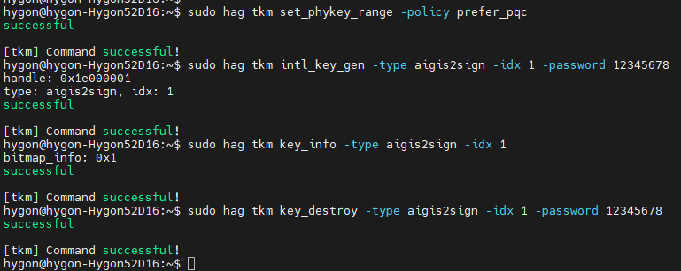

# PQC算法使用说明

## 1. PQC算法概述

PQC（Post-Quantum Cryptography，后量子密码）算法能够抵抗量子计算攻击。目前海光在密码学算法体系中支持以下两类PQC算法：

| 算法类别 | 功能 | 算法名称 |
|:----- | :-----| :-----|
| 国际PQC标准算法 | 密钥封装（KEM） | ML-KEM |
| 国际PQC标准算法 | 数字签名 | ML-DSA、SLH-DSA |
| 国内PQC算法 | 数字签名 | Aigis-Sign |
| 国内PQC算法 | 密钥封装（KEM） | Aigis-Enc |

其中国际PQC标准算法为NIST已发布的FIPS 203/204/205标准算法，国内PQC算法符合国密相关规范要求。

## 2. SDF接口支持的PQC算法

目前海光SDF接口支持以下PQC算法，各算法的最低安全固件版本要求如下：

| 算法 | 最低固件版本 | C86-4G | 海光2/3号 |
|:----- | :-----| :-----| :-----|
| Aigis2-sign | 2352 | 支持 | 需第4节配置支持 |
| ML\_KEM\_768 | 2428 | 支持 | 需第4节配置支持 |
| ML\_DSA\_65 | 2610 | 支持 | 需第4节配置支持 |
| Aigis2-enc | 2662 | 支持 | 需第4节配置支持 |
| SLH-DSA-SHA2-128F | 2670 | 支持 | 需第4节配置支持 |

> **说明：** 后续将根据需求拓展更多的PQC算法。

相关PQC算法的接口定义请参考《海光SDF扩展接口说明》。

## 3. 海光CPU对PQC的支持情况

海光CPU对PQC算法的支持分为两个阶段：

| 阶段 | 支持方式 |
|:----- | :-----|
| 当前 | 以固件植入方式支持 |
| 未来 | PQC指令集、CCP协处理器方式支持 |

> **说明：** 无论采用何种硬件支持方式，上层SDF接口都会保持兼容，用户无需改动应用代码。

## 4. PQC算法海光2/3号使用条件

海光2/3的CPU，在满足以下条件时，可以通过配置方式使用PQC算法：

| 配置项 | 最低版本要求 |
|:----- | :-----|
| 安全固件 | 2632 |
| hag工具 | 2632 |
| HCT驱动 | hct\_3.0.23 |

### 4.1 配置方法

满足上述版本要求后，执行以下命令启用PQC算法：

```
sudo hag tkm set_phykey_range -policy prefer_pqc
```

该配置成功后，2/3号CPU即可以使用PQC算法。配置写入物理机固件中，**掉电不丢失**（除重刷BIOS外）。



### 4.2 版本检查方式

```
sudo hag general version
```

```
sudo hag general check
```

```
sudo /opt/hygon/hct/hct/script/hctconfig status
```
