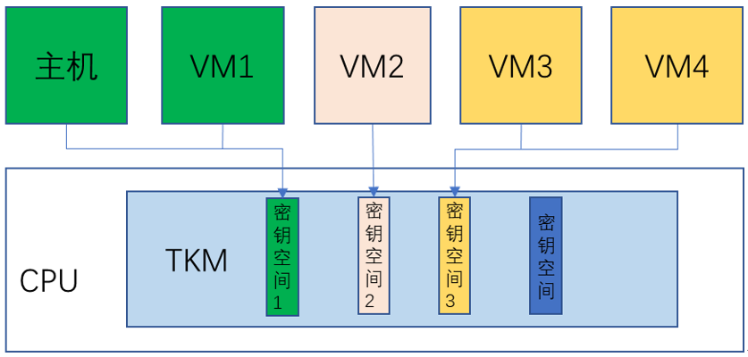
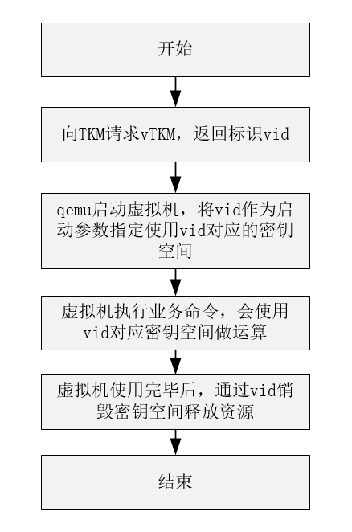
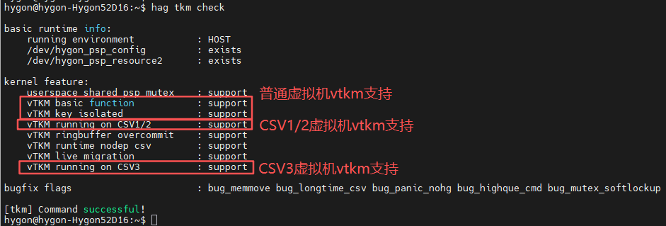
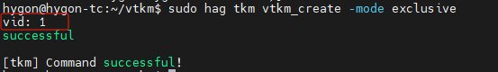
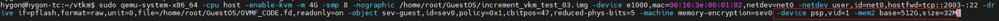
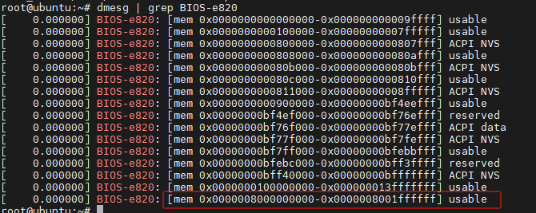
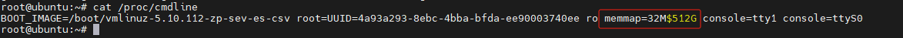
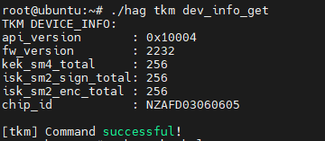
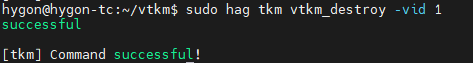

## 1. vTKM使用简介

### 1.1 vTKM密钥资源

在基于物理主机支持TKM的基础上，也可以实现基于虚拟机的vTKM（Virtual TKM）支持，虚拟机下使用SDF基于vTKM实现，如下图所示，当前vTKM可以支持两种模式：

#### （1）密钥隔离vTKM

支持虚拟机隔离独占密钥资源的使用，称为密钥隔离vTKM（需内核支持）；

#### （2）密钥共享vTKM

支持多个虚拟机共享同一份密钥资源的使用，或虚拟机与主机共享同一份密钥资源的使用，称为密钥共享vTKM。



### 1.2 vTKM支持虚拟机类型

目前普通虚拟机与CSV1/2、CSV3虚拟机均支持vTKM，对密钥空间及硬件与固件的依赖情况如下：

| **虚拟机** | **支持的vTKM模式**               | **硬件依赖**        | **固件依赖（最低）** |
|------------|--------------------------------|---------------------|--------------|
| 普通虚拟机  | 密钥隔离vTKM、密钥共享vTKM      | 海光2/3/4           | 2070         |
| CSV1虚拟机 | 密钥隔离vTKM                   | 海光2/3/4           | 2131         |
| CSV2虚拟机 | 密钥隔离vTKM                   | 海光3/4             | 2131         |
| CSV3虚拟机 | 密钥隔离vTKM                   | 海光4               | 2678         |

### 1.3 vTKM使用基本流程

#### （1）创建vTKM密钥实体

通过hag工具在TKM内部创建vTKM密钥实体，可以选择创建密钥隔离的vTKM实体，也可以创建密钥共享的vTKM实体，创建成功后返回对应的标识符，这里以vid表示；

#### （2）绑定vTKM与虚拟机

启动虚拟机，在启动时根据用户需求传入对应的vid，TKM将vid对应的vTKM实体与该虚拟机相绑定；

#### （3）使用vTKM密钥资源

虚拟机正常启动后，可以在其环境下使用其对应的vTKM实体密钥资源进行密钥管理与相应的业务运算功能；



### 1.4 vTKM环境依赖

#### （1）内核依赖

- 相关内核支持补丁已推入各个主流社区，由于各OS厂商发布ISO镜像计划与进度不同，暂无法明确推荐已支持的ISO镜像，后续会根据其发布情况不定时更新。
- 当前可以到社区下载已合入vTKM支持补丁的内核自行编译进行验证，如龙蜥社区，推荐已支持vTKM的内核代码如下： [龙蜥](https://gitee.com/anolis/cloud-kernel/tree/devel-6.6/) 、[欧拉](https://gitee.com/openeuler/kernel/tree/OLK-6.6/) 、[统信](https://github.com/deepin-community/kernel) 、[OpenCloud](https://gitee.com/OpenCloudOS/OpenCloudOS-Kernel) ，麒麟V10 SP3 2403  x86\_64 内核版本大于等于 kernel-4.19.90-89.17.v2401.ky10
- **注意：** CSV3支持vtkm补丁正在推送中，如需验证可先提适配需求获取补丁进行编译验证。

> **可通过下图方法检查主机内核对vTKM的支持情况，红框中表示当前内核对各种虚拟机的支持情况，若全包含则表示该主机内核支持所有虚拟机方式。**



#### （2）QEMU依赖

与内核相同，暂无法明确已支持的ISO镜像，建议目前通过自行编译源码方式进行验证，具体patch依赖请参考对应版本的《虚拟化部署》文档

---

## 2. vTKM环境部署

### 2.1 普通虚拟机vTKM部署

环境的安装与验证

- HCT2.x版本：参考[虚拟化部署](<../HCT-2.x 指南/02. 虚拟化部署.md>)
- HCT3.x版本：参考[虚拟化部署](<../HCT-3.x 指南/02. 虚拟化部署.md>)

### 2.2 CSV1/2虚拟机vTKM部署

#### 2.2.1 CSV基础环境

##### （1）CSV基础环境

CSV基础环境可以参考[《安装CSV软件》](<../../../01. 机密计算/02. 用户指南/03. 测试加密虚拟机/01. 安装CSV虚拟机依赖.md>)文档进行搭建

##### （2）QEMU patch支持

QEMU除需包含CSV基础patch外，还需包含vTKM的patch支持，可直接 `clone` [hygon-qemu/6.2.0](https://gitee.com/anolis/hygon-qemu/tree/6.2.0/)仓库使用（6.2.0分支既包含了CSV也包含了vTKM的支持），如果使用其他版本，请将下该仓库中的下列commit 合入所使用的QEMU中

|      版本       |     commit-id       |
|-----------------|-----------------------|
|6.2.0	|9b4396f8c8db6ebef8bd0b315d6649365123db0e（支持密钥隔离）<br> 76a47a90f9ecee19f86039fdea992c7d5c1f4d22  （CSV虚拟机功能支持）<br>c5b9286549f37f14e8ddbfb7831a6b7d125b1f65（CSV虚拟机功能支持）<br>da768933bfcec318425f788524b792e58bdf51ad （CSV虚拟机功能支持）|

#### 2.2.2 启动vTKM虚拟机

##### （1）创建vtkm，获得vid

```
// 创建默认密钥空间vTKM，若需要自定义密钥空间大小，可通过-cfg参数在创建时配置，详细使用方法可通过sudo hag vtkm_create --help查看
$ sudo hag tkm vtkm_create -mode exclusive
```



##### （2）启动CSV1/2虚拟机

根据获得的vid，将vTKM需要使用的vid参数以及mem2参数增加到QEMU启动行中，启动CSV1/2虚拟机：

```
// -device psp,vid=1 -mem2 base=512G,size=32M为CSV1/2下vTKM需要使用命令，
// 其它部分为CSV基础环境命令，可根据实际情况自行调整；示例为CSV1（policy=0x1），
// 若为CSV2虚拟机，请将policy修改为0x5
sudo qemu-system-x86_64 -cpu host -enable-kvm -m 4G -smp 8 -nographic \
/home/root/GuestOS/increment_vkm_test_03.img \
-device e1000,mac=00:16:3e:00:01:02,netdev=net0 \
-netdev user,id=net0,hostfwd=tcp::2003-:22 \
-drive if=pflash,format=raw,unit=0,file=/home/root/GuestOS/OVMF_CODE.fd,readonly=on \
-object sev-guest,id=sev0,policy=0x1,cbitpos=47,reduced-phys-bits=5 \
-machine memory-encryption=sev0 \
-device psp,vid=1 -mem2 base=512G,size=32M
```



vTKM参数说明：

| **参数** | **说明**               |
|----------|--------------------------------|
| -device psp,vid=1            |  指定CSV1/2虚拟机使用的密钥空间              |
| -mem2 base=512G,size=32M     | QEMU为CSV1/2虚拟机提供的给vTKM使用的内存空间|

其中base=512G,size=32M参数指定时，qemu进程将在指定的地址范围内映射 16个2MB大页面，并将其绑定到相应的 TKM 密钥空间。

##### （3）dmesg检查内存区间

进入虚拟机OS之后，使用dmesg查看BIOS-e820的地址范围包含\[512G,512G+32M）区间，说明BIOS已经将mem2选项设置的内存空间提供给内核：



##### （4）修改GRUB memmap

首次进入CSV1/2虚拟机的OS时，需要修改GRUB选项，设置memmap=32M$512G，确保内核预留\[512G,512G+32M)内存范围，这里512G与32M需要与上面配置的base,size相同；若已配置，则可以跳过该步骤。配置成功后的效果如下图所示：



```
注意：不同OS的grub配置memmap=32M$512G参数由于符号识别会有些差异，大部分OS的grub配置参数如下，供参考：memmap=32M\\\$512G
```

##### （5）环境验证

参考 2.4 节进行vTKM环境验证。

### 2.3 CSV3虚拟机vTKM部署

#### 2.3.1 CSV3基础环境

##### （1）CSV3基础环境

CSV3基础环境搭建可参考[《启动CSV3加密虚拟机》](<../../../01. 机密计算/02. 用户指南/03. 测试加密虚拟机/08. 启动CSV3加密虚拟机.md>)文档进行搭建，安全固件（build id）版本要求不低于 **2678**。

##### （2）QEMU要求

QEMU版本要求与CSV1/2要求相同。

#### 2.3.2 启动vTKM虚拟机

##### （1）创建vtkm，获得vid

创建vtkm，获得vid，方法同 2.2.2 步骤（1）：

```
$ sudo hag tkm vtkm_create -mode exclusive
```

##### （2）启动CSV3虚拟机

在原CSV3虚拟机启动命令行基础上，仅增加 `-device psp,vid=1` 参数即可，**无需配置 -mem2 参数**，启动CSV3虚拟机。示例（`policy=0x45` 为CSV3虚拟机启动参数，`vid`请替换为实际创建的vid值）：

```
sudo qemu-system-x86_64 -name csv3-vm --enable-kvm -cpu host \
-m 6114 -hda /opt/hygon/csv/vm.qcow2 \
-drive if=pflash,format=raw,unit=0,file=/opt/hygon/csv/OVMF_CODE.fd,readonly=on \
-qmp tcp:127.0.0.1:2222,server,nowait -vnc 0.0.0.0:0 \
-object sev-guest,id=sev0,policy=0x45,cbitpos=47,reduced-phys-bits=5 \
-machine memory-encryption=sev0 -nographic \
-device psp,vid=1
```

vTKM参数说明：

| **参数** | **说明**               |
|----------|--------------------------------|
| -device psp,vid=1            |  指定CSV3虚拟机使用的密钥空间              |

> **说明：** CSV3虚拟机使用vTKM无需配置 `-mem2` 参数，也无需在虚拟机内执行dmesg检查及GRUB memmap预留配置。

##### （3）环境验证

参考 2.4 节进行vTKM环境验证。

### 2.4 通过dev\_info\_get方式的验证

在已部署的普通/CSV1/2/CSV3虚拟机中，执行任意一个TKM命令，确认在虚拟机环境下已可以使用TKM，这里以hag tkm dev\_info\_get为例：



上图结果表示，虚拟机环境已经满足vTKM使用。

### 2.5 vTKM实例销毁

当虚拟机使用vTKM实例完毕后，可以通过hag工具将其销毁，这里假设实例对应的vid为1，销毁方式如下：

```
$ sudo ./hag tkm vtkm_destroy -vid 1
```


