## 1. 概述

PSPCCP VQ的配置可以通过BIOS和HAG工具进行配置，本文档描述通过BIOS或HAG工具来配置PSPCCP VQ的相关步骤。

## 2.测试环境

| 类型       | 要求            | 备注 |
|--------------|-----------------------|--------------|
| 海光 BIOS PI版本 | C86 2/3G: DhyanaPatch\_PI2.1.0.4\_200275\_002（含）以上<br />C86 4G 7000/5000系列：PI4.2.0.9（含）以上<br />C86 4G 3000系列：PI4.6.0.6（含）以上 | 其中，包含的安全固件版本为2155及以上(可通过hag工具查看安全固件版本) |
| 海光安全工具(hag)版本 | 2155（含）以上 | 可通过 hag general version命令查看hag工具自身版本 |
| Kernel | 无  | 本文以5.16.20内核为例，需包含海光安全功能相关补丁 |

## 3. BIOS配置PSPCCP VQ

一般来说BIOS厂商会在BIOS Setup界面提供配置PSPCCP VQ选项，但每个BIOS的界面和实现会有不同，具体请咨询各BIOS厂商。当前测试环境的设置如下：

配置路径：Advanced-\>HYGON CBS-\>Validation Common Options-\>PSPCCP VQ

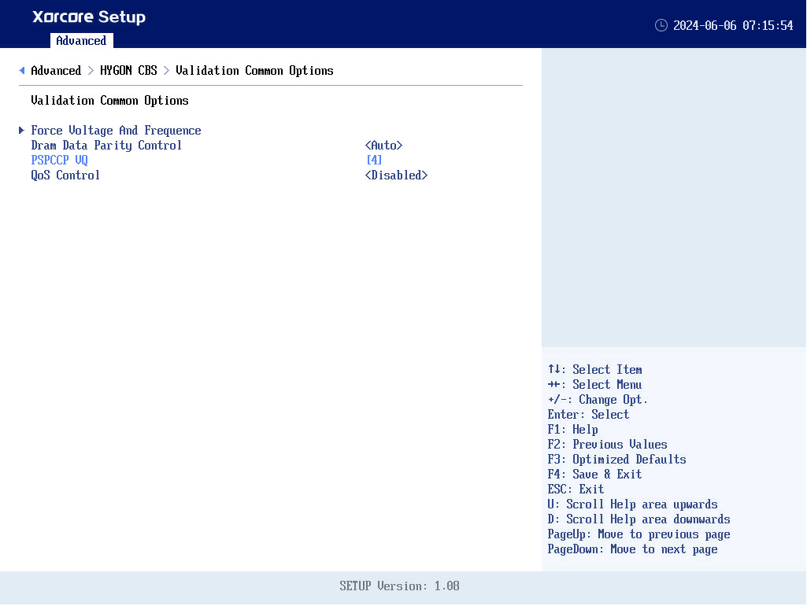

## 4. HAG配置PSPCCP VQ

**有些BIOS厂商不会集成设置VQ的代码，而且不同的BIOS厂商在SETUP里面的配置路径及选项五花八门，给使用者带来不便，海光提供可以在OS下通过HAG工具下配置VQ的方式。**

### 4.1 Hag安装与说明

Hag工具获取及使用说明请参考链接：[海光安全工具简介](<../../../07. 工具/01. 海光安全工具/01. 海光安全工具简介.md>)

### 4.2 导入通用安全证书

设置VQ功能将在通用安全证书导入成功后才能使用，导入通用安全证书的方法请参考链接：

[导入通用安全证书](<../../../07. 工具/01. 海光安全工具/02. 导入通用安全证书.md>)

### 4.3 HAG配置VQ命令查看

执行如下命令获取VQ配置的命令：

```
$ sudo hag ccp help
```

**命令说明：获取Hag设置VQ的命令信息。**

命令正确执行的结果如下图，支持的命令包括vq\_control、vq\_num、vq\_num\_running。

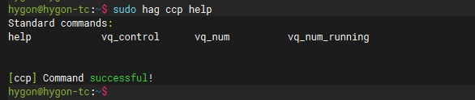

**注：vq\_control和vq\_num命令当前暂不支持在海光2/3G中使用，当前仅支持在海光4G（含）以上使用。vq\_num\_running命令支持在海光2/3/4G（含）以上使用。**

### 4.4. HAG配置VQ说明及验证

#### 4.4.1.配置VQ的控制设备

vq\_control命令主要用来选择配置VQ的控制设备，即BIOS或者OS，命令格式如下：

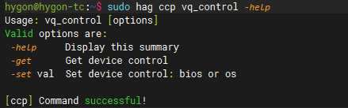

默认的配置VQ的控制设备为BIOS，即在BIOS的Setup进行配置，参考前面第三章节。

将配置VQ的控制设备设置为OS，命令如下：

```
$ sudo hag ccp vq_control -set os
```

**命令说明：选择配置VQ的控制设备为OS。**

命令正确执行的结果如下图。

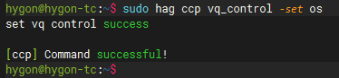

可以使用如下命令查看当前配置VQ的控制设备：

```
$ sudo hag ccp vq_control -get
```

**命令说明：查看配置VQ的控制设备。**

命令正确执行的结果如下图。

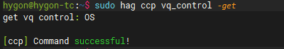

#### 4.4.2.配置VQ的数目

vq\_num命令主要用来配置PSPCCP 给X86使用的VQ数目（0~4），命令格式如下：

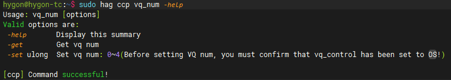

将暴露给X86的VQ设置为4，命令如下：

```
$ sudo hag ccp vq_num -set 4
```

**命令说明：配置VQ的数目。**

命令正确执行的结果如下图。

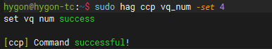

可以使用如下命令查看当前配置VQ的数目：

```
$ sudo hag ccp vq_num -get
```

**命令说明：查看VQ的配置数目。**

命令正确执行的结果如下图。

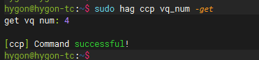

**注：配置和查看VQ数目前，必须将VQ的控制设备设置为OS，否则这两个命令不生效。**

**PSPCCP中可以给X86使用的最大VQ数是4，设置VQ数目完成后，必须重启设备才可以生效，且配置永久生效。**

#### 4.4.3.动态配置给X86使用的VQ数目

vq\_num\_running命令主要用来配置PSPCCP 给X86使用的VQ数目（0~4），命令格式如下：

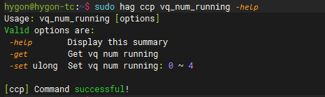

将暴露给X86使用的VQ设置为4，命令如下：

```
$ sudo hag ccp vq_num_running -set 4
```

**命令说明：配置给X86使用的VQ数目。**

命令正确执行的结果如下图。

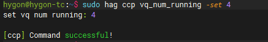

可以使用如下命令查看当前配置给X86使用的VQ数目：

```
$ sudo hag ccp vq_num_running -get
```

**命令说明：查看配置给X86使用的VQ数目。**

命令正确执行的结果如下图。

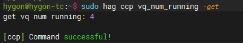

**注：PSPCCP中可以给X86使用的最大VQ数是4，设置VQ数目完成后，临时生效，不需重启设备，重启后配置会被清除。**
