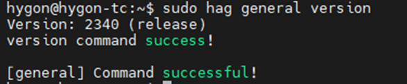
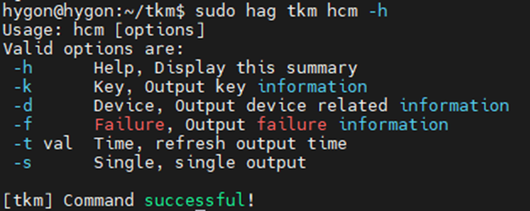
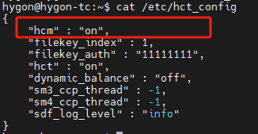
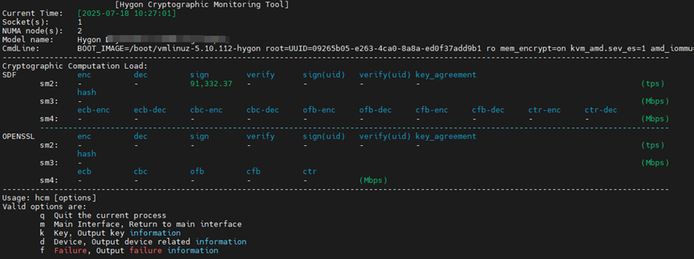
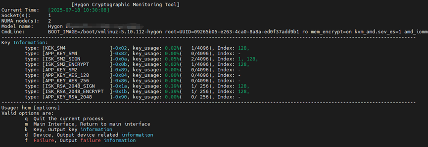
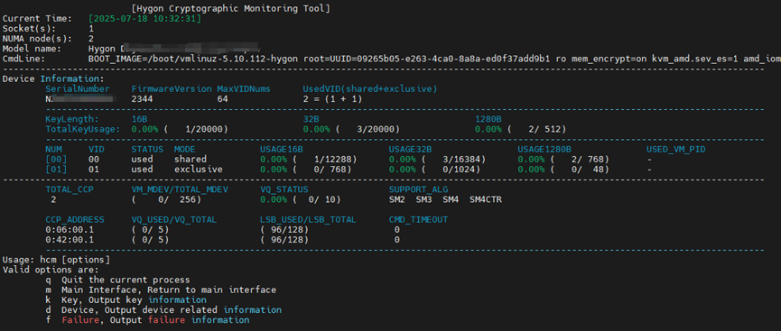
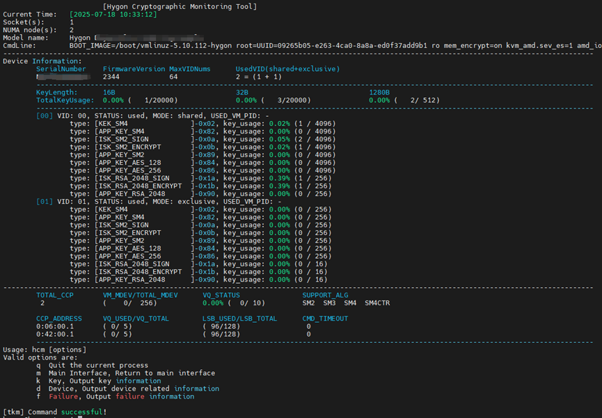
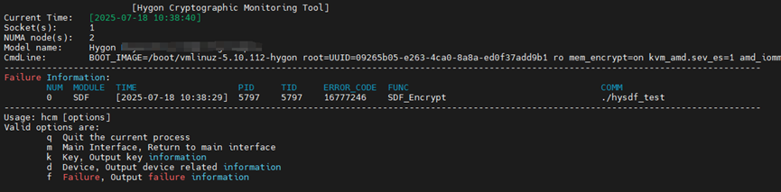

# 1. 概述

海光密码技术(HCT, Hygon Cryptographic Technology)是基于海光密码协处理器和密码指令集自主设计研发的一套密码算法加速软件开发套件，包括密码运算加速引擎CAE (Crypto Accelerate Engine)和可信密钥管理模块TKM（Trusted Key Management Module）两部分；在HCT实际应用中，用户较为关注如密钥空间状态、运算资源状态、实时输出性能带宽等信息。
基于以上需求，基于海光安全工具HAG（Hygon AnQuan GongJu），海光集成一个专门的HCT状态查询命令HCM（Hygon Cryptographic Monitoring Tool），使用HCM对环境要求如下表：<br>
表 1 HCM功能的配置要求

|  配置   | 要求  |  备注  |
|  ----  | ----  |----  |
| CPU      | 海光CPU 2号及以上| |
| BIOS     | PI 版本2.1.0.4及以上 | 对应安全固件版本1837及以上 |
| HCT驱动  | HCT3.0及以上 | |
| HAG工具  | 2321及以上 |HCM已集成到hag工具 |

# 2. HCM命令说明

## 2.1 HCM基本说明

HCM集成在海光安全工具HAG中，可以通过如下命令进行基本的使用。<br>
表2 命令使用示例：

|  命令   | 说明  |
|  :----  | :----  |
| ./hag tkm hcm -h      | 输出使用帮助信息，包含支持的参数与参数说明|
| ./hag tkm hcm     | 默认屏幕周期性刷新输出方式，输出基本配置信息，如运算负载等 |
| ./hag tkm hcm -s  | 非屏幕刷新输出，输出运算负载、密钥信息等配置后退出 |
| ./hag tkm hcm -k  | 密钥信息输出，周期性输出密钥配置信息 |
| ./hag tkm hcm –k -s | 密钥信息输出，单次输出密钥配置信息 |
| ./hag tkm hcm –d（./hag tkm hcm后按d） | 设备信息输出，周期性输出设备信息界面信息 |
| ./hag tkm hcm –f（./hct 后按f） | 失败信息输出，周期性输出设备失败信息 |
| ./hag tkm hcm –t 2 | ./hag tkm hcm –t 2	每2秒更新一次显示信息，默认为1秒 |

## 2.1 HCM版本与帮助信息查看

可以通过如下命令获取HCM版本（HCM跟随HAG版本号）与支持的命令，如下图所示：<br>
**命令说明**：获取HCM的版本号信息。

```
$ sudo hag general version
```



执行如下命令获取HCM支持的命令：

```
$ sudo hag tkm hcm -h
```

**命令说明**：获取HCM支持的命令信息。
命令正确执行的结果如下图，HCM支持的命令分类显示。主要分为以下几项：帮助信息、密钥信息、设备信息、失败信息、刷新周期、是否单次输出。



# 3. HCM使用说明

## 3.1 运算负载显示

出于性能影响考虑，运算负载显示默认为关闭状态，若需要使用，可通过在/etc/hct\_config中增加"hcm" : "on",行打开。



#### （1）显示效果

默认循环显示命令：

```
$ sudo hag tkm hcm
```

命令正确执行的结果如下图，主界面目前默认显示SDF（TKM）与OPENSSL（CAE）两种类型接口的性能信息，图示为后台在运行一个SDF接口使用SM2签名算法的进程，因此实时显示了对应的性能数据。



#### （2）显示说明

- 主界面主要显示性能负载信息，字样“Cryptographic Computation Load:”下的信息为目前支持负载显示内容；
- 目前支持SDF接口与OPENSSL接口两个模块负载信息，其中OPENSSL接口负载必须调用CAE引擎才可使用；
- 目前显示分别以SM2、SM3、SM4算法做区分，每种算法单独用一行显示负载信息，其中SM2包含加解密、签名验签、密钥协商等几个显示，以tps为单位；SM3包含哈希显示，以Mbps为单位；SM4包含ECB/CBC/OFB/CFB/CTR几种模式的加解密显示，以Mbps为单位；

## 3.2 密钥信息显示

#### （1）显示效果

循环显示密钥命令：

```
$ sudo hag tkm hcm -k
```

命令正确执行的结果如下图，该界面目前默认显示密钥管理模块中各类型密钥配置信息与已使用信息，图示为其中几种类型密钥使用几个密钥索引的显示效果。



#### （2）显示说明

- 该界面主要显示工具运行环境下的密钥信息，字样“Key Information:”下的信息为目前支持密钥显示内容；
- 每一行代表一种密钥类型，每一行中包含了该类型密钥实际使用数、配置数、使用率以及实际使用密钥对应的索引号（界面效果需要最多显示10个索引）；

## 3.3 设备信息显示

#### （1）显示效果

循环显示设备信息命令：

```
$ sudo hag tkm hcm -d
```

命令正确执行的结果如下图，该界面目前默认显示设备序列号信息、所有密钥资源数与使用率、虚拟化场景下各个独占密钥空间密钥使用情况等的显示效果。



单次显示设备信息命令：

```
$ sudo hag tkm hcm –d -s
```

命令正确执行的结果如下图，该界面目前默认显示设备序列号信息、所有密钥资源数与使用率、虚拟化场景下各个独占密钥空间密钥使用情况等的显示效果，相比循环场景，单次输出不受窗口大小限制，显示了更详细的每个独占密钥空间的密钥配置与使用信息。



#### （2）显示说明

 - 该界面主要显示工具运行环境下的设备信息，字样“Device Information:”下的信息为目前支持设备显示内容；
 - 物理主机、虚拟机、容器下该命令显示状况不同，上图为主机下完整的显示效果；
 - 主机下显示中几个主要内容如下表所示：

| 显示内容| 说明 |
| :----| :----|
| SerialNumber| CPU序列号|
| FirmwareVersion | 固件版本|
| MaxVIDNums | 支持的最大隔离的密钥空间数目|
| UsedVID(shared+exclusive) | 当前已使用隔离的密钥空间数目，包含共享与独占两种密钥空间|
| KeyLength | 整个设备支持的几种长度的密钥 |
| TotalKeyUsage | 整个设备几种长度密钥的使用情况，如已使用数目、总数目、使用率 |
| NUM | 隔离密钥空间的序号，从0开始|
| VID | 虚拟密钥空间标识，VID由创建相应密钥空间时返回|
| STATUS | VID对应密钥空间状态：已创建且被使用、已创建但未被使用 |
| MODE | VID对应密钥空间模式：独占或共享模式|
| USED\_VM\_PID | VID对应密钥空间被使用时，对应虚拟机的进程号 |
| TOTAL\_CCP | 可用CCP的总个数 |
| VM\_MDEV/TOTAL\_MDEV | 虚拟机可用的mdev个数/总共的mdev个数 |
| VQ\_STATUS | VQ的使用状态 |
| SUPPORT\_ALG| 支持的算法 |
| CCP\_ADDRESS| CCP的PCI地址|
| VQ\_USED/VQ\_TOTAL| 每个CCP中VQ对应的使用状态|
| LSB\_USED/LSB\_TOTAL| 每个CCP中lsb对应的使用状态|
| CMD\_TIMEOUT| 每个CCP设置的超时时间|

## 3.3 失败信息显示

#### （1）显示效果

循环显示设备信息命令：

```
$ sudo hag tkm hcm -f
```

命令正确执行的结果如下图，该界面目前可以显示设备发生异常时的错误信息，如错误模块、错误时间、错误码、错误函数、错误执行命令等。



#### （2）显示说明

- 该界面主要显示失败信息，字样“Failure Information:”下的信息为目前失败显示内容；
- 显示以行为单位，每一行为一次失败项，行内记录了对应失败详细信息；
- 失败行从左到右分别表示序号NUM、对应模块MODULE、错误时间TIME、错误进程PID、错误线程TID、错误码ERROR\_CODE、错误发生函数FUNC、错误进程运行命令COMM。

​
​
​
​
