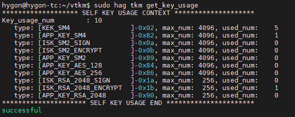
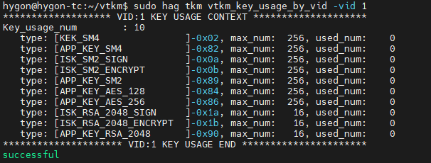
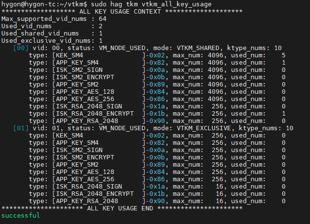

# TKM密钥信息查看命令说明

## 查看当前环境密钥使用情况

hag根据实际环境获得对应的密钥空间情况，**虚拟机主机下均可使用**

```
$ sudo hag tkm get_key_usage
```



如上图为主机下通过该命令查询的密钥使用情况，可以看出主机使用的密钥空间下支持的密钥类型、每种类型最大支持的密钥数量以及当前已使用的密钥数量。

## 主机查看指定vid对应密钥空间密钥使用情况

**仅主机下可以使用**

```
$ sudo hag tkm vtkm_key_usage_by_vid -vid 1
```



如上图为主机下通过该命令查询vid1对应密钥空间的密钥使用情况，可以看出该密钥空间下支持的密钥类型、每种类型最大支持的密钥数量以及当前已使用的密钥数量。

## 主机查看所有vid对应密钥空间密钥使用情况

**仅主机下可以使用**

```
$ sudo hag tkm vtkm_all_key_usage
```



如上图为主机下通过该命令查询所有密钥空间的密钥使用情况，可以看出每个密钥空间下支持的密钥类型、每种类型最大支持的密钥数量以及当前已使用的密钥数量。
